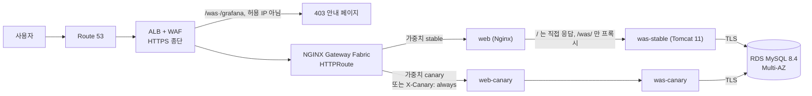
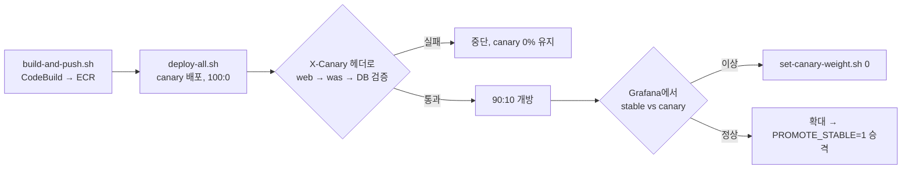

# Spring PetClinic on Amazon EKS — 컨테이너 기반 3Tier 서비스 운영

WAR 기반 레거시 앱인 `spring-framework-petclinic`(Spring 7 / Jakarta EE 11)을 컨테이너로 만들고, AWS 서울 리전(`ap-northeast-2`)의 **Amazon EKS 1.36** 위에서 **실제 서비스처럼 운영**할 수 있게 구축한 개인 프로젝트입니다.

- **기간**: 2026-10-22 ~ 10-28 (개인 프로젝트, KDT 멀티클라우드 과정 중간프로젝트 II)
- **목표**: 고가용성 · 자동 확장 · 보안 · 관측성 · 무중단 배포 · 백업 · 비용 관리 7가지를 **코드로 재현 가능하게** 갖추기
- **원칙**: VPC부터 배포까지 전부 이 저장소의 스크립트와 매니페스트로 재현합니다. 저장소가 Public이므로 시크릿·계정 ID·엔드포인트는 코드에 두지 않습니다.


---

## 결과 한눈에 보기

| 목표 | 구현 | 실측 결과 |
|---|---|---|
| 고가용성 | 2개 AZ(2a·2c), AZ별 NAT, RDS Multi-AZ, Pod AZ 분산(`topologySpread` + `matchLabelKeys`) | 롤링 배포·부하 중에도 AZ 균형 유지 (8개일 때 2a 4 · 2c 4) |
| 자동 확장 | was는 KEDA(요청률 50 req/s/Pod), web은 HPA(CPU 60%), 노드는 Karpenter | 450 req/s에서 was 2 → 8개, 노드 2 → 5대, 부하 후 2로 축소 |
| 부하 내성 | k6 단계 부하 50 → 150 → 300 → 450 req/s | 276,139건 중 5xx 0건, p95 48 ms, 실패 약 0.0018% |
| 무중단 배포 | Gateway API 카나리(0% 검증 → 90:10 → 확대), graceful shutdown | 재시작 중 요청 실패 707건 중 2건 → **923건 중 0건**, 롤백 약 3초 |
| 보안 | WAF 관리형 규칙 + 직원 경로 IP 허용, IRSA, NetworkPolicy 기본 차단, ESO | 비허용 IP의 `/was`·`/grafana` 우회 시도 5종 모두 403 |
| 관측성 | Prometheus·Grafana, OpenTelemetry → Tempo 트레이스, Fluent Bit → CloudWatch, Slack 알림 | stable/canary 버전별 RED 대시보드, 404 주입 시 5xx 오경보 없음 |
| 백업 · 비용 | 매일 03:00 KST `mysqldump` → S3(버전 관리), 일일 중지·기동 스크립트 | 아침 기동 12분 13초 오류 0, NAT만 밤에 꺼도 월 약 $85 절감 |

---

## 요청 흐름



- `/` 공개 병원 홈페이지는 Nginx가 직접 응답하므로 WAS·DB가 멈춰도 열립니다.
- `/was/` 직원용 PetClinic 앱과 `/grafana/` 는 WAF 허용 IP에서만 열립니다.

---

## 설계 선택과 이유

| 선택 | 이유 (없으면 생기는 문제) |
|---|---|
| **EKS 관리형 컨트롤 플레인** | API 서버·etcd 이중화, 인증서, 업그레이드를 AWS에 맡기고 서비스 운영에 집중 |
| **AZ 2개 + AZ별 NAT** | 데이터센터 하나가 멈춰도 서비스 유지, NAT 장애가 다른 AZ로 번지지 않음 |
| **노드 3티어 분리** | `ng-critical`(컨트롤러)·`ng-platform`(모니터링)은 Taint로 격리된 고정 2대씩, 앱은 Karpenter `np-app`(On-Demand 우선, 초과분 Spot). 앱 부하가 몰려도 컨트롤러·관측 스택은 영향 없음 |
| **ALB + NGINX Gateway Fabric** | ALB는 관리형 입구(HTTPS·WAF), Gateway API `HTTPRoute`로 가중치·헤더 라우팅을 표준 문법으로 처리 (ingress-nginx 미사용) |
| **카나리 배포** | 롤링은 문제 버전이 모든 사용자에게 섞이고, 블루/그린은 전환 순간 100%가 바뀌고 자원이 2배. 카나리는 0%에서 검증하고 비율만 바꿔 3초 안에 롤백 |
| **was는 요청률로 확장 (KEDA)** | JVM은 기동 직후 JIT·GC로 CPU가 출렁여 CPU 기준 판단이 흔들림 |
| **Bastion 없음** | 작업 서버(AWS 밖 관리자 PC)가 IAM 임시 세션으로 EKS API를 호출, DB 작업은 클러스터 안 Job이 수행 → AWS에 열린 SSH·상시 서버 없음 |
| **이미지 빌드는 CodeBuild** | 작업 서버(LXC)에서 컨테이너 빌드 불가 → 소스를 zip으로 S3에 올려 CodeBuild가 빌드, ECR은 IMMUTABLE 태그 + KMS |

### 카나리 배포 절차



---

## 주요 구현

- **컨테이너 이미지**: 멀티스테이지 빌드(JDK로 빌드 → JRE·Tomcat만 실행), WAR를 미리 풀어 `webapps/was` 에 배치해 읽기 전용 루트 파일시스템 지원, 비루트 UID 10001, 베이스 이미지 버전 고정 + JMX Exporter SHA256 검증, 접속 정보는 실행 시 Secret으로 주입
- **매니페스트**: preStop 15초 + grace 45초 + PDB, startupProbe(최대 5분)·readiness(HTTP)·liveness(TCP) 분리, 힙을 메모리의 65%로 제한, stable/canary 별도 Deployment
- **보안**: 정적 액세스 키 없음(컨트롤러별 IRSA, 앱 Pod는 AWS 권한·SA 토큰 없음), DB 계정 3분리(admin/app/backup), 백업 Job은 S3 `PutObject` 만, IMDSv2 강제 + Pod IMDS 차단, RDS TLS 강제(`require_secure_transport=ON`)
- **NetworkPolicy**: `default-deny-all` 후 NGF→web, web→was, was→DB, was→OTel, Prometheus→메트릭 포트, DNS만 허용
- **분산 트레이싱**: OpenTelemetry Operator가 Java agent를 주입(이미지 재빌드 없음), `service.version=stable|canary`로 버전 구분, 로그에 `trace_id` 포함, Grafana exemplar에서 Tempo 트레이스로 이동
- **비용 관리**: `daily-stop.sh --stop-nat` / `daily-start.sh --start-nat` 로 노드·RDS·NAT를 내리고 올림 (EKS 컨트롤 플레인 약 $2.4/일, ALB 약 $0.6/일은 남음)

---

## 트러블슈팅 (19건 중 일부)

| 증상 | 원인 | 해결 |
|---|---|---|
| 롤링 재시작 중 502/504 | Pod 종료와 EndpointSlice 제외 사이 1~3초 틈 | `preStop` sleep 15초 → 실패 0건 |
| 롤아웃 후 Pod가 한 AZ로 쏠림 | 분산 계산에 구버전 Pod 포함 | `matchLabelKeys: [pod-template-hash]` |
| 404 몇 건에 5xx critical 알림 | Tomcat `errorCount` 가 4xx까지 셈, 저트래픽이라 비율 31% | OTel 상태 코드 5xx만 세는 규칙 + promtool 시나리오 테스트 |
| 새 WAS가 Ready가 안 됨 | 읽기 전용 루트용 emptyDir가 이미지의 `rewrite.config` 를 가림 | 시작 스크립트가 설정 복사. 카나리 0%라 사용자 영향 없음 |
| 보호자 검색 리다이렉트가 `http://` | 프록시 뒤 Tomcat이 scheme을 http로 인식 | `X-Forwarded-Proto` + `RemoteIpValve` |
| WAF 경로 규칙이 매칭 안 됨 | AWS CLI v2가 `SearchString` 을 base64로 해석 | `--cli-binary-format raw-in-base64-out` |

---

## 기술 스택

| 분류 | 구성 요소 |
|---|---|
| Application | Spring Framework PetClinic 7.0.3, Java 21 |
| Web / WAS | `nginx:1.27.2-alpine`, `tomcat:11.0.2-jre21-temurin-noble`, JMX Exporter 1.0.1 |
| Kubernetes | Amazon EKS 1.36, AL2023, eksctl, Helm |
| Traffic | Route 53, ACM, AWS WAFv2, AWS Load Balancer Controller 3.6.1, Gateway API v1.6.3, NGINX Gateway Fabric 2.8.0 |
| Autoscaling | Karpenter 1.15.0, KEDA 2.21.0, Metrics Server 3.14.0 |
| Secrets | AWS Secrets Manager, External Secrets Operator 2.13.0 |
| Observability | kube-prometheus-stack 92.11.0, OpenTelemetry Operator / Collector, Tempo, aws-for-fluent-bit, Slack |
| Data | Amazon RDS for MySQL 8.4.11 LTS (Multi-AZ), S3 백업 |
| Build | AWS CodeBuild, Amazon ECR (IMMUTABLE, KMS) |

---

## 작업 방식: 3-에이전트 협업

[`ORCA_WORKFLOW.md`](./ORCA_WORKFLOW.md) 에 정의한 절차로 기능마다 **설계 → 구현 → 코드 리뷰 → 보안 점검**을 거쳤습니다.

| 역할 | 담당 | 산출물 |
|---|---|---|
| 아키텍처 설계 · 보안 점검 | Antigravity | `docs/features/<기능>/design.md`, `security.md` |
| 조율 · 구현 · 일일 기록 | Claude | 코드 + 커밋, `docs/daily/` |
| 코드 리뷰 | Codex | `docs/features/<기능>/review.md` |

기능 문서는 [`docs/features/`](./docs/features/) 에 14개(`production-hardening`, `apm-tracing`, `graceful-shutdown`, `spread-on-rollout`, `landing-page` 등)가 있고, 날짜별 진행 기록은 [`docs/daily/`](./docs/daily/) 에 있습니다.

---

## 직접 구축하기

필요한 도구: `aws` CLI v2, `eksctl`, `kubectl`, `helm`, `jq`, `envsubst`, `curl` (오프라인 검증용 `python3` + PyYAML, `promtool`)

```bash
cp .env.example .env                                   # 계정·도메인 등 입력 (.env 는 커밋되지 않음)

./infra/aws/provision-aws-resources.sh vpc             # VPC, 서브넷 6개, IGW, AZ별 NAT
./infra/aws/provision-aws-resources.sh pre-cluster     # IAM, ECR, S3, CodeBuild, WAF, ACM
./infra/aws/provision-aws-resources.sh cluster         # EKS 1.36 (ng-critical, ng-platform)
./infra/aws/provision-aws-resources.sh post-cluster    # RDS MySQL 8.4 Multi-AZ, Secrets Manager
./infra/aws/provision-aws-resources.sh grafana-waf     # /was·/grafana 허용 IP 규칙 (필수)

IMAGE_TAG=v1.0.0 ./scripts/build-and-push.sh           # CodeBuild로 이미지 빌드 → ECR
STABLE_IMAGE_TAG=v1.0.0 CANARY_IMAGE_TAG=v1.0.0 ./scripts/deploy-all.sh
```

각 단계는 멱등하게 동작해 중간에 멈춰도 다시 실행할 수 있습니다. 모든 명령은 AWS 요금이 발생합니다.

### 운영 명령

```bash
./scripts/validate-manifests.sh          # 클러스터 없이 매니페스트·보안 정책 정적 검사
./scripts/test-prometheus-rules.sh       # 알림 규칙 promtool 단위 테스트

# 카나리: 0%에서 검증 후 개방 → 확대 → 롤백 / 승격
STABLE_IMAGE_TAG=v1.0.0 CANARY_IMAGE_TAG=v1.1.0 ./scripts/deploy-all.sh
./scripts/set-canary-weight.sh 50
./scripts/set-canary-weight.sh 0
PROMOTE_STABLE=1 STABLE_IMAGE_TAG=v1.1.0 CANARY_IMAGE_TAG=v1.1.0 ./scripts/deploy-all.sh

./scripts/rotate-db-secrets.sh           # DB 비밀번호 무중단 회전
./scripts/daily-stop.sh --stop-nat       # 업무 외 시간 중지
./scripts/daily-start.sh --start-nat     # 아침 기동
```

---

## 디렉터리 구조

```text
.
├── app/            # spring-framework-petclinic 소스 (WAR)
├── docker/         # web (Nginx), was (Tomcat 11 + JMX Exporter) Dockerfile
├── infra/          # AWS 프로비저닝 스크립트, IAM 최소 권한 정책, eksctl, Karpenter
├── k8s/            # 매니페스트 (base, secrets, jobs, web, was, gateway, monitoring, logging, tracing)
├── scripts/        # 빌드·배포·카나리·시크릿 회전·일일 중지/기동·정적 검증
├── tests/          # PrometheusRule 단위 테스트
└── docs/
    ├── architecture.md          # 전체 아키텍처 명세
    ├── architecture.drawio.svg  # 아키텍처 다이어그램
    ├── features/                # 기능별 설계·리뷰·보안 점검
    └── daily/                   # 일일 작업 기록
```

## 다음 과제

- GitHub push로 시작되는 CI/CD 파이프라인 (현재는 명령으로 CodeBuild 빌드 · 배포)
- 배포 스크립트에서 명령줄 이미지 태그가 `.env` 보다 우선하도록 수정
- EKS API 접근을 관리자 IP로 제한, `daily-stop` 의 PDB 대기 개선
