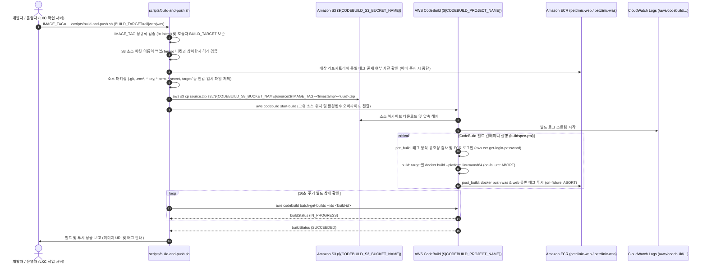

# 아키텍처

## 1. 개요 — 시스템 목적과 범위

`spring-framework-petclinic`(전통적인 Spring Framework 7.x / Jakarta EE 11 WAR 패키징 기반 동물병원 관리 웹 애플리케이션)을 AWS 서울 리전(`ap-northeast-2`)의 **Amazon EKS (`1.36`)** 환경 위에 고가용성(Multi-AZ: `2a`, `2c`), 정교한 자동 확장(HPA / KEDA / Karpenter), 계층별 네트워크·권한 격리, 3축 통합 관측성(Prometheus / Grafana / Alertmanager / CloudWatch Logs / OpenTelemetry + Grafana Tempo 분산 트레이싱)을 갖춘 클라우드 네이티브 아키텍처로 운영한다.

- **포함 범위 (In-Scope)**:
  - Route 53, ACM, AWS WAFv2, LBC 기반 internet-facing ALB(`target-type: ip`)를 통한 엣지 보안 및 TLS 종단
  - NGINX Gateway Fabric(NGF) `Gateway` 및 `HTTPRoute`를 이용한 L7 라우팅과 헤더(`X-Canary: always`) 검증 통과 후 100:0 → 90:10으로 여는 가중치 기반 카나리(Canary) 트래픽 분할
  - `web`(Nginx 1.27 정적 서빙 + 리버스 프록시)과 `was`(Tomcat 11 언패킹 WAR + JMX Exporter + OpenTelemetry Java Agent 무코드 자동 주입) 2-Tier 분리 및 각각 CPU 기반 HPA / Prometheus 요청률 기반 KEDA 오토스케일링
  - 3-Tier 노드 분리: `np-app`(Karpenter On-Demand 기본 풀 + `np-app-spot` Spot 확장 풀), `ng-critical`(클러스터 컨트롤러·OpenTelemetry Operator 및 DB 초기화/백업 Job 전용 관리형 노드 그룹), `ng-platform`(모니터링·분산 트레이싱 스택 및 `gp3` PVC 전용 관리형 노드 그룹)
  - 프라이빗 DB 서브넷의 RDS MySQL 8.4 LTS Multi-AZ(Primary/Standby 동기 복제), S3 암호화 백업(`CronJob`), 역할별 DB 계정(admin/app/backup) 분리, AWS Secrets Manager + External Secrets Operator(ESO) 기반 시크릿 동기화
  - OpenTelemetry(Operator · Java Agent · Collector) + Grafana Tempo(전용 S3 버킷 IRSA 연동) 기반 분산 트레이싱(SDK 10% 헤드 샘플링), 100% 전수 RED 메트릭(`http_server_request_duration_seconds`) 및 Trace-based Exemplar(`trace_id`) 점프, Logback MDC(`trace_id`/`span_id`) 로그 상관분석
  - 업무 외 시간 비용 절감을 위한 일일 리소스 중지·기동 스크립트(`scripts/daily-stop.sh`, `scripts/daily-start.sh` — Karpenter 앱 노드, EKS 관리형 노드 그룹, RDS MySQL 일괄 제어 및 잔여 비용 안내)
  - AWS CodeBuild 기반 컨테이너 이미지 온디맨드 빌드 및 ECR 푸시 파이프라인(`scripts/build-and-push.sh`, `buildspec.yml` — 작업 서버의 rootless 컨테이너 제약을 격리하고 표준 클라우드 환경에서 `web`/`was` 멀티스테이지 이미지를 `linux/amd64`로 빌드·푸시, 전용 S3 소스 버킷 1일 만료, 최소 권한 IAM Role, 불변 태그 중복 차단 및 `latest` 금지)
- **제외 범위 (Out-of-Scope)**:
  - Spring Boot 내장 톰캣 JAR로의 전환 (외부 Tomcat 11 컨테이너 배포 구조 유지)
  - 멀티 리전 액티브-액티브 구성 (`ap-northeast-2` 단일 리전 Multi-AZ에 집중)
  - 기존 EKS 1.31 클러스터의 제자리 업그레이드 절차 (현재 구성은 1.36 새 클러스터 생성 기준, `docs/features/production-hardening/design.md` §1.3)
  - 비즈니스 도메인 엔티티 스키마 및 DB 테이블(DDL) 변경 (단, 외부 RDS 환경변수 바인딩, flatpickr `yyyy/MM/dd` 날짜 형식 호환 패치, 대시보드 전용 읽기 전용 `VisitSummary` 프로젝션 DTO 도입은 반영)
  - 일일 중지 시 EKS 컨트롤 플레인, NAT Gateway, ALB(`Ingress`), `gp3` EBS PVC 삭제·재생성 및 EventBridge/Lambda 기반 자동 스케줄러 구축 (`docs/features/daily-stop-start/design.md` §1.4)
  - Grafana Loki 도입, Tail-based Sampling, NGF·`web`(Nginx) 계층 트레이싱, `tempo-distributed`(마이크로서비스 모드 + Kafka) 전환 및 상용 APM 도입 (`docs/features/apm-tracing/design.md` §1.4, `docs/features/tempo-chart-migration/design.md` §1.4)
  - GitHub Webhook 및 AWS CodePipeline 자동 트리거 연동 (운영자/개발자가 검증된 태그로 필요 시 트리거하는 온디맨드 CLI 빌드 워크플로 유지, `docs/features/codebuild-image-build/design.md` §1.4)

---

## 2. 구성 요소 — 각 컴포넌트의 역할

| 계층 | 구성 요소 | 역할 및 주요 특징 | 배치 위치 (네임스페이스 / 노드 티어) |
|---|---|---|---|
| **Edge / DNS** | Route 53, ACM, AWS WAFv2 | 도메인 A(Alias) 라우팅, 공인 TLS 인증서 발급·갱신, OWASP/SQLi/KnownBadInputs 관리형 규칙 필터링 | AWS 관리형 (`ap-northeast-2`) |
| **Ingress LB** | AWS ALB (AWS Load Balancer Controller) | HTTP(`80`)→HTTPS(`443`) 리다이렉트, TLS 1.3/1.2 종단, 비정상 헤더 드롭, `target-type: ip`로 NGF Pod에 직접 라우팅 | 퍼블릭 서브넷 (`2a`, `2c`) |
| **L7 Gateway** | NGINX Gateway Fabric 2.x (`nginx-gateway`) | Gateway API(`v1.6.3`). 컨트롤 플레인(2 Replicas)이 Gateway마다 데이터 플레인 `petclinic-gateway-nginx`(2 Replicas, AZ 분산, 차트 PDB `minAvailable: 1`, `ClusterIP`)를 생성. `HTTPRoute`로 `web` / `web-canary` 트래픽 분할(배포 중 100:0, 카나리 검증 후 90:10, `X-Canary: always`는 항상 `web-canary`) | `nginx-gateway` / `np-app` (`workload-tier=app`) |
| **Web Tier** | `web`, `web-canary` (Nginx + Exporter) | `/resources/*`, `/webjars/*` 정적 에셋 직접 서빙 및 보안 헤더 부여, 동적 요청을 각각 `was-stable:8080`, `was-canary:8080`으로 프록시. 사이드카 `nginx-prometheus-exporter`(`:9113`) 내장. CPU 60% 기준 HPA(`web` 2~10, `web-canary` 1~4), stable PDB(`minAvailable: 1`) | `petclinic` / `np-app` (`workload-tier=app`) |
| **WAS Tier** | `was-stable`, `was-canary` (Tomcat 11 + JMX Exporter + OTel Java Agent) | 사전 언패킹된 `webapps/ROOT` 구동(`jpa` 프로필, 읽기 전용 루트 파일시스템), `WelcomeController` 기반 메인 대시보드(`/`, `/welcome` — 운영 통계 3종 및 `VisitSummary` 플랫 프로젝션 기반 최근 방문 5건 조회) 및 PetClinic 비즈니스 서블릿 처리, JMX Exporter(`:9404/metrics`) 노출 및 OpenTelemetry Operator가 주입하는 Java Agent(`autoinstrumentation-java:2.12.0`)로 HTTP·Spring MVC·Hibernate/JDBC 자동 계측(`service.version=stable\|canary`), Logback ConfigMap 마운트로 MDC `trace_id`/`span_id` 출력. Prometheus 요청률 기반 KEDA `ScaledObject`(`was-stable` 2~10·fallback 4, `was-canary` 1~3·fallback 2), stable PDB(`minAvailable: 1`), Tomcat JDBC 풀 최대 10 | `petclinic` / `np-app` (`workload-tier=app`) |
| **Cluster Controllers** | CoreDNS, LBC, Metrics Server, Karpenter, KEDA, ESO, EBS CSI, OpenTelemetry Operator | 클러스터 핵심 제어부, 오토스케일러·시크릿·스토리지 드라이버 및 `Instrumentation` CR 기반 Java Agent Mutating Webhook(`:9443`, `failurePolicy: Ignore`) | `kube-system`, `keda`, `external-secrets`, `opentelemetry-operator-system` / `ng-critical` (Taint: `node-role=critical:NoSchedule`) |
| **DB Jobs** | `db-init` (Job), `db-backup` (CronJob) | 배포 시 admin 계정으로 멱등 스키마/초기 데이터 적재(`schema.sql`, `data.sql`) 및 app/backup 계정 생성·권한 부여, 매일 03:00 KST `mysqldump` 압축본을 S3(`SSE-KMS`)에 업로드 | `petclinic` / `ng-critical` (Taint: `node-role=critical:NoSchedule`) |
| **Observability & Tracing** | Prometheus, Grafana, Alertmanager, OTel Collector, Grafana Tempo, kube-state-metrics, node-exporter, Fluent Bit | `ServiceMonitor` 기반 `web`(`:9113`)·`was`(`:9404`)·`otel-collector`(`:8889`, OpenMetrics Exemplar) 스크래핑, KEDA 스케일링 쿼리 제공, `gp3` 암호화 볼륨 영속화, Prometheus 2 Replicas(`exemplar-storage` 활성화) AZ 분산, `PrometheusRule` → Alertmanager Webhook. OTel Collector(2 Replicas AZ 분산, `:4317`/`:4318` 수신)는 트레이스를 Tempo(`:4317` 수신, `:3200` 쿼리, `gp3` 10Gi WAL + 전용 S3 IRSA)로 전달하고 RED 메트릭+Exemplar를 `:8889`로 노출. `node-exporter` 및 Fluent Bit DaemonSet은 전 노드에서 메트릭·컨테이너 로그(→ CloudWatch Logs) 수집 | `monitoring` (`ng-platform`, Taint: `node-role=platform:NoSchedule`; `node-exporter`는 전 노드 Toleration) / `amazon-cloudwatch` (Fluent Bit 전 노드 Toleration) |
| **Build & CI/CD** | AWS CodeBuild Project (`${CODEBUILD_PROJECT_NAME}`), S3 소스 버킷(`${CODEBUILD_S3_BUCKET_NAME}`), Service Role (`CodeBuildServiceRole-${EKS_CLUSTER_NAME}`) | 작업 서버(LXC)의 rootless podman 제약 없이 AWS 관리형 x86_64(`BUILD_GENERAL1_MEDIUM`, `privilegedMode: true`) 환경에서 Docker in Docker로 `web`/`was` 멀티스테이지 컨테이너 이미지를 `linux/amd64`로 빌드하여 ECR에 푸시. 불변 태그 중복 사전 검증, `latest` 차단, 실행별 고유 S3 소스 키 및 1일 만료 수명주기 적용 | AWS 관리형 (`ap-northeast-2`) |
| **Data / Storage / Registry** | RDS MySQL 8.4 LTS, Secrets Manager, S3 (백업·Tempo·CodeBuild 소스 3개 버킷), ECR | Multi-AZ Primary/Standby RDB(`8.4.11`, `mysql8.4` 파라미터 그룹, `require_secure_transport=ON`), RDS(admin/app/backup)·Grafana·Alertmanager Webhook 시크릿 보관, DB 백업 버킷(`BACKUP_S3_BUCKET_NAME`, 버전 관리), Tempo 트레이스 전용 버킷(`TEMPO_S3_BUCKET_NAME`, 만료 Lifecycle), CodeBuild 소스 아카이브 버킷(`CODEBUILD_S3_BUCKET_NAME`, 1일 만료 Lifecycle; 3개 버킷 상호 이름 격리 검증), 불변 태그(`IMMUTABLE`) 및 KMS 암호화 컨테이너 레지스트리 | 프라이빗 DB 서브넷 (`2a`, `2c`) 및 AWS 관리형 서비스 |

---

## 3. 디렉터리 구조

```text
.
├── .env.example                          # 환경변수 템플릿 (CODEBUILD_PROJECT_NAME, CODEBUILD_S3_BUCKET_NAME, BUILD_TARGET 포함, source 검증 통과)
├── .gitattributes                        # 셸 스크립트 LF 줄바꿈 및 실행 권한 유지
├── .gitignore                            # 빌드 산출물, .env, 로컬 시크릿, .daily-nodegroup-state.json 제외
├── AGENTS.md                             # Codex 코드 리뷰어 규칙
├── CLAUDE.md                             # Claude 구현 규칙
├── ORCA_WORKFLOW.md                      # 에이전트 역할 분담 및 워크플로 정의
├── README.md                             # 프로젝트 아키텍처 개요, 빠른 시작 가이드 및 Day-2 운영 런북 (CodeBuild 빌드 설명 포함)
├── buildspec.yml                         # AWS CodeBuild 빌드 명세서 (pre_build 태그 정규식·latest 검증 및 ECR 로그인 → build linux/amd64 → post_build ECR 푸시, 단계별 on-failure: ABORT)
├── docs/
│   ├── architecture.md                   # 시스템 전체 아키텍처 현황 (본 문서)
│   ├── architecture.drawio               # AWS·Kubernetes 공식 아이콘 기반 Pod 단위 아키텍처 다이어그램 원본 (AZ × 서브넷 격자, 노드별 Pod 배치, K8s 리소스 행, 범례)
│   ├── architecture.drawio.{svg,png}     # 내보낸 다이어그램 이미지 (Embedded XML 포함, draw.io 데스크톱에서 내보냄)
│   ├── design.md                         # 초기 구축 설계서
│   ├── review.md                         # 코드 리뷰 기록
│   ├── security.md                       # 보안·인프라 점검 기록
│   ├── daily/                            # 조율 에이전트 일일 작업 기록 (TEMPLATE.md, YYYY-MM-DD.md)
│   ├── archive/                          # 이전 다이어그램 백업 (architecture-2026-10-24.drawio{,.svg,.png} — Pod 상세화 이전 개요도)
│   └── features/                         # 기능 브랜치별 설계·리뷰·보안 점검 기록
│       ├── production-hardening/{design,review,security}.md
│       ├── daily-stop-start/{design,review,security}.md
│       ├── apm-tracing/{design,review,security}.md
│       ├── tempo-chart-migration/{design,review,security}.md
│       ├── architecture-pod-diagram/design.md   # 다이어그램 Pod 단위 상세화 설계 (Pod 배치 표, 선 규칙)
│       ├── codebuild-image-build/{design,review,security}.md  # CodeBuild 기반 컨테이너 이미지 빌드·푸시 설계·리뷰·보안 점검
│       ├── rds-mysql-84/{design,review,security}.md           # RDS MySQL 8.4 LTS 전환 설계·리뷰·보안 점검
│       └── staff-dashboard/                  # 스태프 운영 대시보드(WelcomeController, VisitSummary) 설계·목업·리뷰·보안 점검
│           ├── mockup/main.html              # UI 프로토타입 원본
│           └── {design,review,security}.md
├── app/                                  # spring-framework-petclinic 소스 코드
│   ├── pom.xml                           # Maven WAR 빌드, MySQL/PostgreSQL/H2/HSQLDB 프로필
│   └── src/
│       ├── main/
│       │   ├── java/org/springframework/samples/petclinic/
│       │   │   ├── model/VisitSummary.java   # 대시보드 최근 방문 읽기 전용 플랫 프로젝션 DTO (EAGER 연관 N+1 방지)
│       │   │   ├── repository/{Owner,Pet,Visit}Repository.java # count 쿼리 및 findRecentVisits(limit) 지원 (jdbc, jpa, springdatajpa 3종 구현체)
│       │   │   ├── service/ClinicService{,Impl}.java # 대시보드 통계 및 최근 방문 읽기 전용(@Transactional(readOnly = true)) 서비스 파사드
│       │   │   └── web/WelcomeController.java # 메인 대시보드(/, /welcome) 라우팅 및 모델 바인딩
│       │   ├── resources/
│       │   │   ├── db/mysql/{schema.sql,data.sql}
│       │   │   └── spring/{mvc-core-config.xml,data-access.properties,datasource-config.xml,...}
│       │   └── webapp/                   # 정적 리소스(resources/) 및 JSP 뷰(WEB-INF/jsp/ — welcome.jsp 대시보드 포함)
│       └── test/...                      # WelcomeControllerTests 및 AbstractClinicServiceTests 3종 프로필 회귀 테스트
├── docker/
│   ├── web/
│   │   ├── Dockerfile                    # Stage 1: Maven webjars/정적 에셋 추출 → Stage 2: nginx:1.27.2-alpine (UID 10001, linux/amd64)
│   │   └── nginx.conf                    # 정적 캐싱, 보안 헤더, /healthz, /nginx_status, WAS 리버스 프록시
│   └── was/
│       ├── Dockerfile                    # Stage 1: MySQL 프로필 WAR 빌드·언패킹 + JMX SHA256 검증 → Stage 2: tomcat:11.0.2-jre21-temurin-noble (UID 10001, linux/amd64)
│       ├── jmx-exporter-config.yaml      # Tomcat GlobalRequestProcessor / ThreadPool / JVM JMX 수집 규칙
│       └── setenv.sh                     # JMX Exporter -javaagent:9404 및 JDBC 드라이버 프로퍼티 설정
├── infra/
│   ├── aws/
│   │   ├── provision-aws-resources.sh    # pre-cluster(IAM/ECR/Logs/백업·Tempo·CodeBuild S3 [버킷 이름 격리 검증]/CodeBuild 프로젝트/WAF/ACM), cluster(eksctl + 누락 IRSA SA 보충), post-cluster(RDS MySQL 8.4.11 Multi-AZ [mysql8.4 파라미터 그룹]/Secrets) 멱등 프로비저닝
│   │   └── iam-policies/                 # lbc, karpenter-controller, karpenter-node-trust, eso, fluent-bit, db-backup, tempo, codebuild 최소 권한 JSON 및 codebuild-trust.json
│   ├── eksctl/
│   │   └── cluster.yaml                  # EKS 1.36 ClusterConfig (VPC 서브넷, IRSA [monitoring/tempo 포함], vpc-cni NetworkPolicy, EBS CSI 버전 고정, ng-critical, ng-platform)
│   └── karpenter/
│       ├── ec2nodeclass.yaml             # AL2023 고정 AMI(al2023@v20260930), IMDSv2(hop limit 1), gp3 30Gi 암호화 루트 볼륨
│       └── nodepool-app.yaml             # np-app(On-Demand, weight 100) 및 np-app-spot(Spot 오버플로 확장) NodePool
├── k8s/
│   ├── base/
│   │   ├── namespace.yaml                # 네임스페이스별 Pod Security Standards(restricted [petclinic, opentelemetry-operator-system] / baseline / privileged) 정의
│   │   ├── networkpolicy-petclinic.yaml  # petclinic 기본 거부(Ingress/Egress) 및 DNS·web→was·RDS(3306)·백업(443)·was→otel-collector(4317/4318) 허용 정책
│   │   └── storageclass-gp3.yaml         # EBS CSI gp3 암호화 StorageClass (WaitForFirstConsumer)
│   ├── secrets/
│   │   ├── secretstore.yaml              # ESO SecretStore (AWS Secrets Manager 연동)
│   │   └── externalsecret-rds.yaml       # Secrets Manager → admin/app/backup 역할별 3개 시크릿 동기화 (sslMode=REQUIRED 포함)
│   ├── jobs/
│   │   ├── job-db-init.yaml              # admin 계정으로 schema/data 적재 + app/backup 계정 생성·최소 권한 부여 Job (ng-critical, mysql:8.4.11, REQUIRE SSL)
│   │   └── cronjob-db-backup.yaml        # 일일 mysqldump(backup 계정) → S3(SSE-KMS) 업로드 CronJob (ng-critical, mysql:8.4.11, IRSA db-backup)
│   ├── web/
│   │   ├── deployment.yaml               # web(→was-stable) 및 web-canary(→was-canary) Deployment + nginx-exporter 사이드카
│   │   ├── service.yaml                  # web, web-canary Service (:80→:8080, :9113)
│   │   ├── hpa.yaml                      # web(2~10), web-canary(1~4) CPU 60% HPA
│   │   ├── pdb.yaml                      # web stable PodDisruptionBudget (minAvailable: 1)
│   │   └── networkpolicy.yaml            # web Ingress 허용 (nginx-gateway → 8080, Prometheus → 9113)
│   ├── was/
│   │   ├── instrumentation.yaml          # OpenTelemetry Instrumentation CR (petclinic-java) 및 Logback MDC 출력용 ConfigMap (petclinic-was-logback)
│   │   ├── deployment-stable.yaml        # was-stable Deployment (inject-java, service.version=stable, Logback 마운트, 1280Mi~2Gi, readiness initialDelaySeconds 20)
│   │   ├── deployment-canary.yaml        # was-canary Deployment (inject-java, service.version=canary, Logback 마운트, 1280Mi~2Gi, readiness initialDelaySeconds 20)
│   │   ├── service-stable.yaml           # was-stable Service (:8080, :9404)
│   │   ├── service-canary.yaml           # was-canary Service (:8080, :9404)
│   │   ├── service.yaml                  # was 통합 Service (:8080, :9404)
│   │   ├── keda-scaledobject.yaml        # was-stable(2~10, fallback 4) / was-canary(1~3, fallback 2) KEDA ScaledObject
│   │   ├── pdb.yaml                      # was stable PodDisruptionBudget (minAvailable: 1)
│   │   └── networkpolicy.yaml            # was Ingress 허용 (web → 8080, Prometheus → 9404)
│   ├── gateway/
│   │   ├── alb-ingress.yaml              # LBC internet-facing ALB Ingress → petclinic-gateway-nginx:80 (HTTPS 443, ACM, WAFv2, drop_invalid_header_fields)
│   │   ├── gateway.yaml                  # NGF Gateway (:80 HTTP)
│   │   └── httproute-canary.yaml         # HTTPRoute (X-Canary: always → web-canary, 기본 가중치 ${STABLE_WEIGHT}:${CANARY_WEIGHT})
│   ├── monitoring/
│   │   ├── dashboard-apm-tracing.yaml    # Grafana APM 대시보드 ConfigMap (grafana_dashboard: "1" — 버전별 요청량·에러율·p95/p99 Exemplar·Tempo 최근 트레이스)
│   │   ├── externalsecret-alertmanager.yaml # Alertmanager Webhook URL ExternalSecret (url_file로 마운트)
│   │   ├── externalsecret-grafana.yaml   # Grafana 관리자 자격증명 ExternalSecret
│   │   ├── kube-prometheus-values.yaml   # Prometheus(2 Replicas AZ 분산, exemplar-storage), Grafana(Tempo 데이터소스 및 exemplarTraceIdDestinations), Alertmanager 설정
│   │   ├── networkpolicy-alertmanager.yaml # Alertmanager Egress 제한 (DNS, 피어 가십 :9094, HTTPS :443만, IMDS 제외)
│   │   ├── networkpolicy-prometheus.yaml # Prometheus Ingress 제한 (KEDA·Grafana → :9090, 자기 자신 → :9090·:8080)
│   │   ├── prometheusrule-petclinic.yaml # 백업 실패(첫 성공 없음 포함), KEDA 지표 오류, WAS 오류율 알림 규칙
│   │   └── servicemonitor-petclinic.yaml # web(:9113), was(:9404), otel-collector(:8889, OpenMetricsText1.0.0) 스크래핑 ServiceMonitor
│   ├── tracing/
│   │   ├── otel-operator-values.yaml     # OpenTelemetry Operator Helm values (ng-critical, 자체 서명 인증서, Pod webhook failurePolicy: Ignore)
│   │   ├── otel-collector-values.yaml    # OpenTelemetry Collector Helm values (ng-platform, Deployment 2 Replicas AZ 분산, OTLP→Tempo / Prometheus :8889 OpenMetrics)
│   │   ├── tempo-values.yaml             # Grafana Tempo Helm values (grafana-community/tempo 3.2.1 단일 바이너리, ng-platform, S3 IRSA SA monitoring/tempo, gp3 10Gi WAL)
│   │   └── networkpolicy-tracing.yaml    # otel-collector 및 tempo Ingress/Egress 최소 권한 NetworkPolicy
│   └── logging/
│       └── fluent-bit-values.yaml        # aws-for-fluent-bit DaemonSet 설정 (전 노드 Toleration → CloudWatch Logs)
├── tests/
│   ├── monitoring/petclinic-rules.test.yaml  # PrometheusRule promtool 단위 테스트
│   ├── scripts/daily-stop-start.test.sh  # daily-stop.sh / daily-start.sh 오프라인 회귀 테스트 (가짜 aws/kubectl, opentelemetry-operator 순서 포함)
│   └── scripts/build-and-push.test.sh    # build-and-push.sh 오프라인 단위 테스트 (가짜 aws CLI 기반 태그/타깃/실행별 고유 소스 키/아카이브 필터/버킷 격리 검증)
└── scripts/
    ├── lib.sh                            # 공통 환경변수 로드(.env), 필수 변수 검증, envsubst 렌더링 함수 (TEMPO_*, OTEL_*, CODEBUILD_* 포함, 명령줄 IMAGE_TAG/BUILD_TARGET 보존)
    ├── build-and-push.sh                 # AWS CodeBuild 원격 빌드 호출 및 상태 추적 스크립트 (소스 패키징 [.git, .env*, 키 파일 제외] → 전용 S3 업로드 [실행별 고유 키] → CodeBuild 실행 및 상태 폴링, --local 지원)
    ├── deploy-all.sh                     # 애드온/트레이싱/매니페스트 배포, 카나리 100:0 고정 후 롤아웃, Route 53 연결, 카나리 E2E 검증 후 STABLE_WEIGHT:CANARY_WEIGHT 개방
    ├── set-canary-weight.sh              # 재배포 없이 카나리 비율 변경 (0 = 긴급 롤백, 100 = 전체 카나리)
    ├── rotate-db-secrets.sh              # Secrets Manager DB 비밀번호 변경 반영 (ESO 강제 동기화 확인 → db-init → was 재시작)
    ├── daily-stop.sh                     # 퇴근 전 앱/Karpenter 노드·RDS·관리형 노드그룹 일괄 중지 및 잔여 비용 안내 (--dry-run 지원)
    ├── daily-start.sh                    # 출근 시 RDS·관리형 노드그룹·컨트롤러(opentelemetry-operator 포함)·Karpenter·워크로드/오토스케일러/CronJob 일괄 복원 (--dry-run 지원)
    ├── test-prometheus-rules.sh          # promtool로 PrometheusRule 단위 테스트 실행
    └── validate-manifests.sh             # YAML 문법, 고정 이미지/애드온 버전, 평문 시크릿 부재, 노드 티어/비루트, 역할별 DB 시크릿·PDB·KEDA fallback, 트레이싱, CodeBuild(buildspec fail-fast/태그 검증/amd64, IAM 정책 최소 권한, 소스/백업/Tempo 버킷 이름 상이 검증, .env.example 정합성, build-and-push 오프라인 테스트), daily-stop/start 회귀 테스트 검증기
```

---

## 4. 데이터 흐름 — Draw.io 아키텍처 다이어그램

> 원본 파일: [`docs/architecture.drawio`](./architecture.drawio) · 편집 가능 이미지(Embedded XML): [`docs/architecture.drawio.svg`](./architecture.drawio.svg) / [`docs/architecture.drawio.png`](./architecture.drawio.png)


**다이어그램 읽는 법**
- **선 종류**: 실선 = 사용자 요청 경로(①~⑥, 남색 stable / 주황 canary), 자홍 점선 = 관측(메트릭·트레이스·로그), 회색 점선 = 생성·설정·권한(컨트롤, RDS Multi-AZ 동기 복제 포함).
- **배치**: VPC를 `2a` / `2c` 두 열 × 퍼블릭·앱 프라이빗·DB 프라이빗 서브넷 행으로 나누고, EKS 클러스터 안에 AZ별 노드 박스(`np-app`/`np-app-spot`, `ng-critical`, `ng-platform`)와 그 위의 Pod를 `이름 ×기본 레플리카 (종류)` 로 그린다. 배치는 `k8s/`·`infra/`·`scripts/deploy-all.sh` 기준의 의도된 배치이며 실클러스터 조회 결과가 아니다.
- **AZ 표기**: 레플리카 2개 이상이면서 zone 분산 제약이 있는 워크로드는 두 AZ에 1개씩 그린다. `AZ 비고정` 이 붙은 Pod(레플리카 1개이거나 AZ 제약 없음)는 그려진 AZ가 예시 위치다.
- **경로 단순화**: ③→④→⑤는 같은 AZ 안에서 세로로 그렸지만 실제 Service 로드밸런싱은 AZ를 넘을 수 있다. 모든 노드에 뜨는 DaemonSet(`aws-node`, `kube-proxy`, `ebs-csi-node`, `prometheus-node-exporter`, `aws-for-fluent-bit`)은 클러스터 안 띠 하나에 모아 그리고, 클러스터 하단에 주요 K8s 리소스(Ingress·Gateway·HTTPRoute·Service·HPA·ScaledObject·ConfigMap·Secret·ExternalSecret·PVC 등, CRD는 `crd` 아이콘)를 AZ 열별 두 상자로 나눠 둔다. 선이 Pod 라벨을 가로지르지 않도록 NGF 컨트롤 플레인 → 데이터 플레인 설정 배포, ESO → Secret, EBS CSI → PVC, OTel Operator → `was` 주입 경로는 선 대신 Pod 설명(또는 라벨 없는 선)으로 표시한다.

### 단계별 트래픽, 분산 트레이싱 및 제어 흐름 (① ~ ⑥)
1. **① DNS 조회**: 사용자 브라우저가 서비스 도메인 질의 시 **Amazon Route 53**에서 ALB의 A(Alias) 레코드를 반환한다.
2. **② HTTPS 접속 및 WAF 필터링**: 브라우저는 `443` 포트로 접속하며, **AWS WAFv2**(Common / SQLi / KnownBadInputs 관리형 규칙)를 통과한 요청만 **Application Load Balancer(ALB)** 에서 **AWS ACM** 공인 인증서로 TLS 종단 처리된다.
3. **③ ALB → NGF Gateway (`target-type: ip`)**: AWS Load Balancer Controller(LBC)가 구성한 ALB가 NodePort 없이 `np-app` 노드풀의 **NGF Gateway Pod** 프라이빗 IP(`:80`)로 직접 라우팅한다.
4. **④ NGF Gateway → `web` / `web-canary` (`HTTPRoute` 카나리 분할)**:
   - 배포 중에는 `web` 100%로 고정되고, 카나리 동적 경로 검증을 통과하면 `web`(90%)과 `web-canary`(10%)로 가중치 분배되며, `X-Canary: always` 헤더가 포함된 요청은 100% `web-canary`로 전달된다.
   - `web`/`web-canary` Deployment는 Metrics Server(`metrics.k8s.io`)의 CPU 사용률(60%)을 기준으로 **HPA**가 각각 2~10개 / 1~4개 Pod로 자동 수평 확장한다.
5. **⑤ `web` → `was` 리버스 프록시 (`:8080`) 및 APM 트레이싱 · RED 메트릭 · Exemplar 수집**:
   - 정적 리소스(`/resources/*`, `/webjars/*`)는 Nginx 컨테이너에서 보안 헤더·캐시 만료 헤더와 함께 직접 응답한다.
   - 동적 서블릿 요청은 `web` → `was-stable:8080`, `web-canary` → `was-canary:8080`으로 각각 프록시된다.
   - 메인 화면(`/` 및 `/welcome`) 요청 시 기존 정적 뷰 컨트롤러 대신 `WelcomeController`가 `ClinicService` 파사드를 호출하여 통계 지표(보호자 수, 반려동물 및 종류 수, 총 방문 수, 활성 수의사 명단)와 최근 방문 목록을 조회한다. 이때 최근 방문은 `Pet.visits`의 `FetchType.EAGER` 컬렉션으로 인한 N+1 SELECT 부하를 방지하기 위해 읽기 전용 플랫 프로젝션 DTO인 `VisitSummary`로 상한 5건(`limit=5`)을 단일 바운디드 쿼리로 조회한 뒤 `welcome.jsp` 대시보드로 렌더링된다.
   - `ng-platform`의 **Prometheus**가 `was` JMX Exporter(`:9404/metrics`) 지표를 수집하고, `ng-critical`의 **KEDA**가 PromQL 요청률(`> 50 req/s`)을 조회하여 `was-stable`을 2~10개, `was-canary`를 1~3개 Pod로 수평 확장한다. Prometheus 조회가 3회 연속 실패하면 fallback 레플리카(4 / 2)를 유지한다.
   - `ng-critical`의 **OpenTelemetry Operator**(`:9443` Mutating Webhook)가 `was-stable`/`was-canary` Pod 생성 시 `Instrumentation` CR(`petclinic-java`)에 따라 `autoinstrumentation-java:2.12.0` init container와 `JAVA_TOOL_OPTIONS`를 무코드·무재빌드로 주입한다.
   - Java Agent는 `parentbased_traceidratio`(`${OTEL_TRACES_SAMPLER_ARG}`, 기본 `0.1` = 10%)로 헤드 샘플링된 HTTP·Spring MVC·Hibernate/JDBC 트레이스 스팬과, 샘플링 없이 **100% 전수 집계된 RED 메트릭**(`http.server.request.duration` + 샘플링된 트레이스에 한해 부착되는 `trace_based` Exemplar `trace_id`)을 OTLP HTTP(`:4318`)로 `ng-platform`의 **OpenTelemetry Collector**(2 Replicas AZ 분산)에 전송한다.
   - **OpenTelemetry Collector**는 `memory_limiter` → `batch` 처리 후 트레이스를 **Grafana Tempo**(`:4317` OTLP gRPC)로 전달하고, RED 메트릭과 Exemplar는 Prometheus Exporter(`:8889/metrics`, `enable_open_metrics: true`, `resource_to_telemetry_conversion.enabled: true`)로 노출하여 **Prometheus**(`enableFeatures: [exemplar-storage]`, `OpenMetricsText1.0.0`)가 스크래핑한다.
   - **Grafana Tempo**(단일 바이너리)는 Live-Store 로컬 WAL(`gp3` 10Gi PVC `/var/tempo`)을 거쳐 IRSA(`monitoring/tempo`)로 전용 **Amazon S3** 버킷(`${TEMPO_S3_BUCKET_NAME}`)에 트레이스 블록을 적재하고 `backend_scheduler`·`backend_worker`로 보존 기간(`${TEMPO_RETENTION_HOURS}`)을 관리하며, **Grafana**의 `PetClinic APM - Service & Canary Tracing` 대시보드(`service_version="stable|canary"`별 요청량·5xx 에러율·p95/p99 지연)에서 Exemplar 점(Dot)을 클릭하면 `trace_id`로 Tempo(`:3200`)의 해당 트레이스 워터폴로 즉시 이동한다.
6. **⑥ `was` 및 DB 관리 워크로드 → RDS MySQL 8.4 LTS (`:3306` TLS)**:
   - `was`는 **ESO**가 **AWS Secrets Manager**에서 동기화한 app 계정 시크릿 `petclinic-rds-secret`(SELECT/INSERT/UPDATE/DELETE 권한)을 주입받아 프라이빗 DB 서브넷의 **RDS MySQL Primary**에 TLS(`require_secure_transport=ON`, `sslMode=REQUIRED`)로 연결한다 (`caching_sha2_password` 기본 인증, Connector/J `8.4.0`). 대시보드 통계 및 최근 방문 조회를 포함한 모든 읽기 로직은 `ClinicServiceImpl`의 `@Transactional(readOnly = true)`로 격리되어 최소 권한 원칙 하에 안전하게 수행된다.
   - `ng-critical`의 `db-init` Job(`mysql:8.4.11`)은 admin 계정 시크릿(`petclinic-rds-admin-secret`)으로 스키마·초기 데이터를 적재하고 app/backup 계정을 생성(`caching_sha2_password` 및 `REQUIRE SSL`)하며, `db-backup` CronJob(`mysql:8.4.11`)은 읽기 전용 backup 계정 시크릿(`petclinic-rds-backup-secret`)으로 일일 `mysqldump` 후 **Amazon S3** 백업 버킷(`BACKUP_S3_BUCKET_NAME`, `SSE-KMS`)에 업로드한다. 모두 TLS로만 연결한다.
   - `was`는 ConfigMap(`petclinic-was-logback`)을 `/etc/petclinic-logging/logback.xml`로 마운트하여 컨테이너 표준 출력 로그에 `[trace_id=... span_id=...]`를 함께 기록하며, 모든 노드의 컨테이너 로그와 RDS 에러/슬로우쿼리 로그는 **Fluent Bit DaemonSet** 및 RDS 로그 내보내기를 통해 **Amazon CloudWatch Logs**로 수집된다.

### 일일 리소스 중지·기동 제어 흐름 (`scripts/daily-stop.sh` · `scripts/daily-start.sh`)
- **퇴근 전 중지 (`scripts/daily-stop.sh [--dry-run]`)**:
  1. **앱 계층 및 Karpenter 노드 축소 (`ng-critical`의 Karpenter 컨트롤러가 살아 있을 때 먼저 수행)**: `cronjob/db-backup`을 `suspend: true`로 전환 → KEDA `ScaledObject`(`was-stable`, `was-canary`)에 `paused-replicas=0` 어노테이션 설정 및 `web`/`web-canary` HPA 삭제 → `web`/`was`와 NGF(`nginx-gateway` 컨트롤 플레인 먼저, 이어서 `petclinic-gateway-nginx` 데이터 플레인) Deployment를 `replicas=0`으로 축소 → Karpenter `NodePool`(`np-app`, `np-app-spot`) `limits`를 `cpu=0, memory=0Gi`로 패치하고 `nodeclaim --all` 삭제 완료를 대기하여 앱 EC2 노드를 모두 종료한다 (`NotFound`만 건너뛰며 `Forbidden`·인증·연결 오류 시 즉시 중단).
  2. **RDS MySQL 중지**: `${RDS_INSTANCE_ID:-${EKS_CLUSTER_NAME}-mysql}` 상태가 `available`이면 `stop-db-instance`를 호출한다 (`stopping`/`stopped`이면 멱등 건너뜀).
  3. **관리형 노드 그룹 축소**: `ng-critical`, `ng-platform`의 현재 `minSize`/`desiredSize`/`maxSize`를 조회해 `desiredSize > 0`이면 `.daily-nodegroup-state.json`(`umask 077`)에 백업한 뒤 `minSize=0, desiredSize=0`으로 축소하고, 각 update ID를 `describe-update`로 조회해 `Successful`을 확인한다(`Failed`/`Cancelled`/15분 초과 시 오류 종료). 마지막으로 중지 불가 리소스(EKS 컨트롤 플레인, NAT Gateway, ALB, 스토리지) 및 RDS 7일 자동 재시작 안내를 출력한다.
- **출근 시 기동 (`scripts/daily-start.sh [--dry-run]`)**:
  1. **사전 검증 및 RDS 시작 요청**: 변경 전 `.daily-nodegroup-state.json`(없으면 `NG_*` 환경변수 또는 기본값 `2/2/4`)의 `minSize`/`desiredSize`/`maxSize` 정수·범위(`1 <= desiredSize`, `minSize <= desiredSize <= maxSize`)를 먼저 검증한다. 이어서 가장 느린 RDS를 먼저 시작(`stopped`이면 즉시 `start-db-instance`, `stopping`이면 `db-instance-stopped` 대기 후 시작)하여 노드 그룹 복원과 병렬로 진행한다.
  2. **관리형 노드 그룹 및 컨트롤러 복원**: `ng-critical`, `ng-platform`의 `minSize`/`desiredSize`/`maxSize`를 복원(update ID별 `describe-update` `Successful` 확인)하고, `coredns`, `karpenter`, `aws-load-balancer-controller`, `external-secrets`, `keda-operator`, `opentelemetry-operator`(`opentelemetry-operator-system` — Pod 주입 Webhook이 `failurePolicy: Ignore`이므로 `was` 기동 전에 반드시 Ready여야 함)의 `rollout status`를 확인한다.
  3. **RDS `available` 대기 및 앱 계층 복원**: `db-instance-available` 확인 후 `infra/karpenter/nodepool-app.yaml` 재적용으로 Karpenter `NodePool` 한도를 복원하고, NGF(최소 2), KEDA 일시중지 어노테이션 해제, `was-stable`(최소 2)/`was-canary`(최소 1)/`web`(최소 2)/`web-canary`(최소 1) 스케일 업(현재 레플리카가 최소치 이상이면 유지), `k8s/web/hpa.yaml` 재적용, Deployment `rollout status` 확인 후 `cronjob/db-backup`을 `suspend: false`로 재개한다 (필수 리소스 부재·오류 시 즉시 실패 처리).

### 컨테이너 이미지 빌드 및 ECR 푸시 파이프라인 (`scripts/build-and-push.sh` · AWS CodeBuild)



- **사전 검증 및 불변 태그 중복 방지**: 스크립트 실행 시 `IMAGE_TAG` 필수 여부와 `latest` 금지, 도커 태그 정규식(`^[A-Za-z0-9_][A-Za-z0-9_.-]{0,127}$`)을 검증하고, 소스 S3 버킷이 백업·Tempo 버킷과 다른지 확인한다. 이어 ECR에 대상 태그가 이미 존재하는지 먼저 조회하여, 이미 배포된 불변 태그를 재빌드하느라 빌드 시간을 낭비하거나 푸시 단계에서 실패하는 일을 사전에 차단한다.
- **소스 아카이빙 및 민감 파일 배제**: 작업 서버에 `zip` 유틸리티가 없는 환경을 지원하기 위해 `git ls-files`와 Python `zipfile`을 조합하여 소스를 패키징한다. 이때 `.git/`, `.env*`(`.env.example` 제외), `*.secret`, `*.key`, `*.pem`, `*.pfx`, `*.p12`, `id_*` 등 모든 시크릿·키 파일 및 로컬 산출물(`app/target/`, `.daily-nodegroup-state.json`)을 엄격히 제외한다.
- **실행별 고유 키 S3 업로드**: 소스 zip을 `${CODEBUILD_S3_BUCKET_NAME}`에 `source/${IMAGE_TAG}-<UTC시각>-<UUID>.zip` 형식의 고유 키로 업로드하여, 동일한 `IMAGE_TAG`로 여러 작업 트리에서 동시 빌드하거나 재시도할 때 발생하는 S3 객체 덮어쓰기 경합(Race Condition / TOCTOU)을 방지한다. 소스 버킷의 객체는 S3 수명주기 정책에 따라 1일 후 자동 삭제된다.
- **CodeBuild 원격 빌드 및 단계별 중단 (Fail-Fast)**: `aws codebuild start-build`로 빌드를 트리거하며, CodeBuild는 `LINUX_CONTAINER`(`BUILD_GENERAL1_MEDIUM`, `privilegedMode: true`) 환경에서 `buildspec.yml`을 실행한다. `pre_build`, `build`, `post_build` 각 단계에 `on-failure: ABORT`가 지정되어 있어 빌드 실패 시 푸시 단계를 건너뛰고, WAS 푸시 실패 시 Web 푸시를 중단하여 부분 배포(half-release)를 방지한다. 타겟 아키텍처는 Karpenter 노드(`np-app`, `np-app-spot`)와 일치하도록 `docker build --platform linux/amd64`로 고정한다.
- **실시간 폴링 및 디버깅 경로 안내**: 스크립트는 10초 주기로 `aws codebuild batch-get-builds`를 호출하여 빌드 페이즈(`currentPhase`)와 상태를 터미널에 출력하고, 빌드 실패 시 전용 CloudWatch Logs 그룹(`/aws/codebuild/${CODEBUILD_PROJECT_NAME}`) 경로를 안내하여 즉시 원인을 분석할 수 있도록 지원한다.

---

## 5. 실행 환경 — 런타임, 컨테이너/클라우드 리소스, 환경변수 목록

### 5.1 런타임 및 주요 컴포넌트 버전

| 구분 | 컴포넌트 | 고정 버전 / 이미지 |
|---|---|---|
| **Application** | Spring Framework PetClinic | `7.0.3` (Spring Framework `7.0.9`, Hibernate `7.4.11.Final`, Java `17` 타겟 / Java `21` 런타임) |
| **Build Container** | Maven (Multi-stage Build) | `maven:3.9.9-eclipse-temurin-21` |
| **Build Host / Container** | AWS CodeBuild Managed Image | `aws/codebuild/amazonlinux2-x86_64-standard:5.0` (`LINUX_CONTAINER`, `BUILD_GENERAL1_MEDIUM` [4 vCPU, 7 GiB], `privilegedMode: true`) |
| **Build Target Architecture** | Docker Platform | `linux/amd64` (x86_64) |
| **Web Container** | Nginx + Exporter Sidecar | `nginx:1.27.2-alpine`, `nginx/nginx-prometheus-exporter:1.3.0` |
| **WAS Container** | Apache Tomcat 11 + JMX Exporter + OTel Java Agent | `tomcat:11.0.2-jre21-temurin-noble`, `jmx_prometheus_javaagent:1.0.1`, `autoinstrumentation-java:2.12.0` (init container 주입) |
| **DB Jobs** | MySQL Client / AWS CLI | `mysql:8.4.11`, `amazon/aws-cli:2.18.0` |
| **Kubernetes** | Amazon EKS | `1.36` (AL2023 AMI `al2023@v20260930`, 새 클러스터 생성 기준) |
| **Gateway API** | Gateway API CRDs / NGF | CRDs `v1.6.3` (standard), `nginx-gateway-fabric` Helm `2.8.0` |
| **Autoscaling** | Karpenter / KEDA / Metrics Server | Karpenter `1.15.0` (+ `karpenter-crd`), KEDA `2.21.0`, Metrics Server Helm `3.14.0` (`v0.9.0`) |
| **Ingress / Storage / Secrets** | LBC / EBS CSI / ESO | `aws-load-balancer-controller` Helm `3.6.1` (`v3.6.1`), `aws-ebs-csi-driver` `${EBS_CSI_ADDON_VERSION}`(환경별 고정), `external-secrets` `2.13.0` (API `v1`) |
| **Observability** | kube-prometheus-stack / Fluent Bit | `kube-prometheus-stack` `92.11.0` (Prometheus `v3.15.0` `exemplar-storage`, Grafana 차트 `14.0.1`), `aws-for-fluent-bit` Helm `0.2.0` (이미지 `3.2.1`) |
| **APM Tracing** | OpenTelemetry Operator / Collector / Grafana Tempo | `opentelemetry-operator` Helm `0.105.0` (`0.144.0`, `kube-rbac-proxy:v0.20.0`), `opentelemetry-collector` Helm `0.116.0` (`otel/opentelemetry-collector-contrib:0.120.0`), `grafana-community/tempo` Helm `3.2.1` (`grafana/tempo:3.1.1`) |
| **Database** | Amazon RDS for MySQL | `8.4.11` LTS (`db.t3.medium`, Multi-AZ, `gp3` 20GB 암호화, `mysql8.4` 파라미터 그룹) |

### 5.2 클러스터 노드 그룹 및 NodePool 구성

| 이름 | 관리 주체 | 용량 / 인스턴스 전략 | Taint | Label | 역할 |
|---|---|---|---|---|---|
| **`np-app`** | Karpenter `NodePool` (`weight: 100`) | **On-Demand 전용** (`c6i`/`m6i`/`t3` `large`~`2xlarge`, 한도 `16 vCPU / 64Gi`, 일일 중지 시 `0`) | 없음 | `workload-tier=app` | 앱 워크로드(`NGF`, `web`, `was` [1280Mi~2Gi]) 기본 용량 수용 |
| **`np-app-spot`** | Karpenter `NodePool` | **Spot 전용** (`c6i`/`m6i`/`t3` `large`~`2xlarge`, 한도 `48 vCPU / 192Gi`, 일일 중지 시 `0`) | 없음 | `workload-tier=app` | `np-app` 한도 초과 시 앱 워크로드 Spot 확장 수용 |
| **`ng-critical`** | EKS Managed NodeGroup | On-Demand (`m6i.large`, Min 2 / Desired 2 / Max 4, Multi-AZ, 일일 중지 시 Min 0 / Desired 0) | `node-role=critical:NoSchedule` | `workload-tier=critical` | 클러스터 컨트롤러(`CoreDNS`, `LBC`, `Metrics Server`, `Karpenter`, `KEDA`, `ESO`, `EBS CSI`, `OpenTelemetry Operator`) 및 `db-init` / `db-backup` 실행 |
| **`ng-platform`** | EKS Managed NodeGroup | On-Demand (`m6i.large`, Min 2 / Desired 2 / Max 4, Multi-AZ, 일일 중지 시 Min 0 / Desired 0) | `node-role=platform:NoSchedule` | `workload-tier=platform` | Prometheus(50Gi × 2), Grafana(10Gi), Alertmanager(10Gi), OTel Collector(× 2), Grafana Tempo(10Gi WAL) 및 `gp3` PVC |

### 5.3 환경변수 목록 (`.env.example` 기준 — 실제 값은 저장소에 기재하지 않음)

| 카테고리 | 변수명 | 용도 |
|---|---|---|
| **AWS / 클러스터** | `AWS_REGION`, `AWS_ACCOUNT_ID`, `EKS_CLUSTER_NAME`, `EBS_CSI_ADDON_VERSION` | 리전, 계정 ID, EKS 클러스터 식별자, EBS CSI 애드온 고정 버전 |
| **VPC 서브넷** | `VPC_ID`, `PUBLIC_SUBNET_A_ID`, `PUBLIC_SUBNET_C_ID`, `APP_PRIVATE_SUBNET_A_ID`, `APP_PRIVATE_SUBNET_C_ID`, `DB_PRIVATE_SUBNET_A_ID`, `DB_PRIVATE_SUBNET_C_ID` | `2a`/`2c` 퍼블릭(ALB), 앱 프라이빗(EKS 노드), DB 프라이빗(RDS) 서브넷 ID |
| **엣지 / 도메인** | `DOMAIN_NAME`, `ROUTE53_HOSTED_ZONE_ID`, `ACM_CERTIFICATE_ARN`, `WAF_WEB_ACL_ARN` | Route 53 도메인·호스팅 영역, ACM 인증서 ARN, WAFv2 WebACL ARN |
| **컨테이너 이미지 / 카나리** | `ECR_WEB_REPOSITORY_URI`, `ECR_WAS_REPOSITORY_URI`, `IMAGE_TAG`, `STABLE_IMAGE_TAG`, `CANARY_IMAGE_TAG`, `STABLE_WEIGHT`, `CANARY_WEIGHT` | `web`/`was` ECR 리포지토리 URI, 빌드 태그, stable/canary 배포 태그, 카나리 검증 통과 후 여는 `HTTPRoute` 가중치(비우면 90:10, 합 100). 검증 전에는 항상 100:0이며, 배포 후 비율 변경은 `scripts/set-canary-weight.sh` |
| **CodeBuild (이미지 빌드)** | `CODEBUILD_PROJECT_NAME`, `CODEBUILD_S3_BUCKET_NAME`, `BUILD_TARGET` | CodeBuild 프로젝트명(기본 `${EKS_CLUSTER_NAME}-image-build`), 소스 아카이브용 전용 S3 버킷명(기본 `${EKS_CLUSTER_NAME}-codebuild-${AWS_ACCOUNT_ID}`, 1일 만료 Lifecycle), 빌드 대상 이미지(`all`, `web`, `was` / 기본값 `all`). `scripts/build-and-push.sh`는 호출 시점에 지정된 `IMAGE_TAG` 및 `BUILD_TARGET`을 `.env`의 빈 기본값보다 우선 보존함 |
| **애플리케이션** | `SPRING_PROFILES_ACTIVE`, `JAVA_OPTS`, `WAS_UPSTREAM_HOST`, `WAS_UPSTREAM_PORT` | Spring 런타임 프로필(`jpa`), JVM 옵션, Nginx 업스트림 호스트/포트 |
| **DB / 시크릿** | `RDS_SECRET_NAME`, `RDS_APP_SECRET_NAME`, `RDS_BACKUP_SECRET_NAME`, `RDS_HOST`, `RDS_PORT`, `RDS_DB_NAME`, `JDBC_URL`, `JDBC_USERNAME`, `JDBC_PASSWORD`, `JDBC_DRIVER_CLASS_NAME` | admin/app/backup 계정별 Secrets Manager 시크릿 경로(`petclinic/*`), ESO가 생성하는 시크릿 키 및 MySQL JDBC 드라이버 클래스명 |
| **관측성 / 백업** | `CW_LOG_GROUP_NAME`, `PROMETHEUS_SERVER_URL`, `GRAFANA_ADMIN_SECRET_NAME`, `ALERTMANAGER_WEBHOOK_SECRET_NAME`, `ALERTMANAGER_WEBHOOK_URL`, `BACKUP_S3_BUCKET_NAME` | CloudWatch 로그 그룹, Prometheus 쿼리 URL, Grafana·Alertmanager Webhook 시크릿 경로(`petclinic/*`), Webhook URL(post-cluster에서 시크릿 생성 시에만 사용), 백업용 S3 버킷명 |
| **분산 트레이싱 (APM)** | `TEMPO_S3_BUCKET_NAME`, `TEMPO_RETENTION_DAYS`, `OTEL_TRACES_SAMPLER_ARG`, `OTEL_DEPLOYMENT_ENVIRONMENT` (및 `deploy-all.sh`가 파생하는 `TEMPO_RETENTION_HOURS`) | Tempo 트레이스 블록 저장용 전용 S3 버킷명(`BACKUP_S3_BUCKET_NAME`과 중복 금지), S3 만료 Lifecycle 및 Tempo 블록 보존 일수(기본 `14`일 → `336h`), OTel Java Agent 헤드 샘플링 비율(`0`~`1`, 기본 `0.1`), `deployment.environment` 리소스 속성(기본 `production`) |
| **일일 중지·기동 (선택)** | `RDS_INSTANCE_ID`, `NG_CRITICAL_DESIRED_SIZE`, `NG_PLATFORM_DESIRED_SIZE` (및 `NG_CRITICAL_MIN_SIZE`, `NG_CRITICAL_MAX_SIZE`, `NG_PLATFORM_MIN_SIZE`, `NG_PLATFORM_MAX_SIZE`) | `daily-stop.sh` / `daily-start.sh` 대상 RDS 식별자(기본 `${EKS_CLUSTER_NAME}-mysql`) 및 `.daily-nodegroup-state.json` 미존재 시 관리형 노드 그룹 복원 기본 용량(기본 `2 / 2 / 4`) |

---

## 6. 외부 의존성 — 외부 API, DB, 서비스

- **AWS 관리형 서비스**:
  - **AWS CodeBuild (`${CODEBUILD_PROJECT_NAME}`)**: 온디맨드 컨테이너 이미지 빌드 서비스 (`BUILD_GENERAL1_MEDIUM`, Docker in Docker, AL2023/x86_64 표준 컨테이너 환경, 전용 CloudWatch Logs 그룹 `/aws/codebuild/${CODEBUILD_PROJECT_NAME}` 보존 기간 30일)
  - **Amazon RDS for MySQL (`8.4.11` LTS)**: 애플리케이션 영속 데이터 저장소 (`:3306`, Multi-AZ, `mysql8.4` 파라미터 그룹, `require_secure_transport=ON`, `error`/`slowquery` CloudWatch 로그 내보내기, 삭제 보호 활성화, 일일 중지 후 7일 경과 시 AWS 정책에 따라 자동 재시작)
  - **AWS Secrets Manager**: RDS 계정별 접속 정보(`$RDS_SECRET_NAME` admin, `$RDS_APP_SECRET_NAME` app, `$RDS_BACKUP_SECRET_NAME` backup), Grafana 관리자 자격증명(`$GRAFANA_ADMIN_SECRET_NAME`), Alertmanager Webhook URL(`$ALERTMANAGER_WEBHOOK_SECRET_NAME`) 보관
  - **Amazon S3**:
    - **DB 백업 버킷 (`$BACKUP_S3_BUCKET_NAME`)**: `db-backup` CronJob의 `mysqldump` 백업 파일 저장소 (퍼블릭 액세스 완전 차단, SSE-KMS 기본 암호화, 버전 관리 활성화)
    - **Tempo 트레이스 전용 버킷 (`$TEMPO_S3_BUCKET_NAME`)**: Grafana Tempo 트레이스 블록 저장소 (퍼블릭 액세스 완전 차단, SSE-KMS 기본 암호화, 비버전 관리, `${TEMPO_RETENTION_DAYS:-14}`일 만료 및 미완료 멀티파트 1일 중단 Lifecycle 규칙)
    - **CodeBuild 임시 소스 버킷 (`$CODEBUILD_S3_BUCKET_NAME`)**: `scripts/build-and-push.sh`가 업로드하는 소스 zip 아카이브 임시 보관소 (퍼블릭 액세스 완전 차단, SSE-S3 AES256 기본 암호화, 비버전 관리, 1일 만료 및 미완료 멀티파트 1일 중단 Lifecycle 규칙, 백업·Tempo 버킷과 이름 상호 격리 필수)
  - **Amazon ECR**: `petclinic-web`, `petclinic-was` 컨테이너 이미지 저장소 (`IMMUTABLE` 태그, 푸시 시 자동 스캔, KMS 암호화)
  - **Amazon CloudWatch Logs**: Fluent Bit가 전송하는 클러스터 컨테이너 로그(`trace_id`/`span_id` MDC 포함) 및 RDS 에러/슬로우쿼리 로그 보관 (보존 기간 30일)
  - **알림 수신처 (Webhook)**: Alertmanager가 HTTPS(`443`)로 알림을 전송하는 Slack/PagerDuty 등 외부 Webhook
  - **Amazon Route 53 / AWS Certificate Manager (ACM) / AWS WAFv2**: DNS 관리, DNS 검증 기반 TLS 인증서, 리전 WebACL(`AWSManagedRulesCommonRuleSet`, `AWSManagedRulesSQLiRuleSet`, `AWSManagedRulesKnownBadInputsRuleSet`)
- **외부 아티팩트 / Helm 차트 레지스트리 (빌드·배포 시점)**:
  - Maven Central (`com.mysql:mysql-connector-j:8.4.0`, `io.prometheus.jmx:jmx_prometheus_javaagent:1.0.1` SHA256 검증 포함, WebJars)
  - GitHub Releases / GHCR (`gateway-api` `v1.6.3` `standard-install.yaml`, `ghcr.io/open-telemetry/opentelemetry-operator/{opentelemetry-operator:0.144.0,autoinstrumentation-java:2.12.0}`)
  - Helm / OCI 레지스트리 (`eks-charts`, `metrics-server`, `kedacore`, `external-secrets`, `prometheus-community`, `open-telemetry`, `grafana-community`, `oci://public.ecr.aws/karpenter/karpenter`, `oci://ghcr.io/nginx/charts/nginx-gateway-fabric`)

---

## 7. 보안 구조 — 인증, 권한, 시크릿 관리 방식

1. **엣지 및 전송 구간 암호화 (TLS Everywhere)**:
   - 외부 트래픽은 ALB에서 ACM 인증서(`ELBSecurityPolicy-TLS13-1-2-2021-06`)로 TLS 종단하며 HTTP(`80`)는 HTTPS(`443`)로 강제 리다이렉트한다.
   - ALB에 `routing.http.drop_invalid_header_fields.enabled=true` 및 AWS WAFv2 WebACL을 적용하고, Nginx(`web`)에서 `server_tokens off`와 보안 응답 헤더(`X-Content-Type-Options: nosniff`, `X-Frame-Options: SAMEORIGIN`, `Referrer-Policy: strict-origin-when-cross-origin`)를 일관되게 반환한다.
   - RDS MySQL은 `mysql8.4` 파라미터 그룹에서 `require_secure_transport=ON`을 강제하고, `was`(`sslMode=REQUIRED`), `db-init`(`--ssl-mode=REQUIRED`), `db-backup`(`--ssl-mode=REQUIRED`) 모두 암호화 연결만 사용한다. Tempo → S3 구간도 HTTPS(`insecure: false`)와 `SSE-KMS` 암호화를 강제하며, CodeBuild 소스 버킷도 SSE-S3(`AES256`) 암호화 및 HTTPS 전송을 강제한다.
2. **네트워크 격리 (VPC SG & Kubernetes NetworkPolicy)**:
   - RDS 보안 그룹은 오직 EKS 클러스터 보안 그룹에서 오는 `TCP 3306`만 허용하며 퍼블릭 접근(`--no-publicly-accessible`)을 차단한다.
   - Amazon VPC CNI의 `enableNetworkPolicy: "true"` 및 `enablePolicyEventLogs: "true"`를 활성화한다.
   - `petclinic` 네임스페이스는 `default-deny-all`(Ingress/Egress 기본 차단) 정책을 기반으로 DNS(`53`), `nginx-gateway`→`web`(`8080`), `web`→`was`(`8080`), `Prometheus`→`web`(`9113`)/`was`(`9404`), `was`→`otel-collector`(`4317`, `4318`), `was`·`db-init`·`db-backup`→RDS(`3306`), `db-backup`→S3/STS(`443`) 통신만 명시적으로 허용한다.
   - `monitoring` 네임스페이스의 Prometheus(`:9090`)는 `prometheus-ingress` NetworkPolicy를 통해 KEDA, Grafana, Prometheus 자체 Pod(`:9090`, `:8080`)에서의 접근만 허용하고, Alertmanager는 `alertmanager-egress` NetworkPolicy로 DNS(`53`), 피어 가십(`9094`), HTTPS(`443`, IMDS `169.254.169.254/32` 제외) 송신만 허용한다.
   - `monitoring` 네임스페이스의 `otel-collector`는 `networkpolicy-tracing.yaml`을 통해 Ingress(`was`→`4317`/`4318`, `prometheus`→`8889`)와 Egress(DNS `53`, `tempo`→`4317`)만 허용하고, `tempo`는 Ingress(`otel-collector`→`4317`/`4318`, `grafana`→`3200`)와 Egress(DNS `53`, 외부 S3/STS `443` [IMDS `169.254.169.254/32` 제외])만 허용한다 (`reportingEnabled: false`로 외부 사용량 리포팅도 비활성화).
3. **최소 권한 IAM (IRSA) 및 IMDS 차단**:
   - 모든 관리형 노드 그룹(`ng-critical`, `ng-platform`)에 `disableIMDSv1: true`, `disablePodIMDS: true`를 설정하고, Karpenter `EC2NodeClass`(`np-app`)에 `httpTokens: required`, `httpPutResponseHopLimit: 1`을 설정하여 일반 Pod가 노드 IAM Role 자격증명을 탈취하지 못하게 차단한다.
   - 컨트롤러, 백업 잡 및 Tempo는 정적 AWS 액세스 키 없이 전용 IRSA ServiceAccount를 사용하며, 리소스 범위를 최소한으로 제한한다 (ESO는 `secret:petclinic/*` 읽기만, `db-backup`은 `s3:::${BACKUP_S3_BUCKET_NAME}/petclinic/*`의 `s3:PutObject`만, `monitoring/tempo`는 전용 버킷 `s3:::${TEMPO_S3_BUCKET_NAME}`의 `ListBucket` 및 `${TEMPO_S3_BUCKET_NAME}/*`의 `Put/Get/Delete/Tagging`만, Fluent Bit는 지정된 로그 그룹 쓰기만 허용).
   - CodeBuild 서비스 역할(`CodeBuildServiceRole-${EKS_CLUSTER_NAME}`)은 `codebuild-trust.json`(`codebuild.amazonaws.com` 신뢰 + `aws:SourceAccount` 조건으로 혼동된 대리인 방지)과 `codebuild-policy.json`으로 구성되며, ECR(`petclinic-web`, `petclinic-was` 2개 리포지토리 푸시/풀만 허용), S3(전용 소스 버킷 `${CODEBUILD_S3_BUCKET_NAME}` 읽기만 허용), CloudWatch Logs(전용 프로젝트 로그 그룹 쓰기만 허용)로 권한을 엄격히 한정한다. RDS, Secrets Manager, EKS 제어 권한은 일절 부여하지 않는다.
   - K8s API 접근이 불필요한 애플리케이션 Pod(`web`, `was`, `db-init`)는 `automountServiceAccountToken: false`로 토큰 마운트를 비활성화한다.
4. **시크릿 외부화, 입력 검증 및 로그·트레이스 개인정보 보호**:
   - 소스 코드, `pom.xml`의 모든 프로필, `Dockerfile`, K8s 매니페스트, Tempo Helm values 어디에도 평문 패스워드나 정적 `access_key`/`secret_key`를 저장하지 않으며(`scripts/validate-manifests.sh`로 검증), AWS CLI 호출 시에도 비밀번호가 프로세스 인자(`argv`)에 노출되지 않도록 `jq` 표준 입력(`file:///dev/stdin`)으로 전달한다.
   - `provision-aws-resources.sh` 및 `deploy-all.sh`는 `TEMPO_S3_BUCKET_NAME != BACKUP_S3_BUCKET_NAME`, `TEMPO_RETENTION_DAYS` 양의 정수, `OTEL_TRACES_SAMPLER_ARG`(`0`~`1` 소수), `OTEL_DEPLOYMENT_ENVIRONMENT`(`^[A-Za-z0-9._-]+$`)를 사전에 검증하여 백업 버킷 오염이나 매니페스트/속성 인젝션을 차단한다. 또한 `provision-aws-resources.sh` 및 `build-and-push.sh`는 `CODEBUILD_S3_BUCKET_NAME`이 백업 및 Tempo 버킷과 상이한지 사전에 강제 검증하여 소스 버킷의 1일 만료 Lifecycle 및 SSE-S3 암호화가 백업/트레이스 데이터를 조기 삭제하거나 암호화 설정을 덮어쓰는 위험을 원천 차단한다.
   - `buildspec.yml`과 `build-and-push.sh`는 `IMAGE_TAG` 정규식(`^[A-Za-z0-9_][A-Za-z0-9_.-]{0,127}$`) 및 `latest` 차단을 이중 검증하며, `build`와 `post_build` 단계에 `on-failure: ABORT`를 적용하여 단일 이미지 빌드/푸시 실패 시 부분 릴리스를 방지한다. 소스 패키징 시에도 `.env*`, `*.secret`, `*.key`, `*.pem`, `id_*`, `*.pfx`, `*.p12` 등 모든 자격증명·개인키 파일을 배제한다.
   - ESO가 AWS Secrets Manager의 시크릿을 주기적으로 동기화하여 `petclinic-rds-admin-secret`(db-init 전용), `petclinic-rds-secret`(was), `petclinic-rds-backup-secret`(db-backup), `grafana-admin`, `alertmanager-webhook`을 생성한다. Alertmanager Webhook URL은 Helm values나 Alertmanager 설정에 들어가지 않고 Secret 파일(`url_file`)로만 읽는다.
   - DB 계정은 역할별로 분리한다: admin(스키마 관리, db-init만 사용), app(`SELECT/INSERT/UPDATE/DELETE`), backup(`SELECT, SHOW VIEW, TRIGGER, LOCK TABLES, PROCESS`). 모든 계정은 MySQL 8.4 기본 규격인 `caching_sha2_password` 인증 및 `REQUIRE SSL`이 적용되며(TLS 터널 상에서 동작하므로 별도 RSA 공개키 교환 불필요), 비밀번호 변경은 `scripts/rotate-db-secrets.sh`로 반영한다(ESO 동기화가 확인되지 않으면 db-init 전에 중단).
   - 대시보드(`welcome.jsp`)에 출력되는 보호자 성명·연락처, 반려동물 및 진료 메모 등 개인정보(PII)는 JSTL `<c:out value="..."/>` 및 Spring 태그 `htmlEscape="true"`를 철저히 적용하여 Cross-Site Scripting(XSS)을 원천 차단한다.
   - 대시보드 조회(`GET /`, `/welcome`)는 외부 사용자 파라미터 수신 없이 정해진 상한(`limit=5`)으로 실행되며, 모든 쿼리는 JPA 파라미터 바인딩 및 JDBC NamedParameter 바인딩을 적용해 SQL Injection을 방어한다. 또한 `Pet.visits` EAGER 연관 로딩으로 인한 N+1 다중 쿼리 및 대규모 엔티티 그래프 메모리 점유(CWE-400 리소스 고갈)를 방어하기 위해 전용 프로젝션 DTO(`VisitSummary`)를 사용하여 단 1회의 바운디드 쿼리로 DB 커넥션 풀(최대 10)과 WAS 힙 메모리를 보호한다.
   - 운영 로그(CloudWatch Logs)에 고객 개인정보(Owner 이름·주소·전화번호)가 포함된 SQL문이 유출되지 않도록 `jpa.showSql=false`를 기본값으로 유지하고, OTel Java Agent의 JDBC 스팬도 파라미터화된 쿼리(`?`)만 기록하며 DB 비밀번호는 별도 `JDBC_PASSWORD` 환경변수로 분리한다.
5. **컨테이너 및 네임스페이스 하드닝**:
   - 모든 네임스페이스에 워크로드 특성에 맞는 Pod Security Standards(`petclinic`·`opentelemetry-operator-system`: `enforce: restricted`, `nginx-gateway`/`external-secrets`/`keda`: `enforce: baseline`, `monitoring`/`amazon-cloudwatch`: `enforce: privileged`) 레이블을 적용한다.
   - `web`, `was`, `db-init`, `db-backup`, `otel-collector`, `tempo`는 비루트 사용자(`UID/GID 10001`, `opentelemetry-operator`는 `65532`), `runAsNonRoot: true`, `allowPrivilegeEscalation: false`, `capabilities: { drop: ["ALL"] }`, `seccompProfile: RuntimeDefault`, `readOnlyRootFilesystem: true`(`otel-operator` 제외)로 실행되며, 런타임 쓰기가 필요한 경로만 `emptyDir` 또는 PVC 볼륨으로 마운트한다.
   - CodeBuild 환경에서 빌드되는 `web` 및 `was` 이미지는 멀티스테이지 빌드를 통해 빌드 도구와 임시 파일을 배제하고, `UID 10001` 비루트 사용자로 구동되며, JMX Exporter JAR은 SHA256 체크섬 고정 검증을 거친다. 빌드 시 `--platform linux/amd64`를 강제하여 Karpenter 노드(`np-app`, `np-app-spot`)의 x86_64 아키텍처와 일치시킨다.
6. **일일 중지·기동 스크립트 최소 권한 및 무결성 보호 (`scripts/daily-stop.sh` · `scripts/daily-start.sh`)**:
   - 두 스크립트는 AWS 컨트롤 플레인(`eks:DescribeCluster`, `eks:DescribeNodegroup`, `eks:UpdateNodegroupConfig`, `eks:DescribeUpdate`, `rds:DescribeDBInstances`, `rds:StopDBInstance`, `rds:StartDBInstance`)과 K8s 스케일링·롤아웃 API(`petclinic`·`nginx-gateway` 리소스 제어, 클러스터 범위 `nodepools`/`nodeclaims` 제어, `kube-system`·`external-secrets`·`keda`·`opentelemetry-operator-system` `deployments` 조회)만 사용하며, DB 비밀번호나 K8s `Secret` 값을 읽거나 출력하지 않는다.
   - 관리형 노드 그룹 스케일 백업 파일(`.daily-nodegroup-state.json`)은 `.gitignore`로 추적에서 제외하고 `umask 077`로 생성하며, 기동 시 모든 변경(RDS 시작 포함) 전에 JSON 유효성과 `minSize`/`desiredSize`/`maxSize` 정수·범위(`desiredSize >= 1`, `minSize <= desiredSize <= maxSize`)를 검증해 손상된 상태 파일이나 잘못된 환경변수로 인한 비정상 스케일링·부분 기동을 차단한다.

---

## 8. 설계 결정 기록

- `petclinic-eks-implementation`: 카나리 트래픽 분할(90:10 및 `X-Canary: always`)을 `HTTPRoute`에서 `web`→`was-stable`, `web-canary`→`was-canary` 두 경로로 분리하여 구현하고 기본 `was` 통합 Service도 함께 유지함 / NGF의 Gateway API `HTTPRoute` 가중치 분배를 그대로 활용하면서 카나리 배포 시 정적·동적 경로 모두 독립적으로 검증하기 위함
- `petclinic-eks-implementation`: KEDA `ScaledObject`에서 빈 `TriggerAuthentication` 리소스를 생략하고 대신 `networkpolicy-prometheus.yaml`로 Prometheus `:9090` 인그레스를 KEDA와 Grafana로 제한함 / 클러스터 내부 Prometheus가 무인증으로 동작하므로 불필요한 더미 인증 리소스 대신 네트워크 정책으로 접근 주체를 통제하는 것이 실질적인 보안을 제공함
- `petclinic-eks-implementation`: `createOrUpdatePetForm.jsp`와 `createOrUpdateVisitForm.jsp`의 flatpickr 초기화 옵션에 `{dateFormat: "Y/m/d"}`를 지정함 / 업스트림 flatpickr 기본 형식(`Y-m-d`)과 도메인 모델 `@DateTimeFormat(pattern = "yyyy/MM/dd")` 간 불일치로 인해 날짜 선택 시 폼 제출이 거절되는 기능 버그를 도메인 모델 변경 없이 해결하기 위함
- `petclinic-eks-implementation`: Karpenter 앱 노드풀을 `np-app`(On-Demand 전용, `weight: 100`, `16 vCPU` 한도)과 `np-app-spot`(Spot 전용, `48 vCPU` 한도) 두 개의 `NodePool`로 분리함 / 단일 NodePool에 `on-demand`와 `spot`을 함께 나열하면 Karpenter가 비용 최적화를 위해 Spot을 우선 선택하므로, 기본 용량은 On-Demand에 보장하고 초과 부하만 Spot으로 확장하려는 설계 의도를 정확히 구현하기 위함
- `petclinic-eks-implementation`: MySQL 프로필 빌드 시 Spring 기동 단계의 `<jdbc:initialize-database>`를 비활성화(`jdbc.initEnabled=false`)하고 `ng-critical`의 `db-init` Job이 스키마·데이터 초기화를 전담하도록 분리함 / `was` Pod가 오토스케일링이나 카나리 배포로 기동될 때마다 RDS에 중복 DDL/DML을 실행하는 경합 조건을 방지하기 위함
- `petclinic-eks-implementation`: `docker/was/Dockerfile` 빌드 단계에서 `petclinic.war`를 `webapps/ROOT`로 사전 언패킹하고 Tomcat 런타임 쓰기 디렉터리(`work`, `temp`, `logs`, `conf/Catalina`, `/tmp`)를 `emptyDir`로 마운트함 / Tomcat 11 컨테이너에서도 `readOnlyRootFilesystem: true`를 강제하여 런타임 파일시스템 변조를 차단하기 위함
- `production-hardening`: EKS를 1.31에서 1.33이 아닌 표준 지원 `1.36`으로 올리고, 1.36을 지원하지 않는 Karpenter·KEDA·ESO·AMI만 함께 올림 / 1.33은 2026-07-29부터 확장 지원 구간이라 표준 지원이 긴 버전을 택했고(`docs/design.md` Q4), 나머지 애드온(NGF, LBC, kube-prometheus-stack 등)은 이후 Q7 결정으로 함께 상향함. 기존 클러스터의 제자리 업그레이드는 다루지 않음
- `production-hardening`: 배포 시 `HTTPRoute`를 먼저 100:0으로 적용하고 Gateway의 수용(`Accepted`, 현재 generation)을 확인한 뒤에 워크로드를 롤아웃하며, `X-Canary: always` 동적 경로 검증 후에만 90:10으로 개방함 / 이전 배포의 90:10 상태에서 재배포하더라도 검증 전 카나리 Pod가 일반 트래픽을 받지 않게 하기 위함
- `production-hardening`: Alertmanager Webhook URL을 `.env` → envsubst 주입 대신 Secrets Manager + ESO로 전달하고 `url_file`로 읽음 / 토큰이 포함된 URL이 Helm release values와 Alertmanager 설정 Secret에 평문으로 남지 않게 하기 위함
- `production-hardening`: DB 계정을 `petclinic_admin`(`db-init` 전용), `petclinic_app`(WAS DML 전용), `petclinic_backup`(`db-backup` 읽기/덤프 전용) 3개로 분리하고 Tomcat JDBC Pool 상한(`maxActive=10`)을 설정함 / 애플리케이션 침해 시 과도한 DB 권한 노출을 막고 최대 스케일 아웃 시에도 RDS `max_connections` 한도를 초과하지 않도록 보장하기 위함
- `production-hardening`: Prometheus를 2 Replicas(AZ 분산 + 개별 `gp3` PVC)로 다중화하고 `was-stable`/`was-canary` KEDA `ScaledObject`에 `fallback`(4 / 2 레플리카)을 추가함 / 단일 AZ 장애나 Prometheus 일시 불능 시에도 모니터링과 WAS 오토스케일링 안전 용량이 유지되도록 하기 위함
- `production-hardening`: 서비스 오픈 전에 NGF `2.8.0`(Gateway API `v1.6.3`), LBC `v3.6.1`, kube-prometheus-stack `92.11.0`, metrics-server `3.14.0`, aws-for-fluent-bit `0.2.0`까지 1.36 기준으로 상향함 / NGF 2.x 재설치·CRD 메이저 변경은 운영 중이면 다운타임이 생기므로, 사용자 트래픽이 없을 때 신규 클러스터 기준으로 맞춰 두기 위함. NGF 2.x에서 데이터 플레인 Service가 `petclinic-gateway-nginx`로 바뀌어 ALB 백엔드를 변경하고, 차트가 PDB를 제공하므로 별도 `pdb-nginx-gateway.yaml`은 삭제함
- `production-hardening`: 카나리 개방 비율을 운영자가 정하도록 `STABLE_WEIGHT`/`CANARY_WEIGHT`(기본 90:10)를 받고, 재배포 없이 비율만 바꾸는 `scripts/set-canary-weight.sh`를 둠 (설계 Q8) / 배포 위험도에 따라 처음 여는 비율을 고르고 지표를 보며 넓히거나 즉시 100:0으로 되돌리는 것이 카나리를 택한 목적이기 때문. 검증 전 100:0 고정은 설정으로 바꿀 수 없음
- `daily-stop-start`: 퇴근 전 중지(`scripts/daily-stop.sh`) 시 `ng-critical` 관리형 노드 그룹보다 앱 워크로드(NGF 컨트롤 플레인 먼저 → 데이터 플레인·`web`·`was`)와 Karpenter `NodePool`(`np-app`, `np-app-spot` 한도 `0`)을 먼저 축소하고 `NodeClaim` 종료를 대기함 / Karpenter 컨트롤러가 `ng-critical`에서 실행되므로 관리형 노드를 먼저 내리면 앱 EC2 인스턴스가 정리되지 않고 밤새 과금되기 때문
- `daily-stop-start`: 출근 시 기동(`scripts/daily-start.sh`)에서 `.daily-nodegroup-state.json` 및 `NG_*` 목표 용량(`minSize`/`desiredSize`/`maxSize`)을 최우선 검증한 뒤 가장 느린 RDS 시작 요청(`stopping`이면 `db-instance-stopped` 대기 후 시작)과 관리형 노드 그룹 복원을 병렬 진행하고, 핵심 컨트롤러와 RDS `available` 확인 후 앱 계층을 복원함 / 잘못된 설정으로 인한 부분 기동을 막고 Multi-AZ RDS 기동 대기 시간을 단축하면서 WAS 초기 기동 시 DB 연결 실패를 방지하기 위함
- `daily-stop-start`: 일일 중지 대상에서 EKS 컨트롤 플레인, NAT Gateway, ALB(`Ingress`), `gp3` EBS PVC를 제외하고 스크립트 출력으로 잔여 비용 및 RDS 7일 자동 재시작 정책만 안내함 / 삭제·재생성 시 수십 분의 프로비저닝 지연, ALB DNS·ACM·WAF 재연결, 모니터링 데이터 유실이 발생하여 일일 온오프 목적에 맞지 않기 때문
- `daily-stop-start`: `daily-stop.sh`는 K8s 리소스 조회 시 `NotFound`만 건너뛰고 권한·인증·연결 오류는 즉시 중단하며, `daily-start.sh`는 필수 컨트롤러·워크로드 부재를 포함한 모든 조회·복원 실패 시 즉시 중단하도록 구현하고 가짜 `aws`/`kubectl` 기반 오프라인 회귀 테스트(`tests/scripts/daily-stop-start.test.sh`)로 검증함 / RBAC 누락이나 인증 만료 상태에서 관리형 노드 그룹만 0으로 내려가거나 워크로드 미복원 상태가 정상 복원으로 오인되는 것을 방지하기 위함
- `apm-tracing`: ECR `IMMUTABLE` 이미지를 재빌드하지 않고 `ng-critical`의 OpenTelemetry Operator(`Instrumentation/petclinic-java`)로 `was-stable`/`was-canary`에 Java Agent init container(`JAVA_TOOL_OPTIONS`)를 주입하며 `petclinic-was-logback` ConfigMap을 `-Dlogback.configurationFile`로 마운트함 / 기존 `CATALINA_OPTS`의 JMX Exporter(`:9404`, KEDA 스케일링용)와 충돌 없이 무코드 자동 계측과 MDC(`trace_id`/`span_id`) 로그 출력을 달성하고, Pod 주입 Webhook은 `failurePolicy: Ignore`(fail-open)로 설정하되 `deploy-all.sh`와 `daily-start.sh`에서 Operator 준비 완료 후 `was`를 기동하도록 순서를 보장함
- `apm-tracing`: 트레이스 헤드 샘플링(`parentbased_traceidratio`, 기본 `0.1`)은 SDK(Java Agent)에서 수행하고, 버전(`service.version=stable|canary`)별 RED 메트릭(`http_server_request_duration_seconds`)은 샘플링 없이 100% 전수 집계하되 `trace_based` 필터로 샘플링된 트레이스에만 Exemplar(`trace_id`)를 부착하여 Collector(`:8889`, `OpenMetricsText1.0.0`) → Prometheus(`exemplar-storage`)로 수집함 / Collector `spanmetrics` + 사후 샘플링이나 Tempo `metrics-generator`를 쓰면 Exemplar의 90%가 Tempo에 없는 트레이스(404 Dead Link)를 가리키거나 카나리 트래픽(10% × 10% = 1%)의 RED 통계가 왜곡되는 문제를 방지하기 위함
- `apm-tracing`: Grafana Tempo 블록 스토리지로 기존 `BACKUP_S3_BUCKET_NAME`을 공유하지 않고 비버전 관리·만료 Lifecycle(`${TEMPO_RETENTION_DAYS}`일, Tempo `retention: ${TEMPO_RETENTION_HOURS}`와 동일 변수에서 파생)이 적용된 전용 S3 버킷(`${TEMPO_S3_BUCKET_NAME}`)과 전용 IRSA(`monitoring/tempo`)를 분리함 / DB 백업 버킷은 덮어쓰기·삭제 방지를 위해 `s3:PutObject`만 허용하고 Versioning을 켜 둔 반면 Tempo Compactor는 `s3:DeleteObject`/`s3:ListBucket`이 필수라 버킷 공유 시 최소 권한 원칙이 깨지고 Noncurrent Version 누적으로 S3 비용이 급증하기 때문
- `apm-tracing`: 듀얼 Java Agent(JMX Exporter + OTel Java Agent) 주입에 맞춰 `was-stable`/`was-canary`의 메모리를 `1280Mi`(Request) / `2Gi`(Limit), `-XX:MaxRAMPercentage=65.0`, `readinessProbe.initialDelaySeconds: 20`으로 조정함 / OTel Agent의 Non-Heap(Metaspace·CodeCache·OTLP 배치 버퍼) 증가로 인한 cgroup `OOMKilled` 및 바이트코드 변환 중 조기 Readiness 실패를 방지하기 위함
- `tempo-chart-migration`: deprecated 처리된 `grafana/tempo` `1.24.4`(`grafana/tempo:2.9.0`)를 업스트림 이관 저장소의 `grafana-community/tempo` `3.2.1`(`grafana/tempo:3.1.1`)로 교체하고 Tempo 3.0에서 삭제된 `-mem-ballast-size-mbs` 플래그 오버라이드(`memBallastSizeMbs: 0`)를 제거함 / 업스트림 지원이 중단된 차트 경고를 해소하고, `backend_scheduler`와 `backend_worker` 양쪽에 `block_retention`(`${TEMPO_RETENTION_HOURS}`)이 동시에 반영되는 차트 `3.2.1`로 S3 Lifecycle 보존 기간 정합성을 유지하기 위함
- `tempo-chart-migration`: Tempo 3.x 전환 시 마이크로서비스 차트(`tempo-distributed`)로 분리하지 않고 단일 바이너리(`grafana-community/tempo`, `replicas: 1`) 구성을 유지함 / SDK 10% 헤드 샘플링 기준 유입량이 초당 수십~수백 스팬 수준으로 단일 프로세스 처리 용량 내에 충분하며, `tempo-distributed`가 필수로 요구하는 외부 Kafka 클러스터 및 6종 이상의 컴포넌트 분리로 인한 `ng-platform` 노드 증설·운영 복잡도를 방지하기 위함
- `architecture-pod-diagram`: 아키텍처 다이어그램을 다중 페이지로 분리하지 않고 단일 페이지(`2400 × 1800`) 내에서 Pod 단위 상세화로 전면 개편하며 기존 다이어그램은 `docs/archive/`에 백업함 (D1) / `docs/architecture.md`는 단일 SVG 임베드 구조이므로 다중 페이지 분리 시 상세 배치가 문서에 보이지 않으며, 백업 보존으로 변경 이력을 온전히 추적할 수 있기 때문
- `architecture-pod-diagram`: 레플리카 2개 이상이면서 AZ 분산 제약(topologySpreadConstraints/anti-affinity)이 있는 워크로드는 `2a`와 `2c`에 1개씩 배치하고, 레플리카 1개이거나 AZ 제약이 없는 Pod는 특정 노드에 배치하되 `· AZ 비고정` 표기를 명시함 (D3) / 실제 스케줄러 위치가 고정되지 않은 Pod를 특정 AZ에 고정된 것으로 오인하지 않도록 사실에 부합하게 표현하기 위함
- `architecture-pod-diagram`: ① DNS 조회 및 ④ 카나리 트래픽(10% 및 `X-Canary`)을 포함한 모든 사용자 요청 데이터 경로를 번호(①~⑥)가 부여된 실선으로 통일하고, 점선은 컨트롤(생성·설정·권한) 및 관측(메트릭·트레이스·로그) 전용으로 정립함 (D5, D6) / 이전 다이어그램에서 카나리/DNS가 점선으로 혼용되어 제어·수집 경로와 의미 충돌이 발생하던 문제를 해결하고 데이터 흐름의 시인성을 높이기 위함
- `architecture-pod-diagram`: 전 노드 DaemonSet 5종은 노드 박스마다 반복하지 않고 클러스터 공통 가로 띠로 일원화하고, K8s 리소스 행은 통로 확보를 위해 AZ 열별 두 상자로 분리 배치함 (D4) / 6개 노드에 30개 이상의 중복 아이콘 배치를 피해 다이어그램 가독성을 유지하고, 선이 Pod 라벨을 가로지르지 않는 정돈된 라우팅 경로를 확보하기 위함
- `codebuild-image-build`: 작업 서버(LXC 컨테이너)의 rootless podman 제약(newuidmap 권한 거부)을 해결하기 위해 로컬 도커 빌드 대신 AWS CodeBuild 원격 빌드로 전환하고 임시 S3 소스 버킷(1일 만료 Lifecycle)과 전용 IAM 역할을 구성함 / 로컬 컨테이너 권한 상승 없이도 표준화된 x86_64 클라우드 환경에서 재현 가능한 불변 이미지 빌드·푸시를 보장하고 외부 Git 자격증명 연동 없이 안전하게 동작하기 위함
- `codebuild-image-build`: GitHub Webhook / CodePipeline 자동 트리거를 연동하지 않고 `scripts/build-and-push.sh`에서 소스 아카이브를 패키징해 S3에 업로드하고 `aws codebuild start-build`를 호출하는 온디맨드 CLI 방식으로 구현함 / 검증된 특정 태그(`IMAGE_TAG`)로 필요 시에만 빌드·푸시하는 수동 통제 배포 워크플로에 부합하고 불필요한 파이프라인 상시 유지 비용 및 자격증명 노출을 방지하기 위함
- `codebuild-image-build`: `CODEBUILD_S3_BUCKET_NAME`이 기존 `BACKUP_S3_BUCKET_NAME` 및 `TEMPO_S3_BUCKET_NAME`과 동일하지 않은지 프로비저닝과 빌드 스크립트 초입에서 강제 검증함 / 소스 버킷의 1일 만료 Lifecycle 및 SSE-S3 암호화가 백업이나 Tempo 버킷에 덮어씌워져 데이터가 조기 삭제되거나 KMS 암호화 설정이 다운그레이드되는 인프라 파괴를 원천 차단하기 위함
- `codebuild-image-build`: S3 소스 아카이브 객체 키에 고유 식별자(`source/${IMAGE_TAG}-<UTC시각>-<UUID>.zip`)를 부여하고 `start-build`에 전달함 / 동일한 `IMAGE_TAG`로 여러 작업 트리에서 빌드를 동시 실행하거나 재시도할 때 첫 빌드가 다운로드하기 전 소스가 덮어써져 의도와 다른 코드가 빌드되는 경합 조건(TOCTOU)을 방지하기 위함
- `codebuild-image-build`: `buildspec.yml`의 `pre_build`·`build`·`post_build` 전 단계에 `on-failure: ABORT`를 설정하고 `IMAGE_TAG` 정규식 검증 및 ECR 불변 태그 사전 조회를 적용함 / 빌드 실패 후 빈 이미지가 푸시되거나 was 푸시 실패 후 web만 푸시되는 부분 배포(half-release)를 방지하고 이미 존재하는 태그로 인한 불필요한 빌드 시간 낭비를 차단하기 위함
- `codebuild-image-build`: `build-and-push.sh` 및 `lib.sh`에서 호출 시점에 지정된 `IMAGE_TAG`와 `BUILD_TARGET`을 `.env`의 빈 기본값보다 우선 보존하도록 처리함 / 사용자가 단일 대상(`BUILD_TARGET=web` 등)을 명시적으로 빌드하려 할 때 `.env`의 빈 값으로 덮어써져 전체 이미지가 빌드·푸시되거나 기존 태그 충돌로 작업이 중단되는 결함을 방지하기 위함
- `rds-mysql-84`: 서울 리전(`ap-northeast-2`)에서 8.0.39 신규 생성이 불가능하고 MySQL 8.0 표준 지원이 2026-07 종료됨에 따라, RDS MySQL 엔진 버전을 5년간 표준 지원이 보장되는 최신 8.4 LTS(`8.4.11`)로 고정하고 DB 파라미터 그룹 패밀리를 `mysql8.4`로 전환함 / Extended Support 추가 과금을 방지하고 2029년 7월까지 장기적인 운영 안정성을 확보하기 위함
- `rds-mysql-84`: MySQL 8.4에서 `mysql_native_password`가 기본 비활성화됨에 따라 기본 인증 방식인 `caching_sha2_password`를 적용하고, 애플리케이션 JDBC 드라이버를 `mysql-connector-j` `8.4.0`으로 상향함 / 전 구간 TLS(`require_secure_transport=ON`, `sslMode=REQUIRED`, `REQUIRE SSL`)가 강제되므로 추가 RSA 공개키 교환(`allowPublicKeyRetrieval=true`) 없이 안전하고 호환성 높은 인증을 달성하기 위함
- `rds-mysql-84`: `db-init` Job 및 `db-backup` CronJob의 클라이언트 컨테이너 이미지를 RDS 엔진과 일치하는 `mysql:8.4.11`로 변경하고 `scripts/validate-manifests.sh`에 엔진·파라미터 그룹·이미지·드라이버 정적 검증을 추가함 / 클라이언트-서버 간 메이저 버전 불일치로 인한 프로토콜 경고 및 mysqldump 호환성 문제를 방지하고 버전 드리프트를 배포 전 차단하기 위함
- `staff-dashboard`: 메인 화면(`/` 및 `/welcome`)을 정적 뷰 컨트롤러(`<mvc:view-controller>`)에서 `@Controller` 기반 `WelcomeController`로 전환하고 `ClinicService` 파사드를 통해 핵심 통계 3종(보호자·반려동물·방문 수)과 수의사 명단, 보호자 검색 폼을 제공하는 운영 대시보드로 개편함 / 병원 스태프가 첫 화면에서 병원 운영 지표와 최근 진료 흐름을 즉시 파악하고 신속 검색과 방문 등록으로 바로 연계할 수 있는 콘솔을 제공하기 위함
- `staff-dashboard`: 대시보드 최근 방문 목록(`findRecentVisits`) 조회 시 `Visit` 엔티티 대신 읽기 전용 플랫 프로젝션 DTO(`VisitSummary`)를 도입함 / `Pet.visits` 컬렉션의 `FetchType.EAGER` 매핑으로 인해 fetch join 시에도 반려동물별 전체 방문 이력이 N+1 추가 조회되는 부하를 원천 차단하고 단 1회의 상한 제한(`limit=5`) 쿼리로만 필요한 필드를 로딩하기 위함 (design.md의 `List<Visit>` 엔티티 그래프 대신 `VisitSummary` 프로젝션 적용)
- `staff-dashboard`: DB 스키마(DDL) 변경 없이 기존 테이블 구조를 유지하고, 목업의 담당 수의사(Assigned Vet)·당직 상태(On Duty) 및 당일 방문(Visits Today) 대신 수의사 전문 분야 명단과 전체 누적 방문 수로 대체함 / 사용자 요구사항에 따라 DB 스키마 수정을 일절 배제하고 과거 시점(2008~2011) 샘플 데이터 환경에서도 빈 화면 없이 일관된 통계를 제공하기 위함
- `staff-dashboard`: 목업의 전역 신규 방문/반려동물 등록 버튼 대신 최근 방문 행별 개별 등록 링크(`/owners/{ownerId}/pets/{petId}/visits/new`)를 제공함 / PetClinic 도메인 구조상 방문 등록은 반드시 특정 보호자 및 반려동물 컨텍스트 하에서만 유효하여 유효하지 않은 전역 엔드포인트 오류를 방지하기 위함
