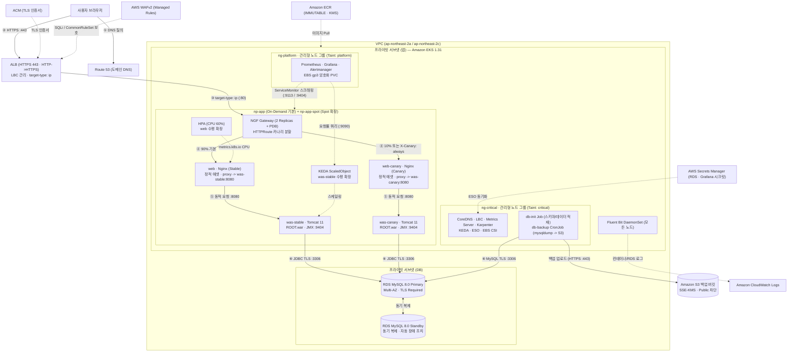

# 아키텍처

## 1. 개요 — 시스템 목적과 범위

`spring-framework-petclinic`(전통적인 Spring Framework 7.x / Jakarta EE 11 WAR 패키징 기반 동물병원 관리 웹 애플리케이션)을 AWS 서울 리전(`ap-northeast-2`)의 **Amazon EKS (`1.31`)** 환경 위에 고가용성(Multi-AZ: `2a`, `2c`), 정교한 자동 확장(HPA / KEDA / Karpenter), 계층별 네트워크·권한 격리, 통합 관측성(Prometheus / Grafana / Alertmanager / CloudWatch Logs)을 갖춘 클라우드 네이티브 아키텍처로 운영한다.

- **포함 범위 (In-Scope)**:
  - Route 53, ACM, AWS WAFv2, LBC 기반 internet-facing ALB(`target-type: ip`)를 통한 엣지 보안 및 TLS 종단
  - NGINX Gateway Fabric(NGF) `Gateway` 및 `HTTPRoute`를 이용한 L7 라우팅과 90:10 가중치·헤더(`X-Canary: always`) 기반 카나리(Canary) 트래픽 분할
  - `web`(Nginx 1.27 정적 서빙 + 리버스 프록시)과 `was`(Tomcat 11 언패킹 WAR + JMX Exporter) 2-Tier 분리 및 각각 CPU 기반 HPA / Prometheus 요청률 기반 KEDA 오토스케일링
  - 3-Tier 노드 분리: `np-app`(Karpenter On-Demand 기본 풀 + `np-app-spot` Spot 확장 풀), `ng-critical`(클러스터 컨트롤러 및 DB 초기화/백업 Job 전용 관리형 노드 그룹), `ng-platform`(모니터링 스택 및 `gp3` PVC 전용 관리형 노드 그룹)
  - 프라이빗 DB 서브넷의 RDS MySQL 8.0 Multi-AZ(Primary/Standby 동기 복제), S3 암호화 백업(`CronJob`), AWS Secrets Manager + External Secrets Operator(ESO) 기반 시크릿 동기화
- **제외 범위 (Out-of-Scope)**:
  - Spring Boot 내장 톰캣 JAR로의 전환 (외부 Tomcat 11 컨테이너 배포 구조 유지)
  - 멀티 리전 액티브-액티브 구성 (`ap-northeast-2` 단일 리전 Multi-AZ에 집중)
  - 비즈니스 도메인 모델 변경 (단, 외부 RDS 환경변수 바인딩 및 flatpickr `yyyy/MM/dd` 날짜 형식 호환 패치는 반영)

---

## 2. 구성 요소 — 각 컴포넌트의 역할

| 계층 | 구성 요소 | 역할 및 주요 특징 | 배치 위치 (네임스페이스 / 노드 티어) |
|---|---|---|---|
| **Edge / DNS** | Route 53, ACM, AWS WAFv2 | 도메인 A(Alias) 라우팅, 공인 TLS 인증서 발급·갱신, OWASP/SQLi/KnownBadInputs 관리형 규칙 필터링 | AWS 관리형 (`ap-northeast-2`) |
| **Ingress LB** | AWS ALB (AWS Load Balancer Controller) | HTTP(`80`)→HTTPS(`443`) 리다이렉트, TLS 1.3/1.2 종단, 비정상 헤더 드롭, `target-type: ip`로 NGF Pod에 직접 라우팅 | 퍼블릭 서브넷 (`2a`, `2c`) |
| **L7 Gateway** | NGINX Gateway Fabric (`nginx-gateway`) | Gateway API(`v1.2.0`) 데이터 플레인(2 Replicas, AZ 분산, PDB 적용). `HTTPRoute`로 `web`(90%) / `web-canary`(10% 및 `X-Canary: always`) 트래픽 분할 | `nginx-gateway` / `np-app` (`workload-tier=app`) |
| **Web Tier** | `web`, `web-canary` (Nginx + Exporter) | `/resources/*`, `/webjars/*` 정적 에셋 직접 서빙 및 보안 헤더 부여, 동적 요청을 각각 `was-stable:8080`, `was-canary:8080`으로 프록시. 사이드카 `nginx-prometheus-exporter`(`:9113`) 내장. `web`은 CPU 60% 기준 HPA(2~10) 스케일링 | `petclinic` / `np-app` (`workload-tier=app`) |
| **WAS Tier** | `was-stable`, `was-canary` (Tomcat 11 + JMX Exporter) | 사전 언패킹된 `webapps/ROOT` 구동(`jpa` 프로필, 읽기 전용 루트 파일시스템), JMX Exporter(`:9404/metrics`)로 `Catalina_GlobalRequestProcessor_requestCount` 노출. `was-stable`은 Prometheus 요청률 기반 KEDA `ScaledObject`(2~10) 스케일링 | `petclinic` / `np-app` (`workload-tier=app`) |
| **Cluster Controllers** | CoreDNS, LBC, Metrics Server, Karpenter, KEDA, ESO, EBS CSI | 클러스터 핵심 제어부 및 오토스케일러·시크릿·스토리지 드라이버 | `kube-system`, `keda`, `external-secrets` / `ng-critical` (Taint: `node-role=critical:NoSchedule`) |
| **DB Jobs** | `db-init` (Job), `db-backup` (CronJob) | 배포 시 멱등 스키마/초기 데이터 적재(`schema.sql`, `data.sql`), 매일 03:00 KST `mysqldump` 압축본을 S3(`SSE-KMS`)에 업로드 | `petclinic` / `ng-critical` (Taint: `node-role=critical:NoSchedule`) |
| **Observability** | Prometheus, Grafana, Alertmanager, Fluent Bit | `ServiceMonitor` 기반 `web`(`:9113`)·`was`(`:9404`) 메트릭 수집, KEDA 스케일링 쿼리 제공, `gp3` 암호화 볼륨 영속화. Fluent Bit DaemonSet은 전 노드 컨테이너 로그를 CloudWatch Logs로 전송 | `monitoring` (`ng-platform`, Taint: `node-role=platform:NoSchedule`) / `amazon-cloudwatch` (Fluent Bit 전 노드 Toleration) |
| **Data / Storage / Registry** | RDS MySQL 8.0, Secrets Manager, S3, ECR | Multi-AZ Primary/Standby RDB(`require_secure_transport=ON`), RDS/Grafana 시크릿 보관, DB 백업 버킷, 불변 태그(`IMMUTABLE`) 및 KMS 암호화 컨테이너 레지스트리 | 프라이빗 DB 서브넷 (`2a`, `2c`) 및 AWS 관리형 서비스 |

---

## 3. 디렉터리 구조

```text
.
├── .env.example                          # 환경변수 템플릿 (시크릿 평문 미포함, source 검증 통과)
├── .gitattributes                        # 셸 스크립트 LF 줄바꿈 및 실행 권한 유지
├── .gitignore                            # 빌드 산출물, .env, 로컬 시크릿 제외
├── AGENTS.md                             # Codex 코드 리뷰어 규칙
├── CLAUDE.md                             # Claude 구현 규칙
├── ORCA_WORKFLOW.md                      # 에이전트 역할 분담 및 워크플로 정의
├── docs/
│   ├── architecture.md                   # 시스템 전체 아키텍처 현황 (본 문서)
│   ├── design.md                         # 초기 구축 설계서
│   ├── review.md                         # 코드 리뷰 기록
│   └── security.md                       # 보안·인프라 점검 기록
├── app/                                  # spring-framework-petclinic 소스 코드
│   ├── pom.xml                           # Maven WAR 빌드, MySQL/PostgreSQL/H2/HSQLDB 프로필
│   └── src/
│       ├── main/
│       │   ├── java/org/springframework/samples/petclinic/...
│       │   ├── resources/
│       │   │   ├── db/mysql/{schema.sql,data.sql}
│       │   │   └── spring/{data-access.properties,datasource-config.xml,...}
│       │   └── webapp/                   # 정적 리소스(resources/) 및 JSP 뷰(WEB-INF/jsp/)
│       └── test/...
├── docker/
│   ├── web/
│   │   ├── Dockerfile                    # Stage 1: Maven webjars/정적 에셋 추출 → Stage 2: nginx:1.27.2-alpine (UID 10001)
│   │   └── nginx.conf                    # 정적 캐싱, 보안 헤더, /healthz, /nginx_status, WAS 리버스 프록시
│   └── was/
│       ├── Dockerfile                    # Stage 1: MySQL 프로필 WAR 빌드·언패킹 + JMX SHA256 검증 → Stage 2: tomcat:11.0.2-jre21-temurin-noble (UID 10001)
│       ├── jmx-exporter-config.yaml      # Tomcat GlobalRequestProcessor / ThreadPool / JVM JMX 수집 규칙
│       └── setenv.sh                     # JMX Exporter -javaagent:9404 및 JDBC 드라이버 프로퍼티 설정
├── infra/
│   ├── aws/
│   │   ├── provision-aws-resources.sh    # pre-cluster(IAM/ECR/Logs/S3/WAF/ACM), cluster(eksctl), post-cluster(RDS/Secrets) 프로비저닝
│   │   └── iam-policies/                 # lbc, karpenter-controller, karpenter-node-trust, eso, fluent-bit, db-backup 최소 권한 JSON
│   ├── eksctl/
│   │   └── cluster.yaml                  # EKS 1.31 ClusterConfig (VPC 서브넷, IRSA, vpc-cni NetworkPolicy, ng-critical, ng-platform)
│   └── karpenter/
│       ├── ec2nodeclass.yaml             # AL2023 고정 AMI, IMDSv2(hop limit 1), gp3 30Gi 암호화 루트 볼륨
│       └── nodepool-app.yaml             # np-app(On-Demand, weight 100) 및 np-app-spot(Spot 오버플로 확장) NodePool
├── k8s/
│   ├── base/
│   │   ├── namespace.yaml                # 네임스페이스별 Pod Security Standards(restricted/baseline/privileged) 정의
│   │   ├── networkpolicy-petclinic.yaml  # petclinic 기본 거부(Ingress/Egress) 및 DNS·web→was·RDS(3306)·백업(443) 허용 정책
│   │   └── storageclass-gp3.yaml         # EBS CSI gp3 암호화 StorageClass (WaitForFirstConsumer)
│   ├── secrets/
│   │   ├── secretstore.yaml              # ESO SecretStore (AWS Secrets Manager 연동)
│   │   └── externalsecret-rds.yaml       # Secrets Manager → petclinic-rds-secret 동기화 (sslMode=REQUIRED 포함)
│   ├── jobs/
│   │   ├── job-db-init.yaml              # schema.sql / data.sql 적재 Job (ng-critical, --ssl-mode=REQUIRED)
│   │   └── cronjob-db-backup.yaml        # 일일 mysqldump → S3(SSE-KMS) 업로드 CronJob (ng-critical, IRSA db-backup)
│   ├── web/
│   │   ├── deployment.yaml               # web(→was-stable) 및 web-canary(→was-canary) Deployment + nginx-exporter 사이드카
│   │   ├── service.yaml                  # web, web-canary Service (:80→:8080, :9113)
│   │   ├── hpa.yaml                      # web CPU 60% HPA (min 2, max 10)
│   │   └── networkpolicy.yaml            # web Ingress 허용 (nginx-gateway → 8080, Prometheus → 9113)
│   ├── was/
│   │   ├── deployment-stable.yaml        # was-stable Deployment (readOnlyRootFilesystem, emptyDir 마운트)
│   │   ├── deployment-canary.yaml        # was-canary Deployment (카나리 검증용)
│   │   ├── service-stable.yaml           # was-stable Service (:8080, :9404)
│   │   ├── service-canary.yaml           # was-canary Service (:8080, :9404)
│   │   ├── service.yaml                  # was 통합 Service (:8080, :9404)
│   │   ├── keda-scaledobject.yaml        # was-stable KEDA ScaledObject (Prometheus 요청률 > 50 req/s 시 확장)
│   │   └── networkpolicy.yaml            # was Ingress 허용 (web → 8080, Prometheus → 9404)
│   ├── gateway/
│   │   ├── alb-ingress.yaml              # LBC internet-facing ALB Ingress (HTTPS 443, ACM, WAFv2, drop_invalid_header_fields)
│   │   ├── gateway.yaml                  # NGF Gateway (:80 HTTP)
│   │   ├── httproute-canary.yaml         # HTTPRoute (X-Canary: always → web-canary 100%, 기본 web 90 : web-canary 10)
│   │   └── pdb-nginx-gateway.yaml        # NGF 데이터 플레인 PodDisruptionBudget (minAvailable: 1)
│   ├── monitoring/
│   │   ├── externalsecret-grafana.yaml   # Grafana 관리자 자격증명 ExternalSecret
│   │   ├── kube-prometheus-values.yaml   # Prometheus, Grafana, Alertmanager ng-platform 배치 및 gp3 PVC 설정
│   │   ├── networkpolicy-prometheus.yaml # Prometheus :9090 Ingress 제한 (KEDA, Grafana, 자기 자신만 허용)
│   │   └── servicemonitor-petclinic.yaml # web(:9113), was(:9404) 스크래핑 ServiceMonitor
│   └── logging/
│       └── fluent-bit-values.yaml        # aws-for-fluent-bit DaemonSet 설정 (전 노드 Toleration → CloudWatch Logs)
└── scripts/
    ├── lib.sh                            # 공통 환경변수 로드(.env), 필수 변수 검증, envsubst 렌더링 함수
    ├── build-and-push.sh                 # ECR 로그인 및 web / was 이미지 빌드·푸시
    ├── deploy-all.sh                     # 애드온/매니페스트 배포, stable/canary 롤아웃 대기, Route 53 연결, 카나리 E2E 검증
    └── validate-manifests.sh             # YAML 문법, 고정 이미지 태그, 평문 시크릿 부재, 노드 티어/비루트 보안 설정 정적 검증기
```

---

## 4. 데이터 흐름 — Mermaid 다이어그램



---

## 5. 실행 환경 — 런타임, 컨테이너/클라우드 리소스, 환경변수 목록

### 5.1 런타임 및 주요 컴포넌트 버전

| 구분 | 컴포넌트 | 고정 버전 / 이미지 |
|---|---|---|
| **Application** | Spring Framework PetClinic | `7.0.3` (Spring Framework `7.0.9`, Hibernate `7.4.11.Final`, Java `17` 타겟 / Java `21` 런타임) |
| **Build Container** | Maven (Multi-stage Build) | `maven:3.9.9-eclipse-temurin-21` |
| **Web Container** | Nginx + Exporter Sidecar | `nginx:1.27.2-alpine`, `nginx/nginx-prometheus-exporter:1.3.0` |
| **WAS Container** | Apache Tomcat 11 + JMX Exporter | `tomcat:11.0.2-jre21-temurin-noble`, `jmx_prometheus_javaagent:1.0.1` |
| **DB Jobs** | MySQL Client / AWS CLI | `mysql:8.0.39`, `amazon/aws-cli:2.18.0` |
| **Kubernetes** | Amazon EKS | `1.31` (AL2023 AMI `al2023@v20241024`) |
| **Gateway API** | Gateway API CRDs / NGF | CRDs `v1.2.0`, `nginx-gateway-fabric` Helm `1.5.1` |
| **Autoscaling** | Karpenter / KEDA / Metrics Server | Karpenter `1.0.6`, KEDA `2.15.2`, Metrics Server `3.12.2` |
| **Ingress / Storage / Secrets** | LBC / EBS CSI / ESO | `aws-load-balancer-controller` `1.9.2`, `aws-ebs-csi-driver` `v1.36.0-eksbuild.1`, `external-secrets` `0.10.4` |
| **Observability** | kube-prometheus-stack / Fluent Bit | `kube-prometheus-stack` `65.8.1`, `aws-for-fluent-bit` Helm `0.1.34` (이미지 `2.32.2`) |
| **Database** | Amazon RDS for MySQL | `8.0.39` (`db.t3.medium`, Multi-AZ, `gp3` 20GB 암호화) |

### 5.2 클러스터 노드 그룹 및 NodePool 구성

| 이름 | 관리 주체 | 용량 / 인스턴스 전략 | Taint | Label | 역할 |
|---|---|---|---|---|---|
| **`np-app`** | Karpenter `NodePool` (`weight: 100`) | **On-Demand 전용** (`c6i`/`m6i`/`t3` `large`~`2xlarge`, 한도 `16 vCPU / 64Gi`) | 없음 | `workload-tier=app` | 앱 워크로드(`NGF`, `web`, `was`) 기본 용량 수용 |
| **`np-app-spot`** | Karpenter `NodePool` | **Spot 전용** (`c6i`/`m6i`/`t3` `large`~`2xlarge`, 한도 `48 vCPU / 192Gi`) | 없음 | `workload-tier=app` | `np-app` 한도 초과 시 앱 워크로드 Spot 확장 수용 |
| **`ng-critical`** | EKS Managed NodeGroup | On-Demand (`m6i.large`, Min 2 / Desired 2 / Max 4, Multi-AZ) | `node-role=critical:NoSchedule` | `workload-tier=critical` | 클러스터 컨트롤러 및 `db-init` / `db-backup` 실행 |
| **`ng-platform`** | EKS Managed NodeGroup | On-Demand (`m6i.large`, Min 2 / Desired 2 / Max 4, Multi-AZ) | `node-role=platform:NoSchedule` | `workload-tier=platform` | Prometheus(20Gi), Grafana(5Gi), Alertmanager(5Gi) 및 `gp3` PVC |

### 5.3 환경변수 목록 (`.env.example` 기준 — 실제 값은 저장소에 기재하지 않음)

| 카테고리 | 변수명 | 용도 |
|---|---|---|
| **AWS / 클러스터** | `AWS_REGION`, `AWS_ACCOUNT_ID`, `EKS_CLUSTER_NAME` | 리전, 계정 ID, EKS 클러스터 식별자 |
| **VPC 서브넷** | `VPC_ID`, `PUBLIC_SUBNET_A_ID`, `PUBLIC_SUBNET_C_ID`, `APP_PRIVATE_SUBNET_A_ID`, `APP_PRIVATE_SUBNET_C_ID`, `DB_PRIVATE_SUBNET_A_ID`, `DB_PRIVATE_SUBNET_C_ID` | `2a`/`2c` 퍼블릭(ALB), 앱 프라이빗(EKS 노드), DB 프라이빗(RDS) 서브넷 ID |
| **엣지 / 도메인** | `DOMAIN_NAME`, `ROUTE53_HOSTED_ZONE_ID`, `ACM_CERTIFICATE_ARN`, `WAF_WEB_ACL_ARN` | Route 53 도메인·호스팅 영역, ACM 인증서 ARN, WAFv2 WebACL ARN |
| **컨테이너 이미지** | `ECR_WEB_REPOSITORY_URI`, `ECR_WAS_REPOSITORY_URI`, `IMAGE_TAG` | `web`/`was` ECR 리포지토리 URI 및 불변 이미지 태그 |
| **애플리케이션** | `SPRING_PROFILES_ACTIVE`, `JAVA_OPTS`, `WAS_UPSTREAM_HOST`, `WAS_UPSTREAM_PORT` | Spring 런타임 프로필(`jpa`), JVM 옵션, Nginx 업스트림 호스트/포트 |
| **DB / 시크릿** | `RDS_SECRET_NAME`, `RDS_HOST`, `RDS_PORT`, `RDS_DB_NAME`, `JDBC_URL`, `JDBC_USERNAME`, `JDBC_PASSWORD` | Secrets Manager 시크릿 경로(`petclinic/*`) 및 ESO가 생성하는 `petclinic-rds-secret` 키 |
| **관측성 / 백업** | `CW_LOG_GROUP_NAME`, `PROMETHEUS_SERVER_URL`, `GRAFANA_ADMIN_SECRET_NAME`, `BACKUP_S3_BUCKET_NAME` | CloudWatch 로그 그룹, Prometheus 쿼리 URL, Grafana 시크릿 경로(`petclinic/*`), 백업용 S3 버킷명 |

---

## 6. 외부 의존성 — 외부 API, DB, 서비스

- **AWS 관리형 서비스**:
  - **Amazon RDS for MySQL (`8.0.39`)**: 애플리케이션 영속 데이터 저장소 (`:3306`, Multi-AZ, `require_secure_transport=ON`, `error`/`slowquery` CloudWatch 로그 내보내기, 삭제 보호 활성화)
  - **AWS Secrets Manager**: RDS 접속 정보(`$RDS_SECRET_NAME`) 및 Grafana 관리자 자격증명(`$GRAFANA_ADMIN_SECRET_NAME`) 보관
  - **Amazon S3**: `db-backup` CronJob의 `mysqldump` 백업 파일 저장소 (퍼블릭 액세스 완전 차단, SSE-KMS 기본 암호화, 버전 관리 활성화)
  - **Amazon ECR**: `petclinic-web`, `petclinic-was` 컨테이너 이미지 저장소 (`IMMUTABLE` 태그, 푸시 시 자동 스캔, KMS 암호화)
  - **Amazon CloudWatch Logs**: Fluent Bit가 전송하는 클러스터 컨테이너 로그 및 RDS 에러/슬로우쿼리 로그 보관 (보존 기간 30일)
  - **Amazon Route 53 / AWS Certificate Manager (ACM) / AWS WAFv2**: DNS 관리, DNS 검증 기반 TLS 인증서, 리전 WebACL(`AWSManagedRulesCommonRuleSet`, `AWSManagedRulesSQLiRuleSet`, `AWSManagedRulesKnownBadInputsRuleSet`)
- **외부 아티팩트 / Helm 차트 레지스트리 (빌드·배포 시점)**:
  - Maven Central (`com.mysql:mysql-connector-j:8.1.0`, `io.prometheus.jmx:jmx_prometheus_javaagent:1.0.1` SHA256 검증 포함, WebJars)
  - GitHub Releases (`gateway-api` `v1.2.0` `standard-install.yaml`)
  - Helm / OCI 레지스트리 (`eks-charts`, `metrics-server`, `kedacore`, `external-secrets`, `prometheus-community`, `oci://public.ecr.aws/karpenter/karpenter`, `oci://ghcr.io/nginx/charts/nginx-gateway-fabric`)

---

## 7. 보안 구조 — 인증, 권한, 시크릿 관리 방식

1. **엣지 및 전송 구간 암호화 (TLS Everywhere)**:
   - 외부 트래픽은 ALB에서 ACM 인증서(`ELBSecurityPolicy-TLS13-1-2-2021-06`)로 TLS 종단하며 HTTP(`80`)는 HTTPS(`443`)로 강제 리다이렉트한다.
   - ALB에 `routing.http.drop_invalid_header_fields.enabled=true` 및 AWS WAFv2 WebACL을 적용하고, Nginx(`web`)에서 `server_tokens off`와 보안 응답 헤더(`X-Content-Type-Options: nosniff`, `X-Frame-Options: SAMEORIGIN`, `Referrer-Policy: strict-origin-when-cross-origin`)를 일관되게 반환한다.
   - RDS MySQL은 파라미터 그룹에서 `require_secure_transport=ON`을 강제하고, `was`(`sslMode=REQUIRED`), `db-init`(`--ssl-mode=REQUIRED`), `db-backup`(`--ssl-mode=REQUIRED`) 모두 암호화 연결만 사용한다.
2. **네트워크 격리 (VPC SG & Kubernetes NetworkPolicy)**:
   - RDS 보안 그룹은 오직 EKS 클러스터 보안 그룹에서 오는 `TCP 3306`만 허용하며 퍼블릭 접근(`--no-publicly-accessible`)을 차단한다.
   - Amazon VPC CNI의 `enableNetworkPolicy: "true"` 및 `enablePolicyEventLogs: "true"`를 활성화한다.
   - `petclinic` 네임스페이스는 `default-deny-all`(Ingress/Egress 기본 차단) 정책을 기반으로 DNS(`53`), `nginx-gateway`→`web`(`8080`), `web`→`was`(`8080`), `Prometheus`→`web`(`9113`)/`was`(`9404`), `was`·`db-init`·`db-backup`→RDS(`3306`), `db-backup`→S3/STS(`443`) 통신만 명시적으로 허용한다.
   - `monitoring` 네임스페이스의 Prometheus(`:9090`)는 `prometheus-ingress` NetworkPolicy를 통해 KEDA, Grafana, Prometheus 자체 Pod에서의 접근만 허용한다.
3. **최소 권한 IAM (IRSA) 및 IMDS 차단**:
   - 모든 관리형 노드 그룹(`ng-critical`, `ng-platform`)에 `disableIMDSv1: true`, `disablePodIMDS: true`를 설정하고, Karpenter `EC2NodeClass`(`np-app`)에 `httpTokens: required`, `httpPutResponseHopLimit: 1`을 설정하여 일반 Pod가 노드 IAM Role 자격증명을 탈취하지 못하게 차단한다.
   - 컨트롤러 및 백업 잡은 전용 IRSA ServiceAccount를 사용하며, 리소스 범위를 최소한으로 제한한다 (ESO는 `secret:petclinic/*` 읽기만, `db-backup`은 `s3:::${BACKUP_S3_BUCKET_NAME}/petclinic/*`의 `s3:PutObject`만, Fluent Bit는 지정된 로그 그룹 쓰기만 허용).
   - K8s API 접근이 불필요한 애플리케이션 Pod(`web`, `was`, `db-init`)는 `automountServiceAccountToken: false`로 토큰 마운트를 비활성화한다.
4. **시크릿 외부화 및 로그 개인정보 보호**:
   - 소스 코드, `pom.xml`의 모든 프로필, `Dockerfile`, K8s 매니페스트 어디에도 평문 패스워드를 저장하지 않으며(`scripts/validate-manifests.sh`로 검증), AWS CLI 호출 시에도 비밀번호가 프로세스 인자(`argv`)에 노출되지 않도록 `jq` 표준 입력(`file:///dev/stdin`)으로 전달한다.
   - ESO가 AWS Secrets Manager의 시크릿을 주기적으로 동기화하여 `petclinic-rds-secret` 및 `grafana-admin-secret`을 생성한다.
   - 운영 로그(CloudWatch Logs)에 고객 개인정보(Owner 이름·주소·전화번호)가 포함된 SQL문이 유출되지 않도록 `jpa.showSql=false`를 기본값으로 유지한다.
5. **컨테이너 및 네임스페이스 하드닝**:
   - 모든 네임스페이스에 워크로드 특성에 맞는 Pod Security Standards(`petclinic`: `enforce: restricted`, `nginx-gateway`/`external-secrets`/`keda`: `enforce: baseline`, `monitoring`/`amazon-cloudwatch`: `enforce: privileged`) 레이블을 적용한다.
   - `web`, `was`, `db-init`, `db-backup`의 모든 컨테이너는 비루트 사용자(`UID/GID 10001`), `runAsNonRoot: true`, `allowPrivilegeEscalation: false`, `capabilities: { drop: ["ALL"] }`, `seccompProfile: RuntimeDefault`, `readOnlyRootFilesystem: true`로 실행되며, 런타임 쓰기가 필요한 경로만 `emptyDir` 볼륨으로 마운트한다.

---

## 8. 설계 결정 기록

- `petclinic-eks-implementation`: 카나리 트래픽 분할(90:10 및 `X-Canary: always`)을 `HTTPRoute`에서 `web`→`was-stable`, `web-canary`→`was-canary` 두 경로로 분리하여 구현하고 기본 `was` 통합 Service도 함께 유지함 / NGF의 Gateway API `HTTPRoute` 가중치 분배를 그대로 활용하면서 카나리 배포 시 정적·동적 경로 모두 독립적으로 검증하기 위함
- `petclinic-eks-implementation`: KEDA `ScaledObject`에서 빈 `TriggerAuthentication` 리소스를 생략하고 대신 `networkpolicy-prometheus.yaml`로 Prometheus `:9090` 인그레스를 KEDA와 Grafana로 제한함 / 클러스터 내부 Prometheus가 무인증으로 동작하므로 불필요한 더미 인증 리소스 대신 네트워크 정책으로 접근 주체를 통제하는 것이 실질적인 보안을 제공함
- `petclinic-eks-implementation`: `createOrUpdatePetForm.jsp`와 `createOrUpdateVisitForm.jsp`의 flatpickr 초기화 옵션에 `{dateFormat: "Y/m/d"}`를 지정함 / 업스트림 flatpickr 기본 형식(`Y-m-d`)과 도메인 모델 `@DateTimeFormat(pattern = "yyyy/MM/dd")` 간 불일치로 인해 날짜 선택 시 폼 제출이 거절되는 기능 버그를 도메인 모델 변경 없이 해결하기 위함
- `petclinic-eks-implementation`: Karpenter 앱 노드풀을 `np-app`(On-Demand 전용, `weight: 100`, `16 vCPU` 한도)과 `np-app-spot`(Spot 전용, `48 vCPU` 한도) 두 개의 `NodePool`로 분리함 / 단일 NodePool에 `on-demand`와 `spot`을 함께 나열하면 Karpenter가 비용 최적화를 위해 Spot을 우선 선택하므로, 기본 용량은 On-Demand에 보장하고 초과 부하만 Spot으로 확장하려는 설계 의도를 정확히 구현하기 위함
- `petclinic-eks-implementation`: MySQL 프로필 빌드 시 Spring 기동 단계의 `<jdbc:initialize-database>`를 비활성화(`jdbc.initEnabled=false`)하고 `ng-critical`의 `db-init` Job이 스키마·데이터 초기화를 전담하도록 분리함 / `was` Pod가 오토스케일링이나 카나리 배포로 기동될 때마다 RDS에 중복 DDL/DML을 실행하는 경합 조건을 방지하기 위함
- `petclinic-eks-implementation`: `docker/was/Dockerfile` 빌드 단계에서 `petclinic.war`를 `webapps/ROOT`로 사전 언패킹하고 Tomcat 런타임 쓰기 디렉터리(`work`, `temp`, `logs`, `conf/Catalina`, `/tmp`)를 `emptyDir`로 마운트함 / Tomcat 11 컨테이너에서도 `readOnlyRootFilesystem: true`를 강제하여 런타임 파일시스템 변조를 차단하기 위함
