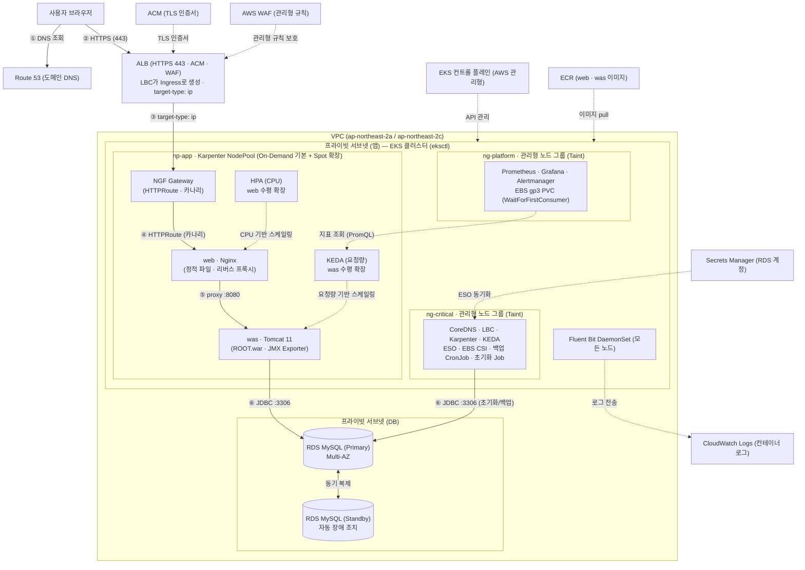

# AWS EKS 기반 Spring Framework PetClinic 아키텍처 및 환경 설계서 (`docs/design.md`)

## 1. 목표와 범위 (하지 않을 것 포함)

### 1.1 목표 (Goals)
`spring-framework-petclinic` (전통적인 Spring Framework WAR 패키징 기반 웹 애플리케이션)을 AWS 서울 리전(`ap-northeast-2`)의 **Amazon EKS** 위에 고가용성(Multi-AZ), 자동 확장(Auto-scaling), 보안 모범 사례, 관측성(Observability)을 갖춘 클라우드 네이티브 아키텍처로 구축한다.

핵심 아키텍처 목표는 다음과 같다:
1. **엣지 및 인그레스 보안**: Route 53 도메인 라우팅, ACM TLS 인증서, AWS WAF(관리형 규칙)를 결합한 인터넷 경계 보안과 AWS Load Balancer Controller(LBC) 기반 ALB(`target-type: ip`, HTTPS 443) 구성.
2. **Gateway API 및 카나리 배포**: NGINX Gateway Fabric(NGF) 기반 `Gateway` 및 `HTTPRoute`를 활용하여 클러스터 내부 L7 라우팅 및 가중치 기반 카나리(Canary) 트래픽 분할 구현.
3. **Web / WAS 2-Tier 분리 및 정교한 오토스케일링**:
   - **Web 계층 (`web`)**: Nginx 컨테이너를 통해 정적 파일(`/resources/**`, `/webjars/**`)을 직접 서빙하고 동적 요청만 WAS로 리버스 프록시(`:8080`). CPU 지표 기반 **HPA**로 수평 확장.
   - **WAS 계층 (`was`)**: Apache Tomcat 11 기반 `ROOT.war` 구동 및 JMX Exporter 내장. Prometheus가 수집한 요청량(HTTP Request Rate / JMX 메트릭) 기반 **KEDA (`ScaledObject`)** 로 수평 확장.
4. **노드 역할 분리 (3-Tier Node Architecture)**:
   - `np-app`: Karpenter `NodePool` (On-Demand 기본 + Spot 확장) — 애플리케이션 워크로드(`NGF Gateway`, `web`, `was`) 전용.
   - `ng-critical`: 관리형 노드 그룹 (Taint 적용) — 클러스터 핵심 컨트롤러(`CoreDNS`, `LBC`, `Karpenter`, `KEDA`, `ESO`, `EBS CSI`) 및 DB 초기화 `Job` / 백업 `CronJob` 실행.
   - `ng-platform`: 관리형 노드 그룹 (Taint 적용) — 모니터링 스택(`Prometheus`, `Grafana`, `Alertmanager`) 및 EBS `gp3` PVC(`WaitForFirstConsumer`) 전용.
5. **데이터 계층 고가용성 및 시크릿 외부화**:
   - 프라이빗 DB 서브넷에 **RDS MySQL (Primary / Standby Multi-AZ 동기 복제 및 자동 장애 조치)** 배치.
   - DB 자격 증명은 **AWS Secrets Manager**에 보관하고 **External Secrets Operator (ESO)** 를 통해 Kubernetes `Secret`으로 안전하게 동기화.
6. **통합 로깅 및 관측성**:
   - 모든 노드에 **Fluent Bit DaemonSet**을 배포하여 컨테이너 로그를 **Amazon CloudWatch Logs**로 전송.
   - `ng-platform`의 Prometheus + Grafana + Alertmanager로 클러스터 및 JMX/요청량 지표를 수집·시각화하고 KEDA 스케일링 트리거로 활용.

### 1.2 범위 (In-Scope)
- Upstream `https://github.com/spring-petclinic/spring-framework-petclinic` 소스 코드 가져오기 및 설정 외부화(환경변수/시스템 프로퍼티로 RDS MySQL 접속 정보 주입 가능하도록 구성)
- `web` (Nginx + 정적 에셋 포함) 및 `was` (Tomcat 11 + `ROOT.war` + JMX Exporter) 멀티 스테이지 `Dockerfile` 작성
- `eksctl` 클러스터 구성 파일 (`ClusterConfig`: VPC 서브넷 매핑, IRSA, `ng-critical`, `ng-platform` 관리형 노드 그룹 정의) 및 AWS 부가 인프라(RDS, WAF, ACM, ECR, Secrets Manager) 프로비저닝 스크립트/매니페스트 작성
- Karpenter `NodePool` 및 `EC2NodeClass` 매니페스트 (`np-app`: On-Demand + Spot 혼합)
- Kubernetes 매니페스트 일체:
  - Namespace, StorageClass (`gp3`, `WaitForFirstConsumer`)
  - ESO `SecretStore` 및 `ExternalSecret`
  - DB 스키마/초기 데이터 적재용 `Job` (`init-db`) 및 정기 `mysqldump` 백업용 `CronJob` (`backup-db`)
  - `web` Deployment, Service, HPA
  - `was` (Stable / Canary) Deployment, Service, KEDA `ScaledObject` (`TriggerAuthentication` 포함)
  - NGF `GatewayClass`, `Gateway`, `HTTPRoute` (카나리 가중치 라우팅 포함) 및 LBC 연동 ALB `Ingress` (또는 Gateway LBC 연동 구문)
  - 모니터링(`Prometheus`, `Grafana`, `Alertmanager`) 및 로깅(`Fluent Bit` DaemonSet) Helm values 및 매니페스트
- 빌드, 이미지 푸시, 배포 및 검증 자동화 스크립트 및 테스트 코드

### 1.3 하지 않을 것 (Out-of-Scope / Non-Goals)
- **PetClinic 비즈니스 로직 변경 금지**: 동물병원 도메인 모델(Owner, Pet, Visit, Vet)이나 화면 UI 기능을 새로 개발하거나 수정하지 않는다 (단, DB 연결 설정 외부화 및 헬스체크/메트릭 노출 설정은 허용).
- **Spring Boot 버전(`spring-petclinic`) 사용 금지**: 내장 톰캣 JAR가 아닌 `spring-framework-petclinic` 레포지토리의 WAR 패키징 구조를 그대로 사용하여 외부 **Tomcat 11** 컨테이너에 `ROOT.war`로 배포한다.
- **멀티 리전(Multi-Region) 액티브-액티브 구성 제외**: 단일 리전(`ap-northeast-2` 서울) 내 Multi-AZ(`ap-northeast-2a`, `ap-northeast-2c`) 고가용성에 집중한다.
- **실제 AWS 자격 증명 및 민감 정보 커밋 금지**: AWS Account ID, 도메인 인증서 ARN, DB 패스워드 등 실제 값은 코드나 매니페스트에 하드코딩하지 않고 `.env.example` 및 템플릿 변수로만 정의한다.

---

## 2. 구성 요소와 디렉터리 구조

### 2.1 시스템 구성 요소 요약
| 계층 | 구성 요소 | 역할 및 주요 특징 | 배치 위치 (노드/서브넷) |
|---|---|---|---|
| **Edge / DNS** | Route 53, ACM, AWS WAF | 도메인 질의 응답, TLS 인증서 관리, 웹 방화벽(OWASP/Managed Rules) | AWS Global / Regional (`ap-northeast-2`) |
| **Ingress LB** | AWS ALB (LBC 관리) | HTTPS 443 종단, ACM·WAF 연동, `target-type: ip`로 NGF Gateway Pod에 직접 라우팅 | 퍼블릭 서브넷 (`2a`, `2c`) |
| **L7 Gateway** | NGF Gateway (`nginx-gateway`) | Kubernetes Gateway API 구현체, `HTTPRoute` 기반 카나리 트래픽 제어 | 프라이빗 서브넷(앱) / `np-app` |
| **Web Tier** | `web` (Nginx) | 정적 리소스 서빙, `/`(동적 요청) → `was:8080` 리버스 프록시, CPU 기반 HPA | 프라이빗 서브넷(앱) / `np-app` |
| **WAS Tier** | `was` (Tomcat 11) | `ROOT.war` 실행, JMX Exporter(`:9404`) 메트릭 노출, 요청량 기반 KEDA 스케일링 | 프라이빗 서브넷(앱) / `np-app` |
| **Control / Add-on** | CoreDNS, LBC, Karpenter, KEDA, ESO, EBS CSI, DB Job/CronJob | 클러스터 필수 애드온 및 DB 초기화(`Job`)/백업(`CronJob`) 수행 | 프라이빗 서브넷(앱) / `ng-critical` (Taint) |
| **Observability** | Prometheus, Grafana, Alertmanager, Fluent Bit | 메트릭 수집(KEDA 연동), 대시보드, 알림, 전 노드 컨테이너 로그 → CloudWatch Logs 전송 | `ng-platform` (Taint, `gp3` PVC) / Fluent Bit은 전 노드 DaemonSet |
| **Data / Security** | RDS MySQL, Secrets Manager, ECR | Multi-AZ(Primary/Standby) RDB, RDS 계정 암호 관리(ESO 연동), `web`/`was` 이미지 레지스트리 | 프라이빗 서브넷(DB) / AWS 관리형 서비스 |

### 2.2 저장소 디렉터리 구조
구현 담당(Claude)은 아래 디렉터리 구조에 맞춰 파일들을 생성 및 구성한다.

```text
.
├── .env.example                          # 환경변수 템플릿 (실제 시크릿 값 제외)
├── .gitignore                            # 빌드 산출물, .env, 로컬 시크릿 제외 설정
├── CLAUDE.md
├── AGENTS.md
├── ORCA_WORKFLOW.md
├── docs/
│   ├── design.md                         # 아키텍처 및 환경 설계 문서 (본 문서)
│   ├── review.md                         # 코드 리뷰 결과 (Codex 작성)
│   └── security.md                       # 보안 점검 결과 (Antigravity 작성)
├── app/                                  # spring-framework-petclinic 애플리케이션 소스
│   ├── pom.xml                           # Maven 빌드 설정 (WAR 패키징, MySQL/Jakarta 설정)
│   └── src/
│       └── main/
│           ├── java/...
│           ├── resources/
│           │   ├── db/mysql/             # schema.sql, data.sql (초기화 Job에서도 활용)
│           │   └── spring/
│           │       └── data-access.properties # 환경변수 치환 지원 DB 설정
│           └── webapp/...
├── docker/
│   ├── web/
│   │   ├── Dockerfile                    # Nginx 이미지 (정적 파일 복사 및 nginx.conf 적용)
│   │   └── nginx.conf                    # 정적 파일 서빙 + was:8080 리버스 프록시 + Prometheus stub_status
│   └── was/
│       ├── Dockerfile                    # Multi-stage: Maven WAR 빌드 -> Tomcat 11 + JMX Exporter
│       ├── jmx-exporter-config.yaml      # JMX Exporter 메트릭 수집 규칙 (Tomcat Thread/Request 지표)
│       └── setenv.sh                     # JVM 옵션, JMX javaagent, DB 환경변수 매핑 스크립트
├── infra/
│   ├── eksctl/
│   │   └── cluster.yaml                  # eksctl ClusterConfig (VPC, ng-critical, ng-platform, IRSA, Addons)
│   ├── karpenter/
│   │   ├── ec2nodeclass.yaml             # Karpenter EC2NodeClass (서브넷, 보안그룹, AMI 설정)
│   │   └── nodepool-app.yaml             # np-app NodePool (On-Demand + Spot, 노드 레이블/요구사항)
│   └── aws/
│       ├── provision-aws-resources.sh    # VPC/RDS Multi-AZ/WAF/ACM/Secrets Manager/ECR 구성 스크립트
│       └── iam-policies/                 # ESO, LBC, Karpenter, CloudWatch, Backup용 IAM Policy JSON
├── k8s/
│   ├── base/
│   │   ├── namespace.yaml                # petclinic, monitoring, ngf 등 네임스페이스 정의
│   │   └── storageclass-gp3.yaml         # EBS CSI gp3 StorageClass (WaitForFirstConsumer)
│   ├── secrets/
│   │   ├── secretstore.yaml              # ESO SecretStore (AWS Secrets Manager 연동, ng-critical 배치)
│   │   └── externalsecret-rds.yaml       # RDS 자격증명 -> k8s Secret (petclinic-rds-secret) 동기화
│   ├── jobs/
│   │   ├── job-db-init.yaml              # 초기 스키마/데이터 적재 Job (ng-critical Toleration/NodeSelector)
│   │   └── cronjob-db-backup.yaml        # 정기 DB 백업 CronJob (ng-critical Toleration/NodeSelector)
│   ├── web/
│   │   ├── deployment.yaml               # web Nginx Deployment (np-app 배치, 리소스 제한, 프로브)
│   │   ├── service.yaml                  # web ClusterIP Service (:80)
│   │   └── hpa.yaml                      # web HPA (CPU 사용률 기반 수평 확장)
│   ├── was/
│   │   ├── deployment-stable.yaml        # was Tomcat 11 메인 Deployment (np-app 배치, ROOT.war, :8080/:9404)
│   │   ├── deployment-canary.yaml        # was Tomcat 11 카나리 Deployment (카나리 배포 검증용)
│   │   ├── service-stable.yaml           # was-stable Service (:8080, :9404)
│   │   ├── service-canary.yaml           # was-canary Service (:8080, :9404)
│   │   ├── service.yaml                  # was 통합/기본 Service (:8080 -> web 프록시 타겟)
│   │   └── keda-scaledobject.yaml        # KEDA ScaledObject (Prometheus 요청량 지표 기반 was 수평 확장)
│   ├── gateway/
│   │   ├── alb-ingress.yaml              # LBC ALB 구성 (HTTPS 443, ACM, WAF, target-type: ip -> NGF Gateway)
│   │   ├── gateway.yaml                  # NGF Gateway 리소스 (np-app 배치)
│   │   └── httproute-canary.yaml         # HTTPRoute (트래픽 라우팅 및 카나리 가중치 분배)
│   ├── monitoring/
│   │   ├── kube-prometheus-values.yaml   # Prometheus, Grafana, Alertmanager Helm 설정 (ng-platform 전용, gp3 PVC)
│   │   └── servicemonitor-petclinic.yaml # web/was(JMX Exporter) 지표 수집용 ServiceMonitor
│   └── logging/
│       └── fluent-bit-values.yaml        # aws-for-fluent-bit DaemonSet 설정 (모든 노드 Toleration -> CloudWatch Logs)
└── scripts/
    ├── build-and-push.sh                 # ECR 로그인 및 web / was 이미지 빌드·푸시 스크립트
    ├── deploy-all.sh                     # 전체 매니페스트 및 Helm 차트 순서대로 배포하는 스크립트
    └── validate-manifests.sh             # 매니페스트 구문/보안 정책/체크리스트 자동 검증 스크립트
```

---

## 3. 데이터 흐름 / API 또는 인터페이스

### 3.1 전체 트래픽 및 제어 흐름도 (Mermaid)
참조 아키텍처 다이어그램의 번호(①~⑥) 및 제어 흐름을 그대로 반영한 데이터 흐름이다.



### 3.2 단계별 상세 데이터 흐름 (① ~ ⑥)
1. **① DNS 조회**: 사용자 브라우저가 서비스 도메인으로 접속 시 Amazon Route 53을 통해 ALB의 A(Alias) 레코드를 조회한다.
2. **② HTTPS 접속 및 WAF 필터링**: 브라우저는 ALB의 `443` 포트로 HTTPS 요청을 전송한다. ALB에는 **ACM(AWS Certificate Manager)** 의 공인 TLS 인증서가 바인딩되어 TLS를 종료(Termination)하며, 앞단에 결합된 **AWS WAF**가 SQL Injection, XSS 등 관리형 규칙(Managed Rules)으로 악성 트래픽을 차단한다.
3. **③ ALB → NGF Gateway (`target-type: ip`)**: AWS Load Balancer Controller(LBC)가 생성한 ALB는 노드 포트(NodePort)를 거치지 않고 `target-type: ip` 모드로 `np-app` 노드풀에 떠 있는 **NGF(NGINX Gateway Fabric) Gateway Pod**의 프라이빗 IP로 직접 트래픽을 전달한다.
4. **④ NGF Gateway → `web` (HTTPRoute · 카나리)**:
   - NGF Gateway는 Kubernetes Gateway API의 `HTTPRoute` 규칙에 따라 요청을 라우팅한다.
   - 카나리 배포 시 `HTTPRoute`의 `backendRefs` 가중치(`weight`, 예: Stable 90 / Canary 10) 또는 헤더 매칭을 통해 트래픽을 세밀하게 분배한다.
   - `web` 계층(Nginx)은 **HPA(HorizontalPodAutoscaler)** 에 의해 Pod CPU 사용률 임계치(예: 60%) 기준으로 자동 수평 확장된다.
5. **⑤ `web` (Nginx) → `was` (Tomcat 11) 리버스 프록시 (`:8080`)**:
   - **정적 요청**: `/resources/*`, `/webjars/*`, `/favicon.ico`, `*.css`, `*.js`, `*.png` 등의 요청은 `web` Nginx 컨테이너 내부에 패키징된 정적 파일에서 즉시 응답(캐시 헤더 포함)하여 WAS 부하를 줄인다.
   - **동적 요청**: 그 외 모든 비즈니스 경로(`/`, `/owners/**`, `/vets/**`, `/pets/**` 등)는 `http://was:8080` (또는 카나리 구성에 따라對應하는 WAS Service `:8080`)으로 리버스 프록시한다.
   - **WAS 오토스케일링**: `was` Pod 내부의 Tomcat 11은 `ROOT.war`를 실행하며, JVM `-javaagent`로 로드된 **JMX Exporter**(`:9404/metrics`)를 통해 초당 요청 수(` Catalina:type=GlobalRequestProcessor` 요청 카운터 등)와 스레드 지표를 노출한다. `ng-platform`의 **Prometheus**가 이를 주기적으로 수집하고, `ng-critical`의 **KEDA**가 Prometheus 쿼리 결과(초당 요청량)를 바탕으로 `was` Deployment를 수평 확장한다.
6. **⑥ `was` 및 DB Job → RDS MySQL (`JDBC :3306`)**:
   - `was` Pod는 ESO가 AWS Secrets Manager로부터 동기화해 준 `petclinic-rds-secret`의 환경변수(`JDBC_URL`, `JDBC_USERNAME`, `JDBC_PASSWORD`)를 주입받아 프라이빗 DB 서브넷의 **RDS MySQL Primary**(`:3306`)에 JDBC로 연결한다.
   - `ng-critical`에서 실행되는 **초기화 Job**(`schema.sql`, `data.sql` 실행)과 **백업 CronJob**(`mysqldump` 수행) 역시 동일한 시크릿과 프라이빗 네트워크 경로(`:3306`)를 통해 RDS와 통신한다.
   - RDS MySQL Primary에 장애가 발생하면 `ap-northeast-2c`의 **RDS MySQL Standby**로 자동 장애 조치(Multi-AZ Failover)되며, 엔드포인트 DNS가 자동 전환되어 애플리케이션 중단 시간을 최소화한다.

### 3.3 주요 내부 인터페이스 및 엔드포인트 명세
| 컴포넌트 | 포트 / 프로토콜 | 경로 / 엔드포인트 | 용도 및 설명 |
|---|---|---|---|
| **ALB** | `443 / HTTPS` (`80`→`443` 리다이렉트) | `/*` | 외부 클라이언트 진입점 (ACM TLS 적용, AWS WAF 연결) |
| **NGF Gateway** | `80 / HTTP` (또는 `8080`) | `/`, `/healthz` | ALB Target Group의 IP 타겟 및 헬스체크 응답 |
| **`web` (Nginx)** | `80 / HTTP` | `/resources/**`, `/webjars/**` | Nginx 로컬 정적 에셋 직접 서빙 |
| **`web` (Nginx)** | `80 / HTTP` | `/*` (그 외 경로) | `proxy_pass http://was-svc:8080` 리버스 프록시 |
| **`web` (Nginx)** | `80 / HTTP` | `/nginx_status` 또는 `/healthz` | Liveness/Readiness Probe 및 Nginx 메트릭 확인 (내부 전용) |
| **`was` (Tomcat 11)** | `8080 / HTTP` | `/`, `/owners`, `/vets`, `/oups` | Spring Framework PetClinic `ROOT.war` 서블릿 엔드포인트 |
| **`was` (JMX Exporter)** | `9404 / HTTP` | `/metrics` | Prometheus 스크래핑용 JVM / Tomcat JMX 메트릭 엔드포인트 |
| **RDS MySQL** | `3306 / TCP` | `jdbc:mysql://<endpoint>:3306/petclinic` | PetClinic 영속 데이터 저장소 (`was`, 초기화 `Job`, 백업 `CronJob` 접근) |

---

## 4. 실행 환경 (런타임 버전, 컨테이너/클라우드 리소스, 환경변수 목록)

### 4.1 런타임 및 오픈소스/애드온 버전 명세
보안 및 재현성을 위해 모든 컨테이너 이미지와 애드온은 `latest` 태그를 금지하고 아래와 같이 버전을 명시하여 고정한다.

| 구분 | 구성 요소 | 권장/기준 버전 | 비고 |
|---|---|---|---|
| **Application** | Spring Framework PetClinic | `spring-framework-petclinic` (`main` 기준, Spring 6.x / Jakarta EE 10+) | `<packaging>war</packaging>` → `ROOT.war` |
| **Build / Runtime** | JDK / JRE | **Java 21 (Eclipse Temurin 21)** (최소 Java 17 이상 필수) | Tomcat 11 구동 및 Maven 빌드 호환 |
| **Build Tool** | Apache Maven | `3.9.9` (`maven:3.9.9-eclipse-temurin-21`) | Multi-stage 빌드 스테이지 사용 |
| **WAS Container** | Apache Tomcat | **Tomcat `11.0.x`** (`tomcat:11.0-jre21-temurin-noble` 등 고정 태그) | 다이어그램 명시 사항 (`was · Tomcat 11`) |
| **JMX Exporter** | Prometheus JMX Exporter | `1.0.1` (`jmx_prometheus_javaagent-1.0.1.jar`) | `was` 컨테이너 내 `-javaagent`로 마운트 |
| **Web Container** | Nginx | **Nginx `1.27.x`** (`nginx:1.27.2-alpine` 등 비루트/고정 태그) | 다이어그램 명시 사항 (`web · Nginx`) |
| **Kubernetes** | Amazon EKS | `1.31` | `eksctl` 기반 프로비저닝 |
| **Gateway API** | NGINX Gateway Fabric (NGF) | `1.5.x` (Gateway API `v1.2.0` 표준) | `Gateway`, `HTTPRoute` 카나리 지원 |
| **Node Autoscaler** | Karpenter | `1.0.x` (`v1` API: `NodePool`, `EC2NodeClass`) | `np-app` 노드풀 동적 프로비저닝 |
| **Pod Autoscaler** | KEDA | `2.15.x` | Prometheus 메트릭 기반 `was` 수평 확장 |
| **Ingress Controller**| AWS Load Balancer Controller | `2.9.x` | ALB 생성 (`target-type: ip`, WAF/ACM 연동) |
| **Secret Sync** | External Secrets Operator (ESO)| `0.10.x` | AWS Secrets Manager ↔ K8s `Secret` 동기화 |
| **Storage CSI** | AWS EBS CSI Driver | `v1.36.x` (EKS Add-on) | `gp3` StorageClass (`WaitForFirstConsumer`) |
| **Monitoring** | kube-prometheus-stack | `65.x` (Prometheus `2.54.x`, Grafana `11.x`, Alertmanager `0.27.x`) | `ng-platform` 배치 |
| **Logging** | AWS for Fluent Bit | `2.32.x` (`public.ecr.aws/aws-observability/aws-for-fluent-bit:2.32.2`) | 전 노드 DaemonSet → CloudWatch Logs |
| **Database** | Amazon RDS for MySQL | **MySQL `8.0.x`** (예: `8.0.39`) | Multi-AZ (Primary + Standby 동기 복제) |

### 4.2 클라우드 및 컨테이너 리소스 구성 (AWS `ap-northeast-2`)

#### 1) 네트워크 (VPC & Subnets — `ap-northeast-2a`, `ap-northeast-2c`)
- **Internet Gateway (IGW)**: VPC 외부 인터넷 연결.
- **퍼블릭 서브넷 (`2a`, `2c`)**: ALB 및 각 가용 영역별 **NAT Gateway** 배치 (고가용성 아웃바운드 구성).
- **프라이빗 서브넷 - 앱 (`2a`, `2c`)**: EKS 워커 노드(`np-app`, `ng-critical`, `ng-platform`) 및 Pod 배치. 외부 직접 접근 차단, 아웃바운드는 NAT GW 경유.
- **프라이빗 서브넷 - DB (`2a`, `2c`)**: RDS 서브넷 그룹. RDS MySQL Primary(`2a`) 및 Standby(`2c`) 배치. 외부 및 인터넷 라우팅 완전 차단.

#### 2) EKS 노드 그룹 및 NodePool 설계 (3-Tier 분리)
모든 워크로드는 노드 그룹의 목적에 맞게 `nodeSelector`, `affinity`, `tolerations`, `topologySpreadConstraints`를 설정한다.

| 노드 그룹 / 풀 이름 | 프로비저너 | 인스턴스 / 용량 전략 | Taint 설정 | Node Label | 배치 대상 워크로드 |
|---|---|---|---|---|---|
| **`np-app`** | **Karpenter `NodePool`** | **On-Demand 기본 + Spot 확장**<br/>(`c6i`, `m6i`, `t3` 계열 등 다중 인스턴스 타입 허용) | 없음 (기본 앱 전용) | `workload-tier=app` | `NGF Gateway`, `web (Nginx)`, `was (Tomcat 11)` |
| **`ng-critical`** | **EKS 관리형 노드 그룹** (`eksctl`) | On-Demand (`t3.large` 또는 `m6i.large`, Min 2 / Max 4, Multi-AZ) | `CriticalAddonsOnly=true:NoSchedule` (또는 `node-role=critical:NoSchedule`) | `workload-tier=critical` | `CoreDNS`, `LBC`, `Karpenter`, `KEDA`, `ESO`, `EBS CSI`, `백업 CronJob`, `초기화 Job` |
| **`ng-platform`** | **EKS 관리형 노드 그룹** (`eksctl`) | On-Demand (`m6i.large`, Min 2 / Max 4, Multi-AZ) | `node-role=platform:NoSchedule` | `workload-tier=platform` | `Prometheus`, `Grafana`, `Alertmanager` (+ EBS `gp3` PVC `WaitForFirstConsumer`) |

> **참고**: `Fluent Bit DaemonSet`은 모든 노드의 컨테이너 로그를 수집해야 하므로 `np-app`, `ng-critical`, `ng-platform`의 모든 Taint를 Tolerate(`operator: Exists`)하도록 설정한다.

#### 3) 오토스케일링 및 스토리지 정책
- **`web` HPA**: `autoscaling/v2` API 사용. `minReplicas: 2`, `maxReplicas: 10`, 평균 CPU Utilization `60%` 기준 스케일링.
- **`was` KEDA `ScaledObject`**: `keda.sh/v1alpha1` API 사용. `minReplicaCount: 2`, `maxReplicaCount: 10`, Prometheus 트리거(`http_requests_total` 또는 JMX `Catalina_GlobalRequestProcessor_requestCount`의 `rate(...[1m])`)가 임계치 초과 시 스케일 아웃.
- **EBS `gp3` StorageClass**: `ebs.csi.aws.com` 프로비저너, `type: gp3`, `encrypted: "true"`, `volumeBindingMode: WaitForFirstConsumer` 설정으로 `ng-platform`의 Prometheus/Grafana/Alertmanager Pod가 스케줄링된 AZ에 맞춰 볼륨이 생성되도록 보장.

### 4.3 환경변수 목록 (값은 기재하지 않음 — `.env.example` 기준)
구현 시 `.env.example` 파일에 아래 변수 이름만 정의하고 실제 값이나 시크릿은 절대 커밋하지 않는다.

| 카테고리 | 환경변수명 | 설명 (용도) | 주입 대상 |
|---|---|---|---|
| **AWS / 공통** | `AWS_REGION` | AWS 리전 코드 (설계 기준: 서울 리전) | CLI, eksctl, ESO, Fluent Bit |
| **AWS / 공통** | `AWS_ACCOUNT_ID` | AWS 12자리 계정 ID | ECR URI, IAM Role ARN 구성 |
| **네트워크 / 클러스터** | `EKS_CLUSTER_NAME` | EKS 클러스터 이름 | eksctl, Karpenter, LBC, Fluent Bit |
| **네트워크 / 클러스터** | `VPC_ID` | 배포 대상 VPC ID | eksctl, LBC, Security Group |
| **네트워크 / 클러스터** | `PUBLIC_SUBNET_A_ID` | `ap-northeast-2a` 퍼블릭 서브넷 ID | eksctl, ALB |
| **네트워크 / 클러스터** | `PUBLIC_SUBNET_C_ID` | `ap-northeast-2c` 퍼블릭 서브넷 ID | eksctl, ALB |
| **네트워크 / 클러스터** | `APP_PRIVATE_SUBNET_A_ID` | `ap-northeast-2a` 프라이빗 서브넷(앱) ID | eksctl, Karpenter |
| **네트워크 / 클러스터** | `APP_PRIVATE_SUBNET_C_ID` | `ap-northeast-2c` 프라이빗 서브넷(앱) ID | eksctl, Karpenter |
| **네트워크 / 클러스터** | `DB_PRIVATE_SUBNET_A_ID` | `ap-northeast-2a` 프라이빗 서브넷(DB) ID | RDS Subnet Group |
| **네트워크 / 클러스터** | `DB_PRIVATE_SUBNET_C_ID` | `ap-northeast-2c` 프라이빗 서브넷(DB) ID | RDS Subnet Group |
| **도메인 / 보안(Edge)** | `DOMAIN_NAME` | Route 53에 등록된 서비스 도메인 명 | ALB Ingress, HTTPRoute |
| **도메인 / 보안(Edge)** | `ROUTE53_HOSTED_ZONE_ID` | Route 53 호스팅 영역 ID | DNS 레코드 설정 |
| **도메인 / 보안(Edge)** | `ACM_CERTIFICATE_ARN` | ACM TLS 인증서 ARN | ALB Ingress (`alb.ingress.kubernetes.io/certificate-arn`) |
| **도메인 / 보안(Edge)** | `WAF_WEB_ACL_ARN` | AWS WAFv2 WebACL ARN | ALB Ingress (`alb.ingress.kubernetes.io/wafv2-acl-arn`) |
| **컨테이너 레지스트리** | `ECR_WEB_REPOSITORY_URI` | `web` (Nginx) ECR 리포지토리 URI | 빌드 스크립트, `web` Deployment |
| **컨테이너 레지스트리** | `ECR_WAS_REPOSITORY_URI` | `was` (Tomcat 11) ECR 리포지토리 URI | 빌드 스크립트, `was` Deployment |
| **컨테이너 레지스트리** | `IMAGE_TAG` | 배포할 컨테이너 이미지 태그 (불변 버전 태그) | 빌드/배포 스크립트 |
| **애플리케이션 / WAS** | `SPRING_PROFILES_ACTIVE` | Spring 활성 프로필 (`mysql`, `jpa` 등) | `was` Tomcat (`setenv.sh` / `JAVA_OPTS`) |
| **애플리케이션 / WAS** | `JAVA_OPTS` | JVM 메모리 및 JMX Exporter `-javaagent` 옵션 | `was` Tomcat 11 |
| **애플리케이션 / Web** | `WAS_UPSTREAM_HOST` | Nginx가 프록시할 WAS K8s 서비스 호스트명 | `web` Nginx |
| **애플리케이션 / Web** | `WAS_UPSTREAM_PORT` | Nginx가 프록시할 WAS 포트 (`8080`) | `web` Nginx |
| **데이터베이스 / 시크릿** | `RDS_SECRET_NAME` | AWS Secrets Manager에 저장된 시크릿 이름/경로 | ESO `ExternalSecret` |
| **데이터베이스 / 시크릿** | `RDS_HOST` | RDS MySQL Primary 엔드포인트 호스트 | ESO → `petclinic-rds-secret` → `was`/Job/CronJob |
| **데이터베이스 / 시크릿** | `RDS_PORT` | RDS MySQL 포트 (`3306`) | ESO → `petclinic-rds-secret` → `was`/Job/CronJob |
| **데이터베이스 / 시크릿** | `RDS_DB_NAME` | 데이터베이스 스키마 이름 (`petclinic`) | ESO → `petclinic-rds-secret` → `was`/Job/CronJob |
| **데이터베이스 / 시크릿** | `JDBC_URL` | `jdbc:mysql://${RDS_HOST}:${RDS_PORT}/${RDS_DB_NAME}...` | `was` Pod (`data-access.properties` 바인딩) |
| **데이터베이스 / 시크릿** | `JDBC_USERNAME` | RDS MySQL 접속 계정명 | ESO → `petclinic-rds-secret` → `was`/Job/CronJob |
| **데이터베이스 / 시크릿** | `JDBC_PASSWORD` | RDS MySQL 접속 비밀번호 | ESO → `petclinic-rds-secret` → `was`/Job/CronJob |
| **관측성 / 백업** | `CW_LOG_GROUP_NAME` | CloudWatch Logs 로그 그룹 이름 | Fluent Bit DaemonSet |
| **관측성 / 백업** | `PROMETHEUS_SERVER_URL` | 클러스터 내부 Prometheus 쿼리 URL | KEDA `ScaledObject` |
| **관측성 / 백업** | `GRAFANA_ADMIN_SECRET_NAME`| Grafana 관리자 자격증명 시크릿 이름 | Monitoring Helm values / ESO |
| **관측성 / 백업** | `BACKUP_S3_BUCKET_NAME` | DB 백업 `CronJob`이 덤프 파일을 업로드할 S3 버킷 또는 PVC 경로 | `cronjob-db-backup.yaml` |

---

## 5. 보안 요구사항 (인증, 권한 최소화, 시크릿 관리 방식)

보안 점검 단계(`docs/security.md`)에서 아래 항목의 준수 여부를 엄격히 감사하므로, 구현 시 반드시 모두 반영해야 한다.

### 5.1 엣지 및 네트워크 보안 (Network & Edge Isolation)
1. **HTTPS 강제 및 WAF 적용**:
   - ALB Ingress에 `alb.ingress.kubernetes.io/listen-ports: '[{"HTTP": 80}, {"HTTPS": 443}]'` 및 `alb.ingress.kubernetes.io/ssl-redirect: '443'`을 설정하여 모든 HTTP 요청을 HTTPS로 리다이렉트한다.
   - `alb.ingress.kubernetes.io/certificate-arn`으로 ACM 인증서를 연결하고, `alb.ingress.kubernetes.io/wafv2-acl-arn`으로 AWS WAF(AWSManagedRulesCommonRuleSet, AWSManagedRulesSQLiRuleSet 등 포함)를 강제 적용한다.
2. **계층 간 최소 포트 허용 (Security Group & NetworkPolicy)**:
   - `0.0.0.0/0` 인바운드는 퍼블릭 서브넷의 **ALB 보안 그룹(`80`, `443`)에만 허용**한다.
   - EKS 워커 노드 보안 그룹은 ALB 보안 그룹으로부터 NGF Gateway Pod 포트로의 인바운드만 허용한다.
   - **RDS 보안 그룹**: 오직 EKS 클러스터/노드 보안 그룹(`was` Pod 및 `ng-critical`의 초기화 `Job`/백업 `CronJob`)에서 출발하는 **`TCP 3306` 포트만 허용**하며, 퍼블릭 접근(`PubliclyAccessible: false`)을 원천 차단한다.
   - Kubernetes `NetworkPolicy`를 통해 `was` Pod는 `web` Pod(8080)와 `Prometheus` Pod(9404)からの 인바운드만 허용하도록 제한한다.

### 5.2 IAM 권한 최소화 (Least Privilege & IRSA / Pod Identity)
1. **노드 IAM 역할 과다 권한 금지**: 워커 노드(Instance Profile)에 `AdministratorAccess`, `AmazonS3FullAccess`, `SecretsManagerReadWrite` 등 광범위한 권한을 부여하지 않는다.
2. **IRSA (IAM Roles for Service Accounts) 분리 적용**:
   - **AWS Load Balancer Controller SA**: ALB/TargetGroup/WAF 연동에 필요한 최소 IAM 권한만 부여.
   - **Karpenter Controller SA**: EC2 인스턴스 시작/종료(`RunInstances`, `TerminateInstances`) 및 가격 조회 등 Karpenter 전용 최소 정책만 부여하고 특정 태그(`karpenter.sh/discovery`)로 범위를 제한.
   - **External Secrets Operator (ESO) SA**: `secretsmanager:GetSecretValue`, `secretsmanager:DescribeSecret` 권한만 부여하되, Resource ARN을 `arn:aws:secretsmanager:ap-northeast-2:${AWS_ACCOUNT_ID}:secret:petclinic/*`로 엄격히 제한 (`*` 와일드카드 전체 허용 금지).
   - **EBS CSI Driver SA**: `AmazonEBSCSIDriverPolicy` 관리형 정책만 연결.
   - **Fluent Bit SA**: 지정된 CloudWatch Log Group에 대해 `logs:CreateLogStream`, `logs:PutLogEvents`, `logs:DescribeLogStreams`만 허용.

### 5.3 시크릿 관리 방식 (Zero Hardcoded Secrets)
1. **코드 및 Git 저장소 내 평문 시크릿 절대 금지**:
   - `pom.xml`, `data-access.properties`, `Dockerfile`, Kubernetes YAML 등 어떤 파일에도 실제 DB 비밀번호나 API 키를 넣지 않는다.
   - `data-access.properties`는 `${JDBC_URL}`, `${JDBC_USERNAME}`, `${JDBC_PASSWORD}` (또는 Spring 환경변수 바인딩)를 읽도록 구성한다.
2. **AWS Secrets Manager + ESO 연동**:
   - RDS MySQL 마스터/애플리케이션 계정 정보는 **AWS Secrets Manager**에 KMS 암호화 상태로 저장한다.
   - 클러스터 내 `ng-critical`에서 동작하는 **ESO(External Secrets Operator)** 가 `SecretStore` 및 `ExternalSecret` 리소스를 통해 Secrets Manager의 값을 주기적으로 조회하여 Kubernetes `Secret`(`petclinic-rds-secret`)으로 생성/갱신한다.
   - `was` Deployment, 초기화 `Job`, 백업 `CronJob`은 `secretKeyRef`로 해당 K8s `Secret`을 참조하여 환경변수로 주입받는다.

### 5.4 컨테이너 및 런타임 보안 (Container Hardening)
1. **Non-root 실행 강제**:
   - `web` (Nginx) 및 `was` (Tomcat 11), `Job`/`CronJob` 컨테이너 모두 `root`(UID 0)로 실행하지 않는다.
   - `Dockerfile`에 전용 비루트 사용자(예: `uid 10001`, `appuser` 또는 `nginx` unprivileged)를 생성 및 지정(`USER 10001`)하고, Kubernetes `securityContext`에 `runAsNonRoot: true`, `runAsUser: 10001`, `allowPrivilegeEscalation: false`, `capabilities: { drop: ["ALL"] }`을 명시한다.
2. **고정 이미지 태그 및 멀티 스테이지 빌드**:
   - 모든 베이스 이미지와 Helm/K8s 이미지에 `:latest` 태그 사용을 금지하고 버전 태그를 고정한다.
   - `was` 이미지는 Maven 빌드 스테이지와 Tomcat 11 런타임 스테이지를 분리(Multi-stage build)하여 최종 이미지에 소스 코드나 빌드 도구(Maven, JDK 컴파일러)가 남지 않도록 한다.
3. **스토리지 및 백업 암호화**:
   - RDS MySQL 스토리지 암호화(`StorageEncrypted: true`), EBS `gp3` StorageClass 볼륨 암호화(`encrypted: "true"`), 백업 저장소 암호화를 모두 활성화한다.

---

## 6. 구현 단계 체크리스트 (Claude가 순서대로 따라갈 수 있게)

구현 담당(Claude)은 아래 단계를 순서대로 진행하며, **각 단계가 완료될 때마다 작은 단위로 커밋**한다.

- [x] **Step 1: 프로젝트 기초 환경 및 PetClinic 소스 코드 구성 (`app/`)**
  - `.gitignore` 및 `.env.example` 파일 작성 (섹션 4.3의 환경변수 목록 전체 포함, 실제 값은 비워두거나 안전한 플레이스홀더로 표기).
  - `https://github.com/spring-petclinic/spring-framework-petclinic` 소스를 `app/` 디렉터리에 가져오거나 구성.
  - `app/src/main/resources/spring/data-access.properties` (및 관련 Spring 설정)가 환경변수 또는 JVM 시스템 프로퍼티(`JDBC_URL`, `JDBC_USERNAME`, `JDBC_PASSWORD`, `JDBC_DRIVER_CLASS_NAME`)를 통해 외부 RDS MySQL을 바라볼 수 있도록 수정 (하드코딩된 패스워드 제거).
  - 커밋: `feat: setup spring-framework-petclinic source and env template`

- [x] **Step 2: `web`(Nginx) 및 `was`(Tomcat 11) 컨테이너화 (`docker/`)**
  - `docker/web/nginx.conf` 및 `docker/web/Dockerfile` 작성:
    - 고정 버전 `nginx:1.27.2-alpine` 기반, 비루트 실행(`8080` 또는 unprivileged 구성), PetClinic 정적 리소스 서빙 및 동적 요청 `was:8080` 리버스 프록시, `/healthz` 엔드포인트 구성.
  - `docker/was/jmx-exporter-config.yaml`, `docker/was/setenv.sh`, `docker/was/Dockerfile` 작성:
    - Stage 1: `maven:3.9.9-eclipse-temurin-21`에서 `ROOT.war` 빌드 및 정적 파일 추출 지원.
    - Stage 2: `tomcat:11.0.2-jre21-temurin-noble` 기반, 기본 `webapps/*` 샘플 제거 후 `ROOT.war` 배치, `jmx_prometheus_javaagent-1.0.1.jar` 탑재(`:9404`), 비루트 유저(`10001`) 전환.
  - 커밋: `feat: add Dockerfiles for web (Nginx) and was (Tomcat 11 with JMX Exporter)`

- [x] **Step 3: AWS 인프라, EKS 클러스터(`eksctl`), Karpenter 매니페스트 작성 (`infra/`)**
  - `infra/eksctl/cluster.yaml` 작성:
    - 리전 `ap-northeast-2`, 가용영역 `ap-northeast-2a`, `ap-northeast-2c` 퍼블릭/프라이빗 서브넷 매핑.
    - 관리형 노드 그룹 `ng-critical` (Taint: `node-role=critical:NoSchedule`, Label: `workload-tier=critical`) 및 `ng-platform` (Taint: `node-role=platform:NoSchedule`, Label: `workload-tier=platform`) 정의.
    - OIDC 활성화 및 LBC, Karpenter, ESO, EBS CSI, Fluent Bit용 IRSA ServiceAccount 최소 권한 설정.
  - `infra/karpenter/ec2nodeclass.yaml` 및 `infra/karpenter/nodepool-app.yaml` 작성:
    - `np-app` NodePool: `workload-tier=app` 레이블, `capacity-type`에 `on-demand`와 `spot` 모두 포함, 리소스 Limits 및 Disruption 정책 정의.
  - `infra/aws/` 하위에 최소 권한 IAM Policy JSON 파일들 및 RDS MySQL(Multi-AZ Primary/Standby), AWS WAF, ACM, ECR, Secrets Manager 프로비저닝 스크립트 작성.
  - 커밋: `feat: add eksctl cluster config, Karpenter np-app NodePool, and AWS infra configs`

- [x] **Step 4: 기본 네임스페이스, EBS `gp3` StorageClass, ESO 시크릿 및 DB Job/CronJob 작성 (`k8s/base/`, `k8s/secrets/`, `k8s/jobs/`)**
  - `k8s/base/namespace.yaml` 및 `k8s/base/storageclass-gp3.yaml` (`ebs.csi.aws.com`, `gp3`, `encrypted: "true"`, `WaitForFirstConsumer`) 작성.
  - `k8s/secrets/secretstore.yaml` 및 `k8s/secrets/externalsecret-rds.yaml` 작성 (AWS Secrets Manager에서 RDS 계정을 읽어 `petclinic-rds-secret` 생성).
  - `k8s/jobs/job-db-init.yaml` (MySQL 스키마/초기 데이터 적재) 및 `k8s/jobs/cronjob-db-backup.yaml` (`mysqldump` 정기 백업) 작성 — 두 워크로드 모두 `ng-critical`의 Taint Toleration 및 `nodeSelector` (`workload-tier: critical`), 비루트 `securityContext` 필수 적용.
  - 커밋: `feat: add gp3 storageclass, ESO external secrets, and DB init/backup jobs`

- [x] **Step 5: `web` 및 `was` 워크로드, HPA, KEDA, NGF Gateway/HTTPRoute, ALB 매니페스트 작성 (`k8s/web/`, `k8s/was/`, `k8s/gateway/`)**
  - `k8s/web/`: `deployment.yaml` (`np-app` 배치, Non-root `securityContext`, Liveness/Readiness 프로브, 리소스 requests/limits), `service.yaml`, `hpa.yaml` (CPU 기반 수평 확장) 작성.
  - `k8s/was/`: `deployment-stable.yaml`, `deployment-canary.yaml` (`np-app` 배치, Tomcat 11 `:8080` 및 JMX `:9404`, `petclinic-rds-secret` 주입, Non-root `securityContext`), `service.yaml` / `service-stable.yaml` / `service-canary.yaml`, `keda-scaledobject.yaml` (Prometheus 요청량 기반 `was` 수평 확장) 작성.
  - `k8s/gateway/`: `gateway.yaml` (NGF Gateway, `np-app` 배치), `httproute-canary.yaml` (`HTTPRoute` 카나리 트래픽 분할 규칙), `alb-ingress.yaml` (LBC ALB: HTTPS 443, ACM 인증서 ARN, WAFv2 ACL ARN, `target-type: ip` 설정) 작성.
  - 계층 간 접근 통제를 위한 `NetworkPolicy` 매니페스트 추가.
  - 커밋: `feat: add web/was deployments, HPA, KEDA ScaledObject, and NGF Gateway/ALB manifests`

- [x] **Step 6: 모니터링(Prometheus/Grafana/Alertmanager) 및 로깅(Fluent Bit) 구성 (`k8s/monitoring/`, `k8s/logging/`)**
  - `k8s/monitoring/kube-prometheus-values.yaml` 작성:
    - Prometheus, Grafana, Alertmanager 모두 `ng-platform` (`nodeSelector: { workload-tier: platform }`, Toleration: `node-role=platform:NoSchedule`)에 배치하고, EBS `gp3` StorageClass PVC를 마운트하도록 설정.
  - `k8s/monitoring/servicemonitor-petclinic.yaml` 작성: `was` JMX Exporter(`:9404/metrics`) 및 `web` 지표를 스크래핑하도록 설정.
  - `k8s/logging/fluent-bit-values.yaml` (또는 DaemonSet 매니페스트) 작성:
    - 모든 노드(`np-app`, `ng-critical`, `ng-platform`)에서 실행되도록 Toleration(`operator: Exists`) 설정 후 CloudWatch Logs로 컨테이너 로그 전송.
  - 커밋: `feat: add Prometheus/Grafana/Alertmanager on ng-platform and Fluent Bit logging`

- [x] **Step 7: 배포 스크립트 및 전체 매니페스트/보안 검증 테스트 작성 (`scripts/`)**
  - `scripts/build-and-push.sh`, `scripts/deploy-all.sh` 작성 (`set -euo pipefail` 적용, 환경변수 검증 포함).
  - `scripts/validate-manifests.sh` (또는 자동화 검증 테스트) 작성하여 다음 항목을 실행 및 통과 확인:
    1. 모든 YAML 파일 문법 유효성 검사
    2. `:latest` 태그 미사용 여부 확인
    3. 평문 시크릿/패스워드 하드코딩 미존재 여부 확인
    4. `np-app`, `ng-critical`, `ng-platform` 노드 분리(`nodeSelector`/`tolerations`) 및 Non-root `securityContext` 적용 여부 확인
  - 커밋: `feat: add deployment automation and manifest validation scripts`

---

## 구현 중 질문

<!-- Claude: 구현 중 설계와 다르게 구현해야 할 이유가 생기거나 모호한 점이 있으면 임의로 바꾸지 말고 이 섹션에 질문을 작성한 뒤 작업을 멈추세요. -->

### Q1. 카나리 분할 지점 (Step 5) — 해석 확인 요청
- 모호한 점: §3.2④는 HTTPRoute(NGF → web)에서 가중치를 나누는데, 카나리 Deployment는 `was` 계층에만 있다.
- 구현한 해석 (§3.2⑤ "카나리 구성에 따라 對應하는 WAS Service"): `web`(stable) → `was-stable`, `web-canary` → `was-canary`. HTTPRoute가 `web` 90 / `web-canary` 10으로 나누고, `X-Canary: always` 헤더는 canary로 고정한다. `web-canary`는 새 파일 없이 `k8s/web/deployment.yaml`, `service.yaml`에 두 번째 문서로 넣었다.
- `was` 통합 Service는 web 이미지 기본값(`WAS_UPSTREAM_HOST=was`)과 맞추려고 남겼지만, 지금은 프록시 대상이 아니다. 삭제할지 결정이 필요하다.
- 다른 방식(예: web 하나에서 nginx `split_clients`로 분할)을 원하면 알려 달라.
- **답변 (사용자):** 90 / 10 분할 확정. `was` 통합 Service를 둘지는 아직 미정.

### Q2. KEDA `TriggerAuthentication` (Step 5) — 생략함
- 클러스터 내부 Prometheus(kube-prometheus-stack)에는 인증이 없어서 `TriggerAuthentication`이 참조할 자격 증명이 없다. 빈 리소스를 만들지 않고 생략했다. Prometheus 앞에 인증을 둘 계획이라면 알려 달라.
