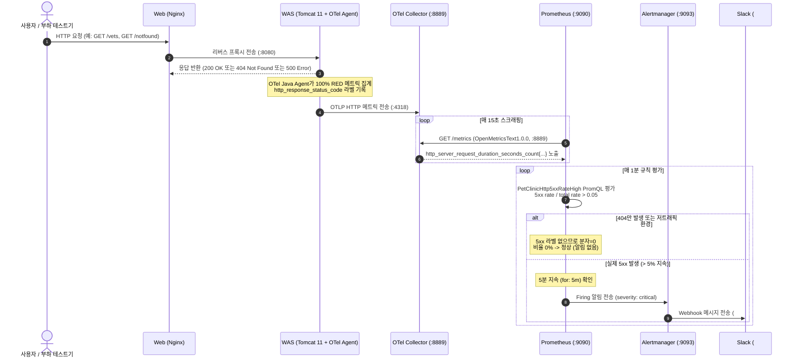

# PetClinic WAS 5xx 에러율 경보 정확도 개선 (`alert-5xx-accuracy`) 설계서

> 문서 위치: `docs/features/alert-5xx-accuracy/design.md`  
> 대상 시스템: EKS v1.36, PetClinic WAS (`was-stable`, `was-canary`), OpenTelemetry RED 메트릭, PrometheusRule, Alertmanager, Slack 알림

---

## 1. 목표와 범위 (하지 않을 것 포함)

### 1.1 배경 및 문제 정의 (Background & Problem)
- **현상 (2026-10-27 09:46:23 발생 현황)**:
  - 2026-10-27 아침 기동(`daily-start.sh --start-nat`) 직후, `PetClinicHttp5xxRateHigh` (critical) 알림이 발생 대기(`pending`) 상태로 진입하였다.
  - 당시 실제 웹 서버(`web`) 접근 로그 상 HTTP 5xx 에러는 **0건**이었으며, 기동 직후 상태 점검 목적으로 수행된 3건의 의도된 404 요청(`/vets.html`, `/actuator/health`)만 존재했다.
  - 기동 직후 트래픽이 적어(약 0.15 req/s, 총 요청 10~13건) 404 요청 3건만으로 에러율이 **23~31%** 로 치솟았고, `for: 5m` 대기 시간 동안 해소되지 않았다면 Slack 채널(`#aws-alert`)로 잘못된 `critical` 경보가 발송될 위험이 있었다.
- **근본 원인 분석 (Root Cause)**:
  - **Tomcat MBean의 4xx/5xx 미구분 집계**:
    - 현재 `k8s/monitoring/prometheusrule-petclinic.yaml`의 `PetClinicHttp5xxRateHigh` 알림 규칙은 Tomcat JMX Exporter 메트릭(`tomcat_errorcount_total`)을 사용하고 있다.
    - Tomcat의 `GlobalRequestProcessor.errorCount`는 HTTP 상태 코드 **400 이상(4xx 클라이언트 오류 + 5xx 서버 오류)을 전부 에러로 합산**한다.
    - 주석(`k8s/monitoring/prometheusrule-petclinic.yaml:32-33`)에도 `Tomcat errorCount counts every status >= 400, so 4xx are included. Switch to a 5xx-only series ... if 4xx noise pages people.` 라고 기록되어 있었으나 교체되지 않고 남아 있었다.
  - **저트래픽 환경에서의 분모 왜곡**:
    - 트래픽이 적은 기동 직후나 한산한 시간대에는 분모(총 요청 수)가 매우 작아 클라이언트 측 오타나 봇의 404 스캔 몇 건만으로 5% 임계치를 가볍게 초과한다.
- **개선 필요성**:
  - 오늘 예정된 워크로드 과부하 테스트(오토스케일링 및 AZ 장애 시험) 전에 4xx 노이즈와 저트래픽 환경의 오경보를 원천 차단하고, 실제 WAS 5xx 서버 장애에만 즉각 반응하도록 경보 규칙을 고도화해야 한다.

### 1.2 핵심 목표 (Goals)
1. **순수 5xx 전용 메트릭 전환을 통한 4xx 노이즈 원천 차단**:
   - `apm-tracing` 기능을 통해 이미 프로비저닝된 OpenTelemetry RED 메트릭인 `http_server_request_duration_seconds_count`를 활용한다.
   - 레이블 `http_response_status_code=~"5.."` 정규식을 적용하여 4xx(404, 400 등) 클라이언트 요청이 분자(에러 수)에 유입되는 것을 100% 차단한다.
2. **Grafana APM 대시보드와의 지표 일관성 확보**:
   - 운영자가 대시보드(`k8s/monitoring/dashboard-apm-tracing.yaml`의 "5xx error rate by version")에서 보는 PromQL 수식과 Alertmanager 경보 수식을 통일하여 관측성 불일치를 방지한다.
3. **저트래픽 및 일시적 스파이크 오경보 방지 메커니즘 검증**:
   - `for: 5m` 지속 평가 윈도우와 PromQL 비율 평가 특성을 활용하여 저트래픽 환경에서의 단발성 요청이나 404 요청으로 인한 경보 오작동을 방지한다.
4. **promtool 단위 테스트 확충을 통한 회귀 방지**:
   - `tests/monitoring/petclinic-rules.test.yaml`에 기존 DB 백업 실패 테스트 외에 다음 3가지 핵심 시나리오를 추가하고 `./scripts/test-prometheus-rules.sh`로 100% 오프라인 검증한다:
     1) **4xx만 존재할 때 (4xx only)**: 404 비율이 30% 이상이어도 5xx가 없으므로 알림 미발생.
     2) **저트래픽 환경 (low traffic)**: 2026-10-27 아침 실상황(0.15 req/s, 404 3건)을 재현하여 알림 미발생.
     3) **실제 5xx 발생 환경 (actual 5xx)**: 500 에러 비율이 10%(> 5%)로 5분 이상 지속될 때 critical 경보 발생, 에러 해소 시 자동 해제.

### 1.3 기존 아키텍처 대비 변경 사항 및 설계 결정 근거

#### (1) 메트릭 소스 결정: Tomcat JMX Exporter vs OpenTelemetry RED 메트릭
- **기존 방식**: `tomcat_errorcount_total{namespace="petclinic", port="8080"}`
  - 한계: Tomcat JMX 사양 상 4xx와 5xx를 분리할 수 없음.
- **채택 방식**: OpenTelemetry Collector가 스크래핑하여 노출하는 `http_server_request_duration_seconds_count`
  - 근거:
    1. OpenTelemetry Java Agent(`autoinstrumentation-java:2.12.0`)가 서블릿 필터 레벨에서 HTTP 상태 코드를 전수(100%) 계측하며, `http_response_status_code` 라벨(예: `200`, `404`, `500`)을 정확히 부여한다.
    2. OpenTelemetry Collector(`:8889`)는 `prometheus` exporter를 통해 Prometheus에 OpenMetrics 형식으로 메트릭을 노출하고 있으며, `k8s/monitoring/servicemonitor-petclinic.yaml`을 통해 15초마다 이미 정상 수집 중이다.
    3. `service_name="petclinic-was"` 라벨을 통해 WAS 티어 전체 요청을 정확히 필터링할 수 있다.

#### (2) PromQL 수식 설계 결정: 순수 5xx 비율 vs 최소 요청수 가드(`and sum(rate) > N`)
- **수식 비교 검토**:
  - **대안 A (순수 5xx 비율 채택)**:
    ```promql
    sum(rate(http_server_request_duration_seconds_count{service_name="petclinic-was", http_response_status_code=~"5.."}[5m]))
      / sum(rate(http_server_request_duration_seconds_count{service_name="petclinic-was"}[5m])) > 0.05
    ```
  - **대안 B (최소 트래픽 가드 결합)**:
    ```promql
    (
      sum(rate(http_server_request_duration_seconds_count{service_name="petclinic-was", http_response_status_code=~"5.."}[5m]))
        / sum(rate(http_server_request_duration_seconds_count{service_name="petclinic-was"}[5m])) > 0.05
    )
    and
    (
      sum(rate(http_server_request_duration_seconds_count{service_name="petclinic-was"}[5m])) >= 1
    )
    ```
- **결정 및 근거: 대안 A (순수 5xx 비율) 채택**:
  1. **2026-10-27 아침 장애의 본질 해결**: 아침 장애는 트래픽이 적어서 울린 것이 아니라, **"404 요청 3건이 5xx로 오인 집계"**되었기 때문에 발생했다. 5xx 전용 지표를 사용하면 404가 아무리 많아도 분자가 0이 되므로 비율은 0%이며 알림이 절대 발생하지 않는다.
  2. **야간/한산 시간대 실제 5xx 장애 탐지 보장**: 대안 B의 `>= 1 req/s` 조건을 걸 경우, 새벽 시간대(트래픽이 0.1~0.5 req/s인 상태)에서 WAS가 DB 연결 장애 등으로 100% 500 에러를 뿜어도 경보가 울리지 않는 치명적인 사각지대가 발생한다.
  3. **`for: 5m` 지속 평가 필터의 효과**: 단발성 500 에러 1건이 발생하더라도 `rate(...[5m])` 윈도우와 `for: 5m` 평가 조건에 의해 5분 이상 에러가 연속 유입되지 않으면 경보가 울리지 않는다.
  4. **Grafana APM 대시보드와의 1:1 수식 일치**: 대시보드의 에러율 패널과 일치하여 혼선을 방지한다.

### 1.4 범위 (In-Scope)
- `k8s/monitoring/prometheusrule-petclinic.yaml`의 `PetClinicHttp5xxRateHigh` 알림 규칙 수식, 주석 및 요약(annotation) 갱신
- `tests/monitoring/petclinic-rules.test.yaml`에 4xx 노이즈, 저트래픽, 실제 5xx 발생 시나리오 단위 테스트 케이스 추가
- `scripts/test-prometheus-rules.sh`를 통한 오프라인 단위 테스트 검증
- `scripts/validate-manifests.sh` 전체 정적 검증 수행

### 1.5 하지 않을 것 (Out-of-Scope / Non-Goals)
- **애플리케이션 소스 코드 및 컨테이너 이미지 수정 제외**: Java/Tomcat 소스 코드나 Dockerfile 수정 없음.
- **OpenTelemetry Agent / Collector 설정 변경 제외**: 이미 `http_response_status_code` 라벨이 정상 수집되고 있으므로 기존 관측 인프라 설정을 변경하지 않음.
- **KEDA ScaledObject 쿼리 변경 제외**: KEDA는 지속적으로 `tomcat_requestcount_total`을 사용하여 트래픽 기반 스케일링을 수행하므로 이번 작업과 무관함.
- **Alertmanager 라우팅 및 Slack Webhook 설정 변경 제외**: 기존 `severity: critical` 라우팅 및 Slack 채널 연동 유지.
- **설계 단계에서의 클러스터 실자원 직접 변경 제외**: 본 설계서는 검토 및 리뷰 후 구현 단계에서 순차 적용.

---

## 2. 구성 요소와 디렉터리 구조 (기존 구조 대비 추가·변경되는 부분 표시)

### 2.1 구성 요소 매핑 및 변경점

| 구성 요소 | 위치 / 매니페스트 | 변경 구분 | 주요 내용 |
|---|---|---|---|
| **PrometheusRule** | `k8s/monitoring/prometheusrule-petclinic.yaml` | `[MOD]` | `PetClinicHttp5xxRateHigh` 수식을 OTel `http_server_request_duration_seconds_count` 5xx 필터링으로 교체, annotation 보완 |
| **promtool Tests** | `tests/monitoring/petclinic-rules.test.yaml` | `[MOD]` | 4xx 전용, 저트래픽(10-27 재현), 실제 5xx 발화/해제 테스트 케이스 3종 추가 |
| **Validation Script** | `scripts/validate-manifests.sh` | `[SAME]` | 기존 매니페스트 문법 및 정적 규칙 검증 (필요 시 promtool 검증 연계 검토) |
| **APM Dashboard** | `k8s/monitoring/dashboard-apm-tracing.yaml` | `[SAME]` | 이미 OTel 5xx 수식을 사용 중이므로 PrometheusRule과 동기화 완료 상태 |
| **설계 문서** | `docs/features/alert-5xx-accuracy/design.md` | `[NEW]` | 본 기능 설계서 |
| **코드 리뷰 문서** | `docs/features/alert-5xx-accuracy/review.md` | `[NEW]` | Codex 코드 리뷰 산출물 (추후 생성) |
| **보안 점검 문서** | `docs/features/alert-5xx-accuracy/security.md` | `[NEW]` | Antigravity 보안 점검 산출물 (추후 생성) |

### 2.2 디렉터리 구조

```text
.
├── docs/
│   ├── architecture.md                          # 시스템 전체 아키텍처 (기존 유지)
│   └── features/
│       └── alert-5xx-accuracy/                  # [NEW] 신규 기능 디렉터리
│           ├── design.md                        # [NEW] 본 설계서 (Antigravity)
│           ├── review.md                        # [NEW] 코드 리뷰 기록 (Codex, 추후 작성)
│           └── security.md                      # [NEW] 보안 점검 기록 (Antigravity, 추후 작성)
├── k8s/
│   └── monitoring/
│       ├── prometheusrule-petclinic.yaml        # [MOD] PetClinicHttp5xxRateHigh 규칙 수정
│       ├── dashboard-apm-tracing.yaml           # [SAME] APM 대시보드 (동일 수식 참조)
│       └── servicemonitor-petclinic.yaml        # [SAME] OTel Collector 스크래핑 설정
├── tests/
│   └── monitoring/
│       └── petclinic-rules.test.yaml            # [MOD] promtool 5xx 단위 테스트 3종 추가
└── scripts/
    ├── test-prometheus-rules.sh                 # [SAME] promtool 오프라인 테스트 실행기
    └── validate-manifests.sh                    # [SAME] 정적 매니페스트 검증기
```

---

## 3. 데이터 흐름 / API 또는 인터페이스

### 3.1 메트릭 수집 및 경보 평가 파이프라인

다음 다이어그램은 클라이언트 요청 발생부터 OTel Java Agent 계측, Prometheus 수집, PromQL 평가, 그리고 Alertmanager 발송까지의 흐름을 보여준다.



### 3.2 PromQL 지표 및 수식 상세 비교

#### 기존 수식 (JMX 기반)
```promql
sum(rate(tomcat_errorcount_total{namespace="petclinic", port="8080"}[5m]))
  / sum(rate(tomcat_requestcount_total{namespace="petclinic", port="8080"}[5m])) > 0.05
```
- **문제점**: `tomcat_errorcount_total`은 HTTP 상태 코드가 400 이상인 모든 요청(404, 400, 403 등)을 카운트한다. 따라서 정상적인 비즈니스 404 응답이나 잘못된 URL 요청이 유입되면 5xx 에러율이 급증하는 치명적인 오판이 발생한다.

#### 변경 수식 (OpenTelemetry RED 메트릭 기반)
```promql
sum(rate(http_server_request_duration_seconds_count{service_name="petclinic-was", http_response_status_code=~"5.."}[5m]))
  / sum(rate(http_server_request_duration_seconds_count{service_name="petclinic-was"}[5m])) > 0.05
```
- **개선점**:
  1. **분자**: `http_response_status_code=~"5.."` 필터로 오직 HTTP 500, 502, 503, 504 등 순수 서버 에러만 정확히 추출한다. 404 등 클라이언트 요청은 분자에 일체 포함되지 않는다.
  2. **분모**: `service_name="petclinic-was"` 필터로 `was-stable` 및 `was-canary`의 전체 HTTP 요청량을 전수(100%) 합산한다.
  3. **비율 계산**: `rate(...[5m])`을 적용하여 최근 5분간의 초당 평균 요청량 기준 5% 초과 여부를 평가한다.
  4. **무트래픽 안전성**: 요청이 전혀 없을 경우 분모가 0이 되어 PromQL은 NaN을 반환하므로 알림이 발화하지 않는다.
  5. **4xx 전용 안전성**: 4xx만 있고 5xx가 없을 경우 `http_response_status_code=~"5.."` 시계열이 아예 존재하지 않거나 rate가 0이 되므로 분자가 0/비어 있어 알림이 절대 발화하지 않는다.

### 3.3 Alert 임계치 및 속성 정의

```yaml
        - alert: PetClinicHttp5xxRateHigh
          expr: |
            sum(rate(http_server_request_duration_seconds_count{service_name="petclinic-was", http_response_status_code=~"5.."}[5m]))
              / sum(rate(http_server_request_duration_seconds_count{service_name="petclinic-was"}[5m])) > 0.05
          for: 5m
          labels: { severity: critical }
          annotations:
            summary: "petclinic WAS 5xx error responses above 5% for 5m"
```

- **`for: 5m`**: 조건이 충족되더라도 최소 5분간 지속되어야 Firing으로 전환된다. 단발성 네트워크 글리치나 순간적인 500 에러 1~2건으로 인한 플래핑(flapping)을 방지한다.
- **`severity: critical`**: 5분 이상 5% 이상의 5xx 장애가 지속되는 것은 심각한 서비스 장애이므로 기존 심각도를 유지하여 Slack 긴급 알림으로 전달한다.
- **`annotations.summary`**: "error responses"에서 "5xx error responses"로 명확히 수정하여 수신자가 즉각 5xx 서버 장애임을 인지할 수 있게 한다.

### 3.4 promtool 단위 테스트 시나리오 설계

`tests/monitoring/petclinic-rules.test.yaml`에 추가할 3가지 핵심 테스트 케이스:

#### 시나리오 1: 4xx만 발생할 때 (4xx Only)
- **가정**: 분당 70건의 200 정상 요청과 30건의 404 요청이 지속 발생 (4xx 비율 30%).
- **기존 규칙 동작**: `tomcat_errorcount_total`이 30%로 계산되어 critical 알림 발화 (오경보).
- **신규 규칙 동작**: 5xx 시계열이 없으므로 분자가 0. 5분, 10분 평가 시점 모두 `exp_alerts: []` 통과.

#### 시나리오 2: 저트래픽 환경 (Low Traffic — 2026-10-27 재현)
- **가정**: 2026-10-27 아침 상황 재현. 분당 7건의 200 요청과 3건의 404 요청 발생 (총 0.17 req/s의 극소 트래픽, 404 비율 30%).
- **기존 규칙 동작**: 404 3건만으로 에러율 30%가 되어 `pending` 상태 돌입.
- **신규 규칙 동작**: 5xx 시계열이 없으므로 분자가 0. 5분, 10분 평가 시점 모두 `exp_alerts: []` 통과.

#### 시나리오 3: 실제 5xx 장애 발생 환경 (Actual 5xx)
- **가정**: 분당 90건의 200 요청과 10건의 500 에러 요청이 발생 (5xx 비율 10% > 5%). 10분 시점에 500 에러 종료(100건에서 동결).
- **신규 규칙 동작**:
  - `eval_time: 5m`: `for: 5m` 대기 상태(`pending`)이므로 아직 Firing 되지 않음 (`exp_alerts: []`).
  - `eval_time: 6m`: 5분 지속 충족으로 `severity: critical` Firing 알림 발생 (`PetClinicHttp5xxRateHigh`).
  - `eval_time: 10m`: 장애 지속 중이므로 지속 Firing.
  - `eval_time: 16m`: 10분에 500 에러가 멈춘 후 5분 경과하여 5xx rate가 0%로 떨어지며 알림 자동 해제 (`exp_alerts: []`).

---

## 4. 실행 환경 (런타임 버전, 컨테이너/클라우드 리소스, 환경변수 목록)

### 4.1 런타임 및 도구 버전
- **Kubernetes**: Amazon EKS v1.36 (`ap-northeast-2`)
- **Prometheus Operator / Stack**: `kube-prometheus-stack` v92.11.0 (Prometheus v2.55.x 이상)
- **OpenTelemetry Java Agent**: `ghcr.io/open-telemetry/opentelemetry-operator/autoinstrumentation-java:2.12.0`
- **OpenTelemetry Collector**: `otel/opentelemetry-collector-contrib:0.120.0`
- **promtool**: Prometheus 룰 검증 및 단위 테스트 CLI 도구
- **Python**: Python 3.11+ 및 PyYAML (`scripts/test-prometheus-rules.sh` 실행용)
- **Bash**: 4.x / 5.x

### 4.2 컨테이너 및 클라우드 리소스
- **EKS 네임스페이스**:
  - `monitoring`: `PrometheusRule` (`petclinic`), Prometheus, Alertmanager, OTel Collector 배치
  - `petclinic`: WAS 애플리케이션 (`was-stable`, `was-canary`) 배치
- **노드 티어**:
  - `ng-platform`: Prometheus, Alertmanager, OTel Collector (Taint: `node-role=platform:NoSchedule`)
  - `np-app`: `was-stable`, `was-canary` (Karpenter On-Demand / Spot 노드풀)
- **K8s Custom Resource**:
  - `PrometheusRule` (`monitoring.coreos.com/v1`)
  - `ServiceMonitor` (`monitoring.coreos.com/v1`)

### 4.3 환경변수 목록 (값 미포함)
본 기능은 기존 쿠버네티스 리소스 매니페스트(`PrometheusRule`) 및 테스트 파일 수정 작업이므로 신규 환경변수를 추가하지 않는다. 배포 및 검증 시 참조되는 기존 환경변수 목록은 다음과 같다:
- `AWS_REGION`
- `EKS_CLUSTER_NAME`
- `ALERTMANAGER_WEBHOOK_URL` (AWS Secrets Manager 보관)

---

## 5. 보안 요구사항 (인증, 권한 최소화, 시크릿 관리 방식)

### 5.1 인증 및 접근 제어
- **K8s RBAC 최소 권한**:
  - `PrometheusRule` 리소스는 클러스터 관리자 또는 배포 파이프라인 ServiceAccount만 수정/적용할 수 있으며 일반 사용자나 파드 내부에서는 수정할 수 없다.
- **네트워크 격리 (NetworkPolicy)**:
  - Prometheus가 OTel Collector의 `:8889` 포트에서 메트릭을 스크래핑하는 경로는 `monitoring` 네임스페이스 내부 통신이며 기존 `networkpolicy-tracing.yaml` 및 `networkpolicy-prometheus.yaml`에 의해 안전하게 허용된다.
  - 외부로 노출되는 경로는 없으며, Alertmanager에서 Slack Webhook 호출 시에만 HTTPS `:443` 아웃바운드가 허용된다.

### 5.2 시크릿 관리 방식
- **공개 저장소 노출 방지**:
  - `PrometheusRule` 매니페스트 및 테스트 파일 내에 평문 시크릿, 계정 ID, ARN, 사설 도메인 실값이 일체 포함되지 않는다.
  - Slack Webhook URL은 AWS Secrets Manager에 보관되고 External Secrets Operator(`externalsecret-alertmanager.yaml`)를 통해 동기화된 파일(`api_url_file`)로만 읽힌다.

### 5.3 데이터 정밀도 및 DoS 방지
- OpenTelemetry Collector의 `memory_limiter`와 `batch` 프로세서가 활성화되어 있어 대량의 5xx 에러 메트릭이 유입되더라도 수집기나 Prometheus 메모리 고갈을 유발하지 않는다.
- `http_response_status_code` 라벨의 카디널리티는 표준 HTTP 상태 코드 수(수십 개 미만)로 제한되므로 라벨 폭발 위험이 없다.

---

## 6. 구현 단계 체크리스트 (Claude가 순서대로 따라갈 수 있게)

Claude는 본 체크리스트를 순서대로 진행하여 변경 사항을 적용하고 검증한다.

- [ ] **Step 1: 알림 규칙 매니페스트 수정**
  - 파일: `k8s/monitoring/prometheusrule-petclinic.yaml`
  - 내용: `PetClinicHttp5xxRateHigh` 규칙의 `expr`, 주석, `summary` 어노테이션을 §3.3 설계 내용대로 수정.
- [ ] **Step 2: promtool 단위 테스트 시나리오 추가**
  - 파일: `tests/monitoring/petclinic-rules.test.yaml`
  - 내용: 기존 DB 백업 테스트 아래에 §3.4의 3가지 시나리오(4xx only, low traffic, actual 5xx) 추가.
- [ ] **Step 3: 오프라인 단위 테스트 검증**
  - 명령: `./scripts/test-prometheus-rules.sh` 실행
  - 확인: `Checking rules.yaml SUCCESS: 3 rules found`, `promtool test rules SUCCESS` 확인.
- [ ] **Step 4: 전체 매니페스트 정적 검증**
  - 명령: `./scripts/validate-manifests.sh` 실행
  - 확인: 모든 YAML 문법, 이미지 태그, 시크릿 검사 exit code 0 확인.
- [ ] **Step 5: 변경 사항 커밋 및 Codex 코드 리뷰 요청**
  - 명령: `git commit -m "fix(monitoring): use otel 5xx metric for petclinic error rate alert"`
  - 산출물: `docs/features/alert-5xx-accuracy/review.md` (Codex 리뷰 대기)
- [ ] **Step 6: Codex 리뷰 지적 사항 반영 및 수정 커밋** (필요 시)
- [ ] **Step 7 [위험]: 클러스터에 변경된 PrometheusRule 적용**
  - 명령: `kubectl apply -f k8s/monitoring/prometheusrule-petclinic.yaml` (또는 `scripts/deploy-all.sh`)
  - 주의: 클러스터 실제 리소스 변경이므로 적용 전 컨펌 필요.
- [ ] **Step 8 [위험]: Prometheus 런타임 규칙 로드 확인**
  - 명령:
    ```bash
    kubectl -n monitoring port-forward svc/kube-prometheus-stack-prometheus 19090:9090 &
    curl -s http://localhost:19090/api/v1/rules | jq '.data.groups[] | select(.name=="petclinic")'
    kill %1
    ```
  - 확인: `PetClinicHttp5xxRateHigh`의 쿼리가 `http_server_request_duration_seconds_count`로 정상 로드되었는지 확인.
- [ ] **Step 9 [위험]: 404 요청 시 오경보 방지 런타임 검증**
  - 명령:
    ```bash
    curl -s -o /dev/null -w "%{http_code}\n" https://${DOMAIN_NAME}/invalid-test-path
    ```
  - 확인: Prometheus `/api/v1/alerts`에서 `PetClinicHttp5xxRateHigh`가 `pending` 상태로 진입하지 않고 `inactive` 유지되는지 확인.

---

## 7. 구현 중 질문
