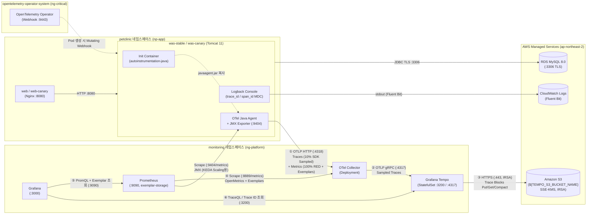

# OpenTelemetry + Grafana Tempo 기반 APM 분산 트레이싱 설계서 (`docs/features/apm-tracing/design.md`)

## 1. 목표와 범위 (하지 않을 것 포함)

### 1.1 목표 (Goals)
기존 모니터링 스택(`Prometheus` · `Grafana` · `Alertmanager`, `ng-platform` 노드 그룹)과 로깅 파이프라인(`Fluent Bit` → `CloudWatch Logs`) 위에 **OpenTelemetry(Operator · Java Agent · Collector) + Grafana Tempo** 기반의 분산 트레이싱(APM) 파이프라인을 추가하여 **메트릭(Metrics) · 로그(Logs) · 트레이스(Traces) 3축 관측성(Observability)** 을 완성한다.

- **핵심 달성 목표**:
  1. **무코드·무재빌드 Java 자동 계측 (Zero-Code Instrumentation via Init Container)**:
     - ECR 레지스트리가 `IMMUTABLE` 태그 정책으로 운영되므로 애플리케이션 소스 코드나 컨테이너 이미지를 재빌드하지 않고, `ng-critical`에 설치된 **OpenTelemetry Operator**와 `Instrumentation` CR(`instrumentation.opentelemetry.io/inject-java`)을 통해 `was-stable` 및 `was-canary` Pod 기동 시 init container 방식으로 OpenTelemetry Java Agent를 주입한다.
     - 리소스 속성(`service.name=petclinic-was`, `service.version=stable|canary`, `deployment.environment`)을 부여하여 카나리 배포 시 버전별 트레이스·지연을 분리 조회하고, SLF4J/Logback MDC 연동(`trace_id`, `span_id`, `trace_flags`) 및 런타임 `logback.configurationFile` ConfigMap 마운트를 통해 이미지 재빌드 없이 컨테이너 표준 출력 로그에 `trace_id` / `span_id`가 기록되게 한다.
  2. **SDK 헤드 샘플링(10%)과 전수(100%) RED 메트릭·Exemplar의 정합성 확보**:
     - 트레이스 헤드 샘플링은 Collector가 아닌 **SDK(`Instrumentation` CR `sampler: parentbased_traceidratio`, 기본 비율 `0.1`, 환경변수 `${OTEL_TRACES_SAMPLER_ARG}`로 분리)** 에서 수행한다.
     - 서비스·버전(`stable`/`canary`)별 요청량(Rate), 에러율(Error), `p95`/`p99` 지연 시간(Duration) 등 **RED 메트릭은 샘플링 비율과 무관하게 100% 전수 집계되는 Java Agent의 OTLP 메트릭(`http.server.request.duration` 등)** 을 사용한다.
     - Java Agent의 기본 Exemplar 필터(`trace_based`)를 통해 **실제 샘플링되어 Tempo에 저장된 트레이스(10%)에만 Exemplar(`trace_id`)가 부착**되게 하고, 이를 OpenTelemetry Collector의 Prometheus Exporter(`enable_open_metrics: true`, `:8889`)로 노출하여 Prometheus(`--enable-feature=exemplar-storage`)가 스크래핑하도록 구성한다.
  3. **Grafana Tempo + S3(IRSA) 장기 보관 및 Grafana 통합**:
     - `ng-platform` 노드 그룹에 **Grafana Tempo**(`:3200` 쿼리, `:4317`/`:4318` OTLP 수신)를 배치하고, 정적 AWS 액세스 키 없이 **IRSA(IAM Roles for Service Accounts)** 만으로 전용 S3 버킷(`${TEMPO_S3_BUCKET_NAME}`, `SSE-KMS` 암호화, 퍼블릭 액세스 완전 차단, 보존 기간 Lifecycle 규칙 적용)에 트레이스 블록을 적재한다.
     - Grafana에 Tempo 데이터소스(`uid: tempo`)와 Prometheus 데이터소스의 `exemplarTraceIdDestinations` 연결을 코드(Helm values 프로비저닝)로 구성하고, `stable` / `canary` 버전별 요청량·에러율·`p95`/`p99` 지연 및 Exemplar 점프가 가능한 APM 대시보드 1종을 추가한다.
  4. **네트워크 최소 권한 격리 및 WAS 리소스 안정성 유지**:
     - 기존 `default-deny-all` 기반 NetworkPolicy 체계를 유지하면서 필수 통신 경로(`was` → `otel-collector` `:4317`/`:4318`, `otel-collector` → `tempo` `:4317`, `grafana` → `tempo` `:3200`, `prometheus` → `otel-collector` `:8889`, `tempo` → S3/STS `:443`, Operator Webhook `:9443`)만 최소한으로 개방한다.
     - 듀얼 Java Agent(기존 JMX Exporter + 신규 OTel Java Agent) 주입에 따른 JVM 힙 외 메모리(Metaspace/CodeCache/버퍼) 증가와 클래스 변환 기동 지연을 반영하여 `was-stable` / `was-canary`의 메모리 Requests/Limits 및 Probe 설정을 조정하고, KEDA 오토스케일링(`tomcat_requestcount_total`) 및 Karpenter 노드 스케줄링에 부작용이 없음을 보장한다.

### 1.2 기존 아키텍처 대비 변경 사항 및 설계 결정 근거

#### (1) S3 버킷 구성 결정: 기존 DB 백업 버킷 공유(Prefix 분리) 대신 **전용 S3 버킷(`${TEMPO_S3_BUCKET_NAME}`) 분리 채택**
- **결정**: 기존 `BACKUP_S3_BUCKET_NAME`(`db-backup` CronJob 전용)에 prefix를 두어 공유하지 않고, Tempo 트레이스 전용 S3 버킷(`${TEMPO_S3_BUCKET_NAME}`)을 별도로 생성한다.
- **근거**:
  1. **IAM 최소 권한 원칙(Least Privilege) 준수**: 기존 `db-backup` IAM 정책(`infra/aws/iam-policies/db-backup-policy.json`)은 백업 파일 덮어쓰기·삭제 방지를 위해 `s3:PutObject`만 허용하고 `s3:GetObject`, `s3:DeleteObject`, `s3:ListBucket`을 부여하지 않는다. 반면 Grafana Tempo(Ingester · Querier · Compactor)는 블록 조회·병합·만료 정리를 위해 버킷 수준의 `s3:ListBucket`과 객체 수준의 `s3:PutObject`, `s3:GetObject`, `s3:DeleteObject`, `s3:GetObjectTagging`, `s3:PutObjectTagging` 권한이 모두 필요하다. 버킷을 공유하면 버킷 수준 액션(`s3:ListBucket`)과 실수·침해 시의 폭발 반경(Blast Radius)이 핵심 RDB 백업 자산과 겹치게 된다.
  2. **수명 주기(Lifecycle) 및 버전 관리(Versioning) 정책 차이**: DB 백업 버킷은 실수로 인한 덮어쓰기 복구를 위해 S3 Versioning(`Status=Enabled`)을 켜 두었지만, Tempo는 수분 단위로 대량의 블록 객체를 생성하고 Compactor가 주기적으로 이전 블록을 삭제(`DeleteObject`)하는 구조다. Versioning이 켜진 버킷에 Tempo 블록을 저장하면 삭제된 블록이 모두 Noncurrent Version으로 쌓여 S3 스토리지 비용이 급증한다. 전용 버킷으로 분리하면 Versioning 없이 깔끔한 만료 Lifecycle 규칙(기본 14일 영구 삭제 + 미완료 멀티파트 업로드 1일 후 중단)을 적용할 수 있다.

#### (2) 샘플링 · RED 메트릭 · Exemplar 아키텍처 결정 (계획 컨펌 확정 사항 C 반영)
- **채택 방식**:
  - **SDK 헤드 샘플링**: `Instrumentation` CR의 `sampler.type: parentbased_traceidratio`, `sampler.argument: "${OTEL_TRACES_SAMPLER_ARG}"`(기본값 `"0.1"`, 즉 10%)로 설정하여 `was`의 OTel Java Agent(SDK) 단계에서 10% 헤드 샘플링을 수행한다.
  - **Collector 파이프라인**: Collector(`otel-collector`)는 이미 10%로 샘플링된 트레이스를 수신하므로 `memory_limiter` → `batch` 프로세서만 거쳐 Tempo로 전송한다.
  - **100% RED 메트릭 + Trace-based Exemplar**: Java Agent가 기본 생성하는 OTLP HTTP 서버 메트릭(`http.server.request.duration` → Prometheus 변환 시 `http_server_request_duration_seconds_{bucket,sum,count}`)은 트레이스 샘플링 비율과 무관하게 **모든 요청(100%)을 대상으로 정확하게 집계**된다. 동시에 Java Agent의 기본 Exemplar 필터(`OTEL_METRICS_EXEMPLAR_FILTER=trace_based`)가 **샘플링된(`sampled=true`) 요청에 한해서만 히스토그램 버킷에 `trace_id` / `span_id` Exemplar를 기록**한다.
  - **Prometheus OpenMetrics 스크래핑**: Collector의 `prometheus` exporter(`:8889`, `enable_open_metrics: true`, `resource_to_telemetry_conversion.enabled: true`)를 Prometheus(`enableFeatures: ["exemplar-storage"]`)가 `OpenMetricsText1.0.0` 프로토콜로 스크래핑한다.
- **기각한 대안 및 근거**:
  1. **Collector `spanmetrics` 커넥터 + Collector `probabilistic_sampler` 방식 기각**:
     - Collector에서 `spanmetrics` 커넥터로 메트릭과 Exemplar를 먼저 만든 뒤 `probabilistic_sampler`(10%)로 트레이스를 드롭하면, `spanmetrics`가 부착한 Exemplar `trace_id`의 **약 90%가 샘플링에서 탈락해 Tempo에 존재하지 않는 트레이스(Dead Link, Grafana 클릭 시 404 Not Found)** 를 가리키게 된다. 반대로 샘플러를 `spanmetrics` 앞에 두면 RED 메트릭 자체가 10% 표본에서만 집계되어 카나리 트래픽(전체 트래픽의 10% × 샘플링 10% = 1%)의 에러율·지연 시간 통계가 왜곡된다. 또한 미샘플링 90% 스팬까지 모두 네트워크로 직렬화·전송해야 하므로 WAS CPU/네트워크 오버헤드가 불필요하게 크다.
  2. **Tempo `metrics-generator` 방식 기각**:
     - Tempo가 수신한 트레이스(10% 샘플)를 기준으로 메트릭을 생성하므로 100% 전수 요청에 대한 정확한 RED 통계가 아니며, Tempo에서 Prometheus로의 역방향 Remote Write 설정(`--web.enable-remote-write-receiver`)과 추가 네트워크 허용 경로(`tempo` → `prometheus:9090`)가 필요해져 Prometheus Ingress 최소 권한 원칙(`networkpolicy-prometheus.yaml`)을 복잡하게 만든다.

### 1.3 범위 (In-Scope)
- `infra/aws/iam-policies/tempo-policy.json` 추가 및 `infra/aws/provision-aws-resources.sh` (`pre-cluster` 단계)에 Tempo 전용 S3 버킷(`${TEMPO_S3_BUCKET_NAME}`) 생성·암호화(`SSE-KMS`)·퍼블릭 차단·보존 기간 Lifecycle 규칙·IAM 정책 생성 추가
- `infra/eksctl/cluster.yaml`에 Tempo 전용 IRSA ServiceAccount(`monitoring/tempo`) 매핑 추가
- `k8s/base/namespace.yaml`에 `opentelemetry-operator-system` 네임스페이스(`pod-security.kubernetes.io/enforce: restricted`) 추가
- OpenTelemetry Operator Helm values(`k8s/tracing/otel-operator-values.yaml`) 및 `Instrumentation` CR + Logback MDC 설정 ConfigMap(`k8s/was/instrumentation.yaml`) 작성
- OpenTelemetry Collector Helm values(`k8s/tracing/otel-collector-values.yaml`), Tempo Helm values(`k8s/tracing/tempo-values.yaml`), Tracing 계층 NetworkPolicy(`k8s/tracing/networkpolicy-tracing.yaml`) 작성
- `k8s/was/deployment-stable.yaml`, `k8s/was/deployment-canary.yaml`에 `instrumentation.opentelemetry.io/inject-java` 어노테이션, 버전별 리소스 속성(`service.version`), Logback MDC ConfigMap 마운트, 리소스(Memory Requests/Limits) 및 Readiness Probe 초기 지연(`initialDelaySeconds`) 조정 반영
- `k8s/base/networkpolicy-petclinic.yaml`에 `was` → `otel-collector`(`:4317`, `:4318`) Egress 허용 규칙 추가
- `k8s/monitoring/kube-prometheus-values.yaml`(Prometheus `exemplar-storage` 활성화, Grafana Tempo 데이터소스 및 Prometheus `exemplarTraceIdDestinations` 프로비저닝), `k8s/monitoring/servicemonitor-petclinic.yaml`(`otel-collector` `:8889` OpenMetrics 스크래핑 추가), `k8s/monitoring/dashboard-apm-tracing.yaml`(서비스·버전별 RED + Exemplar 대시보드 ConfigMap) 작성 및 수정
- `scripts/deploy-all.sh`, `scripts/daily-stop.sh`, `scripts/daily-start.sh`, `scripts/lib.sh`, `.env.example`, `scripts/validate-manifests.sh`, `tests/scripts/daily-stop-start.test.sh`, `README.md` 업데이트

### 1.4 하지 않을 것 (Out-of-Scope / Non-Goals)
- **Grafana Loki 도입 및 CloudWatch Logs 경로 변경 제외**: 기존 `Fluent Bit DaemonSet → CloudWatch Logs` 로그 수집 파이프라인은 그대로 유지한다(로그에는 MDC를 통해 `trace_id`와 `span_id`만 추가 출력).
- **Tail-based Sampling 제외**: 모든 스팬을 메모리에 버퍼링하고 trace_id 기반으로 라우팅해야 하는 Tail 샘플링은 이번 범위에서 제외하고 §8(후속 과제)에만 기록한다.
- **NGINX Gateway Fabric(NGF) 및 `web`(Nginx) 계층 트레이싱 제외**: L7 게이트웨이와 정적 웹 프록시 계층의 OTel 모듈 주입은 이번 범위에서 제외하고 §8(후속 과제)에 기록한다.
- **상용/타사 APM(AWS X-Ray, Datadog, New Relic 등) 도입 제외**: 오픈소스 표준인 OpenTelemetry + Grafana Tempo 조합만 사용한다.
- **컨테이너 이미지(`docker/was/Dockerfile`) 재빌드 및 애플리케이션 Java 소스 수정 제외**: ECR `IMMUTABLE` 제약을 준수하여 이미지 재빌드 없이 K8s 매니페스트와 Operator 주입만으로 구성한다.
- **Terraform 도입 제외 (계획 컨펌 확정 사항 A)**: 본 저장소는 Terraform을 사용하지 않으므로 기존 구조(`infra/aws/provision-aws-resources.sh`, `infra/eksctl/cluster.yaml`, `scripts/deploy-all.sh`)를 그대로 따른다.
- **실제 AWS 클러스터 배포 및 런타임 완료 기준 실행 제외 (계획 컨펌 확정 사항 B)**: 실클러스터가 필요한 검증은 본 작업에서 실행하지 않으며, 대신 §7 "배포 후 검증 테스트 케이스"에 상세 검증 절차와 기대 결과를 명세한다.

---

## 2. 구성 요소와 디렉터리 구조 (기존 구조 대비 추가·변경되는 부분 표시)

### 2.1 추가·변경되는 구성 요소 요약

| 계층 | 구성 요소 | 배치 위치 (네임스페이스 / 노드 티어) | 역할 및 주요 변경 내용 |
|---|---|---|---|
| **Tracing Controller** | **OpenTelemetry Operator** (`opentelemetry-operator` Helm `0.105.0`) | `opentelemetry-operator-system` / `ng-critical` (Taint: `node-role=critical:NoSchedule`) | `Instrumentation` CRD 관리 및 Mutating Admission Webhook(`:9443`, 자체 서명 인증서 자동 생성)을 통한 `was` Pod Java Agent init container 자동 주입 |
| **App Auto-Instrumentation** | **`Instrumentation` CR** (`petclinic-java`) + **Logback ConfigMap** (`petclinic-was-logback`) | `petclinic` / (`was-stable`, `was-canary` Pod에 주입) | `autoinstrumentation-java:2.12.0` init container 주입, SDK 헤드 샘플링(`parentbased_traceidratio`, `${OTEL_TRACES_SAMPLER_ARG}` 기본 `0.1`), OTLP Exporter(`otel-collector.monitoring.svc:4318`), MDC(`trace_id`, `span_id`) 출력 패턴 활성화 |
| **WAS Tier** | **`was-stable`, `was-canary`** (`Deployment`) | `petclinic` / `np-app` (`workload-tier=app`) | `instrumentation.opentelemetry.io/inject-java: "petclinic-java"` 어노테이션, `service.name=petclinic-was`, `service.version=stable\|canary`, `deployment.environment=${OTEL_DEPLOYMENT_ENVIRONMENT}`, 메모리(`1280Mi` req / `2Gi` limit) 및 `readinessProbe.initialDelaySeconds: 20` 상향 |
| **Telemetry Pipeline** | **OpenTelemetry Collector** (`opentelemetry-collector` Helm `0.116.0`, `mode: deployment`) | `monitoring` / `ng-platform` (Taint: `node-role=platform:NoSchedule`) | OTLP 수신(`:4317` gRPC, `:4318` HTTP) → `memory_limiter`, `batch` 처리 → Traces는 Tempo(`:4317`)로 OTLP gRPC 송신, Metrics는 Prometheus Exporter(`:8889`, `enable_open_metrics: true`)로 노출 |
| **Trace Backend** | **Grafana Tempo** (`tempo` Helm `1.24.4`, App `2.9.0`) | `monitoring` / `ng-platform` (Taint: `node-role=platform:NoSchedule`) | 단일 바이너리(Monolithic) 모드, `gp3` `10Gi` 로컬 WAL PVC + **Amazon S3(`${TEMPO_S3_BUCKET_NAME}`)** 백엔드(IRSA `monitoring/tempo` 전용, 정적 키 없음), 쿼리/HTTP API `:3200` 및 OTLP gRPC `:4317` 수신 |
| **Observability UI & Metrics** | **Prometheus & Grafana** (`kube-prometheus-stack` `92.11.0`) | `monitoring` / `ng-platform` (Taint: `node-role=platform:NoSchedule`) | Prometheus `enableFeatures: ["exemplar-storage"]` 및 Collector `:8889` OpenMetrics 스크래핑(`ServiceMonitor`), Grafana Tempo 데이터소스 프로비저닝, Prometheus → Tempo Exemplar 링크, APM 대시보드(`petclinic-apm-tracing`) 자동 마운트 |
| **Cloud Storage & IAM** | **Amazon S3 (`${TEMPO_S3_BUCKET_NAME}`) & IAM Policy (`${EKS_CLUSTER_NAME}-tempo`)** | AWS 관리형 (`ap-northeast-2`) | Tempo 트레이스 블록 전용 S3 버킷(`SSE-KMS`, 퍼블릭 차단, `${TEMPO_RETENTION_DAYS}`일 만료 Lifecycle 규칙) 및 최소 권한 IAM 정책 |

### 2.2 디렉터리 구조 (추가 `[NEW]` · 변경 `[MOD]` 표시)

```text
.
├── .env.example                                       # [MOD] TEMPO_S3_BUCKET_NAME, TEMPO_RETENTION_DAYS, OTEL_TRACES_SAMPLER_ARG, OTEL_DEPLOYMENT_ENVIRONMENT 추가
├── README.md                                          # [MOD] APM 분산 트레이싱(OTel + Tempo) 아키텍처, 포트 및 데이터 흐름 반영
├── docs/
│   ├── architecture.md                                # (변경 없음 — 머지 직전 ⑦ 단계에서 갱신)
│   └── features/
│       └── apm-tracing/
│           └── design.md                              # [NEW] 본 기능 설계서
├── infra/
│   ├── aws/
│   │   ├── provision-aws-resources.sh                 # [MOD] pre-cluster에 tempo IAM 정책 및 Tempo S3 버킷(SSE-KMS, 퍼블릭 차단, Lifecycle) 생성 추가
│   │   └── iam-policies/
│   │       └── tempo-policy.json                      # [NEW] Tempo S3 버킷 전용 최소 권한 IAM 정책 (Put/Get/Delete/List/Tagging)
│   └── eksctl/
│       └── cluster.yaml                               # [MOD] iam.serviceAccounts에 monitoring/tempo (attachPolicyARNs: ${EKS_CLUSTER_NAME}-tempo) 추가
├── k8s/
│   ├── base/
│   │   ├── namespace.yaml                             # [MOD] opentelemetry-operator-system 네임스페이스(PSS restricted) 추가
│   │   └── networkpolicy-petclinic.yaml               # [MOD] was → monitoring/otel-collector (:4317, :4318) Egress 허용 정책 추가
│   ├── was/
│   │   ├── instrumentation.yaml                       # [NEW] Instrumentation CR (petclinic-java) 및 Logback MDC 출력용 ConfigMap (petclinic-was-logback)
│   │   ├── deployment-stable.yaml                     # [MOD] inject-java 어노테이션, service.version=stable, Logback 마운트, 메모리/Probe 조정
│   │   └── deployment-canary.yaml                     # [MOD] inject-java 어노테이션, service.version=canary, Logback 마운트, 메모리/Probe 조정
│   ├── monitoring/
│   │   ├── kube-prometheus-values.yaml                # [MOD] exemplar-storage 활성화, Tempo 데이터소스 및 exemplarTraceIdDestinations 추가
│   │   ├── servicemonitor-petclinic.yaml              # [MOD] otel-collector (:8889, OpenMetricsText1.0.0, enableExemplars: true) ServiceMonitor 추가
│   │   └── dashboard-apm-tracing.yaml                 # [NEW] Grafana 대시보드 ConfigMap (grafana_dashboard: "1" — stable/canary 요청량·에러율·p95/p99·Exemplar)
│   └── tracing/
│       ├── otel-operator-values.yaml                  # [NEW] OpenTelemetry Operator Helm values (ng-critical 배치, 자체 서명 인증서, 리소스/보안 설정)
│       ├── otel-collector-values.yaml                 # [NEW] OpenTelemetry Collector Helm values (ng-platform, Deployment 2 Replicas, OTLP→Tempo/Prometheus)
│       ├── tempo-values.yaml                          # [NEW] Grafana Tempo Helm values (ng-platform, S3 IRSA, :3200/:4317, gp3 10Gi WAL)
│       └── networkpolicy-tracing.yaml                 # [NEW] otel-collector 및 tempo Ingress/Egress NetworkPolicy
├── tests/
│   └── scripts/
│       └── daily-stop-start.test.sh                   # [MOD] daily-start.sh의 opentelemetry-operator 컨트롤러 rollout 확인 스텁 반영
└── scripts/
    ├── lib.sh                                         # [MOD] TEMPLATE_VARS에 신규 환경변수 4종 추가
    ├── deploy-all.sh                                  # [MOD] open-telemetry/grafana Helm repo, Operator/Tempo/Collector 설치 및 CRD/매니페스트 배포 순서 반영
    ├── daily-stop.sh                                  # (필요 시 확인) ng-critical/ng-platform 축소 전 워크로드 중지 흐름 유지
    ├── daily-start.sh                                 # [MOD] 컨트롤러 rollout 대기 목록에 opentelemetry-operator 추가
    └── validate-manifests.sh                          # [MOD] Tracing Helm values 노드 티어, WAS OTel 어노테이션/리소스, S3/IAM 정책 정적 검증 추가
```

---

## 3. 데이터 흐름 / API 또는 인터페이스

### 3.1 분산 트레이싱 · RED 메트릭 · Exemplar · 로그 상관분석 전체 흐름



### 3.2 단계별 상세 인터페이스 및 포트 명세

| 구간 | 출발지 (Source) | 목적지 (Destination) | 프로토콜 / 포트 | 데이터 형식 및 역할 |
|---|---|---|---|---|
| **Webhook 주입** | EKS kube-apiserver | `opentelemetry-operator` (`opentelemetry-operator-system`) | HTTPS `TCP 9443` | `was-stable`/`was-canary` Pod 생성 시 `Instrumentation` CR(`petclinic-java`) 설정에 따라 init container 및 `JAVA_TOOL_OPTIONS` 환경변수 주입 |
| **① OTLP 수집** | `was-stable`, `was-canary` (`petclinic`) | `otel-collector.monitoring.svc.cluster.local` | HTTP `TCP 4318` ( 및 gRPC `TCP 4317` 지원) | **Traces**: SDK에서 `parentbased_traceidratio`(`0.1`)로 샘플링된 HTTP 서블릿·Spring MVC·Hibernate/JDBC 스팬<br>**Metrics**: 100% 전수 집계된 `http.server.request.duration` 히스토그램 + `trace_based` Exemplar(`trace_id`, `span_id`) |
| **② Trace 전달** | `otel-collector` (`monitoring`) | `tempo.monitoring.svc.cluster.local` | gRPC `TCP 4317` | Collector의 `memory_limiter` → `batch`를 통과한 OTLP 트레이스 스팬 전송 |
| **③ S3 적재** | `tempo` (`monitoring`, SA `tempo`) | Amazon S3 (`s3.${AWS_REGION}.amazonaws.com`) & STS | HTTPS `TCP 443` | IRSA(`sts:AssumeRoleWithWebIdentity`)로 발급받은 임시 자격증명으로 `${TEMPO_S3_BUCKET_NAME}`에 트레이스 블록 업로드·조회·컴팩션 |
| **④ Metric 스크래핑** | `prometheus` (`monitoring`) | `otel-collector-opentelemetry-collector.monitoring.svc` | HTTP `TCP 8889` (`/metrics`) | `OpenMetricsText1.0.0` 협상을 통해 `http_server_request_duration_seconds_{bucket,sum,count}` 및 `trace_id` Exemplar 스크래핑 |
| **⑤·⑥ 시각화 및 점프** | `grafana` (`monitoring`) | `prometheus` (`:9090`) 및 `tempo` (`:3200`) | HTTP `TCP 9090` / `TCP 3200` | Prometheus 패널에서 `service_version="stable\|canary"` 별 요청량·에러율·`p95`/`p99` 조회 → 그래프 위 Exemplar 점(Dot) 클릭 시 `trace_id`로 Tempo(`:3200`)의 해당 트레이스 워터폴(HTTP → JDBC)로 즉시 이동 |

### 3.3 컴포넌트별 상세 설정 명세

#### 3.3.1 OpenTelemetry `Instrumentation` CR 및 Logback MDC 연동 (`k8s/was/instrumentation.yaml`)
- **이미지 재빌드 없는 Java Agent 공존 원리**:
  - 기존 `docker/was/setenv.sh`는 `CATALINA_OPTS`에 `-javaagent:/opt/jmx/jmx_prometheus_javaagent.jar=9404:/opt/jmx/config.yaml`을 설정하고, `k8s/was/deployment-*.yaml`은 `JAVA_OPTS`를 설정한다.
  - OpenTelemetry Operator는 컨테이너의 `JAVA_TOOL_OPTIONS` 환경변수에 `-javaagent:/otel-auto-instrumentation-java/javaagent.jar`를 주입한다. JVM은 기동 시 `JAVA_TOOL_OPTIONS`와 `CATALINA_OPTS`/`JAVA_OPTS`의 `-javaagent` 플래그를 **모두 순서대로 로드**하므로, 기존 `:9404` JMX Exporter(KEDA 스케일링 및 `PetClinicHttp5xxRateHigh` 알림용)와 OTel Java Agent가 이미지 수정 없이 완벽히 공존한다.
- **`Instrumentation` CR (`petclinic-java`) 주요 설정**:
  - `spec.exporter.endpoint`: `http://otel-collector-opentelemetry-collector.monitoring.svc.cluster.local:4318` (Java Agent 2.x의 기본 OTLP 프로토콜인 `http/protobuf`와 일치)
  - `spec.propagators`: `[tracecontext, baggage]`
  - `spec.sampler`:
    - `type: parentbased_traceidratio`
    - `argument: "${OTEL_TRACES_SAMPLER_ARG}"` (`.env.example` 기본값 `"0.1"`)
  - `spec.java.image`: `ghcr.io/open-telemetry/opentelemetry-operator/autoinstrumentation-java:2.12.0` (버전 고정, `:latest` 금지)
  - `spec.java.env`:
    - `OTEL_TRACES_EXPORTER=otlp`
    - `OTEL_METRICS_EXPORTER=otlp`
    - `OTEL_LOGS_EXPORTER=none` (범위 밖인 OTLP 로그 파이프라인 전송은 끄고, 기존 stdout → Fluent Bit → CloudWatch Logs 경로를 유지)
    - `OTEL_METRICS_EXEMPLAR_FILTER=trace_based` (샘플링된 트레이스에만 Exemplar 부착)
    - `OTEL_INSTRUMENTATION_LOGBACK_MDC_ENABLED=true`
    - `OTEL_INSTRUMENTATION_JDBC_ENABLED=true`
- **Logback MDC 로그 출력 구성 (`ConfigMap/petclinic-was-logback`)**:
  - 기존 `app/src/main/resources/logback.xml`의 패턴은 `%-5level %logger{0} - %msg%n`으로 `%X{trace_id}`가 없다.
  - 그러나 PetClinic은 Spring Boot가 아닌 순수 Spring Framework 7.x WAR이므로 `LOGGING_PATTERN_LEVEL` 환경변수가 동작하지 않는다.
  - 따라서 ECR 이미지를 재빌드하지 않고 로그에 `trace_id`와 `span_id`를 남기기 위해, `petclinic-was-logback` ConfigMap에 `trace_id=%X{trace_id:-} span_id=%X{span_id:-}`가 포함된 `logback-otel.xml`을 정의하고 `was-stable` / `was-canary` 컨테이너에 읽기 전용으로 마운트(`/etc/petclinic-logging/logback.xml`)한 뒤, `JAVA_OPTS`에 `-Dlogback.configurationFile=/etc/petclinic-logging/logback.xml`을 추가한다.
- **리소스 속성(Resource Attributes) 분리 (`deployment-stable.yaml` / `deployment-canary.yaml`)**:
  - `was-stable` 컨테이너 환경변수:
    - `OTEL_SERVICE_NAME: petclinic-was`
    - `OTEL_RESOURCE_ATTRIBUTES: "service.version=stable,deployment.environment=${OTEL_DEPLOYMENT_ENVIRONMENT}"`
  - `was-canary` 컨테이너 환경변수:
    - `OTEL_SERVICE_NAME: petclinic-was`
    - `OTEL_RESOURCE_ATTRIBUTES: "service.version=canary,deployment.environment=${OTEL_DEPLOYMENT_ENVIRONMENT}"`

#### 3.3.2 OpenTelemetry Collector 설정 (`k8s/tracing/otel-collector-values.yaml`)
- **배치 및 모드**: `monitoring` 네임스페이스, `mode: deployment`, `replicaCount: 2` (Multi-AZ 분산), `ng-platform` (`nodeSelector: { workload-tier: platform }`, Toleration `node-role=platform:NoSchedule`).
- **파이프라인 구성**:
  - **Receivers**:
    - `otlp`: `grpc` (`0.0.0.0:4317`), `http` (`0.0.0.0:4318`)
  - **Processors**:
    - `memory_limiter`: `check_interval: 1s`, `limit_percentage: 75`, `spike_limit_percentage: 15`
    - `batch`: `send_batch_size: 1024`, `timeout: 5s`
  - **Exporters**:
    - `otlp/tempo`: `endpoint: tempo.monitoring.svc.cluster.local:4317`, `tls: { insecure: true }` (클러스터 내부 `ng-platform` 간 통신, NetworkPolicy로 보호)
    - `prometheus`:
      - `endpoint: 0.0.0.0:8889`
      - `enable_open_metrics: true` (Exemplar 직렬화를 위해 필수)
      - `resource_to_telemetry_conversion: { enabled: true }` (OTLP 리소스 속성인 `service.name`, `service.version`, `deployment.environment`를 Prometheus 메트릭 레이블 `service_name`, `service_version`, `deployment_environment`로 변환하여 `stable`/`canary` 그룹핑을 가능하게 함)
  - **Service Pipelines**:
    - `traces`: `receivers: [otlp]` → `processors: [memory_limiter, batch]` → `exporters: [otlp/tempo]`
    - `metrics`: `receivers: [otlp]` → `processors: [memory_limiter, batch]` → `exporters: [prometheus]`

#### 3.3.3 Grafana Tempo 설정 (`k8s/tracing/tempo-values.yaml`)
- **배치 및 계정**: `monitoring` 네임스페이스, `ng-platform` 배치, `serviceAccount.create: false`, `serviceAccount.name: tempo` (eksctl이 IRSA Role과 함께 생성).
- **스토리지 및 보존 설정**:
  - 로컬 WAL(Write-Ahead Log): `persistence.enabled: true`, `storageClassName: gp3`, `size: 10Gi`
  - 백엔드 스토리지:
    ```yaml
    tempo:
      storage:
        trace:
          backend: s3
          s3:
            bucket: ${TEMPO_S3_BUCKET_NAME}
            endpoint: s3.${AWS_REGION}.amazonaws.com
            region: ${AWS_REGION}
            insecure: false
      retention: 336h # 14일 (Compactor 블록 보존 기간, S3 Lifecycle과 정합)
    ```
  - 정적 자격증명(`access_key`, `secret_key`)은 일절 설정하지 않으며, AWS SDK 기본 자격증명 체인이 Pod에 마운트된 IRSA WebIdentity 토큰(`AWS_WEB_IDENTITY_TOKEN_FILE`, `AWS_ROLE_ARN`)을 사용한다.
- **수신 및 쿼리 포트**:
  - 쿼리 / HTTP API: `:3200` (`tempo.monitoring.svc.cluster.local:3200`)
  - OTLP gRPC 수신: `:4317` (`tempo.monitoring.svc.cluster.local:4317`)
  - OTLP HTTP 수신: `:4318` (`tempo.monitoring.svc.cluster.local:4318`)

#### 3.3.4 Grafana 데이터소스 · Exemplar 연동 및 대시보드 (`k8s/monitoring/`)
1. **Prometheus Exemplar Storage 활성화 (`k8s/monitoring/kube-prometheus-values.yaml`)**:
   - `prometheus.prometheusSpec.enableFeatures: ["exemplar-storage"]` 추가.
2. **ServiceMonitor 추가 (`k8s/monitoring/servicemonitor-petclinic.yaml`)**:
   - `otel-collector` ServiceMonitor를 추가하고 `endpoints[0]`에 `port: prometheus` (`8889`), `path: /metrics`, `interval: 15s`, `scrapeProtocols: [OpenMetricsText1.0.0]`, `enableExemplars: true`를 설정한다.
3. **Grafana 데이터소스 프로비저닝 (`k8s/monitoring/kube-prometheus-values.yaml`)**:
   - 기본 Prometheus 데이터소스에 Exemplar → Tempo 연결 추가:
     ```yaml
     grafana:
       sidecar:
         datasources:
           exemplarTraceIdDestinations:
             datasourceUid: tempo
             traceIdLabelName: trace_id
         dashboards:
           enabled: true
           label: grafana_dashboard
           labelValue: "1"
       additionalDataSources:
         - name: Tempo
           type: tempo
           uid: tempo
           url: http://tempo.monitoring.svc.cluster.local:3200
           access: proxy
           jsonData:
             httpMethod: GET
             tracesToMetrics:
               datasourceUid: prometheus
             serviceMap:
               datasourceUid: prometheus
             nodeGraph:
               enabled: true
     ```
4. **APM 대시보드 프로비저닝 (`k8s/monitoring/dashboard-apm-tracing.yaml`)**:
   - `monitoring` 네임스페이스에 `grafana_dashboard: "1"` 레이블을 가진 `ConfigMap`(`petclinic-apm-dashboard`)을 생성하여 Grafana sidecar가 자동 로드하게 한다.
   - **포함 패널 (4개)**:
     1. **버전별 요청량 (Request Rate by `service_version`)**:
        `sum by (service_version) (rate(http_server_request_duration_seconds_count{service_name="petclinic-was"}[5m]))`
     2. **버전별 에러율 (5xx Error Rate by `service_version`)**:
        `sum by (service_version) (rate(http_server_request_duration_seconds_count{service_name="petclinic-was", http_response_status_code=~"5.."}[5m])) / sum by (service_version) (rate(http_server_request_duration_seconds_count{service_name="petclinic-was"}[5m]))`
     3. **버전별 p95 / p99 응답 지연 + Exemplar (Latency p95/p99 with Exemplars)**:
        - `histogram_quantile(0.95, sum by (le, service_version) (rate(http_server_request_duration_seconds_bucket{service_name="petclinic-was"}[5m])))` (`exemplar: true`)
        - `histogram_quantile(0.99, sum by (le, service_version) (rate(http_server_request_duration_seconds_bucket{service_name="petclinic-was"}[5m])))` (`exemplar: true`)
     4. **최근 Tempo 트레이스 목록 (Recent Traces in Tempo — TraceQL 패널)**:
        - Tempo 데이터소스(`uid: tempo`) 대상으로 `{ resource.service.name = "petclinic-was" }` 쿼리 테이블 표시.

---

## 4. 실행 환경 (런타임 버전, 컨테이너/클라우드 리소스, 환경변수 목록)

### 4.1 신규 추가 컴포넌트 및 고정 버전 명세

| 구분 | 컴포넌트 | 차트 / 이미지 | 고정 버전 | 배치 노드 그룹 |
|---|---|---|---|---|
| **Operator** | OpenTelemetry Operator | Helm `open-telemetry/opentelemetry-operator`<br>Image `ghcr.io/open-telemetry/opentelemetry-operator/opentelemetry-operator` | Chart **`0.105.0`**<br>App **`0.145.0`** (차트 기본 고정 태그) | `ng-critical` (`workload-tier=critical`) |
| **Java Auto-Instrumentation** | OTel Java Agent Init Image | `ghcr.io/open-telemetry/opentelemetry-operator/autoinstrumentation-java` | **`2.12.0`** | `np-app` (`was-stable`, `was-canary` Pod initContainer) |
| **Collector** | OpenTelemetry Collector | Helm `open-telemetry/opentelemetry-collector`<br>Image `otel/opentelemetry-collector-contrib` | Chart **`0.116.0`**<br>Image **`0.120.0`** | `ng-platform` (`workload-tier=platform`) |
| **Trace Backend** | Grafana Tempo | Helm `grafana/tempo`<br>Image `grafana/tempo` | Chart **`1.24.4`**<br>Image **`2.9.0`** | `ng-platform` (`workload-tier=platform`) |

> [!NOTE]
> 구현 단계(② Claude)에서 `helm repo update` 후 로컬/업스트림 차트 인덱스의 `appVersion`과 기본 이미지 태그를 확인하되, `scripts/validate-manifests.sh`가 모든 Helm values 및 매니페스트의 이미지 태그 고정 여부(`:latest` 금지, 태그 생략 금지)를 검사하므로 위 표와 같이 명시적 버전 태그를 고정한다.

### 4.2 WAS 리소스 조정 및 오토스케일링 영향 분석 (요구사항 7)

#### (1) `was-stable` / `was-canary` 리소스 및 Probe 조정 내역과 근거

| 항목 | 기존 값 | 변경 후 값 | 변경 근거 |
|---|---|---|---|
| `resources.requests.cpu` | `500m` | `500m` (유지) | SDK 10% 헤드 샘플링 및 비동기 OTLP 배치 전송으로 평시 CPU 증가분은 ~30m 미만 |
| `resources.limits.cpu` | `"2"` | `"2"` (유지) | 기동 시 바이트코드 변환(Bytecode Instrumentation) 피크 CPU를 수용하기에 `2 vCPU`로 충분 |
| **`resources.requests.memory`** | `1Gi` (`1024Mi`) | **`1280Mi`** (`+256Mi`) | 기존 Tomcat + JMX Agent 외에 OTel Java Agent(`javaagent.jar` ~60MB)가 추가 로드되면서 JVM **Metaspace(+80~100MB)**, **CodeCache(+40MB)**, **Direct ByteBuffer / OTLP 배치 버퍼(+60MB)** 등 Non-Heap 메모리가 약 180~250MB 증가한다. 스케줄링 시 노드 메모리 압박을 막기 위해 Requests를 `1280Mi`로 상향한다. |
| **`resources.limits.memory`** | `1536Mi` | **`2Gi`** (`2048Mi`, `+512Mi`) | 기존에는 `JAVA_OPTS: "-XX:MaxRAMPercentage=75.0"`로 인해 컨테이너 한도 `1536Mi` 중 최대 `1152Mi`가 Heap으로 잡히고 Non-Heap 여유분이 `384Mi`뿐이었다. 듀얼 Java Agent(JMX + OTel) 구동 시 Non-Heap이 400MB를 넘으면 **cgroup OOMKilled(Exit Code 137)** 가 발생할 수 있다. 따라서 컨테이너 메모리 Limits를 `2Gi`(`2048Mi`)로 상향하고 `JAVA_OPTS`의 `-XX:MaxRAMPercentage=65.0`(최대 Heap ~`1331Mi`, Non-Heap 여유 ~`717Mi`)으로 조정하여 OOMKilled를 원천 방지한다. |
| **`readinessProbe.initialDelaySeconds`** | 미설정 (`0s`) | **`20`** (`20s`) | Init container가 `javaagent.jar`를 `emptyDir`로 복사하는 시간(1~2초)과 JVM 기동 시 OTel Java Agent가 Spring MVC · Tomcat · Hibernate · MySQL JDBC 클래스를 바이트코드 변환하는 시간(약 8~15초)이 추가된다. `initialDelaySeconds: 20`을 부여하여 워밍업 중 조기 Readiness 탐침 실패 로그를 방지한다. (`startupProbe`는 `periodSeconds: 10, failureThreshold: 30` = 최대 300초로 충분하므로 유지) |

#### (2) HPA / KEDA / Karpenter 스케일링 동작 영향 확인
1. **KEDA `ScaledObject` (`was-stable`, `was-canary`) 영향 없음**:
   - KEDA는 CPU/메모리가 아니라 JMX Exporter(`:9404/metrics`)가 노출하는 `sum(rate(tomcat_requestcount_total{namespace="petclinic",service="was-stable|was-canary",port="8080"}[1m]))` (임계치 `50 req/s`)을 기준으로 스케일링한다.
   - OTel Java Agent는 `JAVA_TOOL_OPTIONS`로 주입되고 기존 `setenv.sh`의 `CATALINA_OPTS` JMX Exporter(`:9404`)는 그대로 동작하므로 KEDA 스케일링 쿼리와 `PetClinicHttp5xxRateHigh` 알림 규칙에 **어떠한 영향도 주지 않는다**.
2. **`web` HPA (`web`, `web-canary`) 영향 없음**:
   - 요구사항 범위 밖 원칙에 따라 `web`(Nginx)은 계측하지 않으므로 CPU 60% HPA 동작은 기존과 100% 동일하다.
3. **Karpenter `NodePool` (`np-app` / `np-app-spot`) 용량 영향 없음**:
   - `was` Pod당 메모리 Request가 `1Gi` → `1.25Gi`(`1280Mi`)로 `256Mi` 증가한다.
   - 최대 스케일 아웃(`was-stable` 10개 + `was-canary` 3개 = 13개 Pod) 시 총 메모리 Request는 `16.25Gi`이며, `web`(최대 14개 × `256Mi` = `3.5Gi`)과 `NGF`(4개 × `256Mi` = `1Gi`)를 합쳐도 총 `~21Gi`다.
   - 이는 `np-app` 기본 On-Demand 한도(`64Gi`) 및 `np-app-spot` 확장 한도(`192Gi`) 안에 여유 있게 들어오므로 Karpenter 노드 프로비저닝 한도에 영향을 주지 않는다.
4. **`ng-critical` 및 `ng-platform` 관리형 노드 그룹 용량 영향 없음**:
   - `ng-critical` (`m6i.large` 2대 = 총 `4 vCPU / 16Gi`): `opentelemetry-operator` (`100m CPU / 128Mi Memory` Request) 추가는 전체 용량의 2% 미만이다.
   - `ng-platform` (`m6i.large` 2대 = 총 `4 vCPU / 16Gi`, 최대 4대): `otel-collector` (2 Replicas × `200m CPU / 256Mi Memory`) + `tempo` (1 Replica × `250m CPU / 512Mi Memory`)가 추가되어도 총 `0.65 vCPU / 1Gi Memory` 증가에 불과하여 기존 2대 노드 내에서 충분히 수용된다.

### 4.3 추가되는 환경변수 목록 (`.env.example` 기준 — 실제 값은 저장소에 기재하지 않음)

| 카테고리 | 변수명 | 필수 여부 | 용도 및 기본값 안내 |
|---|---|---|---|
| **Tracing / Tempo S3** | `TEMPO_S3_BUCKET_NAME` | **필수 (`require`)** | Grafana Tempo 트레이스 블록 저장용 전용 S3 버킷 이름 (`provision-aws-resources.sh pre-cluster` 및 `deploy-all.sh`에서 검증) |
| **Tracing / Tempo S3** | `TEMPO_RETENTION_DAYS` | 선택 (기본 `14`) | Tempo S3 버킷 객체 만료 삭제(Lifecycle `Expiration.Days`) 일수 (양의 정수, 기본값 `14`) |
| **Tracing / OTel Sampling** | `OTEL_TRACES_SAMPLER_ARG` | 선택 (기본 `0.1`) | `Instrumentation` CR의 `parentbased_traceidratio` 헤드 샘플링 비율 (`0.0` ~ `1.0` 문자열, 기본값 `"0.1"` = 10%) |
| **Tracing / Resource Attr** | `OTEL_DEPLOYMENT_ENVIRONMENT` | 선택 (기본 `production`) | WAS 트레이스 및 메트릭에 부여할 `deployment.environment` 리소스 속성 값 (기본값 `production`) |

---

## 5. 보안 요구사항 (인증, 권한 최소화, 시크릿 관리 방식)

### 5.1 최소 권한 IAM (IRSA) 및 정적 자격증명 금지
1. **정적 AWS 액세스 키 사용 금지**:
   - Tempo Helm values(`k8s/tracing/tempo-values.yaml`)나 K8s `Secret`, 환경변수 어디에도 `AWS_ACCESS_KEY_ID` / `AWS_SECRET_ACCESS_KEY`를 두지 않는다.
   - `infra/eksctl/cluster.yaml`의 `iam.serviceAccounts`에 `monitoring` 네임스페이스의 `tempo` ServiceAccount를 등록하여 EKS OIDC 기반 IRSA로만 S3에 접근한다.
2. **Tempo 전용 최소 권한 IAM 정책 (`infra/aws/iam-policies/tempo-policy.json`)**:
   - 대상 리소스를 오직 `${TEMPO_S3_BUCKET_NAME}` 버킷과 그 내부 객체(`${TEMPO_S3_BUCKET_NAME}/*`)로만 한정하며, `BACKUP_S3_BUCKET_NAME` 등 다른 S3 버킷에는 접근할 수 없다:
     ```json
     {
       "Version": "2012-10-17",
       "Statement": [
         {
           "Sid": "TempoBucketList",
           "Effect": "Allow",
           "Action": ["s3:ListBucket"],
           "Resource": "arn:aws:s3:::${TEMPO_S3_BUCKET_NAME}"
         },
         {
           "Sid": "TempoObjectReadWriteDelete",
           "Effect": "Allow",
           "Action": [
             "s3:PutObject",
             "s3:GetObject",
             "s3:DeleteObject",
             "s3:GetObjectTagging",
             "s3:PutObjectTagging"
           ],
           "Resource": "arn:aws:s3:::${TEMPO_S3_BUCKET_NAME}/*"
         }
       ]
     }
     ```
3. **S3 버킷 보안 및 수명 주기 정책 (`infra/aws/provision-aws-resources.sh`)**:
   - 기존 `BACKUP_S3_BUCKET_NAME`과 동일하게 **퍼블릭 액세스 완전 차단**(`BlockPublicAcls=true,IgnorePublicAcls=true,BlockPublicPolicy=true,RestrictPublicBuckets=true`) 및 **SSE-KMS 기본 암호화**(`SSEAlgorithm: aws:kms`, `BucketKeyEnabled: true`)를 강제한다.
   - 버킷 이름 충돌 검증: `TEMPO_S3_BUCKET_NAME`과 `BACKUP_S3_BUCKET_NAME`이 동일하게 설정된 경우 `provision-aws-resources.sh`가 즉시 오류로 중단(`exit 1`)하여 DB 백업 버킷에 삭제 Lifecycle이 덮어써지는 사고를 방지한다.
   - 보존 기간 Lifecycle 규칙(`put-bucket-lifecycle-configuration`): `${TEMPO_RETENTION_DAYS:-14}`일 경과 객체 자동 만료 삭제(`Expiration: { Days: 14 }`) 및 미완료 멀티파트 업로드 1일 후 자동 정리(`AbortIncompleteMultipartUpload: { DaysAfterInitiation: 1 }`)를 설정한다.

### 5.2 네트워크 격리 (Kubernetes NetworkPolicy)
요구사항 6 및 계획 컨펌 확정 사항 C에 따라 아래 경로만 명시적으로 허용하고 그 외 경로는 열지 않는다:

1. **`petclinic` 네임스페이스 (`k8s/base/networkpolicy-petclinic.yaml`)**:
   - `was-egress-to-otel-collector` 추가: `app: was` Pod에서 `monitoring` 네임스페이스의 `app.kubernetes.io/name: opentelemetry-collector` Pod로의 `TCP 4317`(OTLP gRPC) 및 `TCP 4318`(OTLP HTTP) Egress만 허용한다. (`web`, `db-init`, `db-backup`은 제외)
2. **`monitoring` 네임스페이스 (`k8s/tracing/networkpolicy-tracing.yaml`)**:
   - **`otel-collector-netpol`** (`podSelector: { app.kubernetes.io/name: opentelemetry-collector }`, `policyTypes: [Ingress, Egress]`):
     - **Ingress**:
       - `petclinic` 네임스페이스의 `app: was` Pod로부터 `TCP 4317`, `TCP 4318` 허용
       - `monitoring` 네임스페이스의 `app.kubernetes.io/name: prometheus` Pod로부터 `TCP 8889`(Prometheus OpenMetrics exporter) 허용 (계획 컨펌 C 반영)
     - **Egress**:
       - `kube-system`의 `k8s-app: kube-dns`로 `UDP/TCP 53` 허용
       - `monitoring` 네임스페이스의 `app.kubernetes.io/name: tempo` Pod로 `TCP 4317`(OTLP gRPC) 허용
   - **`tempo-netpol`** (`podSelector: { app.kubernetes.io/name: tempo }`, `policyTypes: [Ingress, Egress]`):
     - **Ingress**:
       - `monitoring` 네임스페이스의 `app.kubernetes.io/name: opentelemetry-collector` Pod로부터 `TCP 4317`, `TCP 4318` 허용
       - `monitoring` 네임스페이스의 `app.kubernetes.io/name: grafana` Pod로부터 `TCP 3200`(Tempo Query API) 허용
     - **Egress**:
       - `kube-system`의 `k8s-app: kube-dns`로 `UDP/TCP 53` 허용
       - 외부 S3 및 STS(IRSA 토큰 교환) 통신을 위해 `0.0.0.0/0` (단, EC2 IMDS `169.254.169.254/32`는 명시적으로 `except` 차단)으로의 `TCP 443` 허용

### 5.3 컨테이너 및 Pod Security Standards (PSS) 하드닝
1. **`petclinic` 네임스페이스 (`enforce: restricted`) 준수**:
   - OpenTelemetry Operator가 `was-stable` / `was-canary`에 주입하는 init container(`opentelemetry-auto-instrumentation-java`)도 `restricted` PSS와 `scripts/validate-manifests.sh` 기준을 통과해야 한다.
   - `was` Pod에 이미 설정된 Pod-level `securityContext`(`runAsNonRoot: true`, `runAsUser: 10001`, `runAsGroup: 10001`, `fsGroup: 10001`, `seccompProfile.type: RuntimeDefault`)를 상속받으며, Operator Helm values(`otel-operator-values.yaml`) 및 `Instrumentation` CR에서 컨테이너 보안 컨텍스트(`allowPrivilegeEscalation: false`, `capabilities.drop: ["ALL"]`)가 유지되도록 구성한다.
2. **`opentelemetry-operator-system` 네임스페이스 (`enforce: restricted`)**:
   - `k8s/base/namespace.yaml`에 `opentelemetry-operator-system` 네임스페이스를 추가하고 `enforce/audit/warn: restricted` 레이블을 부여한다.
   - Operator 매니저 컨테이너는 비루트(`runAsNonRoot: true`, `runAsUser: 65532`), `allowPrivilegeEscalation: false`, `capabilities.drop: ["ALL"]`, `seccompProfile.type: RuntimeDefault`로 실행한다.
   - 별도의 `cert-manager` 애드온을 추가 설치하지 않고(공격 표면 및 컨트롤러 복잡도 최소화), 차트 내장 `admissionWebhooks.certManager.enabled: false`, `admissionWebhooks.autoGenerateCert.enabled: true`(`recreate: true`)를 사용하여 Webhook TLS 인증서를 자동 생성·마운트한다.
3. **트레이스 내 민감정보(PII / DB 비밀번호) 보호**:
   - OpenTelemetry Java Agent의 JDBC 계측은 기본적으로 SQL 문을 파라미터화(`SELECT ... WHERE id = ?`)하여 기록하므로 실제 고객 개인정보 바인딩 값이 스팬에 평문 노출되지 않으며, DB 접속 비밀번호는 JDBC URL이 아닌 별도 환경변수(`JDBC_PASSWORD`)로 전달되어 스팬 속성(`db.connection_string`)에 포함되지 않는다.

---

## 6. 구현 단계 체크리스트 (Claude가 순서대로 따라갈 수 있게)

> [!IMPORTANT]
> - 계획 컨펌 확정 사항 A·B에 따라 **실제 AWS 리소스 프로비저닝(`provision-aws-resources.sh` 실행), `eksctl` IRSA 생성, 클러스터 `helm upgrade --install` / `kubectl apply` 실행은 이번 범위에서 수행하지 않는다**.
> - Claude는 Step 1 ~ Step 7의 코드·매니페스트·스크립트·테스트·문서 작성과 오프라인 정적 검증(`bash -n`, `scripts/validate-manifests.sh`, `scripts/test-prometheus-rules.sh`)까지만 수행하고 단계별로 커밋한다.
> - 향후 운영자가 실제 AWS/EKS 환경에 적용할 때 실행하는 단계는 **Step 8 (`[위험]`)** 로 분리하여 명시한다.

- [ ] **Step 1: 환경변수 템플릿 및 AWS S3 · IAM · eksctl IRSA 구성 코드 추가 (`.env.example`, `scripts/lib.sh`, `infra/aws/`, `infra/eksctl/`)**
  - `.env.example`에 `TEMPO_S3_BUCKET_NAME=`, `TEMPO_RETENTION_DAYS=14`, `OTEL_TRACES_SAMPLER_ARG=0.1`, `OTEL_DEPLOYMENT_ENVIRONMENT=production`을 추가하고 `scripts/lib.sh`의 `TEMPLATE_VARS`에 네 변수를 등록한다.
  - `infra/aws/iam-policies/tempo-policy.json`을 작성한다 (`arn:aws:s3:::${TEMPO_S3_BUCKET_NAME}`에 `s3:ListBucket`, `arn:aws:s3:::${TEMPO_S3_BUCKET_NAME}/*`에 `s3:PutObject`, `s3:GetObject`, `s3:DeleteObject`, `s3:GetObjectTagging`, `s3:PutObjectTagging`).
  - `infra/aws/provision-aws-resources.sh`의 `pre_cluster()`를 수정한다:
    - `require`에 `TEMPO_S3_BUCKET_NAME` 추가, `TEMPO_S3_BUCKET_NAME != BACKUP_S3_BUCKET_NAME` 검증 및 `TEMPO_RETENTION_DAYS`(기본 `14`, 양의 정수 검증) 확인.
    - IAM 정책 생성 루프(`for name in lbc karpenter-controller eso fluent-bit db-backup tempo`)에 `tempo`를 추가.
    - `TEMPO_S3_BUCKET_NAME` 버킷을 멱등 생성하고 퍼블릭 액세스 차단(`put-public-access-block`), `SSE-KMS` 암호화(`put-bucket-encryption`), 보존 기간 Lifecycle 규칙(`put-bucket-lifecycle-configuration`: `${TEMPO_RETENTION_DAYS}`일 만료 삭제 및 미완료 멀티파트 1일 중단)을 설정한다.
  - `infra/eksctl/cluster.yaml`의 `iam.serviceAccounts`에 `{ metadata: { name: tempo, namespace: monitoring }, attachPolicyARNs: ["arn:aws:iam::${AWS_ACCOUNT_ID}:policy/${EKS_CLUSTER_NAME}-tempo"] }`를 추가한다.

- [ ] **Step 2: 네임스페이스, OpenTelemetry Operator, Collector, Tempo Helm values 작성 (`k8s/base/namespace.yaml`, `k8s/tracing/`)**
  - `k8s/base/namespace.yaml`에 `opentelemetry-operator-system` 네임스페이스(`pod-security.kubernetes.io/enforce: restricted`)를 추가한다.
  - `k8s/tracing/otel-operator-values.yaml`을 작성한다:
    - `ng-critical` 배치(`nodeSelector: { workload-tier: critical }`, Toleration `node-role=critical:NoSchedule`).
    - `manager.image.repository: ghcr.io/open-telemetry/opentelemetry-operator/opentelemetry-operator`, `manager.image.tag: "0.105.0"` (또는 차트 고정 태그), `manager.collectorImage.repository: otel/opentelemetry-collector-contrib`, `manager.collectorImage.tag: "0.120.0"`, `manager.autoInstrumentationImage.java.repository: ghcr.io/open-telemetry/opentelemetry-operator/autoinstrumentation-java`, `manager.autoInstrumentationImage.java.tag: "2.12.0"` 등 모든 이미지 태그를 명시적으로 고정한다.
    - `admissionWebhooks.certManager.enabled: false`, `admissionWebhooks.autoGenerateCert.enabled: true`, `admissionWebhooks.autoGenerateCert.recreate: true` 설정 및 비루트 `securityContext` 설정.
  - `k8s/tracing/otel-collector-values.yaml`을 작성한다:
    - `mode: deployment`, `replicaCount: 2`, `ng-platform` 배치(`nodeSelector: { workload-tier: platform }`, Toleration `node-role=platform:NoSchedule`).
    - `image.repository: otel/opentelemetry-collector-contrib`, `image.tag: "0.120.0"`.
    - `ports`: `otlp` (`4317`), `otlp-http` (`4318`), `prometheus` (`enabled: true`, `containerPort: 8889`, `servicePort: 8889`, `protocol: TCP`).
    - `config`: `receivers.otlp` (`0.0.0.0:4317`, `0.0.0.0:4318`), `processors` (`memory_limiter`, `batch`), `exporters` (`otlp/tempo` → `tempo.monitoring.svc.cluster.local:4317`, `prometheus` → `0.0.0.0:8889` with `enable_open_metrics: true` & `resource_to_telemetry_conversion.enabled: true`), `service.pipelines` (`traces`, `metrics`).
  - `k8s/tracing/tempo-values.yaml`을 작성한다:
    - `ng-platform` 배치(`nodeSelector: { workload-tier: platform }`, Toleration `node-role=platform:NoSchedule`).
    - `tempo.repository: grafana/tempo`, `tempo.tag: "2.9.0"`.
    - `serviceAccount.create: false`, `serviceAccount.name: tempo`.
    - `persistence`: `enabled: true`, `storageClassName: gp3`, `size: 10Gi`.
    - `tempo.retention: 336h`, `tempo.storage.trace`: `backend: s3`, `s3.bucket: ${TEMPO_S3_BUCKET_NAME}`, `s3.endpoint: s3.${AWS_REGION}.amazonaws.com`, `s3.region: ${AWS_REGION}`, `s3.insecure: false`, `tempo.receivers.otlp.protocols`: `grpc` (`0.0.0.0:4317`), `http` (`0.0.0.0:4318`).

- [ ] **Step 3: WAS 자동 계측(`Instrumentation` CR + Logback MDC) 및 Deployment 리소스/Probe 조정 (`k8s/was/`)**
  - `k8s/was/instrumentation.yaml`을 작성한다:
    - `ConfigMap/petclinic-was-logback` (`namespace: petclinic`): `%d{yyyy-MM-dd HH:mm:ss.SSS} %-5level [trace_id=%X{trace_id:-} span_id=%X{span_id:-}] %logger{36} - %msg%n` 패턴을 가진 `logback.xml` 정의.
    - `Instrumentation/petclinic-java` (`apiVersion: opentelemetry.io/v1alpha1`, `namespace: petclinic`):
      - `exporter.endpoint: http://otel-collector-opentelemetry-collector.monitoring.svc.cluster.local:4318`
      - `propagators: [tracecontext, baggage]`
      - `sampler`: `type: parentbased_traceidratio`, `argument: "${OTEL_TRACES_SAMPLER_ARG}"`
      - `java.image: ghcr.io/open-telemetry/opentelemetry-operator/autoinstrumentation-java:2.12.0`
      - `java.env`: `OTEL_TRACES_EXPORTER=otlp`, `OTEL_METRICS_EXPORTER=otlp`, `OTEL_LOGS_EXPORTER=none`, `OTEL_METRICS_EXEMPLAR_FILTER=trace_based`, `OTEL_INSTRUMENTATION_LOGBACK_MDC_ENABLED=true`, `OTEL_INSTRUMENTATION_JDBC_ENABLED=true`.
  - `k8s/was/deployment-stable.yaml` 및 `k8s/was/deployment-canary.yaml`을 수정한다:
    - `spec.template.metadata.annotations`에 `instrumentation.opentelemetry.io/inject-java: "petclinic-java"` 추가.
    - `containers[0].env`에 `OTEL_SERVICE_NAME: petclinic-was` 및 `OTEL_RESOURCE_ATTRIBUTES` (`stable`: `"service.version=stable,deployment.environment=${OTEL_DEPLOYMENT_ENVIRONMENT}"`, `canary`: `"service.version=canary,deployment.environment=${OTEL_DEPLOYMENT_ENVIRONMENT}"`) 추가.
    - `JAVA_OPTS`를 `"-XX:MaxRAMPercentage=65.0 -Dlogback.configurationFile=/etc/petclinic-logging/logback.xml"`로 업데이트하고 `petclinic-was-logback` ConfigMap을 `/etc/petclinic-logging` (`readOnly: true`)에 마운트한다.
    - `readinessProbe.initialDelaySeconds: 20` 추가, `resources.requests.memory: 1280Mi`, `resources.limits.memory: 2Gi`로 상향한다.

- [ ] **Step 4: NetworkPolicy 최소 권한 경로 허용 (`k8s/base/networkpolicy-petclinic.yaml`, `k8s/tracing/networkpolicy-tracing.yaml`)**
  - `k8s/base/networkpolicy-petclinic.yaml`에 `was-egress-to-otel-collector` 정책을 추가하여 `app: was` Pod에서 `monitoring` 네임스페이스의 `app.kubernetes.io/name: opentelemetry-collector` Pod `:4317`, `:4318`로의 Egress를 허용한다.
  - `k8s/tracing/networkpolicy-tracing.yaml`을 작성하여 §5.2의 `otel-collector-netpol`(Ingress: `was`→`4317/4318`, `prometheus`→`8889` / Egress: DNS `53`, `tempo`→`4317`) 및 `tempo-netpol`(Ingress: `otel-collector`→`4317/4318`, `grafana`→`3200` / Egress: DNS `53`, 외부 HTTPS `443` with IMDS `169.254.169.254/32` 제외)을 정의한다.

- [ ] **Step 5: Prometheus Exemplar · Grafana Tempo 데이터소스 및 APM 대시보드 구성 (`k8s/monitoring/`)**
  - `k8s/monitoring/kube-prometheus-values.yaml`을 수정한다:
    - `prometheus.prometheusSpec.enableFeatures: [exemplar-storage]` 추가.
    - `grafana.sidecar.datasources.exemplarTraceIdDestinations: { datasourceUid: tempo, traceIdLabelName: trace_id }` 및 `grafana.sidecar.dashboards.enabled: true` 추가.
    - `grafana.additionalDataSources`에 Tempo 데이터소스(`name: Tempo`, `type: tempo`, `uid: tempo`, `url: http://tempo.monitoring.svc.cluster.local:3200`, `access: proxy`)를 추가한다.
  - `k8s/monitoring/servicemonitor-petclinic.yaml`에 `otel-collector` ServiceMonitor(`port: prometheus`, `scrapeProtocols: [OpenMetricsText1.0.0]`, `enableExemplars: true`)를 추가한다.
  - `k8s/monitoring/dashboard-apm-tracing.yaml`에 `ConfigMap/petclinic-apm-dashboard` (`labels: { grafana_dashboard: "1" }`)를 작성하여 서비스·버전(`stable`/`canary`)별 요청량, 에러율, `p95`/`p99` 지연(Exemplar 활성화) 및 Tempo 트레이스 목록 패널을 포함한 Grafana 대시보드 JSON을 정의한다.

- [ ] **Step 6: 배포·일일 기동 스크립트 및 정적 검증기 업데이트 (`scripts/`, `tests/`)**
  - `scripts/deploy-all.sh`를 수정한다:
    - `require`에 `TEMPO_S3_BUCKET_NAME` 추가 및 `OTEL_TRACES_SAMPLER_ARG="${OTEL_TRACES_SAMPLER_ARG:-0.1}"`, `OTEL_DEPLOYMENT_ENVIRONMENT="${OTEL_DEPLOYMENT_ENVIRONMENT:-production}"`, `TEMPO_RETENTION_DAYS="${TEMPO_RETENTION_DAYS:-14}"` 기본값 설정.
    - `helm repo add open-telemetry https://open-telemetry.github.io/opentelemetry-helm-charts` 및 `helm repo add grafana https://grafana.github.io/helm-charts` 추가.
    - `ng-critical` 컨트롤러 설치 구간에 `opentelemetry-operator` (`--version 0.105.0 -n opentelemetry-operator-system -f <(render "$K/tracing/otel-operator-values.yaml") --wait`) 설치 추가.
    - `monitoring` 설치 구간에 `tempo` (`--version 1.24.4 -n monitoring -f <(render "$K/tracing/tempo-values.yaml") --wait`), `otel-collector` (`--version 0.116.0 -n monitoring -f <(render "$K/tracing/otel-collector-values.yaml") --wait`), `kubectl apply -f "$K/tracing/networkpolicy-tracing.yaml" -f "$K/monitoring/dashboard-apm-tracing.yaml"` 추가.
    - `render_all "$K/was"`가 `k8s/was/instrumentation.yaml`을 함께 렌더링·적용함을 확인한다.
  - `scripts/daily-start.sh`의 컨트롤러 `rollout status` 대기 목록에 `opentelemetry-operator-system/opentelemetry-operator`를 추가하고, `tests/scripts/daily-stop-start.test.sh`를 이에 맞게 업데이트한다.
  - `scripts/validate-manifests.sh`를 보강한다:
    - `otel-operator-values.yaml` (`critical` 티어), `otel-collector-values.yaml` (`platform` 티어), `tempo-values.yaml` (`platform` 티어, 정적 `access_key`/`secret_key` 부재) 검증 추가.
    - `was-stable`, `was-canary` Deployment의 `instrumentation.opentelemetry.io/inject-java` 어노테이션, `service.version` 분리(`stable`/`canary`), 메모리 상향(`>= 1280Mi` req, `>= 2Gi` limit) 및 `readinessProbe.initialDelaySeconds` 설정 여부 검증 추가.
    - `infra/aws/provision-aws-resources.sh` 및 `scripts/deploy-all.sh`의 `bash -n` 문법 검사를 실행한다.
  - 로컬에서 `./scripts/validate-manifests.sh` 및 `./scripts/test-prometheus-rules.sh`를 실행하여 모두 통과하는지 확인한다.

- [ ] **Step 7: README.md 아키텍처·포트·데이터 흐름 문서화 (`README.md`)**
  - `README.md`의 핵심 아키텍처 하이라이트, 기술 스택 버전 표, 디렉터리 구조에 OpenTelemetry Operator(`ng-critical`), Java Auto-Instrumentation(`was`), OpenTelemetry Collector(`:4317`, `:4318`, `:8889`, `ng-platform`), Grafana Tempo(`:3200`, S3 IRSA, `ng-platform`) 및 Exemplar 연동 흐름을 반영한다. (단, `docs/architecture.md`는 `ORCA_WORKFLOW.md` 규칙에 따라 ⑦ 단계에서만 수정하므로 이번 단계에서는 건드리지 않는다.)

- [ ] **[위험] Step 8 (이번 범위에서는 실행하지 않음 — 실클러스터 배포 시 사용자 컨펌 필수): 실제 AWS 리소스 생성 및 클러스터 배포**
  - ⚠️ **주의 (계획 컨펌 A·B)**: 아래 명령은 실제 AWS 리소스(S3 버킷, IAM 정책, IRSA Role)를 생성하고 클러스터에 CRD·Helm 차트를 설치하며 `was` 롤링 재시작 및 NetworkPolicy 변경을 유발하므로 **이번 작업에서는 절대 실행하지 않는다**. 향후 실클러스터 반영 시 각 항목 직전에 멈추고 사용자 컨펌을 받아야 한다:
    1. `[위험]` `./infra/aws/provision-aws-resources.sh pre-cluster` 실행 (Tempo 전용 S3 버킷 `${TEMPO_S3_BUCKET_NAME}` 및 IAM 정책 `${EKS_CLUSTER_NAME}-tempo` 생성)
    2. `[위험]` `eksctl create iamserviceaccount` 또는 `./infra/aws/provision-aws-resources.sh cluster` 실행 (`monitoring/tempo` IRSA Role 생성)
    3. `[위험]` `./scripts/deploy-all.sh` 실행 (OpenTelemetry Operator/CRD 설치, Tempo/Collector Helm 설치, NetworkPolicy 적용, `was-stable`/`was-canary` 롤링 재시작)

---

## 7. 배포 후 검증 테스트 케이스 (계획 컨펌 확정 사항 B)

실클러스터가 필요한 완료 기준 5개 항목은 향후 Step 8(`[위험]`) 배포 직후 아래 테스트 케이스(TC-1 ~ TC-5) 절차에 따라 검증한다.

### TC-1. `was-stable`, `was-canary` Pod Java Agent 주입 및 무재시작 기동 확인
- **검증 절차**:
  ```bash
  # 1) Pod 상태 및 RESTARTS 횟수(0회) 확인
  kubectl -n petclinic get pods -l app=was -o wide

  # 2) initContainer(opentelemetry-auto-instrumentation-java) 완료 상태 및 주입된 JAVA_TOOL_OPTIONS 확인
  kubectl -n petclinic get pod -l app=was,track=stable -o jsonpath='{.items[0].spec.initContainers[*].name}{"\n"}{.items[0].spec.containers[0].env[?(@.name=="JAVA_TOOL_OPTIONS")].value}{"\n"}'

  # 3) 컨테이너 로그에서 OTel Java Agent 로드 및 MDC(trace_id, span_id) 출력 포맷 확인
  kubectl -n petclinic logs -l app=was,track=stable --tail=30
  ```
- **기대 결과**:
  - `was-stable` (2/2 Ready), `was-canary` (1/1 Ready) 모든 Pod의 `RESTARTS`가 `0`이다.
  - `initContainers`에 `opentelemetry-auto-instrumentation-java`가 존재하고 `Completed (Exit Code 0)` 상태이며, `JAVA_TOOL_OPTIONS`에 `-javaagent:/otel-auto-instrumentation-java/javaagent.jar`가 포함되어 있다.
  - 컨테이너 기동 로그에 `[otel.javaagent ...]` 배너와 함께 요청 처리 시 `[trace_id=<32hex> span_id=<16hex>]`가 출력된다.

### TC-2. Grafana Explore에서 GET 요청 트레이스 및 JDBC Span 조회
- **검증 절차**:
  ```bash
  # 1) 충분한 표본(10% 헤드 샘플링) 확보를 위해 동적 DB 조회 경로(/owners?lastName=)에 30회 요청 전송
  for i in $(seq 1 30); do
    curl -fsS -o /dev/null "https://$DOMAIN_NAME/owners?lastName="
  done

  # 2) Grafana 포트포워딩 후 Explore -> Tempo 데이터소스 선택 (또는 Tempo API 직접 질의)
  kubectl -n monitoring port-forward svc/tempo 3200:3200 &
  curl -sG "http://localhost:3200/api/search" --data-urlencode 'q={ resource.service.name = "petclinic-was" && span.http.request.method = "GET" }' | jq .
  ```
- **기대 결과**:
  - Tempo 검색 결과에 `GET /owners` 트레이스가 조회된다.
  - 특정 `traceID` 상세 조회(`curl -s http://localhost:3200/api/traces/<traceID> | jq .`) 및 Grafana Explore 워터폴 뷰에서 루트 HTTP 서버 스팬(`GET /owners`) 하위에 Hibernate/JDBC 자식 스팬(`SELECT ... FROM owners ...`, `db.system="mysql"`)과 구간별 소요 시간이 계층 구조로 표시된다.

### TC-3. 트레이스에서 `service.version`으로 `stable` / `canary` 구분 확인
- **검증 절차**:
  ```bash
  # 1) X-Canary: always 헤더로 카나리 경로에 30회 요청 전송
  for i in $(seq 1 30); do
    curl -fsS -o /dev/null -H "X-Canary: always" "https://$DOMAIN_NAME/owners?lastName="
  done

  # 2) Grafana Explore (TraceQL) 또는 Tempo Search API로 버전별 분리 조회
  curl -sG "http://localhost:3200/api/search" --data-urlencode 'q={ resource.service.name = "petclinic-was" && resource.service.version = "stable" }' | jq '.traces | length'
  curl -sG "http://localhost:3200/api/search" --data-urlencode 'q={ resource.service.name = "petclinic-was" && resource.service.version = "canary" }' | jq '.traces | length'
  ```
- **기대 결과**:
  - `resource.service.version = "stable"` 쿼리와 `resource.service.version = "canary"` 쿼리 모두 각각 1개 이상의 트레이스를 반환하며, 스팬의 Resource Attributes에 `service.name="petclinic-was"`, `service.version="stable"`(또는 `"canary"`), `deployment.environment="production"`이 정확히 표시된다.

### TC-4. Prometheus 패널의 Exemplar에서 Tempo 트레이스로 이동 확인
- **검증 절차**:
  ```bash
  # 1) Prometheus API에서 http_server_request_duration_seconds_bucket의 Exemplar 저장 여부 조회
  kubectl -n monitoring port-forward svc/kube-prometheus-stack-prometheus 9090:9090 &
  curl -sG "http://localhost:9090/api/v1/query_exemplars" \
    --data-urlencode 'query=http_server_request_duration_seconds_bucket{service_name="petclinic-was"}' \
    --data-urlencode "start=$(date -u -d '10 minutes ago' +%s)" \
    --data-urlencode "end=$(date -u +%s)" | jq .
  ```
  - Grafana UI에서 **`PetClinic APM - Service & Canary Tracing`** 대시보드를 열고 **Latency p95 / p99** 패널의 마름모꼴 Exemplar 점(Dot) 위에 마우스를 올린 뒤 **`Query with Tempo`**(또는 `trace_id` 링크)를 클릭한다.
- **기대 결과**:
  - `/api/v1/query_exemplars` 응답에 `trace_id`와 `span_id`가 포함된 Exemplar 배열이 반환된다.
  - Grafana 패널에서 Exemplar 클릭 시 Split View로 Tempo Explore 화면이 열리며, 404(Not Found) 없이 해당 `trace_id`의 전체 스팬 워터폴이 즉시 렌더링된다(SDK `trace_based` 필터로 샘플링된 트레이스의 `trace_id`만 부착되었기 때문).

### TC-5. Tempo 데이터의 S3 적재 및 IRSA 외 정적 자격증명 부재 확인
- **검증 절차**:
  ```bash
  # 1) Tempo Pod 환경변수 및 마운트에 AWS_ACCESS_KEY_ID / AWS_SECRET_ACCESS_KEY가 없고 IRSA 토큰만 있는지 확인
  kubectl -n monitoring get pod -l app.kubernetes.io/name=tempo -o jsonpath='{.items[0].spec.containers[0].env[*].name}{"\n"}'
  kubectl -n monitoring get sa tempo -o jsonpath='{.metadata.annotations.eks\.amazonaws\.com/role-arn}{"\n"}'

  # 2) Tempo 블록 플러시 주기 후 S3 버킷 내 객체 적재 및 SSE-KMS 암호화 확인
  aws s3 ls "s3://$TEMPO_S3_BUCKET_NAME/" --recursive | head -n 20
  ```
- **기대 결과**:
  - Tempo Pod에 `AWS_ROLE_ARN`과 `AWS_WEB_IDENTITY_TOKEN_FILE`만 주입되어 있고 정적 키(`AWS_ACCESS_KEY_ID`, `AWS_SECRET_ACCESS_KEY`, `access_key`, `secret_key`)는 존재하지 않는다.
  - `s3://$TEMPO_S3_BUCKET_NAME/` 하위에 Tempo 블록 디렉터리 및 메타데이터 객체가 정상 생성되어 있다.

---

## 8. 범위 밖 및 후속 과제 (Future Work)

1. **Tail-based Sampling 도입**:
   - 현재는 비용과 단순성을 위해 SDK 단계에서 10% 헤드 샘플링(`parentbased_traceidratio`)을 수행한다. 향후 에러 발생 트레이스(`status_code=ERROR`)나 고지연 트레이스(`latency > 2s`)를 100% 누락 없이 포착해야 할 경우, OTel Collector 앞단에 `loadbalancing` exporter(Trace ID 해시 라우팅) 계층을 두고 후단 Collector에서 `tail_sampling` 프로세서를 운영하는 2-Tier Collector 구조로 확장할 수 있다.
2. **NGINX Gateway Fabric (NGF) 및 `web` (Nginx) 계층 W3C Trace Context 전파**:
   - 현재 트레이스는 `was`(`petclinic-was`) 진입 시점부터 시작된다. 향후 클라이언트 엣지부터 Nginx 정적/프록시 구간 지연까지 단일 트레이스로 묶으려면 NGF(`NginxProxy` Telemetry 설정)와 `web`(`ngx_http_opentelemetry_module`)에서 OTLP 스팬 생성 및 `traceparent` 헤더 전파를 활성화할 수 있다.
3. **로그 백엔드 통합 (Loki 또는 CloudWatch Logs Insights 딥링크)**:
   - 현재는 로그에 `trace_id`와 `span_id`를 MDC로 기록하여 CloudWatch Logs Insights에서 `@message like /trace_id=<id>/`로 검색할 수 있게 했다. 향후 Grafana Tempo 데이터소스의 `tracesToLogsV2` 설정을 통해 트레이스 스팬에서 로그로 원클릭 이동하는 연동을 추가할 수 있다.

---

## 구현 중 질문

<!-- Claude: 구현 중 설계와 다르게 구현해야 할 이유가 생기거나 모호한 점이 있으면 임의로 바꾸지 말고 이 섹션에 질문을 작성한 뒤 작업을 멈추세요. -->
