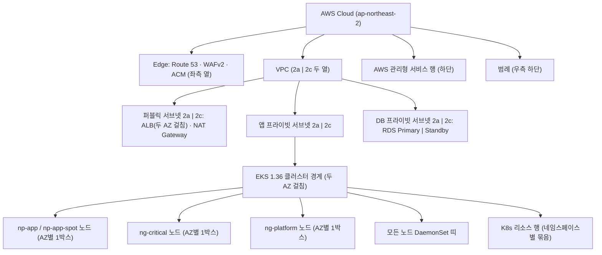

# 아키텍처 다이어그램 Pod 단위 상세화 설계서 (`docs/features/architecture-pod-diagram/design.md`)

> 기준 문서: `docs/architecture.md` (§2 구성 요소, §4 데이터 흐름 ①~⑥, §5.2 노드 그룹·NodePool)
> 백업: `docs/archive/architecture-2026-10-24.drawio{,.svg,.png}` (커밋 `8b9281e`)

## 1. 목표와 범위 (하지 않을 것 포함)

### 1.1 목표
현재 `docs/architecture.drawio` 는 노드 티어를 "박스 + 대표 아이콘 1개 + 텍스트 나열"로 표현해서, 어떤 Pod가 어느 노드 그룹·AZ에 몇 개 뜨는지 다이어그램만으로는 알 수 없다. 이번 기능은 다이어그램을 **Pod 단위**로 상세화한다.

1. **AZ × 서브넷 격자**: VPC 안을 `ap-northeast-2a` / `ap-northeast-2c` 두 열로 나누고, 각 열에 퍼블릭 · 앱 프라이빗 · DB 프라이빗 서브넷 행을 둔다.
2. **노드 단위 배치**: EKS 클러스터 경계 안에 AZ별 EC2 노드 박스(`np-app`/`np-app-spot` Karpenter 노드, `ng-critical` 노드, `ng-platform` 노드)를 두고, 그 안에 실제 Pod를 Kubernetes 공식 아이콘과 `이름 · 레플리카 · 한 줄 설명`으로 하나씩 배치한다.
3. **K8s 리소스 행**: 클러스터 하단에 Ingress · Gateway · HTTPRoute · Service · HPA · ScaledObject · ConfigMap · Secret · ExternalSecret · PVC 등 주요 리소스를 아이콘으로 표시한다.
4. **선 의미 통일과 범례**: 사용자 요청 데이터 경로는 번호(①~⑥)가 붙은 **실선**, 생성·설정·권한(컨트롤) 경로와 관측(메트릭·트레이스·로그) 경로는 **점선**으로 그리고, 범례를 넣는다.
5. **정합성**: 배치·레플리카·포트는 `k8s/`, `infra/`, `scripts/deploy-all.sh` 의 Helm `--set`/values 기준으로 맞추고, 번호는 `architecture.md` §4 ①~⑥ 설명과 일치시킨다.

### 1.2 주요 설계 결정
| # | 결정 | 근거 |
|---|---|---|
| D1 | **한 페이지로 유지**하고 기존 페이지를 교체한다(새 페이지 추가 안 함) | `architecture.md` §4 가 `architecture.drawio.svg` 하나를 임베드한다. draw.io SVG/PNG 내보내기는 기본적으로 첫 페이지만 출력하므로, 페이지를 나누면 상세 내용이 문서에 보이지 않는다. 기존 개요는 `docs/archive/` 에 남아 있다 |
| D2 | **Pod 아이콘은 `mxgraph.kubernetes.icon`(`prIcon=pod`) 하나로 통일**하고, 워크로드 종류(Deployment/StatefulSet/DaemonSet/Job/CronJob)는 라벨의 괄호로 표기한다 | 참고 이미지와 같은 "Pod 단위" 표현. 노드 박스 안에 종류별 아이콘을 섞으면 Pod 수를 한눈에 세기 어렵다. 종류별 아이콘(`deploy`/`sts`/`ds`/`job`/`cronjob`)은 하단 리소스 행에서 쓴다 |
| D3 | **레플리카 2개 이상이면서 zone `topologySpreadConstraints`/anti-affinity 가 있는 워크로드는 두 AZ에 1개씩** 그린다. 레플리카가 1개이거나 AZ 분산 제약이 없는 Pod는 한쪽 AZ 노드에만 그리고 라벨 끝에 `· AZ 비고정` 을 붙인다 | 실제 스케줄 위치가 정해지지 않은 Pod를 특정 AZ에 고정된 것처럼 보이지 않게 하기 위함 |
| D4 | **모든 노드에 뜨는 DaemonSet은 노드마다 반복하지 않고** 클러스터 안 가로 띠 하나(`모든 노드 DaemonSet`)에 모아 그린다 | 노드 6개 × DaemonSet 5종을 반복하면 Pod 아이콘이 30개 늘어 가독성이 떨어진다. 기존 다이어그램의 "Fluent Bit DaemonSet" 띠 표현을 그대로 이어간다 |
| D5 | **카나리 경로(④ 10% / X-Canary)도 실선**으로 그리고 색(주황)으로 구분한다. 기존 다이어그램의 카나리 점선은 없앤다 | 이번 기능에서 "점선 = 컨트롤/관측" 규칙을 도입하므로, 사용자 요청 경로인 카나리가 점선이면 의미가 충돌한다. **기존 표현을 바꾸는 부분**이다 |
| D6 | **① DNS 조회도 실선**으로 바꾼다 | D5와 같은 이유(사용자 요청 데이터 경로). **기존 표현을 바꾸는 부분**이다 |
| D7 | Gateway API·KEDA·ESO·OTel 등 **CRD 기반 리소스는 `prIcon=crd` 아이콘 + 종류 이름 라벨**로 표시한다 | draw.io 내장 Kubernetes 아이콘 세트에 `Gateway`/`HTTPRoute`/`ScaledObject`/`ExternalSecret`/`Instrumentation` 전용 아이콘이 없다. 외부 이미지·커스텀 SVG는 쓰지 않는다 |
| D8 | 캔버스를 약 `2400 × 1800` 으로 넓힌다(기존 `1660 × 1060`) | Pod 약 40개와 리소스 아이콘 약 20개를 11px 이상 글자로 담기 위함. `architecture.md` 에서는 SVG가 폭에 맞게 축소되므로 문서 레이아웃은 바뀌지 않는다 |

### 1.3 범위 (In-Scope)
- `docs/architecture.drawio` 재작성 (Pod 단위 상세화)
- `docs/architecture.drawio.svg`, `docs/architecture.drawio.png` 재내보내기 (Embedded XML 포함)
- `docs/features/architecture-pod-diagram/design.md` (본 문서)

### 1.4 하지 않을 것 (Out-of-Scope)
- **소스 코드·매니페스트·스크립트·values 변경 없음**: `app/`, `docker/`, `infra/`, `k8s/`, `scripts/`, `tests/` 는 한 줄도 바꾸지 않는다. 다이어그램을 그리다 매니페스트와 문서가 어긋난 곳을 찾으면 고치지 말고 아래 "구현 중 질문" 섹션에 적는다.
- **`docs/architecture.md` 직접 수정 없음**: `ORCA_WORKFLOW.md` 규칙상 `architecture.md` 는 ⑦ 단계에서만 바꾼다. ⑦에서 반영할 항목은 §2.3에 정리해 둔다.
- **`docs/archive/` 백업 파일 수정·삭제 없음**.
- **참고 이미지 저장소 추가 금지**: `/tmp/orca-paste-…png` 는 로컬에서 레이아웃만 참고하고 커밋하지 않는다. 참고 이미지에 있는 자원 이름(`pc-vpc`, `pc-alb`, `pc-rds` 등), CIDR(`10.0.x.x`), Pod Identity Agent, `t3.large` 단일 노드, RDS MySQL 8.4 표기는 **이 저장소와 다르므로 옮기지 않는다**. 이 저장소는 IRSA를 쓰며 Pod Identity Agent가 없다.
- **실값 기재 금지**: 계정 ID, ARN, 도메인, 서브넷/VPC ID, CIDR, 버킷 실명, 엔드포인트는 넣지 않는다. 필요하면 `${BACKUP_S3_BUCKET_NAME}` 처럼 변수명이나 일반 명칭으로 쓴다.
- **AWS 실자원 조회로 배치 검증하지 않음**: `kubectl get pods -o wide` 등 실클러스터 조회는 하지 않는다. 배치는 매니페스트·values 기준의 "의도된 배치"다.
- `kube-system` 의 EKS 기본 리소스 중 다이어그램 이해에 필요 없는 것(예: `kube-proxy` 설정 ConfigMap, Webhook 설정, RBAC)은 그리지 않는다.

---

## 2. 구성 요소와 디렉터리 구조

### 2.1 디렉터리 구조 (변경분 표시)
```text
docs/
├── architecture.md                      # (변경 없음 — ⑦에서 갱신)
├── architecture.drawio                  # [변경] Pod 단위 상세 다이어그램으로 재작성
├── architecture.drawio.svg              # [변경] 재내보내기 (Embedded XML)
├── architecture.drawio.png              # [변경] 재내보내기 (Embedded XML)
├── archive/                             # (기존, 변경 없음)
│   └── architecture-2026-10-24.drawio{,.svg,.png}   # Pod 상세화 이전 다이어그램 백업
└── features/
    └── architecture-pod-diagram/        # [추가]
        └── design.md                    # [추가] 본 문서 (review.md, security.md는 이후 단계에서 추가)
```

### 2.2 다이어그램 레이아웃 (컨테이너 계층)



| 영역 | 위치 | 내용 | 아이콘 |
|---|---|---|---|
| 사용자 | VPC 좌측 바깥 | 사용자 브라우저 | `mxgraph.aws4.users` (기존 유지) |
| Edge 열 | 사용자와 VPC 사이 | Route 53, WAFv2, ACM | `mxgraph.aws4.resourceIcon` (기존 유지) |
| 퍼블릭 서브넷 행 | VPC 최상단, AZ별 | ALB 1개(두 AZ 경계에 걸쳐 배치, `target-type: ip`), NAT Gateway | `mxgraph.aws4` |
| 앱 프라이빗 서브넷 행 | VPC 중단, AZ별 | EKS 클러스터 그룹(두 AZ 걸침) → 노드 박스 6개 + DaemonSet 띠 + 리소스 행 | 그룹: `mxgraph.aws4.group` (EKS·EC2 그룹 아이콘), Pod: `mxgraph.kubernetes.icon` |
| DB 프라이빗 서브넷 행 | VPC 하단, AZ별 | RDS MySQL 8.0 Primary(2a) / Standby(2c), 동기 복제선 | `mxgraph.aws4` |
| 관리형 서비스 행 | VPC 아래 | EKS Control Plane, ECR, S3 백업 버킷, Secrets Manager, CloudWatch Logs, S3 Tempo 버킷, IAM(IRSA 역할) | `mxgraph.aws4` (IAM 아이콘만 추가) |
| 범례 | 우측 하단 | 선 종류 4가지 + 아이콘 의미 + "AZ 비고정" 표기 설명 | 텍스트·샘플 선 |

노드 박스 라벨 형식: `EC2 노드 · <이름> (<인스턴스 전략>) · <Taint 또는 "Taint 없음">`
- `np-app / np-app-spot · Karpenter (On-Demand 기본 · Spot 확장, c6i/m6i/t3 large~2xlarge, 노드 수 가변) · Taint 없음 · workload-tier=app`
- `ng-critical · 관리형 노드 그룹 (m6i.large, 2~4) · node-role=critical:NoSchedule`
- `ng-platform · 관리형 노드 그룹 (m6i.large, 2~4) · node-role=platform:NoSchedule`

### 2.3 Pod 배치 표 (다이어그램에 그릴 대상 — 정답지)

Pod 라벨 형식: **`<Pod/워크로드 이름> ×<레플리카>`** (굵게) + 회색 11px 한 줄 설명 `(<종류>) <네임스페이스> · <핵심 포트/역할>`.
레플리카 열의 `(HPA a~b)` 등은 오토스케일 범위다. "AZ" 열의 `2a+2c` 는 두 AZ에 1개씩 그린다는 뜻(D3).

#### (A) `np-app` / `np-app-spot` 노드 (`workload-tier=app`, Taint 없음)
| Pod | 종류 / NS | 레플리카 | AZ | 한 줄 설명 | 근거 |
|---|---|---|---|---|---|
| `petclinic-gateway-nginx` (NGF 데이터 플레인) | Deployment / `nginx-gateway` | 2 (PDB `minAvailable: 1`) | 2a+2c | ③ ALB IP 타겟 `:80`, HTTPRoute 카나리 분할 | `deploy-all.sh` `nginx.replicas=2`, `nginx.pod.topologySpreadConstraints` |
| `nginx-gateway` (NGF 컨트롤 플레인) | Deployment / `nginx-gateway` | 2 | 2a+2c | Gateway·HTTPRoute 감시 → 데이터 플레인 설정 | `nginxGateway.replicas=2`, `nginxGateway.topologySpreadConstraints` |
| `web` | Deployment / `petclinic` | 2 (HPA 2~10, PDB) | 2a+2c | Nginx 1.27 `:8080` + exporter `:9113`, 정적 서빙 | `k8s/web/deployment.yaml` (zone topology), `hpa.yaml`, `pdb.yaml` |
| `web-canary` | Deployment / `petclinic` | 1 (HPA 1~4) | 2a · AZ 비고정 | `X-Canary: always` / 10% → `was-canary` 프록시 | `k8s/web/deployment.yaml` |
| `was-stable` | Deployment / `petclinic` | 2 (KEDA 2~10, fallback 4, PDB) | 2a+2c | Tomcat 11 `:8080` · JMX `:9404` · OTel Agent(init 주입) | `k8s/was/deployment-stable.yaml`, `keda-scaledobject.yaml`, `pdb.yaml` |
| `was-canary` | Deployment / `petclinic` | 1 (KEDA 1~3, fallback 2) | 2c · AZ 비고정 | Tomcat 11 `:8080` · `service.version=canary` | `k8s/was/deployment-canary.yaml` |

#### (B) `ng-critical` 노드 (`workload-tier=critical`, `node-role=critical:NoSchedule`)
| Pod | 종류 / NS | 레플리카 | AZ | 한 줄 설명 | 근거 |
|---|---|---|---|---|---|
| `coredns` | Deployment / `kube-system` | 2 (EKS 애드온 기본) | 2a+2c | 클러스터 DNS `:53` | `infra/eksctl/cluster.yaml` addons.coredns |
| `aws-load-balancer-controller` (LBC) | Deployment / `kube-system` | 2 (차트 기본) | 2a+2c | Ingress → ALB·TargetGroup(Pod IP) 생성, IRSA | `deploy-all.sh` LBC Helm `3.6.1` |
| `karpenter` | Deployment / `kube-system` | 2 (차트 기본, 리더 선출) | 2a+2c | NodePool → `np-app` EC2 생성·정리, IRSA | Karpenter Helm `1.15.0` |
| `ebs-csi-controller` | Deployment / `kube-system` | 2 (애드온 기본) | 2a+2c | `gp3` PVC → EBS 볼륨 생성·연결 | cluster.yaml addons.aws-ebs-csi-driver.controller |
| `metrics-server` | Deployment / `kube-system` | 1 | 2a · AZ 비고정 | `metrics.k8s.io` → `web` HPA | Helm `3.14.0` |
| `keda-operator` | Deployment / `keda` | 1 | 2a · AZ 비고정 | ScaledObject → `was` 스케일, Prometheus PromQL 조회 | KEDA Helm `2.21.0` (`-f $CRITICAL`) |
| `keda-operator-metrics-apiserver` | Deployment / `keda` | 1 | 2c · AZ 비고정 | External Metrics API | 〃 |
| `keda-admission-webhooks` | Deployment / `keda` | 1 | 2c · AZ 비고정 | ScaledObject 검증 Webhook | 〃 |
| `external-secrets` (ESO 컨트롤러) | Deployment / `external-secrets` | 1 | 2a · AZ 비고정 | Secrets Manager → K8s Secret 동기화, IRSA | ESO Helm `2.13.0` |
| `external-secrets-webhook` | Deployment / `external-secrets` | 1 | 2c · AZ 비고정 | ExternalSecret 검증 Webhook | `webhook.nodeSelector` |
| `external-secrets-cert-controller` | Deployment / `external-secrets` | 1 | 2c · AZ 비고정 | Webhook 인증서 관리 | `certController.nodeSelector` |
| `opentelemetry-operator` | Deployment / `opentelemetry-operator-system` | 1 | 2a · AZ 비고정 | `Instrumentation` CR → `was` Java Agent 주입 Webhook `:9443` (`failurePolicy: Ignore`) | `k8s/tracing/otel-operator-values.yaml` |
| `db-init` | Job / `petclinic` | 1 (배포 시 1회) | 2c · AZ 비고정 | admin 계정 스키마·데이터 적재, app/backup 계정 생성 | `k8s/jobs/job-db-init.yaml` |
| `db-backup` | CronJob / `petclinic` | 매일 03:00 KST 1회 | 2c · AZ 비고정 | backup 계정 `mysqldump` → S3(SSE-KMS), IRSA | `k8s/jobs/cronjob-db-backup.yaml` (`schedule: "0 3 * * *"`, `timeZone: Asia/Seoul`) |

> 레플리카가 "차트/애드온 기본"인 항목은 저장소에서 값을 고정하지 않은 것이다. 라벨에는 `×2` 로 쓰되, 구현 시 해당 차트 버전의 기본값을 한 번 확인한다(§6 Step 2). 기본값이 다르면 실제 기본값으로 쓰고 "구현 중 질문" 섹션에 기록한다.

#### (C) `ng-platform` 노드 (`workload-tier=platform`, `node-role=platform:NoSchedule`) — 모두 `monitoring` NS
| Pod | 종류 | 레플리카 | AZ | 한 줄 설명 | 근거 |
|---|---|---|---|---|---|
| `prometheus-…-0/1` | StatefulSet | 2 (PVC 50Gi × 2) | 2a+2c | `:9090`, `exemplar-storage`, KEDA 쿼리 대상 | `kube-prometheus-values.yaml` (`replicas: 2`, zone anti-affinity) |
| `otel-collector` | Deployment | 2 | 2a+2c | OTLP `:4317`/`:4318` 수신 → Tempo, RED+Exemplar `:8889` | `otel-collector-values.yaml` (`replicaCount: 2`, zone) |
| `alertmanager-…-0` | StatefulSet | 1 (PVC 10Gi) | 2a · AZ 비고정 | `PrometheusRule` 알림 → Webhook(HTTPS) | `alertmanagerSpec` |
| `grafana` | Deployment | 1 (PVC 10Gi) | 2a · AZ 비고정 | 대시보드, Tempo 데이터소스 `:3200` | `grafana:` (`persistence`) |
| `prometheus-operator` | Deployment | 1 | 2c · AZ 비고정 | ServiceMonitor·PrometheusRule 반영 | `prometheusOperator:` |
| `kube-state-metrics` | Deployment | 1 | 2c · AZ 비고정 | K8s 오브젝트 메트릭 | `kube-state-metrics:` |
| `tempo-0` | StatefulSet | 1 (PVC 10Gi WAL) | 2c · AZ 비고정 | 단일 바이너리, `:4317` 수신 · `:3200` 쿼리 → S3(IRSA) | `tempo-values.yaml` |

#### (D) 모든 노드 DaemonSet 띠 (D4)
| Pod | NS | 한 줄 설명 | 근거 |
|---|---|---|---|
| `aws-for-fluent-bit` | `amazon-cloudwatch` | 컨테이너 로그 → CloudWatch Logs (IRSA, Toleration `Exists`) | `k8s/logging/fluent-bit-values.yaml` |
| `prometheus-node-exporter` | `monitoring` | 노드 메트릭 (Toleration `Exists`) | `kube-prometheus-values.yaml` |
| `aws-node` (VPC CNI + NetworkPolicy agent) | `kube-system` | Pod IP 할당, NetworkPolicy 집행 | cluster.yaml addons.vpc-cni |
| `kube-proxy` | `kube-system` | Service 라우팅 | addons.kube-proxy |
| `ebs-csi-node` | `kube-system` | EBS 볼륨 마운트 | addons.aws-ebs-csi-driver |

> `ebs-csi-node` 가 Taint 노드(`ng-critical`/`ng-platform`)까지 뜨는지는 EKS 애드온 기본 Toleration에 달려 있다. 구현 시 애드온 버전의 기본 values를 확인하고, 모든 노드가 아니면 띠 라벨에 "(대상 노드 확인 필요)" 대신 실제 대상을 적고 "구현 중 질문" 섹션에 기록한다. 실클러스터 조회는 하지 않는다.

#### (E) 하단 K8s 리소스 행 (네임스페이스별 묶음, 아이콘 + 이름)
| 묶음 | 아이콘(`prIcon`) → 이름 |
|---|---|
| 진입 (`petclinic` / `nginx-gateway`) | `ing` → `petclinic-alb` · `crd` → `Gateway petclinic-gateway (:80)` · `crd` → `HTTPRoute petclinic (90:10 · X-Canary)` · `svc` → `petclinic-gateway-nginx (ClusterIP)` |
| 앱 (`petclinic`) | `deploy` → `web / web-canary / was-stable / was-canary` · `svc` → `web · web-canary · was · was-stable · was-canary` · `hpa` → `web (2~10) · web-canary (1~4)` · `crd` → `ScaledObject was-stable · was-canary` · `crd` → `Instrumentation petclinic-java` · `cm` → `petclinic-was-logback · petclinic-db-scripts` |
| 시크릿 (`petclinic` / `monitoring`) | `crd` → `SecretStore aws-secrets-manager` · `crd` → `ExternalSecret ×5` · `secret` → `petclinic-rds-{admin-,,backup-}secret · grafana-admin · alertmanager-webhook` |
| 배치 작업 (`petclinic`) | `job` → `db-init` · `cronjob` → `db-backup` |
| 관측 (`monitoring`) | `sts` → `prometheus · alertmanager · tempo` · `ds` → `fluent-bit · node-exporter` · `crd` → `ServiceMonitor ×3 · PrometheusRule` · `pvc` → `gp3 (50Gi×2 · 10Gi · 10Gi · 10Gi)` · `sc` → `gp3 (암호화, WaitForFirstConsumer)` |
| 노드 (클러스터 범위) | `crd` → `NodePool np-app · np-app-spot` · `crd` → `EC2NodeClass` |

### 2.4 ⑦ 단계(`architecture.md` 갱신)에서 반영할 항목
- §3 디렉터리 구조에 `docs/archive/` (다이어그램 백업) 줄과 `features/architecture-pod-diagram/` 추가
- §4 상단에 "실선 = 사용자 요청(①~⑥), 점선 = 컨트롤/관측" 범례 한 줄 추가
- §8 설계 결정 기록에 D1·D3·D5 요약 한 줄씩 추가

---

## 3. 데이터 흐름 / 인터페이스

이 기능의 "인터페이스"는 다이어그램의 **선 종류·번호 규칙**이다. 번호와 의미는 `architecture.md` §4 와 1:1로 맞춘다.

### 3.1 선 스타일 규칙 (범례에 그대로 표시)
| 분류 | 스타일 | 색 | 라벨 규칙 |
|---|---|---|---|
| **사용자 요청 — stable** | 실선, 두께 2, 끝 화살표 | 진한 남색 `#232F3E` 계열(기존 ②·③ 색 유지) / ⑤·⑥ 기존 색 유지 가능 | `①`~`⑥` + 프로토콜·포트 |
| **사용자 요청 — canary** | 실선, 두께 2 | 주황 `#D86613` | `④ 10% / X-Canary`, `⑤ proxy :8080` |
| **관측 (메트릭·트레이스·로그)** | 점선 `dashed=1`, 두께 1.5 | 자홍 `#BC1356` | 번호 없음 또는 `⑤` 하위 설명(`OTLP :4318`, `scrape :9404` 등) |
| **생성·설정·권한 (컨트롤)** | 점선 `dashed=1;dashPattern=8 4`, 두께 1.5 | 회색 `#545B64` | 동사형 짧은 라벨(`ALB·TG 생성`, `EC2 생성`, `시크릿 동기화`, `IRSA`) |

> 기존 다이어그램은 ①·카나리를 점선으로, 일부 컨트롤 선을 색만 다른 점선으로 그렸다. 이번에 위 규칙으로 통일한다(D5·D6).

### 3.2 사용자 요청 경로 (실선, 번호)
| 번호 | 시작 → 끝 | 라벨 |
|---|---|---|
| ① | 사용자 → Route 53 | `① DNS 조회` |
| ② | 사용자 → WAFv2 → ALB (ACM 인증서로 TLS 종단) | `② HTTPS :443` / `WAF 필터링` |
| ③ | ALB → 2a·2c 각각의 `petclinic-gateway-nginx` Pod | `③ Pod IP :80 (target-type: ip)` — AZ별 2개 선 |
| ④ | `petclinic-gateway-nginx` → `web` (같은 AZ) / → `web-canary` | `④ 90% 기본` (남색) / `④ 10% · X-Canary` (주황) |
| ⑤ | `web` → `was-stable`, `web-canary` → `was-canary` | `⑤ proxy :8080` |
| ⑥ | `was-stable`·`was-canary` → RDS Primary | `⑥ JDBC TLS :3306` |
| ⑥ (관리) | `db-init`·`db-backup` → RDS Primary, `db-backup` → S3 백업 버킷 | `⑥ 스키마 적재 · 백업 덤프 :3306`, `⑥ 백업 업로드 :443` (기존 다이어그램처럼 ⑥ 하위로 둔다) |

- 노드 경계를 넘는 선이 많아지지 않도록 ③→④→⑤는 **같은 AZ 노드 안에서 세로로** 이어 그린다(참고 이미지 방식). 실제 Service 로드밸런싱은 AZ를 넘을 수 있으므로 범례에 "Service는 AZ 간 분산될 수 있음" 한 줄을 둔다.
- RDS Primary → Standby 는 `Multi-AZ 동기 복제` 라벨의 **회색 점선**으로 그린다(사용자 요청 경로가 아니므로 컨트롤 분류).

### 3.3 관측 경로 (자홍 점선)
| 시작 → 끝 | 라벨 |
|---|---|
| `was-*` → `otel-collector` | `OTLP :4318 (Traces · RED)` |
| `otel-collector` → `tempo` | `OTLP :4317` |
| `prometheus` → `web`/`was`/`otel-collector` | `scrape :9113 / :9404 / :8889` (선 1개 + 라벨로 묶어도 됨) |
| `grafana` → `prometheus` / `tempo` | `:9090 / :3200` |
| `tempo` → S3 Tempo 버킷 | `트레이스 블록 :443 (IRSA)` |
| `aws-for-fluent-bit` 띠 → CloudWatch Logs | `컨테이너 로그` |
| `alertmanager` → 외부 Webhook | `HTTPS :443` (외부 수신처는 텍스트 노트로) |

### 3.4 생성·설정·권한 경로 (회색 점선)
| 시작 → 끝 | 라벨 |
|---|---|
| LBC → ALB | `Ingress → ALB · TG(Pod IP) 생성` |
| ACM → ALB | `TLS 인증서` |
| `karpenter` → `np-app` 노드 박스 | `NodePool → EC2 생성·정리` |
| `keda-operator` → `prometheus` / `was-*` | `PromQL :9090` / `스케일 (2~10 · 1~3)` |
| `metrics-server` → `web` (HPA) | `CPU 60% HPA` |
| `opentelemetry-operator` → `was-*` | `Java Agent 주입 :9443` |
| `nginx-gateway` → `petclinic-gateway-nginx` | `설정 배포` |
| Secrets Manager → `external-secrets` → Secret 아이콘 | `시크릿 동기화 (IRSA)` |
| ECR → `np-app` 노드 박스 | `이미지 pull` |
| EKS Control Plane → 클러스터 경계 | `K8s API` |
| IAM(IRSA 역할) → LBC·Karpenter·ESO·Fluent Bit·`db-backup`·Tempo | `IRSA (OIDC)` — 선 6개 대신 IAM 아이콘 라벨에 대상 나열 + 클러스터 경계로 선 1개 |
| `ebs-csi-controller` → `pvc` 아이콘 | `gp3 볼륨 생성` |

---

## 4. 실행 환경

이 기능은 문서 산출물만 만든다. 런타임·클라우드 리소스·환경변수에 **변경이 없다**.

| 항목 | 내용 |
|---|---|
| 편집 도구 | draw.io (diagrams.net) 데스크톱 앱 또는 XML 직접 작성. 기존 파일 헤더 `host="Electron"` 과 맞추려면 데스크톱 앱 권장 |
| 내보내기 | draw.io 데스크톱 CLI: `drawio -x -f svg --embed-diagram -o docs/architecture.drawio.svg docs/architecture.drawio`, `drawio -x -f png --embed-diagram -o docs/architecture.drawio.png docs/architecture.drawio` (현재 작업 환경에는 `drawio` CLI가 없음 → §6 Step 7) |
| 아이콘 라이브러리 | AWS: `mxgraph.aws4.*` (기존 유지). Kubernetes: `shape=mxgraph.kubernetes.icon;prIcon=<pod\|deploy\|svc\|ing\|cm\|secret\|hpa\|pvc\|job\|cronjob\|ds\|sts\|sc\|crd\|node>` (draw.io 내장). 외부 URL 이미지·base64 커스텀 이미지는 쓰지 않는다 |
| 글꼴 | 기본 Helvetica, 한글은 draw.io 기본 대체 글꼴. 라벨 11~12px, 그룹 제목 13~14px |
| 검증 도구 | `python3` (XML 파싱·스타일 검사, 표준 라이브러리만), `grep` |
| 클라우드 리소스 | 없음 (AWS 호출 없음) |
| 환경변수 | 없음. 다이어그램 라벨에 변수를 표기해야 할 때만 `${BACKUP_S3_BUCKET_NAME}`, `${TEMPO_S3_BUCKET_NAME}`, `${EKS_CLUSTER_NAME}` 처럼 **이름만** 쓴다 |

다이어그램에 표기할 버전(모두 `architecture.md` §5.1과 동일): EKS `1.36`, NGF `2.8.0`, Nginx `1.27`, Tomcat `11`, RDS MySQL `8.0`, Tempo `3.1.1`(단일 바이너리). 그 외 버전은 라벨에 넣지 않는다(갱신 시 어긋남 방지).

---

## 5. 보안 요구사항

다이어그램은 공개 저장소에 올라가므로 **정보 노출 방지**가 핵심이다.

1. **실값 금지**: 12자리 계정 ID, `arn:aws:` 문자열, 실제 도메인, `vpc-`/`subnet-`/`sg-` ID, CIDR, 실제 버킷명, RDS·EKS 엔드포인트, 개인 URL을 라벨·툴팁·메타데이터(`tooltip`, `link`, `placeholders`) 어디에도 넣지 않는다. SVG/PNG에 임베드되는 XML에도 동일하게 적용된다.
2. **보안 구조를 정확히 표현**(과장·누락 금지):
   - IRSA 사용 Pod는 LBC, Karpenter, ESO, Fluent Bit, `db-backup`, Tempo 6개뿐이다. `web`/`was`/`db-init` 에 IAM 선을 긋지 않는다(`automountServiceAccountToken: false`).
   - 관리형 노드 그룹 라벨에 `IMDSv2 · Pod IMDS 차단`, Karpenter 노드 라벨에 `IMDSv2 hop 1` 을 유지한다.
   - DB 시크릿은 역할별 3개(admin → `db-init`, app → `was`, backup → `db-backup`)로 나눠 표시하고, 각 Pod는 자기 시크릿에만 연결한다.
   - TLS 구간 표기 유지: ② `HTTPS :443`, ⑥ `JDBC TLS :3306`, S3 `:443`.
3. **권한 최소화 표기**: 선 라벨에 정책 전문·Action 목록을 넣지 않는다(문서 `architecture.md` §7이 정본).
4. **참고 이미지 비공개**: `/tmp/…png` 를 저장소로 복사하지 않고, `git status` 에서 `docs/` 외 이미지가 추가되지 않았는지 확인한다.
5. **임베드 내용 일치**: SVG/PNG의 Embedded XML이 `.drawio` 원본과 같은 버전인지 확인한다(구버전 XML이 남아 실값이 섞이는 일 방지).

---

## 6. 구현 단계 체크리스트 (Claude용)

> AWS 실자원에 닿는 단계는 없다. 모든 단계는 로컬 파일 작업이다.

- [ ] **Step 1 — 기준 확인**: `docs/architecture.md` §2·§4·§5.2, 백업 `docs/archive/architecture-2026-10-24.drawio` 를 열어 기존 셀(아이콘 스타일, 라벨, 선 번호)을 확인한다. 참고 이미지는 레이아웃만 본다.
- [ ] **Step 2 — 배치 표 재확인**: §2.3 표의 각 행을 "근거" 열 파일로 다시 대조한다. 특히 (1) 차트/애드온 기본 레플리카(LBC·Karpenter·CoreDNS·EBS CSI controller), (2) `ebs-csi-node` Toleration, (3) KEDA 하위 컴포넌트 이름을 해당 차트 버전의 공개 기본 values로 확인한다. 다르면 표 대신 실제 값으로 그리고 "구현 중 질문" 섹션에 적는다. (실클러스터 조회 금지)
- [ ] **Step 3 — 캔버스·컨테이너 골격**: `architecture.drawio` 를 새로 작성한다. `pageWidth≈2400`, `pageHeight≈1800`. AWS Cloud → Edge 열 / VPC(2a·2c 점선 AZ 열) → 퍼블릭·앱·DB 서브넷 행 → EKS 클러스터 그룹 → 노드 박스 6개(AZ별 `np-app`, `ng-critical`, `ng-platform`) → DaemonSet 띠 → 리소스 행 → 관리형 서비스 행 → 범례 순으로 배치한다. 셀 `id` 는 의미 있는 이름(`pod_was_stable_2a` 등)으로 짓는다.
- [ ] **Step 4 — Pod 배치**: §2.3 (A)~(D)를 `shape=mxgraph.kubernetes.icon;prIcon=pod` 아이콘(약 48×48)과 라벨로 배치한다. D3 규칙(2a+2c / AZ 비고정)을 지킨다.
- [ ] **Step 5 — 리소스 행**: §2.3 (E)를 해당 `prIcon` 아이콘으로 배치한다. CRD 계열은 `prIcon=crd` + 종류 이름(D7).
- [ ] **Step 6 — 선과 범례**: §3.1 스타일 규칙으로 §3.2(실선·번호) → §3.3(자홍 점선) → §3.4(회색 점선) 순으로 그린다. 선이 Pod 아이콘을 가로지르지 않게 `edgeStyle=orthogonalEdgeStyle` 와 웨이포인트를 쓴다. 범례에 선 4종, "AZ 비고정" 뜻, "Service는 AZ 간 분산될 수 있음"을 넣는다.
- [ ] **Step 7 — 내보내기**: §4의 draw.io CLI로 SVG·PNG를 `--embed-diagram` 포함해 내보낸다. **`drawio` CLI가 없으면 설치·대체 방법을 임의로 고르지 말고 조율 경로로 사용자에게 묻는다**(데스크톱 앱 설치 또는 사용자가 직접 내보내기). 내보낸 파일이 기존과 같은 이름·경로인지 확인한다.
- [ ] **Step 8 — 정적 검증** (스크래치 스크립트, 저장소에 추가하지 않음):
  - `python3 -c "import xml.etree.ElementTree as E; E.parse('docs/architecture.drawio')"` 로 XML 유효성 확인
  - 모든 `shape=` 값이 `mxgraph.aws4.*` 또는 `mxgraph.kubernetes.icon` 인지 확인(그 외 `image=http`, `data:image` 없음)
  - §2.3 표의 Pod 이름이 모두 `.drawio` 라벨에 있는지 grep
  - 라벨에 `①`~`⑥` 이 모두 있고 §4 순서와 맞는지 확인
  - 실값 검사: `grep -nE '[0-9]{12}|arn:aws|vpc-[0-9a-f]|subnet-[0-9a-f]|sg-[0-9a-f]|([0-9]{1,3}\.){3}[0-9]{1,3}/[0-9]{1,2}|amazonaws\.com' docs/architecture.drawio` 결과가 없어야 한다. SVG는 base64 데이터 때문에 오탐이 날 수 있으므로, 아래 단계에서 디코딩한 Embedded XML과 SVG의 `<text>`/라벨 텍스트에 같은 패턴을 적용한다
  - SVG의 Embedded XML(`content=` 속성)을 디코딩해 원본 `.drawio` 와 같은 셀 수인지 확인
- [ ] **Step 9 — 육안 검토**: PNG를 열어 겹친 라벨, 잘린 글자, 선 교차가 과도한 곳이 없는지 확인한다. `architecture.md` 미리보기에서 SVG가 깨지지 않는지 확인한다.
- [ ] **Step 10 — 범위 확인**: `git status` / `git diff --stat master...HEAD` 에 `docs/architecture.drawio{,.svg,.png}` 와 `docs/features/architecture-pod-diagram/` 외 변경이 없는지 확인한다(`docs/daily/` 는 Claude 일일 기록이므로 예외).
- [ ] **Step 11 — 커밋**: `docs: add pod-level detail to architecture diagram` (push·머지는 하지 않는다).

---

## 구현 중 질문

- (Claude, Step 2 확인 결과 — 질문 아님) 차트 기본값을 공개 values로 대조했고 표와 같음: LBC 3.6.1 `replicaCount: 2`, Karpenter 1.15.0 `replicas: 2`(zone topologySpread 기본), KEDA 2.21.0 operator·metricsServer·webhooks 각 1, ESO 2.13.0 컨트롤러·webhook·certController 각 1, metrics-server 3.14.0 `replicas: 1`, EBS CSI 차트 controller `replicaCount: 2`·node `tolerateAllTaints: true` → `ebs-csi-node` 는 모든 노드 DaemonSet 띠에 그대로 둠. LBC는 zone 분산 제약 없이 레플리카 2라 D3 기준으로는 "AZ 비고정"에 가깝지만 표대로 2a+2c로 그림
- (Claude, Step 7) 이 서버에는 디스플레이가 없고 Xvfb는 sudo 필요·EL10 저장소에 없음, draw.io 데스크톱 32.3.0 Electron headless는 segfault, podman은 newuidmap 오류 → 사용자 결정으로 **SVG·PNG는 사용자가 draw.io 데스크톱에서 직접 내보낸다**(Embedded XML 포함). Step 8의 SVG 관련 검사와 Step 9 육안 검토는 내보낸 파일을 받은 뒤 진행
