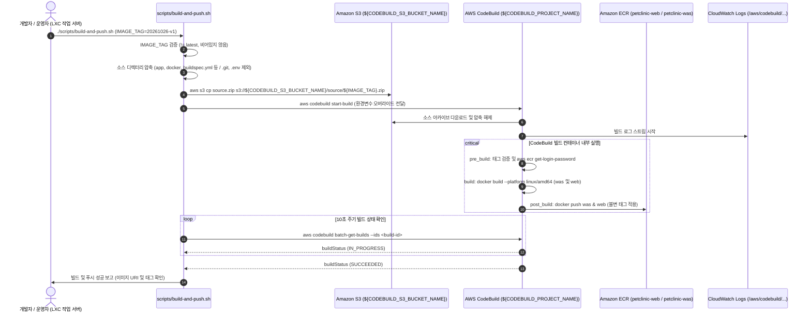

# AWS CodeBuild 기반 컨테이너 이미지 빌드 및 ECR 푸시 설계서 (`docs/features/codebuild-image-build/design.md`)

## 1. 목표와 범위 (하지 않을 것 포함)

### 1.1 배경 및 문제 정의 (Background & Problem)
- **로컬 빌드 환경(LXC 컨테이너)의 한계**:
  - 현재 `scripts/build-and-push.sh`는 로컬 도커 데몬(`docker build`, `docker push`)을 직접 호출하여 `web`(Nginx), `was`(Tomcat 11) 컨테이너 이미지를 빌드하고 Amazon ECR에 푸시하도록 작성되어 있다.
  - 그러나 현재 개발 및 운영 작업 서버가 **비특권(Unprivileged) LXC 컨테이너** 환경으로 구동되고 있어, `podman` 또는 `podman-docker` 실행 시 `newuidmap 6451 0 1000 1 1 524288 65536: write to uid_map failed: Operation not permitted` 오류가 발생하며 rootless 컨테이너 네임스페이스 생성이 원천적으로 불가능하다.
  - 호스트 머신의 보안 설정을 완화하거나 작업 서버에 과도한 특권(Privileged mode)을 부여하는 것은 컨테이너 탈출 및 보안 침해 위험을 유발하므로 권장되지 않는다.
- **클라우드 네이티브 빌드 파이프라인의 필요성**:
  - Amazon EKS 클러스터(`petclinic-eks`)는 Amazon ECR의 컨테이너 이미지를 참조하여 워크로드를 배포하므로, 로컬 환경의 제약과 무관하게 ECR에 이미지를 안전하고 일관되게 빌드·푸시할 수 있는 표준화된 클라우드 빌드 시스템이 필수적이다.
  - 이에 따라 AWS의 완전 관리형 빌드 서비스인 **AWS CodeBuild**를 도입하여 클라우드 상에서 컨테이너 이미지를 빌드하고 ECR로 안전하게 푸시한다.

### 1.2 핵심 목표 (Goals)
1. **AWS CodeBuild 기반 원격 빌드 및 ECR 푸시 구현**:
   - 로컬 도커 데몬 없이 작업 서버에서 `scripts/build-and-push.sh` 실행 시 소스 코드를 패키징하여 전용 S3 소스 버킷에 업로드하고, AWS CodeBuild를 트리거하여 이미지를 빌드 및 ECR에 푸시한다.
   - AWS CodeBuild는 `LINUX_CONTAINER` 표준 환경(`privilegedMode: true`)에서 실행되어 Docker in Docker로 `web` 및 `was` 멀티스테이지 컨테이너 이미지를 빌드한다.
2. **기존 이미지 거버넌스 및 보안 규칙 100% 준수**:
   - **불변 태그(Immutable Tag)**: ECR 저장소 레벨의 `IMMUTABLE` 정책과 함께, 이미 푸시된 동일 태그 덮어쓰기 시도를 차단한다.
   - **`latest` 태그 금지**: 빌드 태그가 `latest`이거나 비어 있는 경우 `build-and-push.sh` 및 CodeBuild `buildspec.yml` 양쪽에서 즉시 빌드를 중단한다.
   - **타겟 아키텍처 고정 (`linux/amd64`)**: Karpenter 노드풀(`np-app`, `np-app-spot`)의 x86_64 인스턴스와 일치하도록 `docker build --platform linux/amd64` 빌드를 강제한다.
   - **컨테이너 보안 하드닝 유지**: `docker/web/Dockerfile`, `docker/was/Dockerfile`의 멀티스테이지 빌드, 비루트 UID `10001` 실행, JMX Exporter JAR SHA256 체크섬 고정 검증을 변함없이 유지한다.
3. **개발자 경험 및 스크립트 인터페이스 일관성 보장**:
   - `scripts/build-and-push.sh`의 기존 파라미터 규격(환경변수 `.env` 로드, `IMAGE_TAG` 필수)을 유지하여 일상 작업 흐름에 혼선을 주지 않는다.
   - 단일 대상 빌드(`BUILD_TARGET=web` 또는 `BUILD_TARGET=was`) 및 전체 빌드(`BUILD_TARGET=all`, 기본값)를 유연하게 지원한다.
   - CLI에서 빌드 상태(`IN_PROGRESS`, `SUCCEEDED`, `FAILED`)를 실시간 폴링하고, 실패 시 CloudWatch Logs 확인 경로와 오류 요약을 제공한다.
4. **전체 아키텍처 및 다이어그램 현행화 준비**:
   - 본 기능의 설계와 구현 결과를 바탕으로 머지 직전 단계(Step ⑦)에서 `docs/architecture.md` 및 `docs/architecture.drawio`에 AWS CodeBuild 빌드 파이프라인을 정식 컴포넌트로 반영할 수 있도록 청사진을 수립한다.

### 1.3 범위 (In-Scope)
- `docs/features/codebuild-image-build/design.md` 작성
- 프로젝트 루트에 AWS CodeBuild 실행 명세서(`buildspec.yml`) 작성
- CodeBuild 서비스 역할(IAM Role) 전용 최소 권한 정책(`infra/aws/iam-policies/codebuild-policy.json`) 작성
- `infra/aws/provision-aws-resources.sh`의 `pre-cluster` 단계에 CodeBuild S3 소스 버킷, IAM Role, CodeBuild Project 멱등 프로비저닝 로직 추가
- `scripts/build-and-push.sh` 개편: 소스 아카이빙 → S3 업로드 → CodeBuild 실행 요청 → 상태 폴링 및 결과 보고
- `.env.example` 및 `scripts/lib.sh`에 CodeBuild 환경변수(`CODEBUILD_PROJECT_NAME`, `CODEBUILD_S3_BUCKET_NAME`) 반영
- `scripts/validate-manifests.sh`에 CodeBuild IAM 정책 문법, buildspec 및 필수 변수 검증 추가
- `README.md`의 Day-2 이미지 빌드 런북 갱신

### 1.4 하지 않을 것 (Out-of-Scope / Non-Goals)
- **GitHub Webhook / AWS CodePipeline 연동 제외**: 본 프로젝트는 git push 시 자동 빌드되는 CI 파이프라인이 아니라, 운영자/개발자가 검증된 특정 태그(`IMAGE_TAG`)로 필요 시 빌드를 트리거하는 온디맨드 빌드 워크플로를 사용하므로 GitHub Webhook, CodePipeline, CodeStar Connection 설정은 범위에서 제외한다.
- **LXC 호스트 시스템/커널 설정 변경 제외**: LXC 컨테이너의 권한 상승이나 호스트의 subuid/subgid 변경을 시도하지 않고, AWS 관리형 빌드 환경을 통해 안전하게 문제를 격리한다.
- **애플리케이션 소스 코드 및 Dockerfile 로직 변경 제외**: `docker/web/Dockerfile`, `docker/was/Dockerfile`, `app/` 코드는 수정하지 않는다.
- **`docs/architecture.md` 직접 수정 제외**: `ORCA_WORKFLOW.md`의 불변 규칙에 따라 `docs/architecture.md`는 머지 직전 ⑦ 단계에서만 갱신한다.

---

## 2. 구성 요소와 디렉터리 구조 (기존 구조 대비 추가·변경되는 부분 표시)

### 2.1 기존 구조 대비 추가·변경되는 구성 요소
| 구분 | 대상 컴포넌트 | 변경 구분 | 상세 변경 내용 |
|---|---|---|---|
| **Build & CI/CD** | **AWS CodeBuild Project** | **추가** | `${CODEBUILD_PROJECT_NAME}`(기본: `${EKS_CLUSTER_NAME}-image-build`). AL2023/Ubuntu x86_64 표준 컨테이너 환경(`privilegedMode: true`)에서 `web`/`was` 도커 이미지를 빌드 |
| **Build Storage** | **CodeBuild S3 버킷** | **추가** | `${CODEBUILD_S3_BUCKET_NAME}`(기본: `${EKS_CLUSTER_NAME}-codebuild-${AWS_ACCOUNT_ID}`). 로컬 소스 아카이브를 업로드하여 CodeBuild로 전달. 임시 파일이므로 1일 만료 Lifecycle 적용 |
| **IAM Security** | **CodeBuild Service Role** | **추가** | `CodeBuildServiceRole-${EKS_CLUSTER_NAME}` 및 `codebuild-policy.json`. ECR 푸시/풀, S3 소스 읽기, CloudWatch Logs 쓰기만 허용하는 최소 권한 원칙 적용 |
| **Build Specification** | **`buildspec.yml`** | **추가** | CodeBuild 빌드 명세. `pre_build`(ECR 로그인, 태그 검증) → `build`(`docker build --platform linux/amd64`) → `post_build`(ECR 푸시) 단계 실행 |
| **Automation Script** | **`scripts/build-and-push.sh`** | **변경** | 로컬 docker 직접 실행에서 소스 zip 압축 → S3 업로드 → `aws codebuild start-build` 호출 → `batch-get-builds` 폴링 구조로 개편 (로컬 도커 옵션 `--local` 병행 지원) |
| **Infra Provisioning** | **`provision-aws-resources.sh`** | **변경** | `pre-cluster` 단계에 CodeBuild S3 버킷, IAM Role/Policy, CodeBuild 프로젝트 멱등 프로비저닝 로직 통합 |
| **Configuration** | **`.env.example`, `scripts/lib.sh`** | **변경** | `CODEBUILD_PROJECT_NAME`, `CODEBUILD_S3_BUCKET_NAME` 환경변수 템플릿 및 `require` 등록 |
| **Validation** | **`validate-manifests.sh`** | **변경** | buildspec YAML 문법, CodeBuild 정책 JSON 최소 권한 및 `.env.example` 정합성 검증 추가 |

### 2.2 디렉터리 구조 (추가 `[NEW]` · 변경 `[MOD]` · 유지 표시)
```text
.
├── .env.example                          # [MOD] CODEBUILD_PROJECT_NAME, CODEBUILD_S3_BUCKET_NAME 추가
├── README.md                             # [MOD] 이미지 빌드 런북 (CodeBuild 기반 동작 설명)
├── buildspec.yml                         # [NEW] AWS CodeBuild 빌드 명세서 (루트 위치)
├── docs/
│   ├── architecture.md                   # (유지 — ⑦ 머지 직전 단계에서 CodeBuild 추가 갱신)
│   ├── architecture.drawio               # (유지 — ⑦ 머지 직전 단계에서 CodeBuild 다이어그램 추가 갱신)
│   └── features/
│       └── codebuild-image-build/
│           └── design.md                 # [NEW] 본 기능 설계서
├── docker/
│   ├── was/                              # (유지 — Dockerfile, jmx-exporter-config, setenv 동일)
│   └── web/                              # (유지 — Dockerfile, nginx.conf 동일)
├── infra/
│   └── aws/
│       ├── provision-aws-resources.sh    # [MOD] pre-cluster에 CodeBuild S3/IAM/Project 프로비저닝 추가
│       └── iam-policies/
│           ├── codebuild-policy.json     # [NEW] CodeBuild 최소 권한 IAM 정책 (ECR, S3, Logs)
│           ├── db-backup-policy.json     # (유지)
│           ├── eso-policy.json           # (유지)
│           └── ...
└── scripts/
    ├── build-and-push.sh                 # [MOD] CodeBuild 원격 빌드 호출 및 상태 추적 스크립트로 개편
    ├── lib.sh                            # [MOD] CODEBUILD_* 변수 TEMPLATE_VARS 등록
    └── validate-manifests.sh             # [MOD] buildspec.yml 및 CodeBuild IAM 정책 오프라인 검증 추가
```

---

## 3. 데이터 흐름 / API 또는 인터페이스

### 3.1 컨테이너 이미지 빌드 및 ECR 푸시 데이터 흐름



### 3.2 단계별 상세 처리 로직

1. **소스 아카이빙 (LXC 작업 서버)**:
   - Git 저장소의 현재 작업 상태(커밋되지 않은 로컬 변경사항 포함 가능)를 빌드에 반영할 수 있도록, 소스 트리를 zip 아카이브로 패키징한다.
   - 단, 다음 항목은 **반드시 제외**한다:
     - `.git/` (불필요한 대용량 이력 및 메타데이터 제외)
     - `.env` 및 `*.secret` (절대 클라우드로 소스 시크릿이 전달되지 않도록 차단)
     - `app/target/` (로컬 빌드 산출물 제외)
     - `.daily-nodegroup-state.json` 및 임시 파일
   - 압축 명령 예시:
     `zip -q -r "$archive_path" . -x ".git/*" ".env" "app/target/*" "*.tmp" ".daily-nodegroup-state.json"`
2. **S3 임시 소스 업로드**:
   - `aws s3 cp "$archive_path" "s3://${CODEBUILD_S3_BUCKET_NAME}/source/${IMAGE_TAG}.zip"`
   - 기본 SSE 암호화(`AES256` 또는 `aws:kms`)로 저장되며, 버킷 수명주기(Lifecycle)에 의해 1일 후 자동 삭제된다.
3. **AWS CodeBuild 빌드 트리거 (`start-build`)**:
   - AWS CLI의 `aws codebuild start-build` 명령을 호출한다:
     ```bash
     build_id=$(aws codebuild start-build \
       --project-name "$CODEBUILD_PROJECT_NAME" \
       --source-type-override S3 \
       --source-location-override "${CODEBUILD_S3_BUCKET_NAME}/source/${IMAGE_TAG}.zip" \
       --environment-variables-override \
         name=IMAGE_TAG,value="$IMAGE_TAG",type=PLAINTEXT \
         name=ECR_WEB_REPOSITORY_URI,value="$ECR_WEB_REPOSITORY_URI",type=PLAINTEXT \
         name=ECR_WAS_REPOSITORY_URI,value="$ECR_WAS_REPOSITORY_URI",type=PLAINTEXT \
         name=AWS_REGION,value="$AWS_REGION",type=PLAINTEXT \
         name=AWS_ACCOUNT_ID,value="$AWS_ACCOUNT_ID",type=PLAINTEXT \
         name=BUILD_TARGET,value="${BUILD_TARGET:-all}",type=PLAINTEXT \
       --query 'build.id' --output text)
     ```
4. **CodeBuild `buildspec.yml` 인터페이스**:
   - 명세서 규격:
     ```yaml
     version: 0.2

     phases:
       pre_build:
         commands:
           - echo "== Validating parameters"
           - '[ -n "$IMAGE_TAG" ] || { echo "IMAGE_TAG is required" >&2; exit 1; }'
           - '[ "$IMAGE_TAG" != "latest" ] || { echo "IMAGE_TAG must not be latest" >&2; exit 1; }'
           - echo "== Logging in to Amazon ECR"
           - aws ecr get-login-password --region "$AWS_REGION" | docker login --username AWS --password-stdin "${AWS_ACCOUNT_ID}.dkr.ecr.${AWS_REGION}.amazonaws.com"
       build:
         commands:
           - echo "== Building container images (Target architecture linux/amd64)"
           - |
             if [ "${BUILD_TARGET:-all}" = "all" ] || [ "${BUILD_TARGET}" = "was" ]; then
               echo "== Building WAS image"
               docker build --platform linux/amd64 -f docker/was/Dockerfile -t "${ECR_WAS_REPOSITORY_URI}:${IMAGE_TAG}" .
             fi
           - |
             if [ "${BUILD_TARGET:-all}" = "all" ] || [ "${BUILD_TARGET}" = "web" ]; then
               echo "== Building Web image"
               docker build --platform linux/amd64 -f docker/web/Dockerfile -t "${ECR_WEB_REPOSITORY_URI}:${IMAGE_TAG}" .
             fi
       post_build:
         commands:
           - echo "== Pushing images to ECR"
           - |
             if [ "${BUILD_TARGET:-all}" = "all" ] || [ "${BUILD_TARGET}" = "was" ]; then
               docker push "${ECR_WAS_REPOSITORY_URI}:${IMAGE_TAG}"
             fi
           - |
             if [ "${BUILD_TARGET:-all}" = "all" ] || [ "${BUILD_TARGET}" = "web" ]; then
               docker push "${ECR_WEB_REPOSITORY_URI}:${IMAGE_TAG}"
             fi
           - echo "== Build and push completed successfully for tag ${IMAGE_TAG}"
     ```
5. **빌드 상태 폴링 및 완료 대기**:
   - 스크립트는 루프를 돌며 10초마다 `aws codebuild batch-get-builds --ids "$build_id"`를 호출하여 `builds[0].buildStatus` 및 `builds[0].currentPhase`를 파싱해 진행 상황을 터미널에 출력한다.
   - 상태가 `SUCCEEDED`이면 푸시된 이미지 URI 목록을 출력하고 정상 종료(`exit 0`).
   - 상태가 `FAILED`, `FAULT`, `TIMED_OUT`, `STOPPED`이면 CloudWatch Logs 스트림 링크 또는 로그 그룹 경로를 출력하고 `exit 1`로 실패 처리한다.

---

## 4. 실행 환경 (런타임 버전, 컨테이너/클라우드 리소스, 환경변수 목록)

### 4.1 런타임 및 주요 컴포넌트 버전

| 구분 | 컴포넌트 | 고정 버전 / 이미지 사양 |
|---|---|---|
| **Build Host OS / Container** | AWS CodeBuild Managed Image | `aws/codebuild/amazonlinux2-x86_64-standard:5.0` (또는 `aws/codebuild/standard:7.0`) |
| **Compute Specification** | CodeBuild Compute Type | `BUILD_GENERAL1_MEDIUM` (4 vCPU, 7 GiB Memory, `LINUX_CONTAINER`, `privilegedMode: true`) |
| **Docker Engine** | CodeBuild Internal Docker | Docker daemon 24.x 이상 (CodeBuild 관리형 이미지 내장) |
| **Build Target Architecture** | Docker Platform | `linux/amd64` (x86_64) |
| **Multi-stage Build Tools** | Maven / JDK / Nginx | Multi-stage Dockerfile 내부 고정 이미지 사용 (`maven:3.9.9-eclipse-temurin-21`, `nginx:1.27.2-alpine`, `tomcat:11.0.2-jre21-temurin-noble`) |
| **Local Packaging CLI** | Linux Utilities | `zip`, `aws-cli` (v2), `bash` 4.x 이상 |

> [!NOTE]
> Compute Type을 `BUILD_GENERAL1_MEDIUM`(4 vCPU, 7 GiB)으로 설정하는 이유: PetClinic `was` 이미지는 빌드 시점 멀티스테이지에서 Maven 기반으로 의존성 패키징 및 WAR 압축 해제를 수행합니다. `SMALL`(2 vCPU, 3 GiB) 대비 빌드 시간을 단축(약 2~3분 내외 완료)하고 메모리 압박을 방지하여 안정적인 빌드를 보장합니다.

### 4.2 클라우드 리소스

| 리소스 종류 | 식별자 / 명명 규칙 | 주요 설정 |
|---|---|---|
| **AWS CodeBuild Project** | `${CODEBUILD_PROJECT_NAME}`<br>(기본값: `${EKS_CLUSTER_NAME}-image-build`) | - Source: S3 (`${CODEBUILD_S3_BUCKET_NAME}`)<br>- Environment: `LINUX_CONTAINER`, `BUILD_GENERAL1_MEDIUM`<br>- Image: `aws/codebuild/amazonlinux2-x86_64-standard:5.0`<br>- Privileged: `true`<br>- Service Role: `CodeBuildServiceRole-${EKS_CLUSTER_NAME}` |
| **Amazon S3 Source Bucket** | `${CODEBUILD_S3_BUCKET_NAME}`<br>(기본값: `${EKS_CLUSTER_NAME}-codebuild-${AWS_ACCOUNT_ID}`) | - 암호화: SSE-KMS 또는 SSE-S3 (`AES256`)<br>- 퍼블릭 액세스: 완전 차단 (Block Public Access 4개 항목 `true`)<br>- Lifecycle: 객체 1일 후 만료(`Expiration: Days: 1`), 미완료 멀티파트 1일 후 중단 |
| **IAM Service Role** | `CodeBuildServiceRole-${EKS_CLUSTER_NAME}` | Trust: `codebuild.amazonaws.com`<br>Policy: `${EKS_CLUSTER_NAME}-codebuild-policy` |
| **CloudWatch Log Group** | `/aws/codebuild/${CODEBUILD_PROJECT_NAME}` | 보존 기간 30일 (빌드 이력 추적 및 디버깅용) |
| **Amazon ECR Repositories** | `petclinic-web`, `petclinic-was` | 기존 프로비저닝된 저장소 재사용 (`IMMUTABLE` 태그, KMS 암호화, `scanOnPush=true`) |

### 4.3 환경변수 목록 (`.env.example` 및 스크립트 기준 — 값은 저장소에 기재하지 않음)

| 카테고리 | 환경변수명 | 필수 여부 | 설명 |
|---|---|---|---|
| **AWS 공통** | `AWS_REGION` | 필수 | AWS 리전 (예: `ap-northeast-2`) |
| **AWS 공통** | `AWS_ACCOUNT_ID` | 필수 | 12자리 AWS 계정 식별자 |
| **클러스터** | `EKS_CLUSTER_NAME` | 필수 | 클러스터 식별자 (예: `petclinic-eks`) |
| **CodeBuild** | `CODEBUILD_PROJECT_NAME` | 선택 | CodeBuild 프로젝트명 (미설정 시 `${EKS_CLUSTER_NAME}-image-build`) |
| **CodeBuild** | `CODEBUILD_S3_BUCKET_NAME` | 선택 | 소스 아카이브용 S3 버킷명 (미설정 시 `${EKS_CLUSTER_NAME}-codebuild-${AWS_ACCOUNT_ID}`) |
| **컨테이너 저장소** | `ECR_WEB_REPOSITORY_URI` | 필수 | `petclinic-web` ECR 리포지토리 URI |
| **컨테이너 저장소** | `ECR_WAS_REPOSITORY_URI` | 필수 | `petclinic-was` ECR 리포지토리 URI |
| **빌드 파라미터** | `IMAGE_TAG` | 필수 | 빌드 대상 태그 (불변 태그 규칙 준수, `latest` 금지) |
| **빌드 파라미터** | `BUILD_TARGET` | 선택 | 빌드 대상 이미지 지정 (`all`, `web`, `was` / 기본값: `all`) |

---

## 5. 보안 요구사항 (인증, 권한 최소화, 시크릿 관리 방식)

### 5.1 CodeBuild Service IAM Role 최소 권한 원칙 (Least Privilege)
CodeBuild 프로젝트가 사용하는 IAM Role(`CodeBuildServiceRole-${EKS_CLUSTER_NAME}`)은 오직 빌드 및 이미지 푸시에 필요한 최소한의 API 권한만 부여받아야 하며, RDS, Secrets Manager, EKS 제어 권한 등 불필요한 인프라 권한은 일절 부여하지 않는다.

정책 정의 파일: `infra/aws/iam-policies/codebuild-policy.json`
```json
{
  "Version": "2012-10-17",
  "Statement": [
    {
      "Sid": "ECRAuthToken",
      "Effect": "Allow",
      "Action": [
        "ecr:GetAuthorizationToken"
      ],
      "Resource": "*"
    },
    {
      "Sid": "ECRPushPullImages",
      "Effect": "Allow",
      "Action": [
        "ecr:BatchCheckLayerAvailability",
        "ecr:GetDownloadUrlForLayer",
        "ecr:BatchGetImage",
        "ecr:PutImage",
        "ecr:InitiateLayerUpload",
        "ecr:UploadLayerPart",
        "ecr:CompleteLayerUpload"
      ],
      "Resource": [
        "arn:aws:ecr:${AWS_REGION}:${AWS_ACCOUNT_ID}:repository/petclinic-web",
        "arn:aws:ecr:${AWS_REGION}:${AWS_ACCOUNT_ID}:repository/petclinic-was"
      ]
    },
    {
      "Sid": "CodeBuildLogEvents",
      "Effect": "Allow",
      "Action": [
        "logs:CreateLogGroup",
        "logs:CreateLogStream",
        "logs:PutLogEvents"
      ],
      "Resource": [
        "arn:aws:logs:${AWS_REGION}:${AWS_ACCOUNT_ID}:log-group:/aws/codebuild/${CODEBUILD_PROJECT_NAME}",
        "arn:aws:logs:${AWS_REGION}:${AWS_ACCOUNT_ID}:log-group:/aws/codebuild/${CODEBUILD_PROJECT_NAME}:*"
      ]
    },
    {
      "Sid": "S3ReadSourceArchive",
      "Effect": "Allow",
      "Action": [
        "s3:GetObject",
        "s3:GetObjectVersion"
      ],
      "Resource": [
        "arn:aws:s3:::${CODEBUILD_S3_BUCKET_NAME}/*"
      ]
    },
    {
      "Sid": "S3GetBucketLocation",
      "Effect": "Allow",
      "Action": [
        "s3:GetBucketLocation"
      ],
      "Resource": [
        "arn:aws:s3:::${CODEBUILD_S3_BUCKET_NAME}"
      ]
    }
  ]
}
```

> [!IMPORTANT]
> **권한 격리 준수 사항**:
> 1. `ecr:PutImage` 및 레이어 업로드 권한은 오직 `petclinic-web`과 `petclinic-was` 2개 리포지토리 ARN으로 엄격히 제한한다.
> 2. `s3:GetObject` 권한은 오직 전용 CodeBuild S3 버킷(`${CODEBUILD_S3_BUCKET_NAME}`)으로 제한하며, DB 백업 버킷(`${BACKUP_S3_BUCKET_NAME}`)이나 Tempo 트레이스 버킷(`${TEMPO_S3_BUCKET_NAME}`)에 대한 접근은 원천 차단된다.
> 3. CloudWatch Logs 쓰기 권한은 해당 프로젝트 전용 로그 그룹으로 한정한다.

### 5.2 S3 소스 아티팩트 버킷 보안 및 수명주기
- **퍼블릭 액세스 완전 차단 (Block Public Access)**:
  - 버킷 설정 시 `BlockPublicAcls`, `IgnorePublicAcls`, `BlockPublicPolicy`, `RestrictPublicBuckets`를 모두 `true`로 설정하여 인터넷 상의 무단 읽기/쓰기를 방지한다.
- **저장 데이터 암호화**:
  - `ServerSideEncryptionConfiguration`을 적용하여 모든 업로드 객체가 기본적으로 SSE 암호화되도록 강제한다.
- **수명주기(Lifecycle) 만료 규칙**:
  - 빌드 소스 zip 파일은 CodeBuild가 다운로드한 직후 더 이상 보관할 필요가 없는 일회성 임시 데이터이다.
  - S3 수명주기 정책을 통해 `1일(24시간)` 후 모든 객체가 자동으로 영구 삭제되도록 설정한다 (`Expiration: Days: 1`).
  - 또한 미완료 멀티파트 업로드도 1일 후 자동 중단되도록 설정하여 불필요한 스토리지 요금 발생과 잠재적 데이터 노출을 차단한다.

### 5.3 시크릿 관리 및 빌드 무결성 보장
- **빌드 시점 시크릿 부재 원칙 (No Secrets at Build Time)**:
  - Spring PetClinic 컨테이너 이미지는 런타임에 Kubernetes Secret(ESO를 통해 Secrets Manager에서 동기화)으로부터 DB 비밀번호와 접속 정보를 주입받는다.
  - 소스 코드, Dockerfile, `buildspec.yml` 어디에도 평문 자격증명이 존재하지 않으며, `scripts/validate-manifests.sh`를 통해 지속적으로 검증된다.
- **소스 아카이브 패키징 시 `.env` 제외 강제**:
  - `scripts/build-and-push.sh`에서 소스 zip 압축 시 `.env` 파일과 로컬 시크릿 파일은 명시적 `-x` 필터를 통해 S3로 전송되지 않도록 강제한다.
- **이미지 불변성 및 태그 변조 방지**:
  - `IMAGE_TAG=latest`는 스크립트 사전 검증 및 `buildspec.yml`의 `pre_build` 단계에서 에러와 함께 차단된다.
  - ECR 리포지토리의 `IMMUTABLE` 태그 정책을 통해, 이미 배포된 이미지 태그를 덮어쓰거나 변조하려는 시도가 AWS API 수준에서 거부된다.
- **바이너리 체크섬 검증**:
  - WAS Dockerfile 내에서 다운로드되는 `jmx_prometheus_javaagent` JAR 파일은 빌드 중 고정된 SHA256 체크섬(`7d61f737fd661610ccc14aea79764faa1ea94a340cbc8f0029b3d2edea3d80c1`) 검증을 거쳐 변조된 아티팩트의 이미지 포함을 방지한다.

---

## 6. 구현 단계 체크리스트 (Claude용)

Claude는 아래 체크리스트 순서에 따라 단계별로 구현하고 커밋을 진행한다. `[위험]` 표시가 된 단계는 실제 AWS 클라우드 자원에 영향을 미치는 작업이므로 반드시 실행 전 멈추고 사용자 컨펌을 받아야 한다.

- [x] **Step 1: CodeBuild 실행 명세서(`buildspec.yml`) 작성** (`bae1a2a`)
  - 프로젝트 루트에 `buildspec.yml` 생성.
  - `pre_build` (ECR 로그인, 태그 유효성 검사), `build` (target별 `docker build --platform linux/amd64`), `post_build` (ECR 푸시) 단계 구현.
  - 커밋: `feat: add buildspec for codebuild image build`

- [x] **Step 2: CodeBuild 서비스 역할 전용 IAM 정책(`infra/aws/iam-policies/codebuild-policy.json`) 작성** (`46f3e20`)
  - ECR(web/was 한정), S3(CodeBuild 버킷 한정), CloudWatch Logs(프로젝트 로그그룹 한정) 최소 권한 정책 작성.
  - 커밋: `feat: add iam policy for codebuild service role`

- [x] **Step 3: 프로비저닝 스크립트(`infra/aws/provision-aws-resources.sh`)에 CodeBuild 리소스 추가** (`853ac60`)
  - `pre_cluster()` 함수 내에 CodeBuild 전용 S3 버킷(`${CODEBUILD_S3_BUCKET_NAME}`) 멱등 생성 및 퍼블릭 차단, 1일 만료 Lifecycle 적용 로직 추가.
  - CodeBuild 서비스 역할(`CodeBuildServiceRole-${EKS_CLUSTER_NAME}`) 생성 및 `codebuild-policy.json` 연결 로직 추가.
  - AWS CodeBuild Project(`${CODEBUILD_PROJECT_NAME}`) 멱등 생성/업데이트(`aws codebuild create-project` / `update-project`) 로직 추가 (`LINUX_CONTAINER`, `BUILD_GENERAL1_MEDIUM`, `privilegedMode: true`).
  - 커밋: `feat: provision codebuild project, s3 bucket, and iam role in pre-cluster`

- [x] **Step 4: 환경변수 템플릿 및 공통 스크립트 갱신 (`.env.example`, `scripts/lib.sh`)** (`ab08cf7`)
  - `.env.example`에 `CODEBUILD_PROJECT_NAME`, `CODEBUILD_S3_BUCKET_NAME` 템플릿 항목 추가.
  - `scripts/lib.sh`의 `TEMPLATE_VARS`에 `CODEBUILD_PROJECT_NAME`, `CODEBUILD_S3_BUCKET_NAME` 등록.
  - 커밋: `feat: add codebuild variables to env example and lib.sh`

- [x] **Step 5: 이미지 빌드 스크립트(`scripts/build-and-push.sh`) 개편** (`321b6fa`)
  - 필수 환경변수 확인 (`AWS_REGION`, `AWS_ACCOUNT_ID`, `ECR_WEB_REPOSITORY_URI`, `ECR_WAS_REPOSITORY_URI`, `IMAGE_TAG`).
  - `CODEBUILD_PROJECT_NAME` 기본값(`${EKS_CLUSTER_NAME}-image-build`), `CODEBUILD_S3_BUCKET_NAME` 기본값(`${EKS_CLUSTER_NAME}-codebuild-${AWS_ACCOUNT_ID}`) 설정.
  - 소스 아카이브 패키징 (`.git`, `.env`, `target/` 등 제외) → S3 업로드 로직 구현.
  - `aws codebuild start-build` 호출 및 `aws codebuild batch-get-builds` 기반 상태 폴링 루프 구현.
  - 빌드 성공 시 ECR 이미지 URI 출력, 실패 시 에러 로그 정보 안내.
  - (옵션: `--local` 플래그 전달 시 기존 로컬 도커 빌드로 동작하는 fallback 로직 보존).
  - 커밋: `feat: rewrite build-and-push.sh to use aws codebuild`

- [x] **Step 6: 검증 스크립트(`scripts/validate-manifests.sh`) 및 정적 검사 보강** (`6759062`)
  - `buildspec.yml` YAML 유효성 및 태그/이미지 규칙 검사 추가.
  - `infra/aws/iam-policies/codebuild-policy.json` 유효성 검사 추가.
  - `.env.example` source 검증 통과 확인.
  - 커밋: `test: add validation checks for codebuild specs and policies`

- [x] **Step 7: 로컬 오프라인 검증 실행** (`6759062`)
  - `./scripts/validate-manifests.sh` 실행하여 전체 정적 검사 및 셸 스크립트 문법 검사 통과 확인.
  - `.env.example` 문법 확인.

- [x] **Step 8 [위험]: `infra/aws/provision-aws-resources.sh pre-cluster` 실행** (실행 완료 2026-10-26)
  - 실제 AWS 계정에 CodeBuild S3 버킷, IAM Role, CodeBuild Project 생성/업데이트 적용.
  - *(실행 전 사용자 컨펌 필수)*

- [x] **Step 9 [위험]: `scripts/build-and-push.sh` 실행 검증** (v1.0.0 SUCCEEDED 2026-10-26)
  - 실제 `IMAGE_TAG`를 지정하여 `scripts/build-and-push.sh` 실행.
  - AWS CodeBuild 콘솔 및 CLI에서 빌드 성공(`SUCCEEDED`) 확인.
  - Amazon ECR `petclinic-web`, `petclinic-was` 저장소에 해당 태그의 이미지가 정상 푸시되었는지 확인.
  - *(실행 전 사용자 컨펌 필수)*

---

## 7. 아키텍처 문서 및 다이어그램 반영 계획 (Step ⑦ 사전 정의)

머지 직전 ⑦ 단계에서 Antigravity가 수행할 `docs/architecture.md` 및 `docs/architecture.drawio` 갱신 사항을 사전에 정의한다:

1. **`docs/architecture.md` §2 구성 요소**:
   - `Build & CI/CD` 계층 추가: **AWS CodeBuild** (`${EKS_CLUSTER_NAME}-image-build`) — LXC 작업 서버의 rootless 컨테이너 제약을 극복하고 표준 클라우드 환경에서 `web`/`was` 멀티스테이지 이미지를 `linux/amd64`로 빌드하여 ECR에 안전하게 푸시하는 빌드 파이프라인.
2. **`docs/architecture.md` §3 디렉터리 구조**:
   - `buildspec.yml`, `codebuild-policy.json` 파일 및 `build-and-push.sh` 개편 내용 반영.
3. **`docs/architecture.md` §4 데이터 흐름**:
   - 개발자/운영자 → S3 소스 아카이브 업로드 → CodeBuild 트리거 → `web`/`was` 빌드 및 ECR 푸시 → EKS 워크로드 배포로 이어지는 이미지 공급망 흐름 설명 추가.
4. **`docs/architecture.md` §5 실행 환경**:
   - CodeBuild 런타임 이미지, Compute 사양(`BUILD_GENERAL1_MEDIUM`), 환경변수(`CODEBUILD_PROJECT_NAME`, `CODEBUILD_S3_BUCKET_NAME`) 추가.
5. **`docs/architecture.md` §6 외부 의존성**:
   - AWS CodeBuild 서비스 추가.
6. **`docs/architecture.md` §7 보안 구조**:
   - CodeBuild 최소 권한 IAM Role 및 S3 소스 버킷 암호화/1일 만료 수명주기 보안 사항 추가.
7. **`docs/architecture.md` §8 설계 결정 기록**:
   - `- codebuild-image-build: 작업 서버(LXC 컨테이너)의 rootless podman 제약(newuidmap 권한 거부)을 해결하기 위해 로컬 도커 빌드 대신 AWS CodeBuild 원격 빌드로 전환하고 임시 S3 소스 버킷과 전용 IAM 역할을 구성함 / 로컬 컨테이너 권한 상승 없이도 표준화된 x86_64 클라우드 환경에서 재현 가능한 불변 이미지 빌드·푸시를 보장하고 외부 Git 자격증명 연동 없이 안전하게 동작하기 위함` 추가.
8. **`docs/architecture.drawio` 다이어그램**:
   - AWS 영역 외곽 또는 도구 영역에 CodeBuild 및 S3 Source 아티팩트 박스를 배치하고 ECR로 향하는 이미지 푸시 화살표 추가 및 SVG/PNG 재내보내기.

---

## 8. 구현 중 질문

- (Claude, 참고·결정 불필요) 구현하면서 설계 범위 안에서 정한 세부 사항:
  - 소스 패키징: 작업 서버에 `zip` 명령이 없어 `git ls-files --cached --others --exclude-standard` + Python `zipfile` 로 묶음. `.gitignore` 대상(`.env`, `target/`, `.daily-nodegroup-state.json`)이 빠지고, `.env*`(`.env.example` 제외)·`*.secret` 은 한 번 더 제외
  - 신뢰 정책 파일 `infra/aws/iam-policies/codebuild-trust.json` 추가 — `codebuild.amazonaws.com` + `aws:SourceAccount` 조건(confused deputy 방지)
  - `buildspec.yml` 의 `pre_build`·`build` 에 `on-failure: ABORT` — CodeBuild는 기본적으로 build 실패 후에도 post_build(푸시)를 실행하므로
  - `build-and-push.sh` 가 빌드 전에 ECR에 같은 태그가 있는지 확인하고 있으면 멈춤(불변 태그라 어차피 푸시 단계에서 실패하므로 빌드 시간 절약)
  - CodeBuild 리소스는 `pre_cluster` 안의 `codebuild()` 함수로, ACM 대기보다 먼저 실행
  - 확인 필요(Step 9에서): Dockerfile 베이스 이미지가 Docker Hub에서 익명으로 받아지므로 CodeBuild 공용 IP에서 pull 횟수 제한(429)에 걸릴 수 있음. 걸리면 ECR Public 미러나 Docker Hub 자격 증명(Secrets Manager) 중 하나가 필요 — 설계 판단 사항

