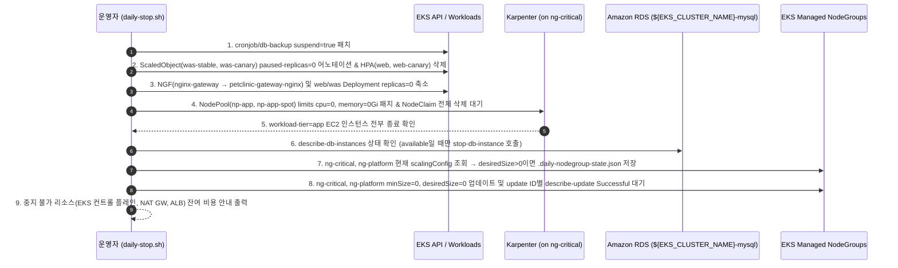
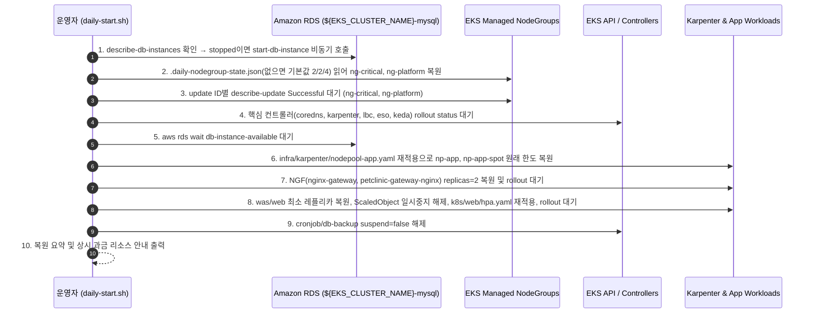

# 일일 리소스 중지·기동 스크립트 설계서 (`docs/features/daily-stop-start/design.md`)

## 1. 목표와 범위 (하지 않을 것 포함)

### 1.1 목표 (Goals)
개발·검증 시간 외(매일 퇴근 후 ~ 익일 출근 전)에 시간당 컴퓨트 과금이 발생하는 핵심 리소스를 안전하게 중지하고, 출근 시 원래 구성대로 복원하는 운영 스크립트 `scripts/daily-stop.sh` 및 `scripts/daily-start.sh`를 추가한다.

- **핵심 제어 대상**:
  1. **Karpenter 앱 노드 축소 및 복원 (`np-app`, `np-app-spot`)**:
     - Karpenter 컨트롤러는 `ng-critical` 관리형 노드그룹에서 실행되므로, **`ng-critical`을 축소하기 전에** 먼저 앱 계층(`workload-tier=app`)의 오토스케일러(`HPA`, KEDA `ScaledObject`)와 워크로드(`web`, `web-canary`, `was-stable`, `was-canary`, `nginx-gateway`, `petclinic-gateway-nginx`)를 `0`으로 줄이고 Karpenter `NodePool`(`np-app`, `np-app-spot`) 한도를 `0`으로 묶어 앱 EC2 인스턴스(`NodeClaim`)가 완전히 종료되게 한다.
     - 야간(03:00 KST)에 실행되는 `db-backup` CronJob이 RDS 중지 상태에서 실패하거나 Pending Job을 쌓지 않도록 중지 시 `suspend: true`, 기동 시 `suspend: false`로 전환한다.
  2. **EKS 관리형 노드그룹 축소 및 원래 값 복원 (`ng-critical`, `ng-platform`)**:
     - 중지 시 각 노드그룹의 현재 스케일링 설정(`minSize`, `desiredSize`, `maxSize`)을 조회하여 로컬 상태 파일(`.daily-nodegroup-state.json`, Git 추적 제외)에 저장한 뒤 `minSize=0, desiredSize=0`으로 축소한다 (이미 `desiredSize=0`인 경우 재실행 시 기존 저장된 원래 값을 덮어쓰지 않음).
     - 기동 시 저장된 원래 값(상태 파일이 없으면 `infra/eksctl/cluster.yaml` 기본값인 `minSize=2, desiredSize=2, maxSize=4` 또는 환경변수 지정값)으로 복원한다.
  3. **RDS for MySQL 인스턴스 중지 및 기동 (`${EKS_CLUSTER_NAME}-mysql`)**:
     - 중지 시 RDS 인스턴스 상태가 `available`이면 `stop-db-instance`를 호출하고, 이미 `stopping`/`stopped`이면 건너뛴다.
     - 기동 시 가장 먼저 `start-db-instance`를 호출(이미 `starting`/`available`이면 건너뜀)하여 관리형 노드그룹 복원과 병렬로 기동을 진행하고, WAS 워크로드 기동 전에 `db-instance-available`을 대기하여 초기 DB 연결 실패를 방지한다.
  4. **중지 불가 리소스 및 잔여 비용 안내**:
     - 중지할 수 없는 **EKS 컨트롤 플레인**, **NAT Gateway**, **ALB**(및 EBS/RDS 스토리지, RDS 7일 후 자동 재시작 정책)와 예상 잔여 시간당·일일 비용을 스크립트 실행 결과에 명확히 출력한다.
  5. **기존 스크립트 규칙 준수 (`.env` 로드, 멱등성, `--dry-run`)**:
     - `scripts/lib.sh`를 통해 `.env`를 로드하고 필수 환경변수를 검증한다.
     - 이미 중지된 상태에서 `daily-stop.sh`를 다시 실행하거나 이미 기동된 상태에서 `daily-start.sh`를 다시 실행해도 오류 없이 상태를 유지하는 **멱등성(Idempotency)** 을 보장한다.
     - `--dry-run` 옵션을 제공하여 실제 AWS API / Kubernetes API 변경 없이 실행 예정 명령과 잔여 비용 안내만 검증할 수 있게 한다.

### 1.2 기존 아키텍처 유지 여부
- 기존 클러스터 아키텍처(`docs/architecture.md`), 애플리케이션 코드(`app/`), 컨테이너 이미지(`docker/`), Kubernetes 매니페스트(`k8s/`, `infra/`)는 **변경하지 않는다**.
- 오직 운영 스크립트(`scripts/daily-stop.sh`, `scripts/daily-start.sh`)와 로컬 상태 파일 무시 규칙(`.gitignore`), 정적 검증(`scripts/validate-manifests.sh`)만 추가·보완한다.

### 1.3 범위 (In-Scope)
- `scripts/daily-stop.sh` 작성 (`--dry-run` 포함, 멱등 동작, 잔여 비용 안내)
- `scripts/daily-start.sh` 작성 (`--dry-run` 포함, 멱등 동작, 원래 노드그룹 용량 및 Karpenter/워크로드/RDS 복원, 상시 비용 안내)
- `.gitignore`에 로컬 노드그룹 스케일 상태 저장 파일(`.daily-nodegroup-state.json`) 추가
- `.env.example`에 선택적 오버라이드 변수(`RDS_INSTANCE_ID`, `NG_CRITICAL_DESIRED_SIZE`, `NG_PLATFORM_DESIRED_SIZE`) 주석 안내 추가
- `scripts/validate-manifests.sh`에 신규 스크립트 문법(`bash -n`) 및 `--dry-run` 오프라인 실행 검증 추가

### 1.4 하지 않을 것 (Out-of-Scope / Non-Goals)
- **실제 AWS 환경에서의 중지/기동 명령 실행 제외**: 본 작업에서는 스크립트 작성과 `--dry-run` 및 정적 검증까지만 수행하며, 실제 AWS 클러스터·RDS를 대상으로 `daily-stop.sh` / `daily-start.sh` 본 실행은 하지 않는다.
- **EKS 클러스터, NAT Gateway, ALB(`Ingress`), EBS PVC 삭제/재생성 제외**:
  - ALB(`k8s/gateway/alb-ingress.yaml`)나 NAT Gateway, EKS 컨트롤 플레인을 삭제하면 재기동 시 수십 분의 프로비저닝 지연과 ALB DNS 변경(Route 53 재전파), ACM/WAF 재연결이 발생하므로 일일 중지 대상에서 제외하고 잔여 비용 안내로 대체한다.
  - `ng-platform`에 연결된 Prometheus(`50Gi` × 2), Grafana(`10Gi`), Alertmanager(`10Gi`)의 `gp3` EBS 볼륨(PVC)은 데이터 보존을 위해 삭제하지 않는다.
- **AWS EventBridge / Lambda 기반 자동 스케줄러 구축 제외**: 운영자가 퇴근/출근 시점에 직접(또는 로컬/CI 러너에서) 실행하는 CLI 스크립트로 제공한다.

---

## 2. 구성 요소와 디렉터리 구조

### 2.1 기존 구조 대비 추가·변경되는 구성 요소
| 구분 | 대상 파일 / 컴포넌트 | 변경 구분 | 역할 및 변경 내용 |
|---|---|---|---|
| **일일 중지 스크립트** | `scripts/daily-stop.sh` | **신규 (`[NEW]`)** | 퇴근 전 `db-backup` CronJob 일시 중지 → 앱 오토스케일러/Deployment `0` 축소 및 Karpenter `NodePool` 한도 `0` 설정(`NodeClaim` 종료) → RDS 중지 요청 → `ng-critical`·`ng-platform` 원래 용량 백업 후 `minSize=0,desiredSize=0` 축소 → 중지 불가 리소스 잔여 비용 안내 |
| **일일 기동 스크립트** | `scripts/daily-start.sh` | **신규 (`[NEW]`)** | 출근 시 RDS 시작 요청 → `ng-critical`·`ng-platform` 원래 용량 복원 및 컨트롤러 Ready 대기 → RDS `available` 대기 → Karpenter `NodePool` 복원(`infra/karpenter/nodepool-app.yaml`) → NGF 및 `web`/`was` 워크로드·HPA·KEDA·CronJob 복원 → 비용 안내 |
| **환경변수 템플릿** | `.env.example` | **변경 (`[MOD]`)** | `daily-stop.sh` / `daily-start.sh`에서 사용하는 선택적 환경변수(`RDS_INSTANCE_ID`, `NG_CRITICAL_DESIRED_SIZE`, `NG_PLATFORM_DESIRED_SIZE`) 기본값 주석 안내 추가 |
| **Git 무시 규칙** | `.gitignore` | **변경 (`[MOD]`)** | 관리형 노드그룹의 중지 직전 스케일 설정을 보관하는 `.daily-nodegroup-state.json` 제외 규칙 추가 |
| **정적 검증기** | `scripts/validate-manifests.sh` | **변경 (`[MOD]`)** | `scripts/daily-stop.sh`, `scripts/daily-start.sh`의 `bash -n` 문법 검사 및 `--dry-run` 실행 검증 추가 |

### 2.2 디렉터리 구조 (추가 `[NEW]` · 변경 `[MOD]` 표시)
```text
.
├── .env.example                                  # [MOD] 일일 중지·기동 선택적 환경변수(RDS_INSTANCE_ID 등) 안내 주석 추가
├── .gitignore                                    # [MOD] .daily-nodegroup-state.json 로컬 상태 파일 무시 추가
├── docs/
│   ├── architecture.md                           # (변경 없음 — 머지 직전 ⑦ 단계에서 갱신)
│   └── features/
│       └── daily-stop-start/
│           └── design.md                         # [NEW] 본 기능 설계서
└── scripts/
    ├── lib.sh                                    # (기존 유지) .env 로드, require, render, render_all 제공
    ├── daily-stop.sh                             # [NEW] 퇴근 전 리소스 일괄 중지 및 잔여 비용 안내 (--dry-run 지원)
    ├── daily-start.sh                            # [NEW] 출근 시 리소스 일괄 복원 및 상시 비용 안내 (--dry-run 지원)
    └── validate-manifests.sh                     # [MOD] daily-stop.sh / daily-start.sh 문법 및 --dry-run 검증 추가
```

---

## 3. 데이터 흐름 / API 또는 인터페이스

### 3.1 CLI 인터페이스 명세

```bash
# 퇴근 전 리소스 중지
./scripts/daily-stop.sh [--dry-run] [-h|--help]

# 출근 시 리소스 기동 및 복원
./scripts/daily-start.sh [--dry-run] [-h|--help]
```

- **옵션**:
  - `--dry-run`: AWS CLI 및 `kubectl` 명령을 실제로 실행하지 않고(`[DRY-RUN]` 접두사로 실행 예정 명령만 순서대로 출력), 중지 불가 리소스 및 잔여 비용 안내까지 출력한 뒤 종료 코드 `0`으로 종료한다. 클러스터나 AWS 네트워크 연결이 없는 오프라인 환경에서도 `.env`(또는 `.env.example` 기본값)만으로 검증 가능해야 한다.
  - `-h`, `--help`: 사용법(`usage: ...`)을 출력하고 종료 코드 `0`으로 종료한다.
  - 정의되지 않은 옵션이 전달되면 사용법을 표준 에러(`>&2`)로 출력하고 종료 코드 `1`로 종료한다.

### 3.2 퇴근 전 중지 흐름 (`scripts/daily-stop.sh`)

> [!IMPORTANT]
> **순서 제약**: Karpenter 컨트롤러 Pod는 `ng-critical` 관리형 노드그룹에서 실행된다. 만약 `ng-critical`을 먼저 `desired=0`으로 줄이면 Karpenter 컨트롤러가 먼저 종료되어 `np-app`/`np-app-spot`의 EC2 인스턴스가 종료되지 않고 밤새 과금된다. 따라서 반드시 **① 앱 워크로드 및 Karpenter 노드 축소 완료 → ② RDS 중지 요청 → ③ 관리형 노드그룹(`ng-critical`, `ng-platform`) 축소** 순서로 실행해야 한다.



1. **사전 검증 및 Kubeconfig 설정**:
   - `scripts/lib.sh` 로드 후 `require AWS_REGION EKS_CLUSTER_NAME` 실행.
   - `RDS_INSTANCE_ID="${RDS_INSTANCE_ID:-${EKS_CLUSTER_NAME}-mysql}"` 설정.
   - `--dry-run`이 아닐 때 `aws eks update-kubeconfig --region "$AWS_REGION" --name "$EKS_CLUSTER_NAME"` 실행.
2. **Step 1 — 야간 CronJob 일시 중지 및 Karpenter 앱 노드 축소**:
   - `petclinic` 네임스페이스의 `cronjob/db-backup`을 `{"spec":{"suspend":true}}`로 패치 (`--ignore-not-found` 또는 존재 여부 확인으로 멱등 처리).
   - KEDA `ScaledObject` (`was-stable`, `was-canary`)에 `autoscaling.keda.sh/paused-replicas=0` 어노테이션을 부여하여 KEDA가 Deployment를 다시 스케일 아웃하지 못하게 고정.
   - `petclinic` 네임스페이스의 `hpa/web`, `hpa/web-canary`를 삭제(`--ignore-not-found`)하여 HPA가 `minReplicas`로 되돌리지 못하게 한 뒤, `deploy/web`, `deploy/web-canary`, `deploy/was-stable`, `deploy/was-canary`를 `--replicas=0`으로 축소.
   - `nginx-gateway` 네임스페이스에서 컨트롤 플레인 `deploy/nginx-gateway`를 먼저 `--replicas=0`으로 축소한 뒤, 데이터 플레인 `deploy/petclinic-gateway-nginx`를 `--replicas=0`으로 축소 (컨트롤 플레인을 먼저 줄여야 데이터 플레인 레플리카를 2로 되돌리지 않음).
   - Karpenter `NodePool` `np-app`, `np-app-spot`의 `spec.limits`를 `{"cpu":"0","memory":"0Gi"}`로 패치하여 신규 노드 생성을 차단하고, 남아 있는 `nodeclaim`을 `kubectl delete nodeclaim --all --ignore-not-found --wait=true --timeout=180s`로 정리하여 앱 노드가 완전히 내려간 것을 확인한다.
3. **Step 2 — RDS MySQL 인스턴스 중지 (`$RDS_INSTANCE_ID`)**:
   - `aws rds describe-db-instances --db-instance-identifier "$RDS_INSTANCE_ID" --query 'DBInstances[0].DBInstanceStatus' --output text` 조회:
     - `available`: `aws rds stop-db-instance --db-instance-identifier "$RDS_INSTANCE_ID"` 실행
     - `stopping` | `stopped`: 이미 중지(중지 진행) 상태이므로 건너뜀 (멱등)
     - 그 외 상태: 현재 상태를 출력하고 건너뛰거나 안내
4. **Step 3 — EKS 관리형 노드그룹(`ng-critical`, `ng-platform`) 축소**:
   - 각 노드그룹(`ng-critical`, `ng-platform`)의 현재 `scalingConfig`(`minSize`, `desiredSize`, `maxSize`)를 조회한다.
   - 현재 `desiredSize > 0`인 경우에만 `$ROOT/.daily-nodegroup-state.json`에 해당 노드그룹의 `{minSize, desiredSize, maxSize}`를 저장/갱신한다. (이미 `desiredSize == 0`인 상태에서 재실행된 경우에는 기존 저장 파일을 유지하여 원래 값 유실을 방지한다.)
   - 현재 `desiredSize == 0`이고 `minSize == 0`이면 API 호출을 건너뛴다 (멱등).
   - 그렇지 않으면 `aws eks update-nodegroup-config --cluster-name "$EKS_CLUSTER_NAME" --nodegroup-name "$ng" --scaling-config "minSize=0,desiredSize=0,maxSize=${maxSize}"`를 호출하고(`--query update.id`), 두 노드그룹 모두 `aws eks describe-update`로 해당 update가 `Successful`이 될 때까지 확인한다. `Failed`/`Cancelled`이거나 15분 안에 끝나지 않으면 오류로 종료한다. `nodegroup-active` 대기는 노드그룹 상태만 보고 update 실패를 알려주지 않으므로 쓰지 않는다 (GitHub Codex PR #7 P2).
5. **Step 4 — 잔여 비용 안내 출력**:
   - §3.4의 표준 안내 블록을 출력한다.

### 3.3 출근 시 기동 및 복원 흐름 (`scripts/daily-start.sh`)



0. **사전 검증**: 어떤 변경보다 먼저 `ng-critical`, `ng-platform`의 목표 스케일 값(Step 2의 우선순위)을 읽고 §5.5로 검증한다. 실패하면 RDS 시작 요청 없이 중단한다 (review R2 / security R2).
1. **Step 1 — RDS MySQL 시작 요청 (병렬 기동으로 대기 시간 단축)**:
   - RDS Multi-AZ 기동(약 5~10분)과 EKS 관리형 노드그룹 기동(약 3~5분)을 병렬로 진행하기 위해 가장 먼저 RDS 상태를 확인한다.
   - `DBInstanceStatus`가 `stopped`이면 `aws rds start-db-instance --db-instance-identifier "$RDS_INSTANCE_ID"`를 호출한다. `stopping`이면 `aws rds wait db-instance-stopped` 후 시작을 요청한다(중지 직후 기동 대비, review R1 M1). `starting` 또는 `available`이면 호출을 생략한다 (멱등).
2. **Step 2 — EKS 관리형 노드그룹(`ng-critical`, `ng-platform`) 원래 값 복원**:
   - 목표 스케일 값 결정 우선순위:
     1. `$ROOT/.daily-nodegroup-state.json`에 해당 노드그룹 기록이 있으면 그 `{minSize, desiredSize, maxSize}` 사용. 파일을 파싱할 수 없거나 값이 §5.5 검증을 통과하지 못하면 기본값으로 대체하지 않고 변경 전에 중단한다 (review R1 M2)
     2. 상태 파일이 없거나 해당 노드그룹 기록이 없으면 환경변수 기본값(`NG_CRITICAL_MIN_SIZE=2`, `NG_CRITICAL_DESIRED_SIZE=2`, `NG_CRITICAL_MAX_SIZE=4` / `NG_PLATFORM_MIN_SIZE=2`, `NG_PLATFORM_DESIRED_SIZE=2`, `NG_PLATFORM_MAX_SIZE=4` — `infra/eksctl/cluster.yaml`과 동일) 사용
   - 현재 노드그룹의 `minSize`, `desiredSize`, `maxSize` 세 값이 모두 목표값과 일치하면 `update-nodegroup-config` 호출을 생략한다 (멱등, review R1 M3).
   - 일치하지 않으면 `aws eks update-nodegroup-config`로 복원하고 두 노드그룹 모두 §3.2 Step 3과 같은 방식으로 `describe-update` 결과가 `Successful`인지 확인한다.
   - `kube-system`, `external-secrets`, `keda` 네임스페이스의 필수 컨트롤러(`coredns`, `karpenter`, `aws-load-balancer-controller`, `external-secrets`, `keda-operator`)가 `rollout status` Ready가 될 때까지 대기한다.
3. **Step 3 — RDS `available` 상태 확인**:
   - `aws rds wait db-instance-available --db-instance-identifier "$RDS_INSTANCE_ID"`를 실행하여 WAS Pod 기동 전에 DB 연결이 가능한 상태임을 보장한다.
4. **Step 4 — Karpenter `NodePool` 및 앱 워크로드·오토스케일러·CronJob 복원**:
   - `render "$ROOT/infra/karpenter/nodepool-app.yaml" | kubectl apply -f -`를 실행하여 (EC2NodeClass는 중지 대상이 아니므로 NodePool 파일만 재적용) `np-app`(`16 vCPU / 64Gi`)과 `np-app-spot`(`48 vCPU / 192Gi`)의 원래 `limits`를 매니페스트 기준으로 멱등 복원한다.
   - `nginx-gateway` 네임스페이스에서 `deploy/nginx-gateway` 및 `deploy/petclinic-gateway-nginx`의 현재 레플리카가 `2` 미만이면 `2`로 스케일 업하고 `rollout status`를 대기한다.
   - `petclinic` 네임스페이스에서:
     - `ScaledObject` (`was-stable`, `was-canary`)에서 `autoscaling.keda.sh/paused-replicas-` 및 `autoscaling.keda.sh/paused-` 어노테이션을 먼저 제거하여 KEDA 자동 확장을 재개한다 (`paused-replicas=0`이 남아 있으면 KEDA가 레플리카를 0으로 되돌림).
     - `was-stable`(최소 `2`), `was-canary`(최소 `1`), `web`(최소 `2`), `web-canary`(최소 `1`)의 현재 `.spec.replicas`가 최소치 미만(`0`)일 때만 최소 레플리카로 스케일 업한다 (이미 기동되어 오토스케일러가 확장한 상태라면 현재 레플리카를 깎지 않음).
     - `kubectl apply -f "$ROOT/k8s/web/hpa.yaml"`로 `web` 및 `web-canary` HPA를 복원한다.
     - `was-stable`, `web`, `was-canary`, `web-canary` Deployment의 `rollout status`를 확인한다.
   - `cronjob/db-backup`을 `{"spec":{"suspend":false}}`로 패치하여 일일 백업 스케줄을 재개한다.
5. **Step 5 — 복원 완료 및 상시 비용 안내 출력**:
   - 복원된 노드그룹/워크로드/RDS 요약과 함께 §3.4의 상시 비용 안내를 출력한다.
6. **오류 처리 (review R1 H1)**: 기동 단계에서 다루는 컨트롤러·Deployment·ScaledObject·CronJob은 모두 필수다. `kubectl` 조회·변경이 실패하면(`NotFound` 포함) 건너뛰지 않고 즉시 실패로 종료한다. 중지 스크립트는 `NotFound`만 건너뛰고(부분 설치·재실행 대비), 권한·인증·연결 오류는 관리형 노드그룹 축소 전에 중단한다.

### 3.4 중지 불가 리소스 및 잔여 비용 출력 형식
`daily-stop.sh`와 `daily-start.sh` 모두 마지막에 아래 정보를 포함한 안내 블록을 출력한다 (`ap-northeast-2` 리전 기준):

```text
== Notice: Non-stoppable resources & remaining costs (ap-northeast-2) ==
  - EKS Control Plane (<EKS_CLUSTER_NAME>): cannot be stopped (~$0.10/hr, ~$2.40/day)
  - NAT Gateway (VPC public subnets, 2 AZs): cannot be stopped (~$0.059/hr per NAT GW, ~$2.83/day for 2 AZs + data processing)
  - Application Load Balancer (petclinic-alb): kept active with Ingress (~$0.0252/hr, ~$0.60/day + LCU)
  - Persistent Storage & Edge (EBS gp3 PVCs, RDS gp3 storage, WAFv2 WebACL, Route 53, Secrets Manager): billed while stopped
  - RDS Auto-Start Note: AWS automatically restarts a stopped RDS instance after 7 consecutive days.
```

---

## 4. 실행 환경 (런타임 버전, 컨테이너/클라우드 리소스, 환경변수 목록)

### 4.1 런타임 및 CLI 요구사항
| 구분 | 도구 / 런타임 | 기준 버전 / 비고 |
|---|---|---|
| **Shell** | `bash` (`#!/usr/bin/env bash`, `set -euo pipefail`) | LF 줄바꿈(`.gitattributes`), 기존 `scripts/*.sh`와 동일 |
| **AWS CLI** | `aws` (v2) | `eks`, `rds`, `sts` 명령 사용 (`--dry-run` 시 호출하지 않음) |
| **Kubernetes CLI** | `kubectl` (`1.36` 호환), `jq`, `envsubst` | `scripts/lib.sh`의 `require`, `render_all` 재사용 |
| **Target EKS Cluster** | Amazon EKS `1.36` | Managed NodeGroup: `ng-critical` (`m6i.large`), `ng-platform` (`m6i.large`) / Karpenter NodePool: `np-app`, `np-app-spot` |
| **Target RDS Instance** | Amazon RDS for MySQL `8.0.39` | 식별자 기본값: `${EKS_CLUSTER_NAME}-mysql` (`db.t3.medium`, Multi-AZ) |

### 4.2 환경변수 목록 (`.env.example` 기준 — 실제 값은 저장소에 기재하지 않음)
| 구분 | 변수명 | 필수 여부 | 용도 및 기본값 |
|---|---|---|---|
| **필수 (기존)** | `AWS_REGION` | 필수 (`require`) | AWS 리전 (예: `ap-northeast-2`) |
| **필수 (기존)** | `EKS_CLUSTER_NAME` | 필수 (`require`) | 대상 EKS 클러스터 이름 (예: `petclinic-eks`) |
| **선택 (신규)** | `RDS_INSTANCE_ID` | 선택 | 중지·기동할 RDS DB 인스턴스 식별자 (미설정 시 `${EKS_CLUSTER_NAME}-mysql`) |
| **선택 (신규)** | `NG_CRITICAL_DESIRED_SIZE` | 선택 | 상태 파일 부재 시 `ng-critical` 복원 기본 Desired 용량 (미설정 시 `2`, `minSize=2`, `maxSize=4`) |
| **선택 (신규)** | `NG_PLATFORM_DESIRED_SIZE` | 선택 | 상태 파일 부재 시 `ng-platform` 복원 기본 Desired 용량 (미설정 시 `2`, `minSize=2`, `maxSize=4`) |

---

## 5. 보안 요구사항 (인증, 권한 최소화, 시크릿 관리 방식)

1. **시크릿·식별자 비노출 및 `.env` 분리**:
   - 스크립트 코드, 주석, 문서(`docs/`) 어디에도 실제 AWS 계정 ID(12자리 숫자), ARN 실값, RDS 엔드포인트, 비밀번호를 하드코딩하지 않는다 (`scripts/validate-manifests.sh`로 검증).
   - 모든 환경 식별자는 `.env`에서 읽으며, 로컬 상태 파일(`.daily-nodegroup-state.json`)은 `.gitignore`에 등록하여 저장소에 커밋되지 않게 한다.
2. **DB 비밀번호 및 시크릿 비접촉**:
   - `daily-stop.sh`와 `daily-start.sh`는 AWS 컨트롤 플레인 API(`eks`, `rds`)와 Kubernetes 스케일링 API만 호출하며, Secrets Manager의 DB 비밀번호나 Kubernetes `Secret` 값을 읽거나 출력하지 않는다.
3. **최소 권한 IAM (실행 주체 권한 범위)**:
   - 스크립트를 실행하는 운영자(또는 자동화 Role)는 다음 최소 권한만 필요로 한다:
     - EKS: `eks:DescribeCluster`, `eks:DescribeNodegroup`, `eks:UpdateNodegroupConfig`, `eks:DescribeUpdate` (대상 클러스터 `${EKS_CLUSTER_NAME}` 및 노드그룹 `ng-critical`, `ng-platform`으로 범위 제한)
     - RDS: `rds:DescribeDBInstances`, `rds:StopDBInstance`, `rds:StartDBInstance` (대상 DB 인스턴스 `${EKS_CLUSTER_NAME}-mysql`로 범위 제한)
     - Kubernetes RBAC: `petclinic`·`nginx-gateway` 네임스페이스의 `deployments`, `deployments/scale`, `horizontalpodautoscalers`, `cronjobs`, `scaledobjects.keda.sh` 및 클러스터 범위의 `nodepools.karpenter.sh`, `nodeclaims.karpenter.sh` 제어 권한, 그리고 기동 시 컨트롤러 Ready 확인용 `kube-system`(`coredns`, `karpenter`, `aws-load-balancer-controller`)·`external-secrets`·`keda` 네임스페이스 `deployments` 조회(`get`, `list`, `watch`) 권한 (security R1 M2)
4. **안전한 `--dry-run` 격리**:
   - `--dry-run` 실행 시에는 어떠한 변경 API(`update-nodegroup-config`, `stop-db-instance`, `start-db-instance`, `kubectl scale/patch/delete/apply`)나 원격 조회도 실행하지 않아 자격증명이 없거나 프로덕션 클러스터에 연결된 상태에서도 부작용 없이 안전하게 동작을 검증할 수 있어야 한다.
5. **입력값 검증**:
   - `NG_CRITICAL_DESIRED_SIZE`, `NG_PLATFORM_DESIRED_SIZE` 또는 상태 파일에서 읽은 숫자 값은 정규식(`^[0-9]+$`) 및 범위(`minSize <= desiredSize <= maxSize`, `desiredSize >= 1`)를 검증하여 (AWS describe 응답의 `scalingConfig`와 Deployment `.spec.replicas`도 산술 비교 전에 정수 검증) 손상된 상태 파일이나 잘못된 환경변수로 인해 노드그룹이 비정상 설정되는 것을 방지한다.
6. **로컬 상태 파일 권한**: `.daily-nodegroup-state.json`은 `umask 077`로 작성해 소유자만 읽을 수 있게 한다 (security R1 Low).

---

## 6. 구현 단계 체크리스트 (Claude가 순서대로 따라갈 수 있게)

> [!NOTE]
> 요구사항에 따라 **스크립트 작성과 `--dry-run` 검증까지만 수행**하며, 실제 AWS 자원에 닿는 본 실행은 하지 않는다. 향후 운영자가 실제 클러스터에서 실행할 때 참고할 수 있도록 실자원 접촉 단계는 별도로 `[위험]` 표시해 구분한다.

- [x] (`676ae9d`) **Step 1: `.gitignore` 및 `.env.example` 업데이트 (`.gitignore`, `.env.example`)**
  - `.gitignore`에 `.daily-nodegroup-state.json`을 추가하여 로컬 노드그룹 스케일 상태 파일이 커밋되지 않도록 설정한다.
  - `.env.example` 하단에 `RDS_INSTANCE_ID`, `NG_CRITICAL_DESIRED_SIZE`, `NG_PLATFORM_DESIRED_SIZE` 선택적 환경변수(비워 두면 각각 `${EKS_CLUSTER_NAME}-mysql`, `2`, `2` 사용)를 주석과 함께 추가하고 `.env.example`이 `source` 검증을 통과하는지 확인한다.
- [x] (`67814f0`) **Step 2: 퇴근 전 리소스 중지 스크립트 작성 (`scripts/daily-stop.sh`)**
  - `#!/usr/bin/env bash`, `set -euo pipefail`, `. "$(dirname "$0")/lib.sh"` 기반으로 작성하고 실행 권한(`chmod +x`)을 부여한다.
  - `--dry-run`, `-h`/`--help` 옵션 파싱 및 알 수 없는 옵션 에러 처리(`exit 1`)를 구현한다.
  - §3.2의 순서(① `db-backup` CronJob `suspend: true` → ② `ScaledObject` 일시 중지·`HPA` 삭제·`web`/`was`/`nginx-gateway` Deployment `replicas=0` 축소 → ③ Karpenter `NodePool` `np-app`/`np-app-spot` 한도 `0` 패치 및 `NodeClaim` 삭제 대기 → ④ RDS `stop-db-instance` 멱등 호출 → ⑤ `ng-critical`·`ng-platform` 원래 스케일 설정 백업(`.daily-nodegroup-state.json`, `desiredSize > 0`일 때만) 및 `minSize=0,desiredSize=0` 멱등 축소 → ⑥ 중지 불가 리소스 잔여 비용 안내 출력)를 구현한다.
- [x] (`1132fd5`) **Step 3: 출근 시 리소스 기동 스크립트 작성 (`scripts/daily-start.sh`)**
  - `#!/usr/bin/env bash`, `set -euo pipefail`, `. "$(dirname "$0")/lib.sh"` 기반으로 작성하고 실행 권한(`chmod +x`)을 부여한다.
  - `--dry-run`, `-h`/`--help` 옵션 파싱 및 알 수 없는 옵션 에러 처리(`exit 1`)를 구현한다.
  - §3.3의 순서(① RDS `start-db-instance` 멱등 비동기 요청 → ② `.daily-nodegroup-state.json` 또는 기본값(`2/2/4`)으로 `ng-critical`·`ng-platform` 복원 및 핵심 컨트롤러 Ready 대기 → ③ RDS `db-instance-available` 대기 → ④ `infra/karpenter/nodepool-app.yaml` 재적용으로 Karpenter `NodePool` 복원, NGF 및 `web`/`was` 최소 레플리카 복원, KEDA `ScaledObject` 일시 중지 해제, `k8s/web/hpa.yaml` 재적용, `db-backup` CronJob `suspend: false` 해제 → ⑤ 상시 과금 리소스 안내 출력)를 구현한다.
- [x] (`ec854b2`) **Step 4: 정적 검증기 보강 및 `--dry-run` 검증 (`scripts/validate-manifests.sh`)**
  - `scripts/validate-manifests.sh`에서 `scripts/daily-stop.sh` 및 `scripts/daily-start.sh`의 `bash -n` 문법 검사와 `AWS_REGION=ap-northeast-2 EKS_CLUSTER_NAME=petclinic-eks` 환경에서의 `--dry-run` 실행(종료 코드 `0` 및 잔여 비용 안내 문구 포함 여부)을 검증하도록 추가한다.
  - `./scripts/validate-manifests.sh`, `./scripts/daily-stop.sh --dry-run`, `./scripts/daily-start.sh --dry-run`을 실행하여 통과를 확인한다.
- [x] **Step 4a: 오프라인 회귀 테스트 (`tests/scripts/daily-stop-start.test.sh`, review R1 M4)** — 가짜 `aws`/`kubectl`로 조회 오류 전파, RDS `stopping`, 상태 파일 저장·보존·복원·손상 거부, `maxSize`만 다른 경우를 검증하고 `scripts/validate-manifests.sh`에서 실행한다 (jq 필요, 없으면 SKIP 출력).
- [ ] **[위험] Step 5 (본 작업에서는 실행하지 않음 — 운영자 수동 실행 전용): 실제 AWS 클러스터 및 RDS 대상 중지·기동 실행**
  - ⚠️ **주의**: 요구사항("스크립트 작성과 dry-run 검증까지만 하고, 실제 AWS 실행은 하지 않는다")에 따라 Claude는 이 단계를 실행하지 않는다. 실제 AWS 환경에 적용할 때는 반드시 사용자 컨펌 후 `--dry-run` 없이 실행한다.

---

## 구현 중 질문

<!-- Claude: 구현 중 설계와 다르게 구현해야 할 이유가 생기거나 모호한 점이 있으면 임의로 바꾸지 말고 이 섹션에 질문을 작성한 뒤 작업을 멈추세요. -->
