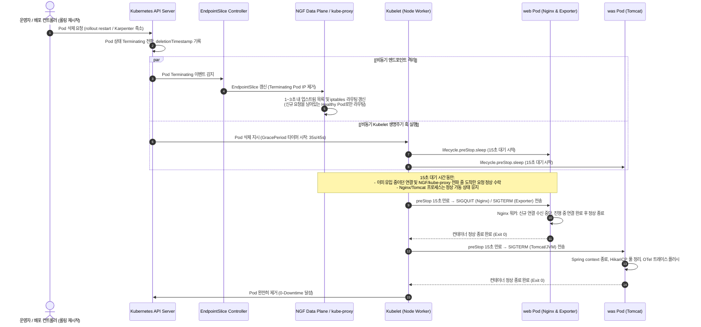

# 무중단 서비스 및 그레이스풀 셧다운 (`graceful-shutdown`) 설계서

> 문서 위치: `docs/features/graceful-shutdown/design.md`  
> 대상 시스템: EKS v1.36, PetClinic `web` / `was` 워크로드, NGINX Gateway Fabric (NGF), Karpenter `np-app`

---

## 1. 목표와 범위 (하지 않을 것 포함)

### 1.1 배경 및 문제 정의 (Background & Problem)
- **현상 (2026-10-26 발생 현황)**:
  - 2026-10-26 `spread-on-rollout` 기능 검증 도중, 메인 페이지(`/`)에 0.5초 간격으로 요청을 지속 전송하는 상태에서 `web` 및 `was-stable` Deployment 롤링 재시작(`rollout restart`)을 2회 수행하였다.
  - 총 707건의 요청 중 **2건의 요청 실패**가 발생하였다.
    - NGF 데이터 플레인(`petclinic-gateway-nginx`) 로그: **HTTP 502 Bad Gateway 1건**, **HTTP 504 Gateway Time-out 1건** 발생.
    - 에러 원인 메시지: `connect() failed (111: Connection refused) while connecting to upstream`.
- **근본 원인 분석 (Root Cause)**:
  - **Kubernetes Pod 종료 생명주기와 비동기 EndpointSlice 전파의 시차 (Race Condition)**:
    - Pod가 종료될 때 Kubernetes 컨트롤 플레인은 두 가지 작업을 **비동기(병렬)**로 수행한다:
      1. **엔드포인트 등록 해제**: `kube-apiserver` → EndpointSlice 컨트롤러 → NGF 컨트롤러/데이터 플레인 및 노드별 `kube-proxy`로 전달되어 로드밸런서/iptables 라우팅 테이블에서 제거된다. 이 전파 및 데이터 플레인 리로드/동기화에는 통상 **1~3초**가 소요된다.
      2. **Pod 컨테이너 종료 시작**: 노드의 `kubelet`이 Pod 내 컨테이너에 즉시 `SIGTERM` 신호를 전송한다.
    - 현재 `k8s/web/deployment.yaml`, `k8s/was/deployment-stable.yaml`, `k8s/was/deployment-canary.yaml`에는 컨테이너 종료 전 지연을 주는 **`lifecycle.preStop` 훅이 전혀 정의되어 있지 않다**.
    - 따라서 `SIGTERM`을 수신한 `web`(Nginx) 또는 `was`(Tomcat) 프로세스가 즉시 신규 수신 소켓을 닫거나 종료 절차에 들어가고, 그 찰나(1~3초) 동안 NGF 데이터 플레인이나 `web` 프록시는 아직 엔드포인트 목록에 남아 있는 구 Pod의 IP로 트래픽을 전송한다.
    - 대상 Pod는 이미 소켓을 닫았으므로 TCP SYN에 대해 RST(`111: Connection refused`)를 반환하게 되고, 클라이언트는 502/504 에러를 경험하게 된다.
  - **사이드카 컨테이너 생명주기 불일치**:
    - `web` Pod 내에 위치한 메트릭 수집 사이드카(`nginx-exporter`) 역시 `preStop`이 없어 메인 Nginx 컨테이너보다 먼저 종료되거나 동시에 닫히면서 메트릭 스크래핑 단절이 발생할 수 있다.

### 1.2 핵심 목표 (Goals)
1. **`lifecycle.preStop.sleep` 도입을 통한 종료 순서 보장 (Graceful Termination Order)**:
   - `엔드포인트 제거 전파 → 대기 (preStop 15초) → 활성/진행 중 요청 처리 완료 → 정상 종료(SIGQUIT/SIGTERM)`의 정합성을 확립한다.
   - EKS v1.36(Kubernetes 1.32+ GA)의 네이티브 선언형 `lifecycle.preStop.sleep: { seconds: 15 }` 액션을 채택하여 컨테이너 내 쉘/바이너리 의존성을 제거한다.
2. **`terminationGracePeriodSeconds` 적정값 산정 및 적용**:
   - `preStop` 대기 시간(15초)과 각 런타임(Nginx 워커 드레인, Tomcat/Spring/HikariCP 컨텍스트 정리 및 OTel 트레이스 배치 플러시)의 최대 처리 시간을 보장하도록 grace period를 상향 조정한다 (`web`: 35초, `was`: 45초).
3. **stable 및 canary 4개 Deployment 일관 적용**:
   - `web` (stable)
   - `web-canary` (canary)
   - `was-stable` (stable)
   - `was-canary` (canary)
4. **정적 검증 스크립트(`scripts/validate-manifests.sh`) 회귀 방지 검사 추가**:
   - 4개 Deployment의 모든 메인 컨테이너 및 사이드카에 `lifecycle.preStop.sleep.seconds` 및 적정 `terminationGracePeriodSeconds`가 선언되어 있는지 검증하는 규칙(Section 11)을 추가한다.
5. **롤링 재시작 중 요청 실패 0건(100% 무중단) 달성 검증**:
   - 메인 화면(`/`)에 0.5초 간격으로 요청을 흘리는 상태에서 `web`과 `was-stable` 롤링 재시작을 2회 수행하여 HTTP 502/504 및 `Connection refused` 0건을 달성한다.

### 1.3 비목표 (Non-Goals / 하지 않을 것)
1. **NGF(NGINX Gateway Fabric) 데이터 플레인 자체에 `preStop` 추가 제외**:
   - 이유: NGF 데이터 플레인(`petclinic-gateway-nginx`)은 Gateway API 컨트롤러가 Gateway CR로부터 자동 생성·관리하는 관리형 리소스이다. 또한 NGF 데이터 플레인의 상위 계층인 AWS ALB의 Target Group에는 이미 `deregistration_delay.timeout_seconds`가 적용되어 있어 ALB 차원의 연결 드레인이 수행된다. 이번 장애의 원인은 클러스터 내부의 `NGF → web` 및 `web → was` 계층 간의 경합이므로 워크로드 계층에 집중한다.
2. **`docker/web/nginx.conf` 변경 및 web 컨테이너 이미지 재빌드(`v1.0.3`) 제외**:
   - 이유:
     - Nginx의 `proxy_next_upstream`은 기본적으로 `error timeout`에 대해 활성화되어 있으나, Kubernetes ClusterIP 서비스(`was-stable`) 환경에서는 Nginx가 Service의 단일 가상 IP로만 연결을 시도하므로 Nginx 자체 upstream 재시도 메커니즘만으로는 iptables의 목적지 Pod 전환을 제어하기 어렵다.
     - 또한 PetClinic의 `/owners/new`, `/pets/new`, `/visits/new` 등 상태를 변경하는 `POST` 요청은 비멱등(non-idempotent)하므로, `proxy_next_upstream`을 무분별하게 확장할 경우 중복 데이터 생성 위험이 따른다.
     - 무엇보다 WAS 계층에 `preStop.sleep`을 적용하면 엔드포인트가 kube-proxy에서 먼저 제거된 후에만 Tomcat 프로세스가 종료되므로, Nginx가 종료 중인 WAS Pod로 연결을 시도하는 상황 자체가 원천 차단된다. 따라서 `nginx.conf` 변경 및 이미지 재빌드(`v1.0.3`) 없이 매니페스트 레벨의 수명주기 제어만으로 문제를 완벽히 해결한다.
3. **CoreDNS TTL 강제 변경 또는 별도의 커스텀 셧다운 컨트롤러 도입 제외**:
   - 표준 Kubernetes API와 네이티브 생명주기 훅만으로 문제를 해결하며 불필요한 외부 의존성을 추가하지 않는다.

---

## 2. 구성 요소와 디렉터리 구조 (기존 구조 대비 추가·변경되는 부분 표시)

```
.
├── docker/
│   ├── web/
│   │   ├── Dockerfile
│   │   └── nginx.conf                 # [유지] WAS 프록시 설정 유지 (이미지 재빌드 v1.0.3 불필요)
│   └── was/
│       └── Dockerfile                 # [유지]
├── k8s/
│   ├── web/
│   │   ├── deployment.yaml            # [변경] web, web-canary에 terminationGracePeriodSeconds(35s)
│   │   │                              #        및 nginx, nginx-exporter에 preStop.sleep(15s) 추가
│   │   ├── service.yaml               # [유지]
│   │   ├── hpa.yaml                   # [유지]
│   │   └── pdb.yaml                   # [유지] minAvailable: 1
│   └── was/
│       ├── deployment-stable.yaml     # [변경] was-stable에 terminationGracePeriodSeconds(45s)
│       │                              #        및 tomcat에 preStop.sleep(15s) 추가
│       ├── deployment-canary.yaml     # [변경] was-canary에 terminationGracePeriodSeconds(45s)
│       │                              #        및 tomcat에 preStop.sleep(15s) 추가
│       ├── service-stable.yaml        # [유지]
│       ├── service-canary.yaml        # [유지]
│       ├── keda-scaledobject.yaml     # [유지]
│       └── pdb.yaml                   # [유지] minAvailable: 1
├── scripts/
│   └── validate-manifests.sh          # [변경] §11 graceful-shutdown 검증 추가 (preStop.sleep, gracePeriod)
└── docs/features/
    └── graceful-shutdown/             # [추가] 신규 기능 디렉터리
        ├── design.md                  # [추가] 본 설계 문서 (Antigravity 작성)
        ├── review.md                  # [추가 예정] 코드 리뷰 (Codex 작성)
        └── security.md                # [추가 예정] 보안 점검 (Antigravity 작성)
```

---

## 3. 데이터 흐름 / API 또는 인터페이스

### 3.1 종료 순서 및 생명주기 타임라인 (Sequence Diagram)

다음 다이어그램은 Pod 롤링 업데이트 또는 삭제 이벤트 발생 시, 엔드포인트 차단과 프로세스 종료가 진행되는 시간 순서를 보여준다.



### 3.2 preStop 방식 상세 비교: `lifecycle.preStop.sleep` vs `exec sleep`

| 비교 항목 | 방식 1: `lifecycle.preStop.sleep` (권장·채택) | 방식 2: `exec: command: ["/bin/sh", "-c", "sleep 15"]` |
|---|---|---|
| **실행 주체** | `kubelet` 데몬이 직접 타이머 관리 (컨테이너 외부) | 컨테이너 내부로 `exec` 요청 진입 후 프로세스 포크 |
| **컨테이너 이미지 요건** | **제약 없음** (Scratch, Distroless, Minimal 모두 지원) | 컨테이너 내 `/bin/sh` 및 `sleep` 바이너리 필수 |
| **`nginx-exporter` 사이드카 지원** | **완벽 지원** (Go 기반 최소 바이너리 이미지에서도 동작) | **실패 위험** (쉘 부재 시 `executable not found` 에러) |
| **프로세스 오버헤드** | 없음 (0 fork) | 프로세스 생성 및 cgroup 리소스 소모 발생 |
| **Kubernetes 지원 버전** | v1.30 Beta, **v1.32+ GA** (본 EKS 클러스터 v1.36 완벽 지원) | K8s 초기 버전부터 지원되던 전통적 레거시 방식 |
| **설정 문법** | `lifecycle.preStop.sleep.seconds: 15` | `lifecycle.preStop.exec.command: ["/bin/sh", "-c", "sleep 15"]` |

- **결론**: 본 EKS 클러스터는 v1.36이므로 네이티브 GA 기능인 `lifecycle.preStop.sleep`을 채택한다. 특히 `web`의 사이드카인 `nginx-prometheus-exporter`와 같이 쉘이 없는 최소 이미지에서도 컨테이너 수정 없이 안전하게 동작한다.

### 3.3 대기 시간(15초)과 `terminationGracePeriodSeconds` 산정 근거

1. **대기 시간 (preStop sleep = 15초)**:
   - EndpointSlice 컨트롤러 감지 및 업데이트: ~0.5초
   - NGF 데이터 플레인 Nginx 프로세스 설정 리로드/피어 갱신: ~1~2초
   - 노드별 `kube-proxy` iptables 규칙 갱신: ~1~2초
   - ALB / DNS / 네트워크 캐시 잔류 가능 시간: ~1~3초
   - 전파 지연의 최악(P99) 시차는 통상 3~5초 이내이므로, **15초**의 sleep은 네트워크 경로 상의 모든 엔드포인트 제거가 완벽히 수렴하기에 충분한 안전 마진(Safety Margin)을 제공한다.
2. **`terminationGracePeriodSeconds`**:
   - `terminationGracePeriodSeconds`는 Pod 삭제 시점부터 `preStop` 실행 시간을 포함하여 최종 `SIGKILL`이 강제 전송되기까지의 전체 유예 시간이다.
   - **`web` 계층**:
     - 구성: preStop sleep(15s) + Nginx 워커 연결 드레인 및 정적 리소스 서빙 완료(~2s) + 버퍼(18s) = **35초** (`terminationGracePeriodSeconds: 35`).
   - **`was` 계층**:
     - 구성: preStop sleep(15s) + Tomcat 서블릿 요청 완료(p95 < 100ms, 최대 트랜잭션 5s) + Spring ApplicationContext 종료 및 HikariCP 커넥션 풀 반환(~3s) + OpenTelemetry Agent 트레이스 배치 플러시(~2s) + JVM 안전 종료 버퍼(20s) = **45초** (`terminationGracePeriodSeconds: 45`).

### 3.4 Nginx 및 Tomcat 프로세스 종료 특성

1. **`web` (Nginx)**:
   - 베이스 이미지: `nginx:1.27.2-alpine`
   - 공식 Nginx 컨테이너 이미지는 `STOPSIGNAL SIGQUIT`가 기본으로 지정되어 있다.
   - containerd 런타임은 이미지의 StopSignal 메타데이터를 인지하여 컨테이너 종료 시 `SIGQUIT`를 전송한다.
   - Nginx의 `SIGQUIT` 동작:
     - Master 프로세스는 신규 Listen 소켓을 닫고, Worker 프로세스에게 진행 중인 HTTP 연결 처리를 마치도록 지시한 후 연결이 모두 종료되면 프로세스를 안전하게 종료한다 (Graceful Exit).
     - preStop 15초가 선행되므로, `SIGQUIT`가 도달하는 시점에는 이미 인입 요청이 완전히 0에 수렴한 상태이므로 즉시 안전하게 종료된다.
2. **`was` (Tomcat 11)**:
   - 런타임 커맨드: `CMD ["catalina.sh", "run"]` (`tomcat:11.0.2-jre21-temurin-noble`)
   - `catalina.sh`는 `SIGTERM`을 수신하면 실행 중인 JVM에 신호를 전달한다.
   - JVM 내 Spring Framework(`PetClinicApplication`)는 기동 시 등록된 JVM Shutdown Hook(`registerShutdownHook()`)을 통해 순차적 종료를 수행한다:
     - Tomcat 커넥터 차단 및 활성 HTTP 스레드 처리 대기.
     - `@PreDestroy` 및 Spring Bean 파괴 콜백 실행.
     - HikariCP 커넥션 풀 안전 해제 (진행 중인 SQL 트랜잭션 롤백/커밋 대기).
     - OpenTelemetry Java Agent가 큐에 쌓인 트레이스 스팬을 OTel Collector(`:4318`)로 최종 플러시(Flush).

### 3.5 `nginx-exporter` 사이드카 종료 순서 및 메트릭 수집 연속성
- `web` Pod는 다중 컨테이너(`nginx`, `nginx-exporter`)로 구성되어 있다.
- Kubernetes는 일반 컨테이너들의 `preStop` 및 종료 신호를 **병렬**로 전송한다.
- 만약 메인 `nginx`에만 `preStop`을 두고 `nginx-exporter`에 두지 않으면, Prometheus가 Pod 삭제 중 메트릭(`:9113`)을 스크랩할 때 exporter가 먼저 사망하여 스크래핑 실패(Alert 발생)가 일어날 수 있다.
- 따라서 `nginx-exporter` 컨테이너에도 동일하게 `lifecycle.preStop.sleep.seconds: 15`를 적용하여, 두 컨테이너가 15초간 함께 살아있다가 동시에 안전하게 종료되도록 보장한다.

### 3.6 web Nginx의 was 프록시 재시도(`proxy_next_upstream`) 필요 여부 분석
- **질문**: `docker/web/nginx.conf`에 `proxy_next_upstream`을 추가하고 web 이미지 태그를 `v1.0.3`으로 올려 재빌드해야 하는가?
- **판단**: **불필요 (이미지 재빌드 및 nginx.conf 변경 미수행)**.
- **상세 논거**:
  1. **Service 아키텍처 한계**:
     - Nginx의 `proxy_pass http://${WAS_UPSTREAM_HOST}:${WAS_UPSTREAM_PORT};`에서 `WAS_UPSTREAM_HOST`는 Kubernetes ClusterIP(`was-stable`)이다.
     - Nginx 관점에서 업스트림 IP는 단 1개(Service Virtual IP)이므로, Nginx 내부의 `proxy_next_upstream`은 단일 IP 실패 시 다른 Pod로 자동 전환하는 로드밸런싱 페일오버를 수행하지 못한다 (이를 위해서는 Headless Service + Nginx 내부 Resolver가 필요하나 이는 아키텍처를 불필요하게 복잡화함).
  2. **비멱등성(Idempotency) 위험**:
     - Nginx 기본값은 `proxy_next_upstream error timeout;`이며 `GET`, `HEAD` 등의 멱등 메서드만 재시도한다.
     - 만약 `non_idempotent` 옵션을 켤 경우, 클라이언트의 결제/데이터 생성(`POST`) 요청이 타임아웃 등으로 재전송되어 DB에 중복 레코드가 생성될 심각한 정합성 결함이 발생한다.
  3. **WAS 계층 `preStop`으로 근본적 해결**:
     - `was-stable` 및 `was-canary`에 `preStop.sleep: 15`를 적용하면, `kube-proxy`가 iptables에서 해당 WAS Pod의 IP를 제거할 때까지 WAS 컨테이너는 계속 실행 상태를 유지한다.
     - 따라서 `web` Nginx가 Service ClusterIP를 통해 요청을 전달할 때 "Connection refused"를 만날 확률이 0이 된다.
     - 결과적으로 소스 코드 및 설정 변경(`docker/web/nginx.conf`)과 이미지 재빌드 없이, 순수 K8s 선언형 매니페스트 변경만으로 문제를 완벽히 해결할 수 있다.

### 3.7 `readinessProbe`와의 관계
- Pod가 `Terminating` 상태로 진입(삭제 요청 수신)하는 순간, Kubernetes의 `endpoints-controller` 및 `endpointslice-controller`는 **`readinessProbe` 통과 여부와 무관하게 해당 Pod를 Service의 활성 엔드포인트 목록에서 즉시 제외**한다.
- 간혹 애플리케이션에서 graceful shutdown을 구현할 때 `/healthz`를 강제로 503으로 변경하는 기법을 쓰기도 하지만, Kubernetes 환경에서는 `preStop`이 트리거되는 즉시 엔드포인트에서 제외되므로 인위적인 헬스체크 실패 처리는 불필요하다.
- 따라서 기존의 `/healthz` 및 `/` 헬스체크 경로는 수정하지 않고 그대로 유지한다.

### 3.8 PDB, HPA, KEDA, Karpenter 노드 통합과의 상호작용
1. **PodDisruptionBudget (PDB)**:
   - `web` 및 `was` 모두 `minAvailable: 1`이 설정되어 있다.
   - Karpenter가 노드 통합(Consolidation)을 위해 노드를 드레인하거나, 노드 교체(Drift)를 수행할 때 Kubernetes Eviction API를 호출한다.
   - PDB에 의해 항상 최소 1개 이상의 Pod가 살아있는 상태가 유지되며, 차례대로 `preStop(15s)`을 거쳐 안전하게 축소된다.
2. **HPA & KEDA 오토스케일링**:
   - 트래픽 감소로 인해 HPA(CPU 기반) 또는 KEDA(PromQL 요청률 기반)가 Pod 레플리카를 스케일 인(축소)할 때도 동일한 K8s Pod 종료 시퀀스가 작동한다.
   - `preStop.sleep` 덕분에 스케일 인 도중에 유입되는 트래픽 손실이 전혀 발생하지 않는다.
3. **Karpenter 노드 축소 타이밍**:
   - Karpenter는 노드 상의 Pod들을 Eviction할 때 Pod의 `terminationGracePeriodSeconds`를 기다려준다.
   - `web`(35s), `was`(45s)의 grace period 동안 노드가 강제 종료되지 않고 안전하게 Pod 드레인을 완료한 후 EC2 인스턴스를 종료한다.

---

## 4. 실행 환경

### 4.1 런타임 및 이미지 버전
- **EKS 클러스터**: AWS EKS v1.36 (`ap-northeast-2`)
- **Web 워크로드**:
  - `nginx`: `nginx:1.27.2-alpine` (UID 10001, linux/amd64)
  - `nginx-exporter`: `nginx/nginx-prometheus-exporter:1.3.0` (UID 10001, linux/amd64)
- **WAS 워크로드**:
  - `tomcat`: `tomcat:11.0.2-jre21-temurin-noble` (Temurin OpenJDK 21, UID 10001, linux/amd64)
  - `jmx-exporter`: `io.prometheus.jmx:jmx_prometheus_javaagent:1.0.1`
  - `otel-agent`: OpenTelemetry Java Agent v2.12.0 (Operator 무코드 주입)
- **Gateway**: NGINX Gateway Fabric v2.8.0

### 4.2 매니페스트 설정 규격

```yaml
# web / web-canary 공통 스펙
spec:
  template:
    spec:
      terminationGracePeriodSeconds: 35
      containers:
        - name: nginx
          lifecycle:
            preStop:
              sleep:
                seconds: 15
        - name: nginx-exporter
          lifecycle:
            preStop:
              sleep:
                seconds: 15

# was-stable / was-canary 공통 스펙
spec:
  template:
    spec:
      terminationGracePeriodSeconds: 45
      containers:
        - name: tomcat
          lifecycle:
            preStop:
              sleep:
                seconds: 15
```

### 4.3 환경변수 목록 (값은 명시하지 않음)
- `web`:
  - `ECR_WEB_REPOSITORY_URI`
  - `STABLE_IMAGE_TAG`
  - `CANARY_IMAGE_TAG`
  - `WAS_UPSTREAM_HOST`
  - `WAS_UPSTREAM_PORT`
- `was`:
  - `ECR_WAS_REPOSITORY_URI`
  - `STABLE_IMAGE_TAG`
  - `CANARY_IMAGE_TAG`
  - `SPRING_PROFILES_ACTIVE`
  - `JAVA_OPTS`
  - `OTEL_SERVICE_NAME`
  - `OTEL_RESOURCE_ATTRIBUTES`
  - `OTEL_DEPLOYMENT_ENVIRONMENT`
  - `JDBC_URL`
  - `JDBC_USERNAME`
  - `JDBC_PASSWORD`

---

## 5. 보안 요구사항 (Security Requirements)

1. **Pod Security Standards (`Restricted`) 불변성 준수**:
   - `lifecycle.preStop.sleep`은 Kubernetes Kubelet 내부 타이머에 의해 관리되므로, 컨테이너에 추가 권한(`allowPrivilegeEscalation: false`, `readOnlyRootFilesystem: true`, `drop: ["ALL"]`, `runAsNonRoot: true`)을 전혀 변경하지 않는다.
   - 컨테이너 내부에서 외부 쉘 바이너리를 실행하지 않으므로, 임의 코드 실행이나 권한 상승 위험이 원천적으로 발생하지 않는다.
2. **서비스 거부(DoS) 및 클러스터 노드 리소스 고갈 방지**:
   - `terminationGracePeriodSeconds`가 과도하게 길면(예: 수백 초) 노드 롤링 업데이트나 Karpenter 노드 통폐합 시 클러스터 리소스가 불필요하게 오래 점유된다.
   - `web: 35s`, `was: 45s`로 적정 상한선을 엄격히 설정하여 15초의 안전 대기 후 프로세스가 종료되지 않더라도 최대 45초 이내에 리소스가 완전히 회수되도록 보장한다.
3. **시크릿 및 민감 정보 격리**:
   - 본 변경은 Pod의 종료 수명주기 훅만 수정하므로, AWS Secrets Manager 및 External Secrets Operator(ESO)로 주입되는 DB 자격증명(`petclinic-rds-secret`)과 환경변수 체계에 아무런 영향을 주지 않는다.

---

## 6. 구현 단계 체크리스트

### Phase 1: 매니페스트 수정 (4개 Deployment)
- [ ] **Step 1: `k8s/web/deployment.yaml` 수정**
  - `Deployment/web`:
    - `spec.template.spec.terminationGracePeriodSeconds: 35` 추가.
    - `containers[name=nginx]`에 `lifecycle.preStop.sleep.seconds: 15` 추가.
    - `containers[name=nginx-exporter]`에 `lifecycle.preStop.sleep.seconds: 15` 추가.
  - `Deployment/web-canary`:
    - `spec.template.spec.terminationGracePeriodSeconds: 35` 추가.
    - `containers[name=nginx]`에 `lifecycle.preStop.sleep.seconds: 15` 추가.
    - `containers[name=nginx-exporter]`에 `lifecycle.preStop.sleep.seconds: 15` 추가.
- [ ] **Step 2: `k8s/was/deployment-stable.yaml` 수정**
  - `Deployment/was-stable`:
    - `spec.template.spec.terminationGracePeriodSeconds: 45` 추가.
    - `containers[name=tomcat]`에 `lifecycle.preStop.sleep.seconds: 15` 추가.
- [ ] **Step 3: `k8s/was/deployment-canary.yaml` 수정**
  - `Deployment/was-canary`:
    - `spec.template.spec.terminationGracePeriodSeconds: 45` 추가.
    - `containers[name=tomcat]`에 `lifecycle.preStop.sleep.seconds: 15` 추가.

### Phase 2: 정적 검증 스크립트 수정 및 로컬 테스트
- [ ] **Step 4: `scripts/validate-manifests.sh` 회귀 검증 규칙 추가 (§11)**
  - 대상 파일 및 Deployment: `web`, `web-canary`, `was-stable`, `was-canary`
  - 검증 규칙:
    - `web`, `web-canary`:
      - `spec.template.spec.terminationGracePeriodSeconds`가 35 이상이어야 함.
      - `nginx`, `nginx-exporter` 컨테이너 모두 `lifecycle.preStop.sleep.seconds`가 정수이며 15 이상이어야 함.
    - `was-stable`, `was-canary`:
      - `spec.template.spec.terminationGracePeriodSeconds`가 45 이상이어야 함.
      - `tomcat` 컨테이너의 `lifecycle.preStop.sleep.seconds`가 정수이며 15 이상이어야 함.
- [ ] **Step 5: 로컬 오프라인 검증 및 서버 dry-run 실행**
  - `bash scripts/validate-manifests.sh` 실행하여 검증 통과 확인.
  - 의도적으로 `preStop` 또는 `terminationGracePeriodSeconds`를 제거했을 때 `FAIL`이 발생하는지 음성 시험(Negative Test) 수행 후 복구.
  - `. ./scripts/lib.sh && render k8s/web/deployment.yaml | kubectl apply --dry-run=server -f -` 등으로 K8s API 서버 유효성 검증.

### Phase 3: 실 클러스터 적용 및 무중단 롤링 재시작 검증 [위험]
> [!IMPORTANT]
> 아래 단계는 실제 AWS EKS 클러스터의 Pod를 교체하므로 사용자의 명시적 승인을 받은 후 수행한다.

- [ ] **Step 6 [위험]: 매니페스트 적용 (Targeted Apply)**
  - 대상 매니페스트 3개 렌더링 및 적용:
    ```bash
    . ./scripts/lib.sh
    render k8s/web/deployment.yaml | kubectl apply -f -
    render k8s/was/deployment-stable.yaml | kubectl apply -f -
    render k8s/was/deployment-canary.yaml | kubectl apply -f -

    kubectl -n petclinic rollout status deploy/web --timeout=300s
    kubectl -n petclinic rollout status deploy/was-stable --timeout=600s
    kubectl -n petclinic rollout status deploy/web-canary --timeout=300s
    kubectl -n petclinic rollout status deploy/was-canary --timeout=600s
    ```
- [ ] **Step 7 [위험]: 트래픽 인입(0.5초 간격) 상태에서 롤링 재시작 2회 반복 시험**
  - 백그라운드에서 메인 페이지(`/`)로 0.5초 간격 연속 HTTP 요청 전송 (성공 여부 및 응답 코드 로깅):
    ```bash
    # 트래픽 생성 루프 예시 (ALB 엔드포인트 또는 인그레스 주소)
    ENDPOINT="https://${DOMAIN:-$(kubectl -n nginx-gateway get svc petclinic-gateway-nginx -o jsonpath='{.status.loadBalancer.ingress[0].hostname}')}"
    # 또는 클러스터 내부 / 로컬 포트포워딩
    ```
  - 트래픽이 흐르는 도중 `web` 및 `was-stable` 롤링 재시작 2회 연속 수행:
    ```bash
    # 1회차 롤링 재시작
    kubectl -n petclinic rollout restart deploy/web deploy/was-stable
    kubectl -n petclinic rollout status deploy/web --timeout=300s
    kubectl -n petclinic rollout status deploy/was-stable --timeout=600s

    # 2회차 롤링 재시작
    kubectl -n petclinic rollout restart deploy/web deploy/was-stable
    kubectl -n petclinic rollout status deploy/web --timeout=300s
    kubectl -n petclinic rollout status deploy/was-stable --timeout=600s
    ```
- [ ] **Step 8 [위험]: 무결성 확인 (요청 실패 0건 및 로그 검증)**
  - 트래픽 결과 집계: 700건 이상의 요청 중 **실패(HTTP non-200) 0건**, 성공률 100% 확인.
  - NGF 데이터 플레인 파드 로그 검사:
    ```bash
    kubectl -n nginx-gateway logs -l app.kubernetes.io/name=petclinic-gateway-nginx --tail=500 | grep -E "502|504|Connection refused"
    ```
  - `502`, `504`, `Connection refused` 로그가 전혀 발생하지 않았음을 확인.

---

## 구현 중 질문

<!-- Claude가 구현 단계에서 판단이 필요했던 사항이나 설계 범위 내 세부 결정을 기록하는 빈 섹션 -->
