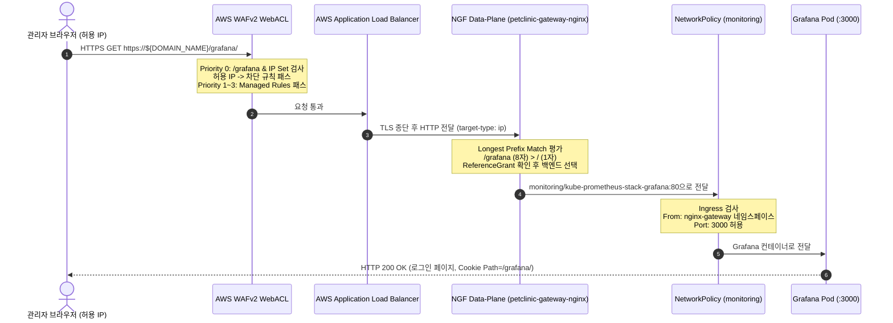
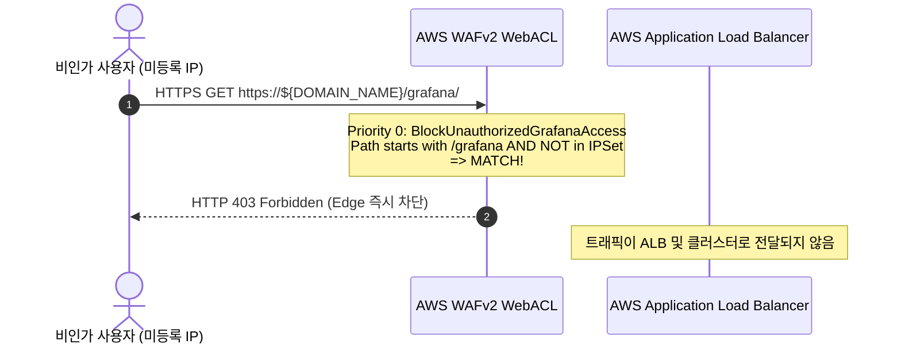

# Grafana 하위 경로 오픈 및 WAF IP 화이트리스트 접근 제어 (`grafana-public-path`) 설계서

> 문서 위치: `docs/features/grafana-public-path/design.md`  
> 대상 시스템: EKS v1.36, AWS WAFv2, NGINX Gateway Fabric (NGF 2.8.0), Gateway API v1, kube-prometheus-stack (Grafana 14.0.1)

---

## 1. 목표와 범위 (하지 않을 것 포함)

### 1.1 배경 및 문제 정의 (Background & Problem)
- **현상**:
  - 현재 Grafana(`monitoring` 네임스페이스, Service `kube-prometheus-stack-grafana:80` -> Pod `:3000`)는 클러스터 내부 전용 Service(`ClusterIP`)로만 운영되고 있다.
  - 운영자 및 개발자가 APM 분산 트레이싱 대시보드, 서비스 RED 메트릭, 카나리 배포 상태를 모니터링하기 위해서는 `kubectl port-forward` 또는 Bastion 호스트 SSH 터널링에 의존해야 하므로 운영 편의성과 신속한 장애 대응 역량이 저하된다.
- **요구사항 및 제약**:
  - 기존 공인 서비스 도메인의 하위 경로 `https://${DOMAIN_NAME}/grafana/`로 Grafana를 안전하게 공개한다.
  - 사용자 결정에 따라 별도 서브도메인(`grafana.example.com`) 대신 **경로 방식(Subpath)**을 채택하여 신규 ACM 인증서 발급이나 Route 53 레코드 추가 없이 기존 엔드포인트를 그대로 활용한다.
  - 접근 제어는 **사용자 결정 A(AWS WAFv2 기반 IP 화이트리스트 제한)**를 적용하여 지정된 관리자 IP(`.env`의 `GRAFANA_ALLOWED_CIDRS`)에서만 접근을 허용하고, 그 외의 모든 외부 접근은 AWS 엣지에서 HTTP 403 Forbidden으로 원천 차단한다.

### 1.2 핵심 목표 (Goals)
1. **서브도메인 대신 기존 도메인 하위 경로(`https://${DOMAIN_NAME}/grafana/`) 라우팅 확립**:
   - 신규 인증서·DNS 추가 없이 기존 `https://${DOMAIN_NAME}/` 하위 경로로 Grafana 웹 UI 및 대시보드를 안정적으로 제공.
2. **연결 방식 최적화: (가) NGF HTTPRoute + ReferenceGrant 채택**:
   - AWS ALB의 IngressGroup 방식 대신, 기존 아키텍처 원칙에 부합하는 NGINX Gateway Fabric(NGF) L7 라우팅 및 Gateway API v1 `ReferenceGrant` 표준을 채택하여 서비스 중단 위험을 원천 배제.
3. **카나리 HTTPRoute(`petclinic`)와 `/grafana` 상호 간섭 원천 배제**:
   - Gateway API 최장 접두사 일치(Longest Prefix Match) 원칙에 따라 `/grafana`(8자)가 `/`(1자, 카나리 90:10 및 `X-Canary: always`)보다 항상 우선순위를 갖도록 구성하여 상호 간섭을 100% 방지.
4. **AWS WAFv2 기반 엄격한 IP 화이트리스트 차단 (사용자 결정 A)**:
   - 기존 WebACL(`${WAF_WEB_ACL_ARN}`)에 `GRAFANA_ALLOWED_CIDRS`를 참조하는 IPSet 및 차단 규칙(`BlockUnauthorizedGrafanaAccess`, Priority 0)을 추가하여 비인가 요청을 엣지에서 즉시 403 차단.
   - 인가된 IP의 요청은 통과 후 기존 AWS Managed Rules(Common, SQLi, KnownBadInputs)의 정밀 검사를 받도록 다층 방어 체계 구축.
5. **Grafana 내부 보안 강화 및 세션/Same-Origin 위험 완화**:
   - `server.root_url=https://${DOMAIN_NAME}/grafana/`, `server.serve_from_sub_path=true` 설정.
   - 쿠키 경로 자동 격리(`Path=/grafana/`), `cookie_secure=true`, `cookie_samesite=lax` 강제.
   - 익명 접속 차단(`auth.anonymous.enabled=false`), 회원가입 차단(`users.allow_sign_up=false`), 로그인 시도 제한(`max_login_attempts=5`), 기존 Secrets Manager 연동 `grafana-admin` 시크릿 유지.
6. **NetworkPolicy 최소 권한 인입 격리**:
   - `monitoring` 네임스페이스에 `grafana-ingress` NetworkPolicy를 신설하여 Grafana Pod(:3000) 인입을 `nginx-gateway` 네임스페이스(NGF 데이터 플레인) 및 Prometheus로만 엄격히 제한.
7. **비용 및 운영 영향 최적화**:
   - WAF 규칙 1개 추가로 월 $1.00 고정비용만 발생하며, ALB 헬스체크, Prometheus 스크랩, `daily-stop.sh`/`daily-start.sh`와의 무중단 정합성 검증.
8. **회귀 검사 및 정적 검증 파이프라인(`scripts/validate-manifests.sh`) 통합**:
   - Section 12 규칙을 추가하여 필수 환경변수 선언, YAML 보안 설정, ReferenceGrant 및 NetworkPolicy 정합성을 자동 검증.

### 1.3 비목표 (Non-Goals / 하지 않을 것)
1. **신규 서브도메인(`grafana.${DOMAIN_NAME}`) 및 신규 ACM 인증서 도입 제외**:
   - 단일 도메인(`${DOMAIN_NAME}`) 하위 경로 방식을 일관되게 유지.
2. **별도 ALB 생성 또는 IngressGroup을 통한 ALB 리스너 복잡화 제외**:
   - ALB는 엣지 TLS 종단 및 WAF 적용의 단일 역할만 유지하며, L7 라우팅은 NGF에 전담시킴.
3. **애플리케이션 및 WAS/Web 소스 코드 수정 제외**:
   - 인프라 및 K8s 선언형 매니페스트 레벨에서 완결.
4. **Grafana 외부 SSO(OAuth2/OIDC/Keycloak/Cognito) 연동 제외**:
   - 현재 구축된 AWS Secrets Manager 동기화 관리자 패스워드(`grafana-admin`) 체계를 유지.

---

## 2. 구성 요소와 디렉터리 구조 (기존 구조 대비 추가·변경되는 부분 표시)

```text
├── .env.example                                      # [변경] GRAFANA_ALLOWED_CIDRS 변수 추가
├── infra/aws/
│   └── provision-aws-resources.sh                    # [변경] WAF IPSet 및 BlockUnauthorizedGrafanaAccess 규칙 생성/업데이트 로직 추가
├── k8s/
│   ├── gateway/
│   │   ├── gateway.yaml                              # [변경] allowedRoutes에 nginx-gateway 네임스페이스 허용 추가
│   │   ├── alb-ingress.yaml                          # [유지] ALB Ingress는 그대로 유지 (/ -> petclinic-gateway-nginx)
│   │   ├── httproute-canary.yaml                     # [유지] PetClinic 90:10 카나리 라우트 유지
│   │   └── httproute-grafana.yaml                    # [신규] /grafana 경로 -> monitoring/kube-prometheus-stack-grafana:80 라우트
│   ├── monitoring/
│   │   ├── kube-prometheus-values.yaml               # [변경] grafana.ini subpath, security, auth 강화 설정 추가
│   │   ├── referencegrant-grafana.yaml               # [신규] nginx-gateway의 HTTPRoute가 monitoring의 Service를 참조할 수 있도록 허가
│   │   └── networkpolicy-grafana.yaml                # [신규] Grafana Pod(:3000) 인입을 nginx-gateway 및 Prometheus로만 제한
├── scripts/
│   ├── lib.sh                                        # [유지] DOMAIN_NAME 이미 TEMPLATE_VARS에 포함됨 확인
│   ├── deploy-all.sh                                 # [변경] referencegrant, networkpolicy-grafana 배포 단계 추가
│   └── validate-manifests.sh                         # [변경] Section 12: grafana-public-path 정적 검증 및 .env.example 검사
└── docs/features/grafana-public-path/
    └── design.md                                     # [신규] 본 설계서
```

---

## 3. 핵심 아키텍처 결정 및 비교 분석

### 3.1 연결 방식 비교: (가) NGF HTTPRoute vs (나) ALB IngressGroup
| 비교 항목 | (가) NGF HTTPRoute + ReferenceGrant (채택) | (나) ALB IngressGroup Ingress (기각) |
| :--- | :--- | :--- |
| **개념** | ALB는 변경 없이 모든 트래픽을 NGF로 전달하고, NGF가 Gateway API 표준으로 `/grafana`를 `monitoring` Service로 라우팅 | ALB에 IngressGroup을 적용하여 ALB 리스너에서 직접 `/grafana*` 타깃그룹(Grafana Pod IP)으로 분기 |
| **기존 아키텍처 정합성** | **최상**: `docs/architecture.md`에 명시된 "ALB는 단순 TLS/WAF 엣지, NGF가 유일한 L7 Gateway" 원칙 100% 준수 | **불량**: L7 라우팅 책임이 AWS ALB와 NGF로 파편화됨 |
| **기존 서비스(PetClinic) 안정성** | **안전**: `k8s/gateway/alb-ingress.yaml` 수정 불필요. 기존 ALB 리스너/타깃그룹 일체 미변경으로 메인 서비스 다운타임 위험 0 | **위험**: 기존 `alb-ingress.yaml`에 `group.name` 주입 시 AWS ALB 리스너 재조정 발생, 오설정 시 메인 서비스 중단 가능 |
| **네트워크 정책 및 격리** | **최소 권한**: Grafana는 오직 `nginx-gateway` Pod IP 및 Prometheus만 허용. ALB 서브넷 직접 노출 차단 | **확장 필요**: Grafana가 ALB VPC 서브넷 전체로부터의 인입을 허용해야 함 |
| **Pod 재스케줄링 반응성** | **즉시 반영 (EndpointSlice)**: Kubernetes 네이티브 CNI 엔드포인트 동기화 (1~2초) | **지연 발생 (ALB Target Group)**: AWS 타깃 등록/해제에 30~60초 소요 |
| **Gateway API 표준 준수** | Gateway API v1 `ReferenceGrant` 표준을 활용한 네임스페이스 간 경계 준수 | IngressGroup 비표준 AWS 전용 어노테이션에 의존 |

> **선택 및 사유**:  
> **(가) NGF HTTPRoute 방식**을 최종 선정한다.  
> 이유: 기존 ALB 리스너 설정을 건드리지 않아 실서버 서비스 중단 위험이 전무하며, K8s Gateway API 표준의 크로스 네임스페이스 접근 제어(`ReferenceGrant`)를 준수하고, Pod 재시작 시 엔드포인트 동기화가 훨씬 빠르고 안정적이기 때문이다.

---

### 3.2 카나리 HTTPRoute(`petclinic`)와 `/grafana` 라우트의 무간섭 보장 원리
1. **Gateway API 명세 상의 라우트 매칭 우선순위 (Precedence Rule)**:
   - Gateway API v1 스펙에 따르면 단일 Listener에 바인딩된 복수의 HTTPRoute 규칙 간 매칭 우선순위는 다음과 같이 엄격하게 정의된다:
     1. **Hostname 일치도**: 가장 구체적인 Hostname (여기서는 동일 호스트 `${DOMAIN_NAME}`).
     2. **Path 일치도**: Exact Match > **Prefix Match (최장 접두사 우선: Longest Prefix Match)**.
     3. **Header 일치도**: 일치하는 헤더 조건 수가 많은 규칙.
2. **접두사 길이 비교**:
   - Grafana HTTPRoute: `path: { type: PathPrefix, value: /grafana }` → **접두사 길이: 8자**
   - PetClinic Canary HTTPRoute: `path: { type: PathPrefix, value: / }` → **접두사 길이: 1자**
3. **무간섭 동작 입증**:
   - 클라이언트가 `https://${DOMAIN_NAME}/grafana/`로 요청 시:
     - 요청 헤더에 `X-Canary: always`가 포함되어 있더라도, PathPrefix `/grafana`(8자)가 `/`(1자)보다 항상 우선 평가된다.
     - 따라서 `/grafana` 요청은 PetClinic 카나리 라우트의 가중치 분할(90:10)이나 헤더 라우팅에 절대 걸리지 않고 100% Grafana 백엔드로만 전송된다.
   - 클라이언트가 `https://${DOMAIN_NAME}/` 또는 `/vets` 등 앱 경로로 요청 시:
     - `/grafana` 접두사와 일치하지 않으므로 기존 PetClinic 카나리 라우트가 정상 동작하여 90:10 및 `X-Canary: always` 분할이 유지된다.

---

### 3.3 AWS WAFv2 IP 화이트리스트 접근 제어 및 비용 분석 (사용자 결정 A)

1. **규칙 설계 (Block Rule with IP Set Exclusion)**:
   - 무단 접근자를 가장 먼저 차단하기 위해 **Priority 0**에 배치한다.
   - 규칙 로직:
     - `UriPath`가 `/grafana`(대소문자 무시)로 시작하고(`STARTS_WITH`),
     - 발신 클라이언트 IP가 `GRAFANA_ALLOWED_CIDRS`로 구성된 IPSet에 속하지 않는 경우(`NOT`),
     - 즉시 **Block** (HTTP 403 Forbidden 응답 반환).
2. **WAF 규칙 우선순위 구성**:
   | Priority | 규칙명 | 유형 | 동작 (Action) | 비고 |
   | :---: | :--- | :--- | :---: | :--- |
   | **0** | `BlockUnauthorizedGrafanaAccess` | Custom Rule | **Block (403)** | 비인가 IP의 `/grafana*` 접근 즉시 차단 |
   | **1** | `AWSManagedRulesCommonRuleSet` | Managed Rule | Block (Terminating) | OWASP Top 10 공통 취약점 필터링 |
   | **2** | `AWSManagedRulesSQLiRuleSet` | Managed Rule | Block (Terminating) | SQL Injection 공격 차단 |
   | **3** | `AWSManagedRulesKnownBadInputsRuleSet` | Managed Rule | Block (Terminating) | 악성 입력 패턴 차단 |
   | Default | - | - | **Allow** | 일반 트래픽 허용 |

3. **이 우선순위 구성의 핵심 장점**:
   - **보안성 극대화**: 비인가 IP는 AWS 엣지에서 즉시 403으로 차단되어 ALB 및 EKS 클러스터로 요청 자체가 인입되지 않는다.
   - **인가된 IP에 대한 지속적 검사**: 인가된 IP의 요청은 Priority 0을 통과한 후 Priority 1~3(AWS Managed Rules)의 정밀 검사를 받으므로, 허용된 개발자/관리자 환경이 악성코드에 감염되어 공격을 시도하더라도 엣지에서 차단된다.
   - **일반 서비스 영향 0**: `/grafana`로 시작하지 않는 일반 사용자 트래픽은 Priority 0 조건을 만족하지 않으므로 곧바로 Priority 1(CommonRuleSet)으로 넘어가 정상 처리된다.

4. **비용 분석 (AWS 서울 리전 기준)**:
   - **WebACL 기본 요금**: $5.00/월 (이미 1개 운영 중이므로 추가 비용 $0)
   - **IPSet 요금**: **$0.00** (IPSet 자체는 무료)
   - **신규 WAF 규칙 (Rule) 요금**: **$1.00 / 월** (규칙당 $1.00/월)
   - **WCU (Web ACL Capacity Units)**:
     - 기존 관리형 규칙 3종: Common(700) + SQLi(200) + KnownBad(200) = 1,100 WCU
     - 신규 커스텀 규칙: ByteMatch(1) + IPSetReference(1) = 2 WCU
     - 총 WCU = 1,102 WCU (기본 제공 한도 1,500 WCU 이내이므로 추가 WCU 비용 $0)
   - **요청 처리 비용**: 100만 건당 $0.60 (관리자 전용 경로이므로 월 수천 건 수준, $0.01 미만)
   - **총 추가 비용**: **월 $1.00 (일 약 $0.033)**

---

### 3.4 Same-Origin 공유 시 보안 위험 및 완화 방안
Grafana가 PetClinic과 동일한 출처(`https://${DOMAIN_NAME}:443`)를 공유함에 따라 브라우저의 동일 출처 정책(Same-Origin Policy) 관점에서 발생할 수 있는 보안 위험과 그 완화 방안을 설계한다.

1. **위험 1: 쿠키 유출 및 오전송 (Cookie Path & Scope)**:
   - *위험*: PetClinic 세션 쿠키(`JSESSIONID`)나 Grafana 세션 쿠키가 상호 간의 경로로 전송되거나 충돌할 위험.
   - *완화*:
     - Grafana의 `server.serve_from_sub_path = true` 활성화 시, Grafana가 발행하는 모든 쿠키(`grafana_session`, `grafana_remember` 등)는 자동으로 `Path=/grafana/`로 제한된다. 따라서 브라우저는 PetClinic 경로(`/`, `/owners` 등) 요청 시 Grafana 쿠키를 전송하지 않는다.
     - `cookie_secure = true`: HTTPS 환경에서만 쿠키 전송 보장.
     - `cookie_samesite = lax`: 제3자 사이트에서의 CSRF 공격 차단.
2. **위험 2: 교차 사이트 스크립팅 (XSS) 전파**:
   - *위험*: PetClinic 웹페이지에 XSS 취약점이 존재할 경우, 동일 출처 내의 Grafana 세션이나 API 토큰을 탈취하려 시도할 수 있음.
   - *완화*:
     - Grafana 세션 쿠키는 `HttpOnly` 속성이 강제되어 JavaScript(`document.cookie`)로 읽을 수 없다.
     - WAF Priority 0에서 비인가 IP를 원천 차단하고 있으므로, 외부 공격자가 피해자의 브라우저를 통해 XSS 페이로드를 실행하더라도 공격자의 서버로 정보를 직접 유출하기 어렵다.
     - Grafana의 `allow_embedding = false`를 적용하여 `X-Frame-Options: deny` 및 CSP `frame-ancestors`를 강제, iframe을 통한 클릭재킹 및 UI 덧씌우기를 방지한다.
3. **위험 3: 무차별 대입 공격 (Brute Force) 및 계정 보안**:
   - *완화*:
     - Grafana 설정에서 익명 접속 차단: `auth.anonymous.enabled = false`.
     - 신규 가입 차단: `users.allow_sign_up = false`.
     - 로그인 시도 제한: `max_login_attempts = 5` (5회 실패 시 계정 임시 잠금).
     - 초기 관리자 패스워드는 기존과 동일하게 AWS Secrets Manager에서 ESO(`externalsecret-grafana.yaml`)를 통해 동기화되는 `grafana-admin` Secret을 그대로 사용한다.

---

### 3.5 시스템 상호작용 및 영향 평가
1. **`web`(Nginx) Pod의 트래픽 가로채기(Interception) 여부**:
   - `docker/web/nginx.conf`에는 `location / { proxy_pass was }`가 설정되어 있으나, NGF가 L7 라우터로서 `/grafana` 경로 요청을 Grafana Pod로 직접 포워딩하므로 트래픽이 `web` Pod를 전혀 통과하지 않는다. 따라서 간섭이 전혀 발생하지 않는다.
2. **헬스체크 영향**:
   - AWS ALB의 헬스체크는 `alb.ingress.kubernetes.io/healthcheck-path: /healthz`를 통해 NGF 데이터 플레인(`petclinic-gateway-nginx:80`)을 직접 점검한다. Grafana의 경로나 상태는 ALB 헬스체크에 아무런 영향을 주지 않는다.
3. **Prometheus 메트릭 스크래핑 영향**:
   - `monitoring` 네임스페이스의 Prometheus는 K8s 내부 Service(`http://kube-prometheus-stack-grafana:80/metrics`)를 통해 Grafana를 스크래핑한다.
   - Grafana는 `serve_from_sub_path = true` 상태에서도 내부 메트릭 엔드포인트 `/metrics`를 정상 제공하며, `ServiceMonitor`의 동작에 영향을 주지 않는다.
4. **일일 정지/시작 (`daily-stop.sh` / `daily-start.sh`) 영향**:
   - `daily-stop.sh` 실행 시 `ng-platform` 노드 그룹이 축소되어 Grafana Pod가 안전하게 종료되며, `10Gi gp3 PVC`는 보존된다.
   - 중지 상태에서 `/grafana/` 접근 시: WAF는 인가 IP 검사를 수행하며, NGF는 백엔드 Pod가 없으므로 503 Service Unavailable을 반환한다.
   - `daily-start.sh` 실행 시: 노드 그룹이 복구되면서 Grafana Pod가 재기동되고 PVC가 재마운트되며, NGF 엔드포인트가 자동 복구되어 정상 서비스된다.
   - WAF WebACL 및 IPSet은 중지 기간에도 보존되며 월 $1.00의 고정비용만 유지된다.

---

## 4. 데이터 흐름 / 인터페이스 상세

### 4.1 인가된 사용자의 Grafana 접근 흐름


### 4.2 비인가 IP의 차단 흐름


---

## 5. 실행 환경 및 설정 사양

### 5.1 런타임 및 컴포넌트 버전
- **EKS Cluster**: Kubernetes `v1.36`
- **NGINX Gateway Fabric (NGF)**: Chart `2.8.0`, Gateway API CRDs `v1.6.3` (Standard)
- **kube-prometheus-stack**: Chart `92.11.0`, Grafana App `13.2.4` (Grafana Chart `14.0.1`)
- **AWS WAFv2**: Regional WebACL, WAFv2 API

### 5.2 환경변수 사양 (값은 기술하지 않음)
- `.env` 및 `.env.example`:
  - `GRAFANA_ALLOWED_CIDRS`: 쉼표로 구분된 IPv4 CIDR 목록 (예: `IP1/32,IP2/24`). 미지정 또는 빈 값일 경우 모든 IP 차단.
  - 기존 변수 재활용: `DOMAIN_NAME`, `WAF_WEB_ACL_ARN`, `EKS_CLUSTER_NAME`, `AWS_REGION`

### 5.3 주요 매니페스트 변경 사양

#### (1) `k8s/gateway/gateway.yaml` (네임스페이스 허용 확장)
```yaml
spec:
  gatewayClassName: nginx
  listeners:
    - name: http
      port: 80
      protocol: HTTP
      allowedRoutes:
        namespaces:
          from: Selector
          selector:
            matchExpressions:
              - key: kubernetes.io/metadata.name
                operator: In
                values:
                  - petclinic
                  - nginx-gateway
```

#### (2) `k8s/gateway/httproute-grafana.yaml` (신규 생성)
```yaml
apiVersion: gateway.networking.k8s.io/v1
kind: HTTPRoute
metadata:
  name: grafana
  namespace: nginx-gateway
spec:
  parentRefs:
    - name: petclinic-gateway
      namespace: nginx-gateway
      sectionName: http
  rules:
    - matches:
        - path:
            type: PathPrefix
            value: /grafana
      backendRefs:
        - name: kube-prometheus-stack-grafana
          namespace: monitoring
          port: 80
```

#### (3) `k8s/monitoring/referencegrant-grafana.yaml` (신규 생성)
```yaml
apiVersion: gateway.networking.k8s.io/v1
kind: ReferenceGrant
metadata:
  name: allow-nginx-gateway-to-grafana
  namespace: monitoring
spec:
  from:
    - group: gateway.networking.k8s.io
      kind: HTTPRoute
      namespace: nginx-gateway
  to:
    - group: ""
      kind: Service
      name: kube-prometheus-stack-grafana
```

#### (4) `k8s/monitoring/networkpolicy-grafana.yaml` (신규 생성)
```yaml
apiVersion: networking.k8s.io/v1
kind: NetworkPolicy
metadata:
  name: grafana-ingress
  namespace: monitoring
spec:
  podSelector:
    matchLabels:
      app.kubernetes.io/name: grafana
  policyTypes:
    - Ingress
  ingress:
    - from:
        - namespaceSelector:
            matchLabels:
              kubernetes.io/metadata.name: nginx-gateway
      ports:
        - protocol: TCP
          port: 3000
    - from:
        - podSelector:
            matchLabels:
              app.kubernetes.io/name: prometheus
      ports:
        - protocol: TCP
          port: 3000
```

#### (5) `k8s/monitoring/kube-prometheus-values.yaml` (grafana.ini 추가)
```yaml
grafana:
  <<: *platform
  admin:
    existingSecret: grafana-admin
    userKey: admin-user
    passwordKey: admin-password
  persistence:
    enabled: true
    storageClassName: gp3
    size: 10Gi
  grafana.ini:
    server:
      domain: ${DOMAIN_NAME}
      root_url: https://${DOMAIN_NAME}/grafana/
      serve_from_sub_path: true
    security:
      cookie_secure: true
      cookie_samesite: lax
      allow_embedding: false
    users:
      allow_sign_up: false
      auto_assign_org: true
      auto_assign_org_role: Viewer
    auth:
      login_maximum_inactive_lifetime_duration: 4h
      login_maximum_lifetime_duration: 24h
      max_login_attempts: 5
    "auth.anonymous":
      enabled: false
```

---

## 6. 구현 단계 체크리스트

Claude가 작업을 단계별로 완수할 수 있도록 명확히 순서화하며, AWS 실자원에 닿거나 클러스터 변경을 수반하는 단계는 **[위험]**으로 명시한다.

- [ ] **1단계: 환경변수 및 검증 스크립트 기반 마련**
  - [ ] `.env.example`에 `GRAFANA_ALLOWED_CIDRS=` 추가 (값 없이 빈 템플릿).
  - [ ] `scripts/validate-manifests.sh`에 `Section 12: Grafana public subpath & security guards` 검증 규칙 추가:
    - `.env.example` 내 `GRAFANA_ALLOWED_CIDRS` 존재 여부 검사.
    - `k8s/monitoring/kube-prometheus-values.yaml` 내 `server.root_url`, `serve_from_sub_path`, `cookie_secure`, `cookie_samesite`, `allow_sign_up`, `auth.anonymous.enabled` 선언 검사.
    - `k8s/gateway/gateway.yaml`에 `nginx-gateway` 네임스페이스 허용 여부 검사.
    - `k8s/gateway/httproute-grafana.yaml`, `k8s/monitoring/referencegrant-grafana.yaml`, `k8s/monitoring/networkpolicy-grafana.yaml` 존재 및 필수 필드 검사.
  - [ ] `bash scripts/validate-manifests.sh` 실행하여 기존 규칙 정합성 사전 확인.

- [ ] **2단계: Kubernetes 매니페스트 작성**
  - [ ] `k8s/gateway/gateway.yaml` 수정: `allowedRoutes`를 `matchExpressions`로 확장하여 `petclinic` 및 `nginx-gateway` 모두 허용.
  - [ ] `k8s/gateway/httproute-grafana.yaml` 신규 작성.
  - [ ] `k8s/monitoring/referencegrant-grafana.yaml` 신규 작성.
  - [ ] `k8s/monitoring/networkpolicy-grafana.yaml` 신규 작성.
  - [ ] `k8s/monitoring/kube-prometheus-values.yaml` 수정: `grafana.grafana.ini` 블록 추가.
  - [ ] `scripts/deploy-all.sh` 수정:
    - `kube-prometheus-stack` 배포 직후 `networkpolicy-grafana.yaml` 및 `referencegrant-grafana.yaml` apply 추가.

- [ ] **3단계: AWS 프로비저닝 스크립트 수정**
  - [ ] `infra/aws/provision-aws-resources.sh`의 WAF 생성/업데이트 로직 고도화:
    - `GRAFANA_ALLOWED_CIDRS` 파싱 및 WAFv2 IPSet(`${EKS_CLUSTER_NAME}-grafana-allowed-ips`) 생성/업데이트 함수 작성.
    - `BlockUnauthorizedGrafanaAccess` 규칙(Priority 0) 생성 및 기존 관리형 규칙(Priority 1, 2, 3)과 함께 WebACL 생성 또는 `update-web-acl` 멱등 적용.

- [ ] **4단계: [위험] AWS WAF IPSet 및 WebACL 실자원 적용**
  - [ ] 현재 접속 환경의 공인 IP를 `.env`의 `GRAFANA_ALLOWED_CIDRS`에 설정 (커밋 금지).
  - [ ] `infra/aws/provision-aws-resources.sh` 실행하여 WAF IPSet 및 WebACL 규칙 업데이트 적용.
  - [ ] `aws wafv2 get-web-acl`로 Priority 0 규칙과 IPSet 매핑 확인.

- [ ] **5단계: [위험] Kubernetes 리소스 배포 및 Helm 업그레이드**
  - [ ] `kubectl apply -f k8s/monitoring/referencegrant-grafana.yaml -f k8s/monitoring/networkpolicy-grafana.yaml` 적용.
  - [ ] `helm upgrade kube-prometheus-stack prometheus-community/kube-prometheus-stack ...` 실행하여 Grafana 설정 반영.
  - [ ] Grafana Pod 롤링 재시작 완료 대기 (`kubectl -n monitoring rollout status deploy/kube-prometheus-stack-grafana`).
  - [ ] `kubectl apply -f k8s/gateway/gateway.yaml -f k8s/gateway/httproute-grafana.yaml` 적용.
  - [ ] NGF 상태 확인 (`kubectl -n nginx-gateway get httproute grafana -o yaml` -> `status.parents[].conditions` Accepted 확인).

- [ ] **6단계: 통합 검증 및 시나리오 테스트**
  - [ ] **검증 A (허용 IP 접속)**:
    - 허용된 IP 환경의 브라우저 또는 curl로 `https://${DOMAIN_NAME}/grafana/` 접속.
    - HTTP 200 응답 및 Grafana 로그인 화면 정상 노출 확인.
    - 정적 에셋(JS, CSS) 경로가 `/grafana/public/...`로 로드되는지 확인.
    - 관리자 계정(`grafana-admin` 시크릿)으로 정상 로그인 확인.
  - [ ] **검증 B (비허용 경로/IP 차단)**:
    - 허용 목록에 없는 IP에서 요청 시(또는 임시로 IPSet에서 제외 테스트) HTTP 403 Forbidden 반환 확인.
    - WAF CloudWatch 메트릭 `BlockUnauthorizedGrafanaAccess` 카운트 증가 확인.
  - [ ] **검증 C (메인 서비스 및 카나리 무간섭)**:
    - `https://${DOMAIN_NAME}/` 접속 시 PetClinic 메인 화면 정상 반환 확인.
    - `curl -H "X-Canary: always" https://${DOMAIN_NAME}/` 요청 시 카나리 정상 라우팅 확인.
    - 카나리 가중치 분할(90:10) 정상 유지 확인.
  - [ ] **검증 D (정적 검증 스크립트 실행)**:
    - `bash scripts/validate-manifests.sh` 실행하여 모든 검사 PASS 확인.

---

## 7. 구현 중 질문

*(비어 있음)*

- (Claude, ② 구현) 설계와 다르게 한 점 — 모두 같은 의도를 더 정확히 구현하기 위한 것:
  1. **로그인 시도 제한:** `auth.max_login_attempts` 는 Grafana에 없는 설정이다. Grafana 기본 무차별 대입 방어(`security.disable_brute_force_login_protection = false`, 같은 사용자 5분 내 5회 실패 시 잠금)를 그대로 쓰고 값은 넣지 않았다. `users.auto_assign_org_role` 도 가입이 꺼져 있어 의미가 없어 뺐다.
  2. **NetworkPolicy:** `nginx-gateway` 네임스페이스 전체 대신 데이터 플레인 Pod만(`gateway.networking.k8s.io/gateway-name: petclinic-gateway`) 허용했다. 같은 네임스페이스의 NGF 컨트롤 플레인은 Grafana에 접근할 이유가 없다.
  3. **WAF 경로 비교:** `/grafana` 비교 전에 `URL_DECODE` → `NORMALIZE_PATH` → `LOWERCASE` 를 적용했다. NGF(nginx)는 `%67rafana`·`//grafana`·`/./grafana` 를 모두 `/grafana` 로 해석해 Grafana로 보내므로, 대소문자만 무시하면 이런 경로로 IP 제한을 우회할 수 있다.
  4. **WAF 적용 방식:** `pre-cluster` 안이 아니라 별도 하위 명령 `provision-aws-resources.sh grafana-waf` 로 만들었다. `WAF_WEB_ACL_ARN` 은 `pre-cluster` 가 처음 만든 뒤에야 `.env` 에 들어가고, 허용 IP가 바뀔 때 이것만 다시 실행하면 된다. 기존 규칙 설정은 그대로 두고 우선순위만 한 칸씩 민다(재실행해도 같은 결과).
  5. **ReferenceGrant:** 클러스터가 `gateway.networking.k8s.io/v1` 을 제공해 v1을 썼다(설계와 같음).
  - 확인 필요(적용 단계): `serve_from_sub_path = true` 에서 Grafana 차트의 헬스 프로브(`/api/health`)와 Prometheus 스크랩(`/metrics`)이 계속 성공하는지 `helm upgrade --wait` 와 타깃 상태로 확인한다.
