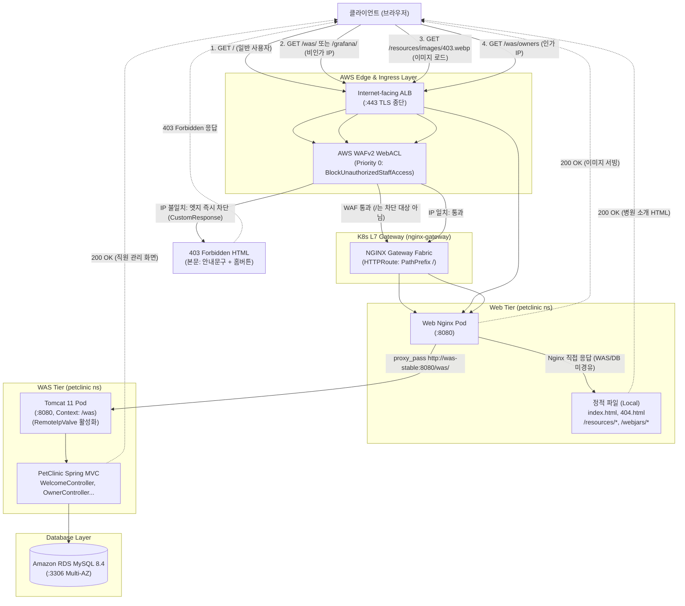

# 병원 랜딩 페이지 구축 및 직원용 PetClinic WAS 하위 경로 격리 (`landing-page`) 설계서

> 문서 위치: `docs/features/landing-page/design.md`  
> 대상 시스템: EKS v1.36, AWS WAFv2, NGINX Gateway Fabric (NGF 2.8.0), Nginx 1.27.2, Tomcat 11.0.2, Spring Framework 7.x, OpenTelemetry 2.12.0

---

## 1. 목표와 범위 (하지 않을 것 포함)

### 1.1 배경 및 문제 정의 (Background & Problem)
- **현상**:
  - 현재 `https://${DOMAIN_NAME}`의 루트 경로(`/`)에 내부 직원용 동물병원 관리 애플리케이션(PetClinic WAS — 환자 차트 조회, 진료 등록, 의료진 관리 등)이 직접 노출되어 있다.
  - 외부 일반 방문자/보호자가 접속했을 때 병원 소개, 진료 안내, 진료 시간, 오시는 길을 확인할 수 있는 공개 홈페이지가 부재하다.
  - 일반 공개 페이지와 내부 직원용 업무 시스템의 접근 경로가 분리되지 않아, WAS 및 DB에 불필요한 퍼블릭 트래픽이 직접 도달하고 보안 경계가 모호하다.
  - 이전 작업(2026-10-26 일일 남은 일)에서 확인된 바와 같이, 리버스 프록시(ALB → NGF → Web Nginx) 뒤의 Tomcat 11이 프록시의 HTTPS 종단을 인식하지 못해 Spring MVC의 `redirect:` 302 Location 헤더가 `http://`로 발급된 후 ALB에서 `301 Moved Permanently`(`https://`)로 재리다이렉트되는 비효율 및 보안 취약점이 존재한다.

- **요구사항**:
  - `https://${DOMAIN_NAME}/`의 첫 화면을 병원 소개를 담은 경량의 반응형 정적 랜딩 페이지로 교체한다.
  - 이 정적 메인 페이지는 Web Nginx가 직접 서빙하며, WAS(Tomcat)나 DB(RDS)가 장애 상태이거나 정지되어 있어도 무중단으로 정상 서비스되어야 한다.
  - 기존의 직원용 PetClinic 관리 애플리케이션은 하위 경로 `/was/`로 완전히 이동한다.
  - `/was/` 경로는 기존 Grafana(`/grafana/`)와 동일하게 AWS WAFv2 최우선순위(Priority 0) IP 화이트리스트 차단 규칙을 적용하여, 인가된 IP(`GRAFANA_ALLOWED_CIDRS` / `STAFF_ALLOWED_CIDRS`)에서만 접근을 허용하고 비인가 외부 접근은 엣지(ALB)에서 원천 차단한다.
  - WAF에서 차단된 비인가 요청에는 디자인된 전용 403 페이지("이곳은 병원 직원만 들어갈 수 있어요" 문구, 대표 사진, 홈으로 가기 버튼)를 HTTP 상태 코드 403 그대로 반환한다.
  - 302 Location의 `http://` 발생 문제를 Tomcat `RemoteIpValve` 구성을 통해 근본적으로 해결한다.

### 1.2 핵심 목표 (Goals)
1. **Web Tier(Nginx) 직접 서빙 기반의 정적 병원 랜딩 페이지 (`/`) 구축**:
   - 외부 CDN, 외부 웹폰트, 외부 지도 API 등 일체의 외부 네트워크 의존성 없이 단독 동작하는 HTML5/CSS3 반응형 메인 페이지 제공.
   - 포함 콘텐츠:
     - 병원 소개 (환자 중심 진료 철학, 현대적 시설 소개)
     - 진료 과목 4개 (일반 내과, 외과 수술, 치과 진료, 영상의학/정밀검진 — `data.sql`의 specialties와 정합)
     - 의료진 6명 (DB `vets` 테이블의 실제 영문 성명과 100% 일치: James Carter, Helen Leary, Linda Douglas, Rafael Ortega, Henry Stevens, Sharon Jenkins)
     - 진료 시간 안내 (평일 월–금 10:00–18:00, 토 10:00–16:00, 일요일·공휴일 휴진)
     - 오시는 길 (주소, 대표전화, 팩스, 이메일 안내; 외부 지도 스크립트 대신 시각적 텍스트/카드 안내)
     - 하단 사업자 정보 (가상 사업자등록번호/대표자명 표기 + "본 사이트는 포트폴리오용 교육 데모 시스템입니다" 명시)
     - 헤더 네비게이션 및 "직원 전용 (Staff Portal)" 전용 섹션 내 직원용 시스템(`/was/`) 및 모니터링 Grafana(`/grafana/`) 바로가기 버튼 배치.
   - 고가용성: WAS Pod 및 RDS MySQL이 완전히 다운되어도 Web Nginx Pod 자체 메모리/로컬 디스크에서 100% 서빙.

2. **직원용 PetClinic WAS의 컨텍스트 경로 이동 (`/was/`)**:
   - `docker/was/Dockerfile`에서 사전 언패킹 디렉터리를 `webapps/ROOT`에서 `webapps/was`로 전환하여 Tomcat 서블릿 컨텍스트를 `/was`로 설정.
   - JSP 뷰 레이어 전반의 `<spring:url>` 자동 컨텍스트 경로(`/was/`) 반영 확인.
   - flatpickr 스타일/스크립트 하드코딩 2곳(`createOrUpdateVisitForm.jsp`, `createOrUpdatePetForm.jsp`)을 `<spring:url>` 기반으로 수정하여 404 방지.
   - `docker/web/nginx.conf`에서 `/was/` 프록시 및 정적 에셋 서빙 경로 매핑.

3. **AWS WAFv2 기반 엄격한 비인가 접근 차단 및 디자인된 403 커스텀 응답**:
   - `/was/` 경로에 대해 `/grafana/`와 동일한 인가 IP 검증 수행.
   - 경로 우회 공격 방지를 위한 3중 텍스트 변환(`URL_DECODE`, `NORMALIZE_PATH`, `LOWERCASE`) 강제.
   - WAF Custom Response Body 기능(AWS 16KB 한도)을 활용하여 HTTP 403 Forbidden 상태 코드와 함께 스타일이 적용된 HTML 응답 반환.
   - 403 페이지 내 200KB급 WebP 이미지 및 공통 정적 리소스는 WAF 차단 대상이 아닌 Web Nginx의 공개 경로(`/resources/images/403.webp`)에서 브라우저가 지연 로딩하도록 설계.
   - Web Nginx 자체 404 페이지(`error_page 404`)를 신설하여 일관된 톤앤매너의 에러 안내 제공.

4. **프록시 환경 302 리다이렉트 HTTPS 정합성 확보 (`RemoteIpValve`)**:
   - Tomcat 11의 `server.xml`에 `RemoteIpValve`를 선언하여 Nginx 및 ALB가 전달하는 `X-Forwarded-Proto`, `X-Forwarded-For`, `X-Forwarded-Port` 헤더를 신뢰하도록 구성.
   - Spring MVC의 `redirect:` 시 `request.getScheme()`이 `https`로 인식되어 `Location: https://${DOMAIN_NAME}/was/...`가 즉시 발급되도록 조치 (302 → 301 루프 제거).

5. **카나리 배포(Canary), KEDA, OTel 관측성 영향 최소화 및 무중단 배포 순서 정립**:
   - Web(`web-canary`)과 WAS(`was-canary`)가 페어(Pair)로 격리 동작하는 트랙 구조를 활용하여 안전한 롤아웃 설계.
   - Tomcat `startupProbe`/`readinessProbe` 및 `scripts/deploy-all.sh`의 E2E 카나리 검증 경로를 `/was/`로 갱신.
   - KEDA(Tomcat 8080 커넥터 메트릭) 및 OpenTelemetry RED 메트릭(서비스명 기준 집계)의 연속성 검증.

### 1.3 비목표 (Non-Goals / 하지 않을 것)
1. **Spring Security 등 복잡한 WAS 로그인/인증 프레임워크 신규 도입 제외**:
   - 현재 단계에서는 AWS WAFv2 Priority 0 IP 화이트리스트 기반의 네트워크 경계 보안 모델을 유지한다. (앱 레벨 RBAC/로그인은 후속 과제로 분리)
2. **환자 온라인 예약, 진료 접수, 결제 기능 개발 제외**:
   - 대외 안내용 정보성 정적 페이지에 집중하며, 인터랙티브 예약 백엔드는 개발하지 않는다.
3. **외부 상용 지도 API(카카오맵, 네이버 지도, 구글맵) 연동 제외**:
   - 외부 스크립트 로딩으로 인한 성능 저하, CSP(Content Security Policy) 복잡화, API 키 노출 위험을 방지하고 깔끔한 주소 카드/대중교통 안내 텍스트로 대체한다.
4. **의료진 실제 사진 촬영/임베딩 제외**:
   - Claude가 보유한 병원 대표 사진(WebP ~260KB)과 403 에러 사진(WebP ~200KB) 2종만 사용하며, 의료진 섹션은 정돈된 카드 및 아이콘 UI로 구성한다.
5. **DB 스키마(DDL) 및 엔티티 수정 제외**:
   - 기존 MySQL 8.4 DB 스키마(`vets`, `specialties`, `types`, `owners`, `pets`, `visits`)는 일체 변경하지 않는다.

---

## 2. 구성 요소와 디렉터리 구조 (기존 구조 대비 추가·변경되는 부분 표시)

```text
.
├── .env.example                                      # [유지/보완] GRAFANA_ALLOWED_CIDRS 확인 (WAS와 동일 IPSet 공유)
├── app/
│   ├── src/main/webapp/
│   │   ├── WEB-INF/jsp/pets/
│   │   │   ├── createOrUpdateVisitForm.jsp           # [변경] flatpickr CSS/JS 링크를 <spring:url>로 교체
│   │   │   └── createOrUpdatePetForm.jsp             # [변경] flatpickr CSS/JS 링크를 <spring:url>로 교체
│   │   └── resources/
│   │       └── images/
│   │           ├── hospital.webp                     # [신규] 병원 메인 대표 이미지 (약 260KB, EXIF 제거)
│   │           └── 403.webp                          # [신규] 직원 전용 안내 403 이미지 (약 200KB, EXIF 제거)
├── docker/
│   ├── was/
│   │   ├── Dockerfile                                # [변경] WAR 언패킹 위치 ROOT -> was (/webapps/was) 및 server.xml 복사
│   │   └── server.xml                                # [신규] Tomcat RemoteIpValve 및 8080 커넥터 표준 설정
│   └── web/
│       ├── Dockerfile                                # [변경] 정적 랜딩 페이지(index.html), 404 페이지 추가 스테이지 복사
│       ├── nginx.conf                                # [변경] / 정적 서빙, /was/ 프록시, /was/resources, /was/webjars 라우팅, error_page 404
│       ├── static/
│       │   ├── index.html                            # [신규] 병원 공개 정적 메인 페이지 (반응형, 무외부의존)
│       │   ├── 404.html                              # [신규] 404 Not Found 안내 페이지
│       │   └── css/
│       │       └── landing.css                       # [신규] 메인 페이지 반응형 스타일시트 (시스템 폰트 스택)
├── infra/aws/
│   └── provision-aws-resources.sh                    # [변경] WAF WebACL 규칙에 /was 차단 조건 추가 및 403 CustomResponseBody 등록
├── k8s/
│   ├── was/
│   │   ├── deployment-stable.yaml                    # [변경] startupProbe, readinessProbe 경로 / -> /was/
│   │   └── deployment-canary.yaml                    # [변경] startupProbe, readinessProbe 경로 / -> /was/
│   └── gateway/
│       └── httproute-canary.yaml                     # [유지] / 접두사(PathPrefix /)로 web/web-canary 카나리 분할 유지
├── scripts/
│   ├── lib.sh                                        # [변경] WAF 검증 함수(grafana_waf_ready -> staff_waf_ready) 확장
│   ├── deploy-all.sh                                 # [변경] E2E 카나리 검증 경로 /was/owners로 수정, 랜딩페이지 확인 추가
│   └── validate-manifests.sh                         # [변경] probe 경로 /was/, WAF 규칙 정합성 정적 검증 Section 추가
├── tests/
│   └── scripts/
│       └── grafana-waf-ready.test.sh                 # [변경] /was 및 /grafana 통합 WAF 규칙 검증 테스트 갱신
└── docs/features/landing-page/
    └── design.md                                     # [신규] 본 설계서
```

---

## 3. 데이터 흐름 / API 또는 인터페이스

### 3.1 요청 인입 시나리오별 데이터 흐름 다이어그램



---

### 3.2 WAF 규칙 아키텍처 비교 및 결정 (사용자 결정 2번)

`/was/` 경로를 `/grafana/`와 동일한 조건으로 보호하기 위해 다음 두 가지 방안을 비교 검토하였다.

| 비교 항목 | (방안 1) 단일 통합 규칙 확장 (`BlockUnauthorizedStaffAccess`) [채택] | (방안 2) 별도 개별 규칙 추가 (`BlockUnauthorizedWasAccess`) [기각] |
| :--- | :--- | :--- |
| **규칙 구성** | Priority 0 단일 규칙 내 `OrStatement`로 `/grafana`와 `/was` 결합 | Priority 0 (`/grafana`), Priority 1 (`/was`) 별도 2개 규칙 운영 |
| **비용 (AWS WAF)** | **월 $1.00 유지** (커스텀 규칙 1개 요율 적용) | **월 $2.00로 증가** (규칙 1개당 월 $1.00 추가 요금 발생) |
| **WCU (용량 단위)** | **3 WCU** (ByteMatch 2개 + IPSet 1개) — 기본 1,500 WCU 내 여유 충분 | **4 WCU** (각 2 WCU씩 2개 규칙) |
| **403 커스텀 응답** | **단일 템플릿 일관 적용**: 직원/관리자용 차단 페이지 통일 | 각 규칙별로 커스텀 응답 개별 지정 필요 (중복 관리) |
| **관리 복잡도** | 단일 IPSet(`GRAFANA_ALLOWED_CIDRS`) 및 단일 규칙으로 원자적 업데이트 가능 | 규칙 간 우선순위 충돌 및 순서 관리 복잡도 증가 |

> **설계 결정**:  
> **(방안 1) 단일 통합 규칙 확장**을 채택한다.  
> 이유: 추가 비용 발생($0 추가) 없이 단일 WAF 규칙으로 관리자/직원 전용 하위 경로(`/grafana`, `/was`)를 완벽히 묶을 수 있으며, 동일한 403 커스텀 응답 본문(`petclinic-staff-403`)을 공유할 수 있어 아키텍처가 훨씬 간결하고 경제적이다.

#### WAF 규칙 상세 JSON 구조 (Priority 0)
```json
{
  "Name": "BlockUnauthorizedStaffAccess",
  "Priority": 0,
  "Action": {
    "Block": {
      "CustomResponse": {
        "ResponseCode": 403,
        "CustomResponseBodyKey": "petclinic-staff-403",
        "ResponseHeaders": [
          { "Name": "Content-Type", "Value": "text/html; charset=utf-8" },
          { "Name": "Cache-Control", "Value": "no-cache, no-store, must-revalidate" }
        ]
      }
    }
  },
  "VisibilityConfig": {
    "SampledRequestsEnabled": true,
    "CloudWatchMetricsEnabled": true,
    "MetricName": "BlockUnauthorizedStaffAccess"
  },
  "Statement": {
    "AndStatement": {
      "Statements": [
        {
          "OrStatement": {
            "Statements": [
              {
                "ByteMatchStatement": {
                  "FieldToMatch": { "UriPath": {} },
                  "PositionalConstraint": "STARTS_WITH",
                  "SearchString": "/grafana",
                  "TextTransformations": [
                    { "Priority": 0, "Type": "URL_DECODE" },
                    { "Priority": 1, "Type": "NORMALIZE_PATH" },
                    { "Priority": 2, "Type": "LOWERCASE" }
                  ]
                }
              },
              {
                "ByteMatchStatement": {
                  "FieldToMatch": { "UriPath": {} },
                  "PositionalConstraint": "STARTS_WITH",
                  "SearchString": "/was",
                  "TextTransformations": [
                    { "Priority": 0, "Type": "URL_DECODE" },
                    { "Priority": 1, "Type": "NORMALIZE_PATH" },
                    { "Priority": 2, "Type": "LOWERCASE" }
                  ]
                }
              }
            ]
          }
        },
        {
          "NotStatement": {
            "Statement": {
              "IPSetReferenceStatement": {
                "ARN": "${STAFF_ALLOWED_IPSET_ARN}"
              }
            }
          }
        }
      ]
    }
  }
}
```

---

### 3.3 403 Forbidden 및 404 Not Found 처리 설계 (사용자 결정 3번)

1. **WAF 16KB 용량 제한 극복 및 403 응답 구조**:
   - AWS WAFv2의 `CustomResponseBodies` 최대 크기 제한은 **16,384 바이트 (16 KB)**이다.
   - Claude가 구현할 403 사진(약 200KB WebP)은 WAF 본문에 직접 base64로 포함할 수 없다 (16KB 초과로 AWS API 오류 발생).
   - **해결책**:
     - WAF 본문(`CustomResponseBodyKey: petclinic-staff-403`)에는 순수 HTML 구조와 2KB 미만의 모바일 반응형 인라인 `<style>`만 포함한다.
     - 403 페이지 내 이미지는 절대 경로 ``으로 참조한다.
     - 클라이언트 브라우저는 WAF로부터 403 HTML을 수신한 직후, 이미지 태그를 파싱하여 `https://${DOMAIN_NAME}/resources/images/403.webp`를 요청한다.
     - `/resources/` 경로는 WAF 차단 대상(`/was`, `/grafana`)이 아니므로 ALB를 통과하여 Web Nginx가 로컬 디스크에서 200 OK로 WebP 이미지를 즉시 전달한다.
   - 문구 및 기능:
     - "이곳은 병원 직원만 들어갈 수 있어요" (친근하고 명확한 출입 제한 안내)
     - "인증된 사내 네트워크(지정 IP)에서만 접근이 가능합니다."
     - 버튼: `<a href="/" class="btn-home">홈으로 돌아가기</a>` (루트 `/`로 안전 복귀)

2. **404 Not Found 범위 및 디자인 통일**:
   - 범위: 사용자가 존재하지 않는 경로(예: `/about-us`, `/notfound`)로 접속 시 Web Nginx 레벨에서 처리.
   - 구현 방식: Web Nginx에 `error_page 404 /404.html;` 지정.
   - 디자인 톤앤매너: 403 페이지와 동일한 색상 체계(#2563eb, #1e293b), 레이아웃 카드, 시스템 폰트 스택을 공유하여 브랜드 일관성 유지.
   - 문구: "요청하신 페이지를 찾을 수 없습니다" + 홈으로 돌아가기 버튼.

---

### 3.4 302 Location `http://` 이슈 근본 해결: Tomcat `RemoteIpValve` (사용자 결정 5번)

#### 문제 원인 분석
- 클라이언트가 HTTPS(`https://${DOMAIN_NAME}`)로 요청을 보냄.
- ALB가 TLS를 종단하고 `X-Forwarded-Proto: https`, `X-Forwarded-Port: 443`, `X-Forwarded-For: <client-ip>` 헤더를 추가하여 NGF로 전달.
- NGF는 Web Nginx로 전달하고, Web Nginx는 `proxy_pass http://${WAS_UPSTREAM_HOST}:${WAS_UPSTREAM_PORT}/was/`로 Tomcat에 일반 HTTP로 요청.
- Tomcat은 역방향 프록시 설정을 알지 못해 `request.getScheme()`을 `"http"`, `request.getServerPort()`를 `8080`(또는 `80`)으로 인식.
- 보호자 검색 또는 폼 제출 후 Spring MVC가 `redirect:/was/owners/1`을 실행하면 Tomcat `HttpServletResponse.sendRedirect()`가 절대 URL `http://${DOMAIN_NAME}/was/owners/1`을 Location 헤더로 작성.
- 브라우저는 `http://...`로 새 요청을 시도하고, ALB 리스너 80이 이를 가로채 `301 Moved Permanently`(`https://...`)로 리다이렉트함 (불필요한 네트워크 왕복 + 브라우저 혼합 콘텐츠/보안 경고 유발).

#### 해결 방안
1. **Tomcat `RemoteIpValve` 설정 (`docker/was/server.xml`)**:
   Tomcat의 `<Engine>` 또는 `<Host>` 내에 `RemoteIpValve`를 배치하여 상류 프록시 헤더를 신뢰하도록 구성한다.
   ```xml
   <Valve className="org.apache.catalina.valves.RemoteIpValve"
          internalProxies="10\.\d{1,3}\.\d{1,3}\.\d{1,3}|172\.(1[6-9]|2[0-9]|3[0-1])\.\d{1,3}\.\d{1,3}|127\.\d{1,3}\.\d{1,3}\.\d{1,3}|192\.168\.\d{1,3}\.\d{1,3}"
          remoteIpHeader="x-forwarded-for"
          proxiesHeader="x-forwarded-by"
          protocolHeader="x-forwarded-proto"
          protocolHeaderHttpsValue="https"
          httpServerPort="80"
          httpsServerPort="443" />
   ```
2. **Web Nginx 프록시 헤더 보강 (`docker/web/nginx.conf`)**:
   Web Nginx에서 Tomcat으로 전달 시 클라이언트 프로토콜 및 포트를 누락 없이 전달:
   ```nginx
   proxy_set_header Host $host;
   proxy_set_header X-Real-IP $remote_addr;
   proxy_set_header X-Forwarded-For $proxy_add_x_forwarded_for;
   proxy_set_header X-Forwarded-Proto $http_x_forwarded_proto;
   proxy_set_header X-Forwarded-Port 443;
   ```
3. **결과 검증**:
   Tomcat이 `request.isSecure() == true`, `request.getScheme() == "https"`로 정상 인식하여, 302 Location이 즉시 `https://${DOMAIN_NAME}/was/...`로 발급되며 301 이동 과정이 완전히 소멸된다.

---

### 3.5 정적 에셋 및 Web Nginx 라우팅 아키텍처

Web Nginx(`docker/web/nginx.conf`)는 정적 서빙과 프록시의 관문 역할을 수행한다.

```nginx
# Server block template. ${WAS_UPSTREAM_HOST}/${WAS_UPSTREAM_PORT} are filled by envsubst at start.
server {
    listen 8080;
    server_tokens off;

    # Security headers
    add_header X-Content-Type-Options "nosniff" always;
    add_header X-Frame-Options "SAMEORIGIN" always;
    add_header Referrer-Policy "strict-origin-when-cross-origin" always;

    # ALB Ingress Health Check
    location = /healthz {
        access_log off;
        default_type text/plain;
        return 200 "ok\n";
    }

    # Nginx Prometheus Exporter sidecar
    location = /nginx_status {
        stub_status;
        access_log off;
        allow 127.0.0.1;
        deny all;
    }

    # Custom 404 page
    error_page 404 /404.html;
    location = /404.html {
        root /usr/share/nginx/html;
        internal;
    }

    # Public Landing Page & Static Assets (WAS/DB 장애 시에도 100% 가용)
    location = / {
        root /usr/share/nginx/html;
        index index.html;
        expires 1h;
    }

    location /resources/ {
        root /usr/share/nginx/html;
        expires 7d;
    }

    location /webjars/ {
        root /usr/share/nginx/html;
        expires 30d;
    }

    # WAS Static Assets (Spring <spring:url> generates /was/resources/ and /was/webjars/)
    location /was/resources/ {
        alias /usr/share/nginx/html/resources/;
        expires 7d;
    }

    location /was/webjars/ {
        alias /usr/share/nginx/html/webjars/;
        expires 30d;
    }

    # Staff Portal (PetClinic WAS)
    location = /was {
        return 301 /was/;
    }

    location /was/ {
        proxy_pass http://${WAS_UPSTREAM_HOST}:${WAS_UPSTREAM_PORT}/was/;
        proxy_set_header Host $host;
        proxy_set_header X-Real-IP $remote_addr;
        proxy_set_header X-Forwarded-For $proxy_add_x_forwarded_for;
        proxy_set_header X-Forwarded-Proto $http_x_forwarded_proto;
        proxy_set_header X-Forwarded-Port 443;
        proxy_connect_timeout 5s;
        proxy_read_timeout 60s;
    }
}
```

---

### 3.6 폰트(Typography) 설계 결정 (사용자 결정 1번)

- **옵션 비교**:
  1. 외부 CDN 웹폰트(Google Fonts Noto Sans KR 등): 외부 장애 시 렌더링 블로킹, 네트워크 지연 발생, CSP 복잡화로 배제.
  2. 컨테이너 내부 woff2 자체 서빙(Self-host): 빌드 시 폰트 파일 패키징 필요(용량 수 MB 증가).
  3. **모던 시스템 폰트 스택 (System Font Stack) [채택]**:
     ```css
     font-family: -apple-system, BlinkMacSystemFont, "Pretendard", "Apple SD Gothic Neo", "Noto Sans KR", "Malgun Gothic", "맑은 고딕", sans-serif;
     ```
- **선정 이유**:
  - 추가 네트워크 페이로드 0 바이트 (초고속 로딩, FOUT/FOIT 깜빡임 전무).
  - macOS, iOS, Windows, Android 최신 OS의 기본 내장 고품질 한글 글꼴을 그대로 활용.
  - 외부 의존성 0 원칙을 가장 완벽하게 충족.

---

## 4. 실행 환경 (런타임 버전, 리소스, 환경변수)

### 4.1 런타임 및 기반 소프트웨어 버전
- **EKS**: `v1.36` (서울 리전 `ap-northeast-2`)
- **NGINX Gateway Fabric (NGF)**: `2.8.0` (Gateway API `v1.6.3`)
- **Web Container**: `nginx:1.27.2-alpine` (UID 10001, 비루트 실행)
- **WAS Container**: `tomcat:11.0.2-jre21-temurin-noble` (UID 10001, 비루트 실행)
- **Java / Framework**: OpenJDK 21, Spring Framework 7.x, Jakarta EE 11
- **Database**: Amazon RDS MySQL 8.4 LTS Multi-AZ (`require_secure_transport=ON`)
- **AWS WAFv2**: Regional WebACL (ALB 연결, Priority 0 커스텀 차단 규칙)

### 4.2 컨테이너 및 클라우드 리소스 사양
- **`web` Deployment** (2 Replicas, AZ 균등 분산, PDB `minAvailable: 1`):
  - CPU: Request `100m` / Limit `500m`
  - Memory: Request `64Mi` / Limit `256Mi`
- **`was` Deployment** (KEDA 관리 2~10 Replicas, PDB `minAvailable: 1`):
  - CPU: Request `500m` / Limit `2000m`
  - Memory: Request `1280Mi` / Limit `2048Mi`
- **AWS WAFv2 WCU**:
  - 규칙 용량: Priority 0 `BlockUnauthorizedStaffAccess` = 3 WCU
  - 총 WCU: 1,103 WCU (기본 1,500 WCU 한도 이내)

### 4.3 환경변수 목록 (설정 명세 — 실제 값 제외)

| 변수명 | 위치 | 용도 |
| :--- | :--- | :--- |
| `DOMAIN_NAME` | `.env`, CI/CD | 공인 서비스 도메인 명 |
| `AWS_REGION` | `.env` | AWS 서울 리전 식별자 (`ap-northeast-2`) |
| `EKS_CLUSTER_NAME` | `.env` | EKS 클러스터 이름 (WAF IPSet 명명에 활용) |
| `WAF_WEB_ACL_ARN` | `.env` | ALB에 바인딩된 WAFv2 WebACL ARN |
| `GRAFANA_ALLOWED_CIDRS` | `.env` | 직원 및 관리자 허용 공인 IPv4 CIDR 목록 (콤마 구분) |
| `ECR_WEB_REPOSITORY_URI` | `.env`, K8s | ECR Web 이미지 리포지토리 URI |
| `ECR_WAS_REPOSITORY_URI` | `.env`, K8s | ECR WAS 이미지 리포지토리 URI |
| `STABLE_IMAGE_TAG` | 배포 파이프라인 | 프로덕션 Stable 트랙 컨테이너 태그 |
| `CANARY_IMAGE_TAG` | 배포 파이프라인 | 카나리 배포 검증용 컨테이너 태그 |
| `WAS_UPSTREAM_HOST` | `web` Deployment | Nginx의 WAS 프록시 상류 서비스 DNS (`was-stable` / `was-canary`) |
| `WAS_UPSTREAM_PORT` | `web` Deployment | WAS 서비스 포트 (`8080`) |
| `SPRING_PROFILES_ACTIVE`| `was` Deployment | 활성 프로필 (`jpa`) |

---

## 5. 보안 요구사항 (인증, 권한 최소화, 시크릿 관리)

1. **다층 심층 방어 (Defense-in-Depth)**:
   - **1계층 (AWS WAF 엣지)**: 비인가 IP의 `/was*` 및 `/grafana*` 접근을 최우선순위(Priority 0)에서 403 차단하여 내부 클러스터로의 침입 시도를 사전 차단.
   - **2계층 (AWS Managed Rules)**: 인가된 IP의 요청이라도 WAF Priority 1~3(CommonRuleSet, SQLi, KnownBadInputs)을 거쳐 검사.
   - **3계층 (Kubernetes NetworkPolicy)**: Web Tier만 WAS Tier(8080)로 접근 가능하며, 외부에서 WAS로의 직접 인입은 원천 차단.
   - **4계층 (비루트 실행 및 읽기 전용 파일시스템)**: Web(UID 10001) 및 WAS(UID 10001) 모두 `readOnlyRootFilesystem: true`, `allowPrivilegeEscalation: false`, `capabilities.drop: ["ALL"]` 강제.

2. **WAF 우회 공격 방지 (Path Normalization)**:
   - 공격자가 `%2fwas`, `/./was`, `/WAS`, `//was` 등으로 URI를 조작하여 WAF 규칙을 우회하지 못하도록, WAF 규칙 평가 시 `URL_DECODE` → `NORMALIZE_PATH` → `LOWERCASE` 3중 변환 파이프라인을 필수 적용.

3. **공개 저장소 보안 준수**:
   - 병원 랜딩 페이지 하단의 사업자 정보는 반드시 가상의 데모 정보로 작성하며, "본 사이트는 포트폴리오용 교육 데모 시스템입니다" 문구를 명시.
   - 코드, 매니페스트, 테스트 파일, 일일 기록 및 문서에 AWS 계정 ID, 실제 IP, 개인 이메일, ARN 등의 실값이 포함되지 않도록 플레이스홀더 사용.

4. **RemoteIpValve 내부 프록시 신뢰 제한 (`internalProxies`)**:
   - `RemoteIpValve`의 `internalProxies` 정규표현식을 VPC 내부 대역(`10.0.0.0/16`) 및 사설 대역으로 제한하여, 외부 악의적 클라이언트가 위조된 `X-Forwarded-Proto` 헤더를 직접 주입하지 못하도록 보호.

---

## 6. 구현 단계 체크리스트 (Claude 작업 가이드)

> **안내**: 아래 단계 중 실제 AWS 클라우드 인프라에 변경을 가하거나 요금이 발생할 수 있는 작업은 **`[위험]`**으로 표기되어 있습니다. 조율 에이전트(Claude)는 `[위험]` 단계 실행 전 반드시 사용자 승인을 득해야 합니다.

### Phase 1: 로컬 애플리케이션 및 컨테이너 설정 준비
- [ ] **1.1 JSP 뷰 레이어 flatpickr 링크 수정**:
  - `app/src/main/webapp/WEB-INF/jsp/pets/createOrUpdateVisitForm.jsp` 내 하드코딩된 `/webjars/flatpickr/...` 링크 2곳을 `<spring:url>` 태그로 변경.
  - `app/src/main/webapp/WEB-INF/jsp/pets/createOrUpdatePetForm.jsp` 내 하드코딩된 `/webjars/flatpickr/...` 링크 2곳을 `<spring:url>` 태그로 변경.
- [ ] **1.2 대표 이미지 배치**:
  - Claude가 보유한 병원 대표 사진(WebP ~260KB, EXIF 제거)을 `app/src/main/webapp/resources/images/hospital.webp`에 배치.
  - Claude가 보유한 403 안내 사진(WebP ~200KB, EXIF 제거)을 `app/src/main/webapp/resources/images/403.webp`에 배치.
- [ ] **1.3 Tomcat RemoteIpValve 구성 및 Dockerfile 갱신**:
  - `docker/was/server.xml` 신설 (RemoteIpValve, Connector 8080, Host localhost).
  - `docker/was/Dockerfile` 수정:
    - Stage 1에서 `/was` 디렉터리에 WAR 언패킹 (`mkdir /was && cd /was && jar xf ...`).
    - Stage 2에서 `COPY --from=build /was webapps/was`로 복사.
    - `COPY docker/was/server.xml conf/server.xml` 추가.
- [ ] **1.4 Web Tier 정적 랜딩 페이지 및 404 페이지 작성**:
  - `docker/web/static/index.html` 작성:
    - 병원 소개, 진료 과목 4개, 의료진 6명(DB 영어 이름 일치), 진료 시간, 오시는 길(텍스트/카드), 가상 사업자 정보("교육용 데모" 표기), 직원 전용 버튼(`/was/`, `/grafana/`).
    - 외부 리소스(CDN, 폰트, 지도) 0, 반응형 CSS 적용.
  - `docker/web/static/404.html` 작성:
    - 병원 톤앤매너 안내문구 및 홈으로 이동 버튼.
  - `docker/web/nginx.conf` 갱신:
    - `/` 정적 랜딩 페이지 매핑, `/resources/`, `/webjars/`, `/was/resources/`, `/was/webjars/` 정적 서빙.
    - `/was/` 프록시 매핑 (`proxy_set_header X-Forwarded-Port 443;` 포함).
    - `error_page 404 /404.html;` 추가.
  - `docker/web/Dockerfile` 갱신:
    - `COPY docker/web/static/ /usr/share/nginx/html/` 반영.

### Phase 2: 쿠버네티스 매니페스트 및 스크립트 정합성 갱신
- [ ] **2.1 WAS 프로브 경로 변경**:
  - `k8s/was/deployment-stable.yaml`: `startupProbe.httpGet.path` 및 `readinessProbe.httpGet.path`를 `/`에서 `/was/`로 변경.
  - `k8s/was/deployment-canary.yaml`: `startupProbe.httpGet.path` 및 `readinessProbe.httpGet.path`를 `/`에서 `/was/`로 변경.
- [ ] **2.2 배포 및 검증 스크립트 수정**:
  - `scripts/deploy-all.sh`:
    - E2E 카나리 검증 curl 경로를 `https://$DOMAIN_NAME/was/owners?lastName=`으로 수정.
    - 랜딩 페이지 정적 검증(`curl -fsS https://$DOMAIN_NAME/`) 단계 추가.
  - `scripts/lib.sh`:
    - `grafana_waf_ready` 함수를 확장하여 `/grafana`와 `/was`를 모두 차단하는 `BlockUnauthorizedStaffAccess` 규칙 검증으로 업데이트.
  - `tests/scripts/grafana-waf-ready.test.sh`:
    - 통합된 WAF 규칙 구조를 검증하도록 테스트 모의 데이터 갱신.
  - `scripts/validate-manifests.sh`:
    - WAS probe 경로 `/was/` 검사 및 Nginx 정적 설정 정합성 검증 추가.
- [ ] **2.3 로컬 단위 테스트 및 정적 검증 통과**:
  - `./scripts/validate-manifests.sh` 실행 및 전체 통과 확인.
  - `./tests/scripts/grafana-waf-ready.test.sh` 실행 및 통과 확인.

### Phase 3: 클라우드 인프라 WAF 업데이트 및 이미지 빌드
- [ ] **3.1 [위험] AWS WAFv2 WebACL 규칙 업데이트**:
  - `infra/aws/provision-aws-resources.sh`에 `BlockUnauthorizedStaffAccess` 및 `petclinic-staff-403` 커스텀 응답 본문 반영.
  - `./infra/aws/provision-aws-resources.sh grafana-waf` 실행으로 WebACL Priority 0 규칙 갱신.
- [ ] **3.2 [위험] 컨테이너 이미지 온디맨드 빌드 및 ECR 푸시**:
  - `./scripts/build-and-push.sh --tag <new-tag>` 실행하여 CodeBuild를 통해 `web` 및 `was` 신규 이미지 ECR 푸시.

### Phase 4: 카나리 배포 및 무중단 전환 (배포 순서)
- [ ] **4.1 [위험] 카나리 트랙 사전 배포 (100:0 고정 상태)**:
  - Gateway API HTTPRoute를 100:0으로 고정하여 사용자 트래픽을 기존 stable에 유지.
  - `was-canary` 및 `web-canary`에 신규 이미지 배포.
  - `deploy-all.sh`의 E2E 카나리 검증(`X-Canary: always` 헤더로 `/was/owners?lastName=` 호출) 통과 확인.
- [ ] **4.2 [위험] Stable 트랙 배포 및 롤아웃**:
  - `was-stable` 및 `web` Deployment 순차 롤아웃:
    - 1순위: `was-stable` 롤아웃 시작 (`/was/` 서빙 준비).
    - 2순위: `web` 롤아웃 (`/` 정적 랜딩 페이지 개시 및 `/was/` 프록시 연결).
  - 롤아웃 완료 대기: `kubectl -n petclinic rollout status deploy/was-stable`, `deploy/web`.
- [ ] **4.3 [위험] 트래픽 점진 개방 및 모니터링**:
  - `./scripts/set-canary-weight.sh 90 10` (또는 필요 시 100:0 유지) 적용.
  - 외부 비인가 IP에서 `/was/` 및 `/grafana/` 접속 시 403 커스텀 페이지가 올바르게 뜨는지 확인.
  - 인가된 IP에서 `/was/` 접속 및 보호자 검색 후 302 리다이렉트가 HTTPS로 즉시 수행되는지 확인.

---

## 7. 카나리 배포 영향도, KEDA/OTel 계측 및 롤백 전략 (사용자 결정 4번)

### 7.1 컴포넌트 간 비호환성 방지 및 롤아웃 순서
- **문제**: 구버전 `web`(루트 프록시)과 신버전 `was`(`/was/` 전용), 또는 신버전 `web`(`/was/` 프록시)과 구버전 `was`(루트 전용)가 일시적으로 교차할 때 HTTP 404가 발생할 수 있다.
- **해결 방안: 트랙 격리 및 배포 순서**:
  1. `web-canary`와 `was-canary`는 오직 서로만 통신하므로, 카나리 트랙을 신버전 태그로 먼저 배포하여 `X-Canary: always`로 사전 격리 테스트를 완벽히 수행한다.
  2. Stable 트랙 배포 시:
     - `was-stable`을 먼저 롤아웃한다.
     - Web Nginx의 정적 라우팅 설정(`/was/resources/`, `/was/webjars/`) 덕분에 WAS가 준비되는 즉시 에셋 요청이 처리된다.
     - `web` Deployment를 이어서 롤아웃하여 `/` 정적 페이지와 `/was/` 프록시 라우팅을 활성화한다.
     - K8s의 RollingUpdate 전략(`maxUnavailable: 0`, `maxSurge: 1`)과 Pod Anti-Affinity/AZ 분산 제약에 의해 무중단으로 신규 Pod가 이전 Pod를 교체한다.

### 7.2 KEDA 및 OpenTelemetry 계측 영향 분석
1. **KEDA Auto-scaling**:
   - `keda-scaledobject.yaml`의 메트릭 쿼리는 `sum(rate(tomcat_requestcount_total{namespace="petclinic",service="was-stable",port="8080"}[1m]))`이다.
   - `tomcat_requestcount_total`은 Tomcat 커넥터(포트 8080) 수준에서 수집되는 글로벌 요청 카운터이므로, 컨텍스트 경로가 `/`에서 `/was`로 변경되어도 JMX 수집 및 KEDA 스케일링 지표는 100% 정상 작동한다.
   - 단, 일반 대중의 메인 화면 접속이 Web Nginx에서 직접 처리되므로 WAS의 요청 부하가 감소하여 평시 2 Replicas로 안정적 유지된다.
2. **OpenTelemetry 분산 트레이싱 & RED 메트릭**:
   - Java Agent(`autoinstrumentation-java:2.12.0`)는 서블릿 컨텍스트를 자동 감지하여 트레이스 스팬의 `http.route` 및 `url.path`에 `/was/...`를 자동으로 기록한다.
   - PrometheusRule(`PetClinicHttp5xxRateHigh`) 및 Grafana APM 대시보드는 `service_name="petclinic-was"`를 기준으로 에러율과 레이턴시를 집계하므로 경로 변경에 따른 알림 규칙 수정이 전혀 필요 없다.

### 7.3 긴급 롤백(Rollback) 절차
만일 신규 배포 후 치명적 오류가 발생할 경우:
1. 즉시 카나리 가중치를 0으로 격리:
   ```bash
   ./scripts/set-canary-weight.sh 100 0
   ```
2. 이전 안정 버전 이미지 태그로 Deployment 이미지 롤백:
   ```bash
   kubectl -n petclinic set image deployment/web nginx=${ECR_WEB_REPOSITORY_URI}:${PREVIOUS_TAG}
   kubectl -n petclinic set image deployment/was-stable tomcat=${ECR_WAS_REPOSITORY_URI}:${PREVIOUS_TAG}
   ```
3. WAF 규칙은 `/was` 차단을 유지하더라도 구버전 복구 전까지 임시로 통과가 필요할 경우 `provision-aws-resources.sh` 재실행으로 이전 단일 `/grafana` 규칙으로 원복.

---

## 8. 구현 중 질문
*(구현 진행 중 조율 에이전트 또는 리뷰어가 질의할 사항을 기록하는 섹션)*

### Q1. (Claude, 2026-10-27) §3.4 `X-Forwarded-Proto` 전달 경로 — 설계 가정과 실클러스터가 다름
- 확인(읽기 전용): NGF 데이터 플레인 nginx(`petclinic-gateway-nginx`)가 모든 location에서 `proxy_set_header X-Forwarded-Proto "$scheme";` 로 헤더를 덮어씀. ALB→NGF 구간이 HTTP이므로 web Nginx가 받는 값은 `http` → 지금 `$http_x_forwarded_proto` 를 그대로 넘기면 RemoteIpValve를 넣어도 Tomcat은 계속 `http` 로 인식(302 `http://` 그대로).
- 제안: web Nginx `/was/` 에서 `proxy_set_header X-Forwarded-Proto https;` 로 고정(ALB가 80을 443으로 리다이렉트하므로 외부 요청은 모두 https). `X-Forwarded-Port 443` 은 설계대로 유지.
- 답변(사용자, 2026-10-27): 제안대로. `X-Forwarded-Proto https` 고정.

### Q2. (Claude, 2026-10-27) §6 Phase 4.2 / §7.1 stable 롤아웃 순서 — `was-stable` 먼저면 공개 `/` 가 끊김
- 예전 web은 `/` 를 WAS로 프록시함. 새 was(`/was` 컨텍스트)가 먼저 나가면 예전 web의 `/` 와 `/resources` 외 모든 요청이 404 → web 롤아웃이 끝날 때까지 공개 첫 화면까지 깨짐.
- 제안: `web` 먼저 → `/` 는 즉시 새 메인 페이지(WAS 무관), `/was/` 만 was 롤아웃이 끝날 때까지 몇 분 404. 직원 화면 짧은 공백은 수용하고 공개 화면 중단은 0. 순서를 바꿔도 되는지 확인 필요.
순서를 바꿔도 되는지 확인 필요.
- 답변(사용자, 2026-10-27): 제안대로. stable은 `web` 먼저, 이어서 `was-stable`.

### Q3. (Claude, 2026-10-27) §3.3·§3.6 403/404 디자인·글꼴 — 사용자 확정 시안과 다름
- 사용자 확정 시안: 강조색 `#0F6B62`, 본문색 `#16302B`, 403 문구 "이곳은 병원 직원만 들어갈 수 있어요" + "요청하신 페이지는 병원 내부 네트워크에서만 열립니다…", 직원 섹션 문구 "병원 직원용 메뉴입니다. 병원 내부 네트워크에서만 열리며, 외부에서는 접속이 제한됩니다."
- 설계: 403/404 색 `#2563eb`·`#1e293b`, 403 보조 문구 "인증된 사내 네트워크(지정 IP)…".
- 제안: 색·문구는 시안을 따름. 글꼴은 설계대로 시스템 글꼴 스택(외부·용량 0) — 시안의 Noto Serif 제목은 시스템 명조/고딕으로 대체됨.
시안의 Noto Serif 제목은 시스템 명조/고딕으로 대체됨.
- 답변(사용자, 2026-10-27): 제안대로(시안 색·문구, 시스템 글꼴 스택).

### Q4. (Claude, 2026-10-27) §3.3 WAF 사용자 지정 응답 본문 크기
- 설계는 본문 한도를 16KB로 적음. 한도 값과 무관하게 403 HTML(인라인 스타일 포함)을 4KB 이하로 만들어 어느 쪽이든 넘지 않게 하겠음. 설계 변경 아님, 기록만.

### Q5. (Claude, 2026-10-27) §6 2.2 카나리 E2E 검증 경로 — 구현에서 조정, 기록
- `/was` 가 WAF 허용 목록 뒤로 가면, 배포를 실행하는 호스트가 허용 IP가 아닐 때 `https://<DOMAIN>/was/owners` 검사가 항상 403으로 실패함(이 서버 IP는 허용 목록 밖).
- 구현: `/was/owners?lastName=` 은 `kubectl exec deploy/web-canary -c nginx -- wget http://127.0.0.1:8080/was/owners?lastName=` 로 web-canary Nginx → was-canary 경로를 검사하고, ALB 경로는 `X-Canary: always` 로 `/` 를 검사. 허용 목록은 넓히지 않음.

### Q6. (Claude, 2026-10-27) WAF 403 본문 파일 위치 — 구현에서 조정, 기록
- 설계 §2는 403 본문을 `provision-aws-resources.sh` 안에 두는 것으로 적었으나, 크기 검사와 수정이 쉽도록 `infra/aws/waf-staff-403.html`(2,872바이트)로 분리하고 스크립트가 `jq --rawfile` 로 읽음. `validate-manifests.sh` §13이 4KB 이하와 이미지 경로를 검사.
