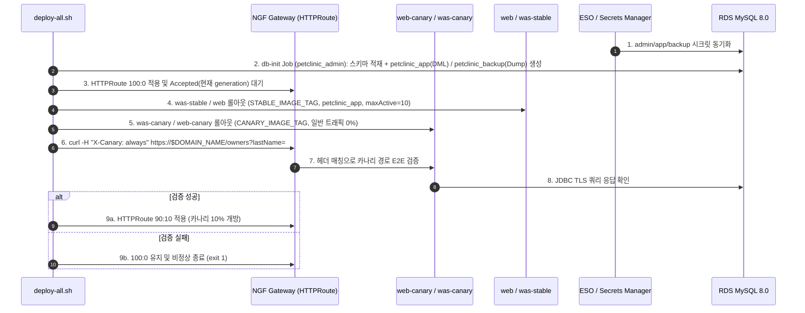

# 운영·보안·고가용성 강화 설계서 (`docs/features/production-hardening/design.md`)

## 1. 목표와 범위 (하지 않을 것 포함)

### 1.1 목표 (Goals)
초기 구축된 AWS EKS 기반 Spring Framework PetClinic 아키텍처(`master` `dc5fc91`)의 운영·보안·고가용성 점검 결과를 바탕으로, 실제 프로덕션 배포 및 장애 대응에 필요한 5대 핵심 영역을 보완한다.

기존 구조를 변경해야 하는 이유와 핵심 목표는 다음과 같다:
1. **카나리 배포 버전 분리 및 트래픽 게이팅 (Canary Version Isolation & Traffic Gating)**:
   - **변경 이유**: 기존 구조는 `web`/`was-stable`과 `web-canary`/`was-canary`가 동일한 `${IMAGE_TAG}`를 참조하고, 카나리 롤아웃 완료 전에 90:10 라우팅을 적용하여 배포 중 미검증 카나리 버전으로 사용자 트래픽이 유입되는 문제가 있었다.
   - **목표**: `STABLE_IMAGE_TAG`와 `CANARY_IMAGE_TAG`(및 `STABLE_WEIGHT`/`CANARY_WEIGHT`)를 분리하고, 재배포 시 먼저 `HTTPRoute`를 `100:0`으로 격리(Gateway `Accepted` 확인)한 뒤 워크로드를 롤아웃하고, `X-Canary: always` 헤더 기반 동적 경로(`/owners?lastName=`) 검증 통과 후에만 `90:10`으로 개방한다.
2. **DB 커넥션 풀 상한 설정 및 Canary 오토스케일링 (DB Connection Budget & Canary Autoscaling)**:
   - **변경 이유**: Tomcat JDBC Pool 기본값(`maxActive=100`)이 그대로 적용되어 최대 확장 시 RDS `db.t3.medium`의 `max_connections`를 고갈시킬 수 있고, Canary Pod가 1개로 고정되어 트래픽 증가 시 먼저 포화될 위험이 있었다.
   - **목표**: Pod당 Tomcat JDBC Pool 상한(`maxActive=10`, `maxIdle=5`, `minIdle=2`, `initialSize=2`, `maxWait=5000`, `testOnBorrow=true`, `validationQuery=SELECT 1`)을 명시하고, `web-canary` HPA(1~4) 및 `was-canary` KEDA `ScaledObject`(1~3)를 추가한다.
3. **모니터링 고가용성(Multi-AZ), KEDA Fallback, PDB 및 장애 알림 체계 (HA & Alerting)**:
   - **변경 이유**: 단일 Prometheus 레플리카와 단일 AZ EBS PVC 구조여서 AZ 장애 시 모니터링과 `was` KEDA 스케일링이 함께 중단되며, Alertmanager 수신처와 핵심 장애 `PrometheusRule`, `web`/`was` PDB가 없었다.
   - **목표**: Prometheus를 2 Replicas(AZ 분산 + 개별 `gp3` PVC)로 다중화하고, `was-stable`(fallback 4) 및 `was-canary`(fallback 2) KEDA `ScaledObject`에 `fallback`을 구성하며, `web`/`was-stable`에 `PodDisruptionBudget`(`minAvailable: 1`)과 `DoNotSchedule` AZ 분산을 적용한다. 또한 Alertmanager Webhook 수신처와 백업 실패(최초 미성공 포함)·KEDA 오류·WAS 오류율 `PrometheusRule`(및 `promtool` 단위 테스트)을 구성한다.
4. **DB 최소 권한 3계정 분리 및 시크릿 회전 절차 (DB Least Privilege & Secret Rotation)**:
   - **변경 이유**: 기존에는 RDS 마스터 계정(`petclinic_admin`) 하나를 `was`, `db-init`, `db-backup`이 모두 공유하여 애플리케이션 침해 시 DDL/관리 권한까지 노출되었으며, 시크릿 회전 시 실행 중인 Pod에 반영하는 절차가 없었다.
   - **목표**: `petclinic_admin`(`db-init` 전용), `petclinic_app`(`was` DML 전용), `petclinic_backup`(`db-backup` 덤프 전용) 3개 계정과 각각의 Secrets Manager 시크릿 / ESO `ExternalSecret`으로 분리하고, ESO 동기화 시각(`refreshTime`) 검증을 포함한 시크릿 회전 스크립트(`scripts/rotate-db-secrets.sh`)를 제공한다. 또한 Alertmanager Webhook URL도 Secrets Manager + ESO(`url_file`)로 외부화하고 Egress NetworkPolicy로 송신 범위를 제한한다.
5. **표준 지원 버전 상향(EKS 1.36) 및 프로비저닝 멱등성·정적 검증 강화 (Lifecycle & Idempotency)**:
   - **변경 이유**: EKS `1.31`의 지원 종료 임박 및 비멱등 프로비저닝 스크립트(`provision-aws-resources.sh`)로 인해 재실행 복구와 장기 운영이 어려웠다.
   - **목표**: 표준 지원 기간이 충분한 **EKS `1.36`** 및 호환 버전 세트(AL2023 AMI `al2023@v20260930`, Karpenter `1.15.0`, KEDA `2.21.0`, ESO `2.13.0` API `v1`, EBS CSI `${EBS_CSI_ADDON_VERSION}`)로 상향하고, `provision-aws-resources.sh`의 전 단계 멱등성 보장 및 `validate-manifests.sh` 정적 검증 규칙을 대폭 확장한다.

### 1.2 범위 (In-Scope)
- `.env.example`, `scripts/lib.sh`, `scripts/deploy-all.sh`, `scripts/rotate-db-secrets.sh`, `scripts/validate-manifests.sh`, `scripts/test-prometheus-rules.sh` 수정 및 추가
- `app/src/main/resources/spring/data-access.properties` 및 `datasource-config.xml`의 Tomcat JDBC Pool 상한 설정
- `infra/eksctl/cluster.yaml`, `infra/karpenter/ec2nodeclass.yaml`, `infra/aws/iam-policies/karpenter-controller-policy.json`, `infra/aws/provision-aws-resources.sh` 업데이트
- `k8s/secrets/`, `k8s/jobs/`, `k8s/web/`, `k8s/was/`, `k8s/gateway/`, `k8s/monitoring/` 매니페스트 보강 및 `tests/monitoring/petclinic-rules.test.yaml` 추가

### 1.3 하지 않을 것 (Out-of-Scope / Non-Goals)
- **PetClinic 비즈니스 도메인 로직 변경 금지**: 동물병원 도메인 모델이나 컨트롤러/뷰 로직은 수정하지 않는다.
- **기존 EKS 1.31 클러스터의 제자리(In-place) 단계별 업그레이드 스크립트 작성 제외**: 본 설계는 신규 클러스터 프로비저닝 기준을 EKS `1.36`으로 상향하는 것이며, 1.31→1.32→…→1.36 순차 인플레이스 업그레이드 자동화는 범위에서 제외한다.
- **EKS 1.36을 이미 지원하는 부가 차트(NGF 2.x, LBC 3.x, kube-prometheus-stack 92.x)의 메이저 마이그레이션 제외**: 데이터 플레인/CRD 파괴적 변경이 수반되는 차트 메이저 업그레이드는 후속 기능으로 분리한다(§7 Q6 참조).

---

## 2. 구성 요소와 디렉터리 구조

### 2.1 기존 구조 대비 추가·변경되는 구성 요소
| 구분 | 대상 컴포넌트 | 변경 구분 | 상세 변경 내용 |
|---|---|---|---|
| **Edge / Gateway** | `httproute-canary.yaml`, `deploy-all.sh` | **변경** | 고정 `90/10` 가중치를 `${STABLE_WEIGHT}` / `${CANARY_WEIGHT}` 템플릿으로 변경하고, 배포 시 `100/0` 선적용(Gateway `Accepted` 확인) → 롤아웃 → `X-Canary: always` 검증 → `90/10` 개방 |
| **Web Tier** | `web`, `web-canary` | **추가/변경** | Stable(`STABLE_IMAGE_TAG`) / Canary(`CANARY_IMAGE_TAG`) 이미지 분리, `web` AZ 분산 `DoNotSchedule` 강화, `web-canary` HPA(1~4) 추가, `k8s/web/pdb.yaml`(`minAvailable: 1`) 추가 |
| **WAS Tier** | `was-stable`, `was-canary`, Tomcat JDBC Pool | **추가/변경** | Stable / Canary 이미지 분리, Pod당 JDBC Pool 상한(`maxActive=10`) 설정, `was-stable` AZ 분산 `DoNotSchedule` 및 KEDA `fallback`(4), `was-canary` KEDA `ScaledObject`(1~3, `fallback` 2) 추가, `k8s/was/pdb.yaml`(`minAvailable: 1`) 추가 |
| **DB / Secrets** | Secrets Manager, ESO (`v1`), `db-init`, `db-backup` | **추가/변경** | `petclinic_admin` / `petclinic_app` / `petclinic_backup` 3계정 및 3개 `ExternalSecret` 분리, `db-init`에서 최소 권한 부여(`REQUIRE SSL`), `scripts/rotate-db-secrets.sh` 회전 스크립트 추가 |
| **Observability** | Prometheus, Alertmanager, `PrometheusRule` | **추가/변경** | Prometheus `replicas: 2`(AZ 분산), Alertmanager Webhook Secret(`externalsecret-alertmanager.yaml`, `url_file`) 및 `networkpolicy-alertmanager.yaml` 추가, `prometheusrule-petclinic.yaml` 및 `promtool` 테스트 추가 |
| **Cluster / Infra** | EKS `1.36`, Karpenter `1.15.0`, KEDA `2.21.0`, ESO `2.13.0` | **변경** | EKS `1.36` 호환 버전 세트 상향, `aws-ebs-csi-driver` `${EBS_CSI_ADDON_VERSION}` 고정, `provision-aws-resources.sh` 전 단계 멱등성 확보 |

### 2.2 디렉터리 구조 (추가 `[NEW]` · 변경 `[MOD]` 표시)
```text
.
├── .env.example                                       # [MOD] STABLE/CANARY_IMAGE_TAG, RDS_APP/BACKUP_SECRET_NAME, ALERTMANAGER_WEBHOOK_SECRET_NAME, EBS_CSI_ADDON_VERSION 추가
├── docs/
│   ├── architecture.md                                # [MOD] EKS 1.36, 3계정 시크릿, 카나리 게이팅, 모니터링 HA 반영
│   └── features/
│       └── production-hardening/
│           ├── design.md                              # [NEW] 본 기능 설계서
│           ├── review.md                              # [NEW] 기능 코드 리뷰 기록
│           └── security.md                            # [NEW] 기능 보안·인프라 점검 기록
├── app/
│   └── src/main/resources/spring/
│       ├── data-access.properties                     # [MOD] jdbc.pool.maxActive=10 등 커넥션 풀 상한 프로퍼티 추가
│       └── datasource-config.xml                      # [MOD] DataSource 빈에 커넥션 풀 프로퍼티 및 testOnBorrow 바인딩
├── infra/
│   ├── aws/
│   │   ├── provision-aws-resources.sh                 # [MOD] 전 리소스 조회 후 생성/갱신(멱등성), DB 3계정 및 Alertmanager 시크릿 생성
│   │   └── iam-policies/
│   │       └── karpenter-controller-policy.json       # [MOD] Karpenter 1.15.0 호환 권한(DescribeInstanceStatus 등) 추가
│   ├── eksctl/
│   │   └── cluster.yaml                               # [MOD] EKS 1.36 상향, aws-ebs-csi-driver ${EBS_CSI_ADDON_VERSION} 고정
│   └── karpenter/
│       └── ec2nodeclass.yaml                          # [MOD] AL2023 AMI al2023@v20260930 상향
├── k8s/
│   ├── secrets/
│   │   ├── secretstore.yaml                           # [MOD] external-secrets.io/v1 API 상향
│   │   └── externalsecret-rds.yaml                    # [MOD] admin / app / backup 3개 ExternalSecret(v1)으로 분리
│   ├── jobs/
│   │   ├── job-db-init.yaml                           # [MOD] admin 시크릿 사용 및 app/backup DB 유저 생성·최소 권한 부여
│   │   └── cronjob-db-backup.yaml                     # [MOD] petclinic-rds-backup-secret 사용
│   ├── web/
│   │   ├── deployment.yaml                            # [MOD] STABLE/CANARY_IMAGE_TAG 분리, stable AZ DoNotSchedule
│   │   ├── hpa.yaml                                   # [MOD] web-canary HPA (1~4) 추가
│   │   └── pdb.yaml                                   # [NEW] web stable PodDisruptionBudget (minAvailable: 1)
│   ├── was/
│   │   ├── deployment-stable.yaml                     # [MOD] STABLE_IMAGE_TAG 사용, AZ DoNotSchedule
│   │   ├── deployment-canary.yaml                     # [MOD] CANARY_IMAGE_TAG 사용
│   │   ├── keda-scaledobject.yaml                     # [MOD] was-stable fallback(4) 및 was-canary ScaledObject(1~3, fallback 2) 추가
│   │   └── pdb.yaml                                   # [NEW] was-stable PodDisruptionBudget (minAvailable: 1)
│   ├── gateway/
│   │   └── httproute-canary.yaml                      # [MOD] STABLE_WEIGHT / CANARY_WEIGHT 환경변수 템플릿화
│   └── monitoring/
│       ├── externalsecret-alertmanager.yaml           # [NEW] Alertmanager Webhook URL ExternalSecret (monitoring 네임스페이스)
│       ├── externalsecret-grafana.yaml                # [MOD] external-secrets.io/v1 API 상향
│       ├── kube-prometheus-values.yaml                # [MOD] Prometheus replicas: 2 AZ 분산, Alertmanager secret 마운트(url_file)
│       ├── networkpolicy-alertmanager.yaml            # [NEW] Alertmanager Egress 제한 (DNS 53, HTTPS 443, IMDS 차단)
│       └── prometheusrule-petclinic.yaml              # [NEW] 백업 실패·KEDA 오류·WAS 오류율 알림 규칙
├── tests/
│   └── monitoring/
│       └── petclinic-rules.test.yaml                  # [NEW] PrometheusRule promtool 단위 테스트
└── scripts/
    ├── lib.sh                                         # [MOD] 신규 템플릿 환경변수 등록
    ├── deploy-all.sh                                  # [MOD] Karpenter 1.15/KEDA 2.21/ESO 2.13 설치, 100:0 선적용 후 롤아웃 및 카나리 검증
    ├── rotate-db-secrets.sh                           # [NEW] ESO 강제 동기화(refreshTime 확인) → db-init 재실행 → was 롤링 재시작
    ├── test-prometheus-rules.sh                       # [NEW] promtool test rules 실행 스크립트
    └── validate-manifests.sh                          # [MOD] 태그 분리, DB 시크릿 분리, 커넥션 풀 상한, KEDA fallback, PDB, 애드온 버전 고정 검증 추가
```

---

## 3. 데이터 흐름 / API 또는 인터페이스

### 3.1 카나리 배포 게이팅 및 DB 권한 분리 흐름 (Mermaid)


### 3.2 주요 인터페이스 및 알림 규칙 명세
1. **DB 계정별 권한 인터페이스**:
   - `petclinic_admin` (`petclinic-rds-admin-secret` ← `${RDS_SECRET_NAME}`): RDS 마스터 계정. `db-init` Job에서만 사용.
   - `petclinic_app` (`petclinic-rds-secret` ← `${RDS_APP_SECRET_NAME}`): `GRANT SELECT, INSERT, UPDATE, DELETE ON petclinic.* ... REQUIRE SSL`. `was-stable`, `was-canary` 전용.
   - `petclinic_backup` (`petclinic-rds-backup-secret` ← `${RDS_BACKUP_SECRET_NAME}`): `GRANT SELECT, SHOW VIEW, TRIGGER, LOCK TABLES ON petclinic.*`, `GRANT PROCESS ON *.* ... REQUIRE SSL`. `db-backup` CronJob 전용.
2. **PrometheusRule 알림 인터페이스 (`k8s/monitoring/prometheusrule-petclinic.yaml`)**:
   - `PetClinicDBBackupFailed` (`critical`): 마지막 성공 후 26시간 경과(`time() - kube_cronjob_status_last_successful_time > 26*3600`) 또는 첫 성공 이력이 없고 생성 후 26시간 경과(`unless kube_cronjob_status_last_successful_time`).
   - `PetClinicKedaMetricsError` (`warning`): `sum by (scaledObject) (increase(keda_scaled_object_errors_total{exported_namespace="petclinic"}[5m])) > 0` (5분 지속).
   - `PetClinicHttp5xxRateHigh` (`critical`): 5분간 Tomcat `:8080` 요청 대비 에러 비율(`tomcat_errorcount_total / tomcat_requestcount_total`)이 `5%`(`0.05`) 초과.

---

## 4. 실행 환경 (런타임 버전, 컨테이너/클라우드 리소스, 환경변수 목록)

### 4.1 런타임 및 애드온 버전 명세
| 구분 | 구성 요소 | 기준 버전 | 비고 |
|---|---|---|---|
| **Kubernetes** | Amazon EKS | **`1.36`** | 표준 지원 버전 (신규 클러스터 생성 기준) |
| **Worker AMI** | Amazon Linux 2023 | **`al2023@v20260930`** | Karpenter `EC2NodeClass` 고정 릴리스 |
| **Node Autoscaler** | Karpenter / `karpenter-crd` | **`1.15.0`** | Kubernetes 1.36 공식 호환 |
| **Pod Autoscaler** | KEDA | **`2.21.0`** | Kubernetes 1.36 공식 호환, `fallback` 및 operator ServiceMonitor 활성화 |
| **Secret Sync** | External Secrets Operator (ESO) | **`2.13.0`** (`external-secrets.io/v1`) | `SecretStore` 및 `ExternalSecret` `v1` API 사용 |
| **Storage CSI** | AWS EBS CSI Driver | **`${EBS_CSI_ADDON_VERSION}`** | EKS 1.36 호환 빌드 버전 환경변수 고정 |
| **Monitoring** | kube-prometheus-stack | `65.8.1` (Prometheus `replicas: 2`, `50Gi` × 2) | `ng-platform` Multi-AZ 배치 |
| **Application / DB** | Tomcat 11 / Nginx / RDS MySQL | `11.0.2-jre21-temurin-noble` / `1.27.2-alpine` / `8.0.39` | 기존 고정 태그 유지 |

### 4.2 리소스 예산 및 고가용성 정책
- **Tomcat JDBC Pool 예산**: Pod당 `maxActive=10`, `maxIdle=5`, `minIdle=2`, `initialSize=2`, `maxWait=5000`. 최대 스케일 아웃(`was-stable` 10 + `was-canary` 3 + 롤링 여유분) 시에도 총 연결 수가 160개 이하로 제한되어 RDS `db.t3.medium` 한도를 안전하게 준수한다.
- **오토스케일링 및 Fallback**:
  - `web` HPA: `2~10` (CPU 60%), `web-canary` HPA: `1~4` (CPU 60%)
  - `was-stable` KEDA `ScaledObject`: `2~10` (PromQL `> 50 req/s`, `fallback: { failureThreshold: 3, replicas: 4 }`)
  - `was-canary` KEDA `ScaledObject`: `1~3` (PromQL `> 50 req/s`, `fallback: { failureThreshold: 3, replicas: 2 }`)
- **PDB 및 AZ 분산**: `web` 및 `was-stable`에 `PodDisruptionBudget`(`minAvailable: 1`)과 `whenUnsatisfiable: DoNotSchedule` 토폴로지 분산 적용. Prometheus(`replicas: 2`) 역시 `DoNotSchedule`로 AZ 간 분산 배치.

### 4.3 추가·변경 환경변수 목록 (`.env.example` 기준 — 실제 값은 기재하지 않음)
| 카테고리 | 환경변수명 | 설명 (용도) | 주입 대상 |
|---|---|---|---|
| **클러스터 / 애드온** | `EBS_CSI_ADDON_VERSION` | EKS 1.36 호환 `aws-ebs-csi-driver` 고정 버전 | `infra/eksctl/cluster.yaml`, `provision-aws-resources.sh` |
| **컨테이너 이미지** | `STABLE_IMAGE_TAG` | `web` / `was-stable` 배포용 불변 이미지 태그 | `k8s/web/deployment.yaml`, `k8s/was/deployment-stable.yaml` |
| **컨테이너 이미지** | `CANARY_IMAGE_TAG` | `web-canary` / `was-canary` 배포용 불변 이미지 태그 | `k8s/web/deployment.yaml`, `k8s/was/deployment-canary.yaml` |
| **카나리 라우팅** | `STABLE_WEIGHT` | `HTTPRoute` Stable 가중치 (`100` 또는 `90`) | `k8s/gateway/httproute-canary.yaml`, `scripts/deploy-all.sh` |
| **카나리 라우팅** | `CANARY_WEIGHT` | `HTTPRoute` Canary 가중치 (`0` 또는 `10`) | `k8s/gateway/httproute-canary.yaml`, `scripts/deploy-all.sh` |
| **데이터베이스 / 시크릿** | `RDS_SECRET_NAME` | RDS 마스터(`petclinic_admin`) Secrets Manager 경로 (`petclinic/*`) | ESO → `petclinic-rds-admin-secret` → `db-init` Job |
| **데이터베이스 / 시크릿** | `RDS_APP_SECRET_NAME` | 앱 전용(`petclinic_app`) Secrets Manager 경로 (`petclinic/*`) | ESO → `petclinic-rds-secret` → `was-stable`, `was-canary` |
| **데이터베이스 / 시크릿** | `RDS_BACKUP_SECRET_NAME` | 백업 전용(`petclinic_backup`) Secrets Manager 경로 (`petclinic/*`) | ESO → `petclinic-rds-backup-secret` → `db-backup` CronJob |
| **관측성 / 알림** | `ALERTMANAGER_WEBHOOK_SECRET_NAME` | Alertmanager Webhook URL Secrets Manager 경로 (`petclinic/*`) | ESO → `alertmanager-webhook` Secret (`url_file`) |
| **관측성 / 알림** | `ALERTMANAGER_WEBHOOK_URL` | `post-cluster` 단계에서 Secrets Manager에 저장할 초기 Webhook URL | `infra/aws/provision-aws-resources.sh` |

---

## 5. 보안 요구사항 (인증, 권한 최소화, 시크릿 관리 방식)

1. **DB 최소 권한 분리 및 SSL 강제**:
   - `was-stable` 및 `was-canary`는 절대 `petclinic-rds-admin-secret`이나 `petclinic-rds-backup-secret`을 마운트/참조하지 못하며(`validate-manifests.sh`로 강제 검증), 오직 DML 권한만 가진 `petclinic-rds-secret`(`petclinic_app`)만 사용한다.
   - `db-init` Job에서 동적 SQL로 계정을 생성·갱신할 때 사용자명·비밀번호·DB명을 `[A-Za-z0-9_]` 정규식으로 엄격히 검증한 후 실행하여 SQL 인젝션을 방지하고, 모든 계정에 `REQUIRE SSL`을 강제한다.
2. **Alertmanager Webhook 시크릿 외부화 및 Egress 통제**:
   - 인증 토큰이 포함된 Webhook URL은 Helm release values나 매니페스트에 평문(`url:`)으로 넣지 않고, AWS Secrets Manager(`$ALERTMANAGER_WEBHOOK_SECRET_NAME`)에서 ESO `ExternalSecret`(`k8s/monitoring/externalsecret-alertmanager.yaml`)으로 동기화한 뒤 Alertmanager Pod에 Secret으로 마운트하여 `url_file`로 읽는다.
   - `k8s/monitoring/networkpolicy-alertmanager.yaml`을 통해 Alertmanager Pod의 Egress를 클러스터 DNS(`53`), 클러스터 내부 peer, 외부 HTTPS(`443`, 단 IMDS `169.254.169.254/32` 제외)로만 제한한다.
3. **안전한 시크릿 회전 보장**:
   - `scripts/rotate-db-secrets.sh` 실행 시 ESO `force-sync` 어노테이션 부여 후 모든 대상 `ExternalSecret`의 `.status.refreshTime`이 현재 시각 이후로 갱신되었는지 확인하며, 제한 시간(60초) 내 갱신되지 않으면 `db-init` 실행 전에 즉시 실패 종료(`exit 1`)한다.

---

## 6. 구현 단계 체크리스트 (Claude가 순서대로 따라갈 수 있게)

- [x] **Step 1: 지원 버전 상향 (EKS 1.36 및 호환 애드온·AMI 세트) (`infra/eksctl/`, `infra/karpenter/`, `infra/aws/iam-policies/`, `scripts/`)**
  - `infra/eksctl/cluster.yaml`의 클러스터 버전을 `1.36`으로 상향하고 `aws-ebs-csi-driver` 버전을 `${EBS_CSI_ADDON_VERSION}`으로 고정.
  - `infra/karpenter/ec2nodeclass.yaml`의 AMI alias를 `al2023@v20260930`으로 상향하고, `scripts/deploy-all.sh`에서 Karpenter(`1.15.0` + `karpenter-crd`), KEDA(`2.21.0`), ESO(`2.13.0`, 매니페스트 `external-secrets.io/v1`)로 업그레이드.
- [x] **Step 2: DB 최소 권한 계정 분리(Admin / App / Backup) 및 커넥션 풀 상한 설정 (`infra/aws/`, `k8s/secrets/`, `k8s/jobs/`, `app/`, `scripts/`)**
  - `provision-aws-resources.sh`에서 `RDS_SECRET_NAME`, `RDS_APP_SECRET_NAME`, `RDS_BACKUP_SECRET_NAME` 3개 시크릿 생성.
  - `k8s/secrets/externalsecret-rds.yaml`에서 3개 `ExternalSecret` 분리 및 `k8s/jobs/job-db-init.yaml`에서 `petclinic_app`/`petclinic_backup` 최소 권한 계정 생성(`REQUIRE SSL`).
  - `scripts/rotate-db-secrets.sh` 작성 (`refreshTime` 갱신 검증 포함).
  - `data-access.properties` 및 `datasource-config.xml`에 Tomcat JDBC Pool 상한(`maxActive=10` 등) 설정.
- [x] **Step 3: Stable / Canary 이미지 태그 분리 및 카나리 100:0 선적용 게이팅 (`k8s/web/`, `k8s/was/`, `k8s/gateway/`, `scripts/`)**
  - `STABLE_IMAGE_TAG` / `CANARY_IMAGE_TAG` 및 `STABLE_WEIGHT` / `CANARY_WEIGHT` 분리.
  - `web-canary` HPA(1~4) 및 `was-canary` KEDA `ScaledObject`(1~3, `fallback` 2) 추가.
  - `scripts/deploy-all.sh`에서 워크로드 롤아웃 전에 `HTTPRoute`를 `100:0`으로 먼저 적용하고 Gateway `Accepted`(현재 generation)를 확인한 뒤 롤아웃 및 `X-Canary: always` 검증 후 `90:10` 개방.
- [x] **Step 4: 모니터링 고가용성(Prometheus Multi-AZ), KEDA Fallback, PDB 및 Alertmanager 시크릿·알림 규칙 구성 (`k8s/monitoring/`, `k8s/web/`, `k8s/was/`, `tests/`)**
  - Prometheus `replicas: 2` AZ 분산, `was-stable`/`was-canary` KEDA `fallback`, `web`/`was-stable` PDB(`minAvailable: 1`) 및 `DoNotSchedule` AZ 분산 구성.
  - `externalsecret-alertmanager.yaml`(`url_file`), `networkpolicy-alertmanager.yaml`, `prometheusrule-petclinic.yaml` 및 `tests/monitoring/petclinic-rules.test.yaml`(`scripts/test-prometheus-rules.sh`) 추가.
- [x] **Step 5: 인프라 프로비저닝 스크립트 멱등성 보완 및 정적 검증기 강화 (`infra/aws/provision-aws-resources.sh`, `scripts/validate-manifests.sh`)**
  - `provision-aws-resources.sh` 전 단계 리소스 존재 여부 확인 및 재사용·갱신 로직 적용.
  - `validate-manifests.sh`에 이미지 태그 분리, 역할별 DB 시크릿 참조, JDBC Pool `maxActive <= 10`, KEDA `fallback`, Prometheus `replicas >= 2`, PDB, Alertmanager `url_file`, EKS 애드온 버전 고정 검사 추가.

---

## 구현 중 질문

<!-- Claude: 구현 중 설계와 다르게 구현해야 할 이유가 생기거나 모호한 점이 있으면 임의로 바꾸지 말고 이 섹션에 질문을 작성한 뒤 작업을 멈추세요. -->

### Q4. EKS 버전 선택 (1.33 vs 표준 지원 버전)
- **질문 요약**: 2026-10-22 기준 EKS 1.33은 확장 지원 구간이므로 표준 지원 버전(1.34–1.37)으로 올리고 호환 애드온 세트를 맞출지 결정 필요.
- **답변 (사용자)**: 표준 지원 버전으로 올리고 애드온도 그 버전에 맞춘다 (`1.36` 채택).

### Q5. `docs/review.md` 이전 라운드 총평 수정 여부
- **질문 요약**: `CLAUDE.md` 규칙상 리뷰어 작성 문장은 구현 담당이 수정할 수 없으므로 다음 리뷰 라운드에서 리뷰어가 갱신하도록 둘지 결정 필요.
- **답변 (사용자)**: 다음 라운드에서 리뷰어가 갱신한다.

### Q6. EKS 1.36에서 메이저 업그레이드를 보류한 애드온 범위
- **결정 요약**: 1.36을 공식 지원하지 않는 컴포넌트(Karpenter `1.15.0`, KEDA `2.21.0`, ESO `2.13.0`, AMI `al2023@v20260930`)를 우선 상향하고, 파괴적 변경이 수반되는 NGF `2.x`, LBC `3.x`, `kube-prometheus-stack` `92.x` 등은 후속 작업으로 분리한다.

### Q7. 애드온 메이저 상향 범위 — 사용자 결정과 §1.3·Q6이 다름
- **상황**: 2026-10-22 사용자가 NGF `2.x`, LBC `3.x`, `kube-prometheus-stack` `92.x`, metrics-server, aws-for-fluent-bit를 **전체** 상향하고, 서비스 오픈 전에 진행해 다운타임 문제를 없애며, 설계서를 먼저 작성(b 방법)하기로 결정했다. 그런데 본 설계서 §1.3과 Q6은 이 상향을 범위에서 제외하고 후속 기능으로 분리한다.
- **질문**: 이 상향을 (a) 본 기능 설계에 Step으로 추가할지, (b) 별도 기능(`docs/features/<기능명>/design.md`)으로 설계할지 결정이 필요하다. 설계가 나오기 전까지 구현하지 않는다.

### Q8. `STABLE_WEIGHT` / `CANARY_WEIGHT`를 `.env.example`에 둘지
- **상황**: §4.3은 두 변수를 `.env.example` 기준 환경변수로 나열하지만, 구현에서는 `scripts/deploy-all.sh`가 배포 단계마다 `100/0` → `90/10`을 직접 지정한다. `.env`에 값을 넣어도 덮어써지므로 `.env.example`에는 넣지 않았다(`docs/architecture.md`도 같은 기준으로 기재).
- **질문**: 현재 구현(스크립트가 지정, `.env.example` 미기재)을 유지할지, 운영자가 개방 비율을 `.env`로 조정할 수 있게 바꿀지 결정이 필요하다.
