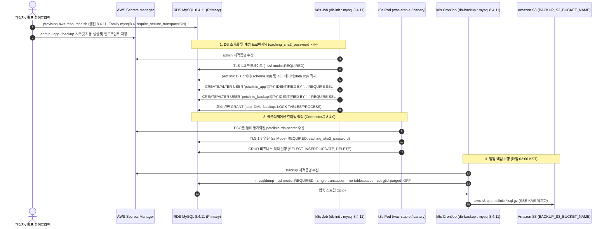

# RDS MySQL 8.4 LTS 전환 설계서 (`docs/features/rds-mysql-84/design.md`)

## 1. 목표와 범위 (하지 않을 것 포함)

### 1.1 배경 및 문제 정의 (Background & Problem)
- **MySQL 8.0.39 신규 프로비저닝 불가 (`ap-northeast-2`)**:
  - 현재 `infra/aws/provision-aws-resources.sh`에 명시된 MySQL 엔진 버전 `8.0.39`는 AWS `ap-northeast-2`(서울) 리전에서 더 이상 신규 RDS 인스턴스로 생성할 수 없다 (현재 생성 가능한 8.0 계열 버전은 `8.0.46` 등 일부 마이너 버전에 한정됨).
- **MySQL 8.0 표준 지원 종료 및 확장 지원(Extended Support) 추가 과금 방지**:
  - MySQL 8.0 계열은 2026-07-31 부로 커뮤니티 및 AWS RDS 표준 지원(Standard Support)이 공식 종료된다.
  - 표준 지원 종료 후에도 8.0 인스턴스를 유지할 경우 AWS RDS Extended Support 요금(vCPU/시간당 추가 과금)이 부과되어 인프라 유지 비용이 크게 증가한다.
- **MySQL 8.4 LTS(장기 지원 버전)의 안정성 및 수명 주기**:
  - MySQL 8.4 LTS는 2029년 7월까지 5년간 공식 표준 지원이 보장되므로, 빈번한 메이저 업그레이드 없이 장기적 운영 안정성과 비용 최적화를 달성할 수 있다.
  - AWS `ap-northeast-2` 리전에서 `8.4.5`부터 `8.4.11`까지 RDS 엔진 버전이 제공되고 있다.
- **신규 생성(Greenfield) 기준 아키텍처**:
  - 현재 프로덕션 환경에 기동 중인 실 RDS 인스턴스는 존재하지 않으므로, 기존 데이터 마이그레이션이나 인플레이스 메이저 업그레이드(In-place upgrade)가 아닌 **신규 클러스터/인스턴스 생성 기준**으로 클린 아키텍처를 수립한다.

### 1.2 핵심 목표 (Goals)
1. **RDS MySQL 엔진 버전 및 파라미터 그룹 정확한 고정**:
   - RDS MySQL 엔진 버전을 `ap-northeast-2` 최신 LTS 패치 버전인 **`8.4.11`** 로 명확히 고정한다.
   - DB 파라미터 그룹 패밀리를 기존 `mysql8.0`에서 **`mysql8.4`** (`${db_id}-params`)로 전환한다.
   - 데이터 전송 암호화를 위해 파라미터 그룹의 **`require_secure_transport=ON`** 설정을 변함없이 강제한다.
2. **Kubernetes DB 관리 작업(`db-init`, `db-backup`) 클라이언트 이미지 일치**:
   - `k8s/jobs/job-db-init.yaml` 및 `k8s/jobs/cronjob-db-backup.yaml`의 클라이언트 컨테이너 이미지를 `mysql:8.0.39`에서 RDS 엔진 버전과 동일한 **`mysql:8.4.11`** 로 교체한다.
3. **애플리케이션(WAS) 드라이버 호환성 확보 및 LTS 업그레이드**:
   - `app/pom.xml`의 MySQL JDBC 드라이버(`com.mysql:mysql-connector-j`)를 Innovation 버전 `8.1.0`에서 공식 LTS 드라이버인 **`8.4.0`** 으로 상향하여 MySQL 8.4 LTS 엔진과의 프로토콜 및 인증 완벽 호환을 보장한다.
4. **MySQL 8.4 변경점(인증, 명령어, DDL/DML) 호환성 검증**:
   - `mysql_native_password` 기본 비활성화에 따른 신규 인증 기본값인 **`caching_sha2_password`** 동작을 검증하고, TLS 강제 환경에서 추가 RSA 키 교환 없이 원활하게 인증되도록 규격화한다.
   - `db-init`의 계정 생성 구문(`CREATE USER ... IDENTIFIED BY ... REQUIRE SSL;`)과 `mysqldump` 백업 옵션(`--ssl-mode=REQUIRED --single-transaction --no-tablespaces --set-gtid-purged=OFF`)이 8.4에서 정상 동작함을 보장한다.
5. **검증 및 배포 스크립트 정합성 현행화**:
   - `scripts/validate-manifests.sh`에 MySQL 8.4 파라미터 그룹 패밀리, 엔진 버전, DB Job 이미지, Connector/J 드라이버 버전 검증을 반영하여 휴먼 에러를 사전에 차단한다.

### 1.3 범위 (In-Scope)
- `docs/features/rds-mysql-84/design.md` 설계서 작성
- `infra/aws/provision-aws-resources.sh`의 RDS 파라미터 그룹 패밀리(`mysql8.4`) 및 엔진 버전(`8.4.11`) 변경
- `k8s/jobs/job-db-init.yaml`의 `mysql` 컨테이너 이미지 태그(`mysql:8.4.11`) 갱신
- `k8s/jobs/cronjob-db-backup.yaml`의 `dump` 컨테이너 이미지 태그(`mysql:8.4.11`) 갱신 및 `mysqldump` 플래그 호환성 검증
- `app/pom.xml`의 `<mysql-driver.version>`을 `8.4.0`으로 갱신
- `scripts/validate-manifests.sh`의 정적 검증 규칙 갱신
- `README.md` 내 기술 스택 표 및 컴포넌트 버전 명세 현행화

### 1.4 하지 않을 것 (Out-of-Scope / Non-Goals)
- **기존 RDS 인스턴스 인플레이스 업그레이드 및 스냅샷 복원 제외**: 현재 운영 중인 RDS 인스턴스가 없는 신규 생성 환경이므로 마이그레이션 다운타임 절차나 업그레이드 스크립트는 다루지 않는다.
- **MySQL 9.x Innovation 버전 도입 제외**: 프로덕션의 장기 운영 안정성 및 LTS 보증(2029년 7월까지)을 최우선으로 하므로 단기 수명 주기(Innovation)인 9.x는 채택하지 않는다.
- **Aurora MySQL 또는 타 DBMS 엔진 전환 제외**: 기존 아키텍처인 RDS MySQL Multi-AZ(`db.t3.medium`) 규격을 그대로 유지한다.
- **`mysql_native_password` 강제 재활성화 제외**: 파라미터 그룹에서 구식 인증 방식인 `mysql_native_password`를 억지로 켜지 않고, 최신 보안 표준인 `caching_sha2_password` + TLS 환경을 기본 규격으로 채택한다.
- **`docs/architecture.md` 및 `architecture.drawio` 직접 수정 제외**: `ORCA_WORKFLOW.md` 불변 규칙에 따라 `docs/architecture.md`는 최종 머지 직전 ⑦ 단계에서 Claude가 일괄 현행화한다 (본 설계서 §2.1 및 §4.1에 변경 근거 명시).

---

## 2. 구성 요소와 디렉터리 구조 (기존 구조 대비 추가·변경되는 부분 표시)

### 2.1 기존 구조 대비 추가·변경되는 구성 요소
| 구분 | 대상 컴포넌트 | 변경 구분 | 기존 사양 | 변경 사양 (MySQL 8.4 LTS) | 변경 이유 및 근거 |
|---|---|---|---|---|---|
| **Database** | **Amazon RDS for MySQL** | **변경** | Engine `8.0.39`<br/>Family `mysql8.0` | Engine **`8.4.11`**<br/>Family **`mysql8.4`** | `ap-northeast-2`에서 8.0.39 신규 생성 불가 및 2026-07-31 표준 지원 종료(Extended Support 비용 방지). 2029-07까지 표준 지원 보장 |
| **Parameter Group** | **RDS Parameter Group** | **변경** | Family `mysql8.0`<br/>`require_secure_transport=ON` | Family **`mysql8.4`**<br/>`require_secure_transport=ON` | 8.4 엔진 호환 파라미터 그룹 패밀리로 전환. TLS 강제 통신 보안 설정 유지 |
| **K8s DB Init** | **`job-db-init`** | **변경** | `mysql:8.0.39` | **`mysql:8.4.11`** | RDS 엔진 버전과 클라이언트 CLI 버전을 일치시켜 `caching_sha2_password` 기본 인증 및 스키마 로드 안정성 확보 |
| **K8s DB Backup** | **`cronjob-db-backup`** | **변경** | `mysql:8.0.39` | **`mysql:8.4.11`** | `mysqldump` 클라이언트 버전을 8.4로 일치시켜 백업 덤프 생성 시 프로토콜 불일치 및 경고 방지 |
| **WAS Dependency** | **Connector/J 드라이버** | **변경** | `mysql-connector-j:8.1.0` | **`mysql-connector-j:8.4.0`** | MySQL 8.4 LTS 공식 호환 드라이버 적용, `caching_sha2_password` 및 TLS 최적화 |
| **Validation** | **`validate-manifests.sh`** | **변경** | 8.0 기준 이미지 검사 | **8.4 LTS 기준 검증 추가** | 프로비저닝 스크립트, DB Job 매니페스트, pom.xml의 버전 일치 여부 정적 검증 |
| **Documentation** | **`README.md`** | **변경** | MySQL 8.0.39 표기 | **MySQL 8.4 LTS (8.4.11) 표기** | 프로젝트 공개 문서 및 환경 설명 현행화 |

### 2.2 디렉터리 구조 (추가 `[NEW]` · 변경 `[MOD]` · 유지 표시)
```text
.
├── .env.example                          # (유지 — RDS_HOST, RDS_PORT, RDS_DB_NAME 등 변수 규격 동일)
├── README.md                             # [MOD] 기술 스택 표 및 DB 생성 안내의 MySQL 버전 8.4 LTS로 갱신
├── app/
│   ├── pom.xml                           # [MOD] <mysql-driver.version>을 8.1.0에서 8.4.0으로 상향
│   └── src/main/resources/db/mysql/
│       ├── schema.sql                    # (유지 — CREATE TABLE IF NOT EXISTS 등 8.4 완전 호환)
│       └── data.sql                      # (유지 — INSERT IGNORE INTO 등 8.4 완전 호환)
├── docs/
│   ├── architecture.md                   # (유지 — ⑦ 머지 직전 단계에서 Claude가 8.4 LTS 반영)
│   ├── architecture.drawio               # (유지 — ⑦ 머지 직전 단계에서 Claude가 8.4 LTS 반영)
│   └── features/
│       └── rds-mysql-84/
│           └── design.md                 # [NEW] 본 기능 설계서
├── infra/
│   └── aws/
│       └── provision-aws-resources.sh    # [MOD] db-parameter-group-family mysql8.4 및 engine-version 8.4.11로 수정
├── k8s/
│   ├── jobs/
│   │   ├── job-db-init.yaml              # [MOD] 컨테이너 이미지를 mysql:8.4.11로 수정
│   │   └── cronjob-db-backup.yaml        # [MOD] initContainer 이미지를 mysql:8.4.11로 수정
│   ├── secrets/
│   │   └── externalsecret-rds.yaml       # (유지 — JDBC URL 내 sslMode=REQUIRED 및 시크릿 템플릿 유지)
│   └── was/
│       ├── deployment-stable.yaml        # (유지 — 환경변수 주입 규격 동일)
│       └── deployment-canary.yaml        # (유지 — 환경변수 주입 규격 동일)
└── scripts/
    └── validate-manifests.sh             # [MOD] RDS 엔진 버전(8.4.11), 파라미터 그룹(mysql8.4), 이미지 태그 오프라인 검증 추가
```

---

## 3. 데이터 흐름 / API 또는 인터페이스

### 3.1 전체 데이터베이스 상호작용 흐름 (Data Flow)



### 3.2 MySQL 8.4 호환성 분석 및 인터페이스 영향

#### 1) 인증 플러그인 (`caching_sha2_password` vs `mysql_native_password`)
- **변경 사항**: MySQL 8.4 LTS부터 구형 인증 방식인 `mysql_native_password` 플러그인이 서버 엔진 레벨에서 **기본 비활성화(Disabled by default)** 되었다.
- **영향 분석**:
  - `k8s/jobs/job-db-init.yaml`의 사용자 생성 SQL:
    ```sql
    CREATE USER IF NOT EXISTS '$APP_USER'@'%' IDENTIFIED BY '$APP_PASSWORD' REQUIRE SSL;
    ALTER USER '$APP_USER'@'%' IDENTIFIED BY '$APP_PASSWORD' REQUIRE SSL;
    CREATE USER IF NOT EXISTS '$BACKUP_USER'@'%' IDENTIFIED BY '$BACKUP_PASSWORD' REQUIRE SSL;
    ALTER USER '$BACKUP_USER'@'%' IDENTIFIED BY '$BACKUP_PASSWORD' REQUIRE SSL;
    ```
  - 기존 구문은 `IDENTIFIED WITH mysql_native_password`를 명시하지 않고 `IDENTIFIED BY` 구문만 사용하므로, MySQL 8.4의 기본 인증 플러그인인 `caching_sha2_password`로 계정이 자동 생성된다.
  - `caching_sha2_password`는 보안상 패스워드 해시 암호화를 위해 RSA 공개키 교환을 요구하지만, **TLS(SSL) 연결 환경에서는 TLS 터널을 통해 직접 암호화된 인증 정보를 전달하므로 RSA 공개키 교환(`allowPublicKeyRetrieval=true`)이 전혀 필요 없다.**
  - 본 아키텍처는 RDS 파라미터 그룹의 `require_secure_transport=ON`, 계정 레벨의 `REQUIRE SSL`, JDBC의 `sslMode=REQUIRED`, CLI의 `--ssl-mode=REQUIRED`를 통해 모든 연결이 100% TLS로 강제되므로 `caching_sha2_password` 인증이 추가 설정 없이 완벽하고 안전하게 동작한다.

#### 2) 애플리케이션 JDBC 드라이버 (`mysql-connector-j:8.4.0`)
- **영향 분석**:
  - `app/pom.xml`의 `<mysql-driver.version>`을 기존 `8.1.0`에서 **`8.4.0`** 으로 업그레이드한다.
  - Connector/J 8.4.0은 MySQL 8.4 LTS를 위한 전용 공식 LTS 드라이버로서, `com.mysql.cj.jdbc.Driver` 클래스명을 그대로 유지하며, Spring Data JPA / Hibernate `7.4.11.Final` 및 Tomcat JDBC 풀과의 호환성이 완벽하게 보장된다.
  - `k8s/secrets/externalsecret-rds.yaml`의 JDBC URL:
    `jdbc:mysql://{{ .host }}:{{ .port }}/{{ .dbname }}?useUnicode=true&sslMode=REQUIRED`
    옵션 변경 없이 그대로 사용 가능하다.

#### 3) `mysqldump` 백업 옵션 호환성
- **영향 분석**:
  - `k8s/jobs/cronjob-db-backup.yaml`의 덤프 실행 명령어:
    ```bash
    mysqldump --ssl-mode=REQUIRED -h "$RDS_HOST" -P "$RDS_PORT" -u "$JDBC_USERNAME" \
      --single-transaction --no-tablespaces --set-gtid-purged=OFF "$RDS_DB_NAME" \
      | gzip > /backup/petclinic.sql.gz
    ```
  - MySQL 8.4에서 `mysqldump`의 복제 관련 레거시 플러그인(`--master-data`, `--dump-slave`)이 비권장 경고를 발생시키지만, 현재 백업 스크립트는 해당 플러그인을 전혀 사용하지 않고 오직 표준적인 `--single-transaction`, `--no-tablespaces`, `--set-gtid-purged=OFF`만 사용하므로 8.4에서도 경고 없이 완전 무중단 일관성 덤프를 생성한다.

#### 4) 스키마 및 시드 데이터 DDL/DML 호환성
- `app/src/main/resources/db/mysql/schema.sql`:
  - `CREATE TABLE IF NOT EXISTS`, `INT(4) UNSIGNED`, `AUTO_INCREMENT`, `FOREIGN KEY`, `INDEX` 구문 모두 MySQL 8.4에서 정상 동작한다.
  - `ALTER DATABASE petclinic DEFAULT CHARACTER SET utf8 DEFAULT COLLATE utf8_general_ci;` 구문에서 `utf8`은 8.4에서도 여전히 `utf8mb3` 별칭으로 정상 수용된다.
- `app/src/main/resources/db/mysql/data.sql`:
  - `INSERT IGNORE INTO ... VALUES (...)` 구문은 8.4에서 완벽히 호환되며 멱등한 초기 데이터 적재를 보장한다.

---

## 4. 실행 환경 — 런타임, 컨테이너/클라우드 리소스, 환경변수 목록

### 4.1 런타임 및 주요 컴포넌트 버전 (현행화 기준)

| 구분 | 컴포넌트 | 변경 전 (MySQL 8.0) | 변경 후 (MySQL 8.4 LTS) | 비고 |
|---|---|---|---|---|
| **Database** | Amazon RDS for MySQL | `8.0.39` | **`8.4.11`** | `ap-northeast-2` 최신 LTS 패치 버전 고정 |
| **Parameter Group** | RDS DB Parameter Group | `mysql8.0` (`${db_id}-params`) | **`mysql8.4`** (`${db_id}-params`) | `require_secure_transport=ON` 유지 |
| **DB Client Job** | Docker Image (`job-db-init`) | `mysql:8.0.39` | **`mysql:8.4.11`** | Docker Hub 공식 Oracle Linux 기반 이미지 |
| **DB Backup Job** | Docker Image (`cronjob-db-backup`) | `mysql:8.0.39` | **`mysql:8.4.11`** | initContainer 덤프 생성용 이미지 |
| **App Dependency** | `mysql-connector-j` | `8.1.0` | **`8.4.0`** | `app/pom.xml` MySQL Profile 런타임 의존성 |
| **AWS CLI** | `amazon/aws-cli` | `2.18.0` | `2.18.0` | `cronjob-db-backup` 업로드 컨테이너 유지 |
| **Application WAS** | Apache Tomcat 11 | `11.0.2-jre21-temurin-noble` | `11.0.2-jre21-temurin-noble` | WAS 컨테이너 및 Java 21 런타임 유지 |

### 4.2 인프라 및 클라우드 리소스 스펙
- **RDS 인스턴스 사양**:
  - 인스턴스 클래스: `db.t3.medium` (2 vCPU, 4 GiB Memory)
  - 다중 AZ 구성: `--multi-az` (Primary in AZ 2a, Standby in AZ 2c 동기 복제)
  - 스토리지: 20 GiB `gp3`, 암호화 활성화 (`--storage-encrypted`, AWS KMS `aws/rds`)
  - 네트워크 격리: DB 전용 프라이빗 서브넷(`DB_PRIVATE_SUBNET_A_ID`, `DB_PRIVATE_SUBNET_C_ID`), 퍼블릭 접근 완전 차단(`--no-publicly-accessible`)
  - 보안 그룹: EKS 워커 노드(`np-app`, `ng-critical`)에서의 3306 인바운드만 허용
  - 백업 및 보호: 백업 보존 기간 7일(`--backup-retention-period 7`), 삭제 방지 활성화(`--deletion-protection`), 태그 스냅샷 복사 활성화(`--copy-tags-to-snapshot`)
  - 관측성: CloudWatch Logs 내보내기 (`--enable-cloudwatch-logs-exports '["error","slowquery"]'`)

### 4.3 환경변수 목록 (`.env.example` 기준 — 실제 값은 기재하지 않음)
본 기능 변경으로 신규 환경변수가 추가되거나 제거되지 않으며, 기존 규격을 그대로 유지한다.

| 카테고리 | 환경변수명 | 필수 여부 | 설명 |
|---|---|---|---|
| **AWS / 클러스터** | `AWS_REGION` | 필수 | 배포 대상 AWS 리전 (예: 서울 리전) |
| | `AWS_ACCOUNT_ID` | 필수 | AWS 12자리 계정 식별자 |
| | `EKS_CLUSTER_NAME` | 필수 | EKS 클러스터 식별자 (RDS 이름 접두어로 활용) |
| **VPC 서브넷** | `DB_PRIVATE_SUBNET_A_ID` | 필수 | RDS Primary가 배치되는 DB 프라이빗 서브넷 A |
| | `DB_PRIVATE_SUBNET_C_ID` | 필수 | RDS Standby가 배치되는 DB 프라이빗 서브넷 C |
| **DB 식별 / 접속** | `RDS_DB_NAME` | 필수 | 기본 생성 데이터베이스명 (`petclinic`) |
| | `RDS_PORT` | 필수 | MySQL 서비스 포트 (`3306`) |
| | `RDS_SECRET_NAME` | 필수 | 관리자 계정(`petclinic_admin`) Secrets Manager 시크릿명 |
| | `RDS_APP_SECRET_NAME` | 필수 | WAS 애플리케이션 전용 계정(`petclinic_app`) 시크릿명 |
| | `RDS_BACKUP_SECRET_NAME` | 필수 | 백업 작업 전용 계정(`petclinic_backup`) 시크릿명 |
| | `RDS_INSTANCE_ID` | 선택 | RDS 인스턴스 ID (`${EKS_CLUSTER_NAME}-mysql` 기본값) |
| **백업 저장소** | `BACKUP_S3_BUCKET_NAME` | 필수 | 일일 DB 백업본이 적재되는 S3 버킷명 |

---

## 5. 보안 요구사항 (인증, 권한 최소화, 시크릿 관리 방식)

### 5.1 인증 및 암호화 요구사항 (Authentication & Encryption)
- **최신 인증 플러그인 규격 (`caching_sha2_password`)**:
  - MySQL 8.4의 기본 인증 플러그인인 `caching_sha2_password`를 적용하고 구식 `mysql_native_password`는 사용하지 않는다.
  - 패스워드는 SHA-256 기반 솔트 해시로 보호된다.
- **전송 구간 암호화 (In-Transit Encryption)**:
  - RDS 파라미터 그룹 레벨: `require_secure_transport=ON`을 적용하여 비SSL 클라이언트의 접속을 DB 엔진 차원에서 원천 차단한다.
  - 사용자 계정 레벨: `petclinic_app`, `petclinic_backup` 계정에 `REQUIRE SSL`을 부여하여 TLS 연결 없이는 인증이 불가하도록 2중 방어한다.
  - 클라이언트 레벨: `job-db-init` 및 `cronjob-db-backup`은 `--ssl-mode=REQUIRED`, 애플리케이션 WAS의 JDBC URL은 `sslMode=REQUIRED`를 명시하여 TLS 핸드셰이크를 강제한다.
- **저장 시 암호화 (At-Rest Encryption)**:
  - RDS EBS 볼륨은 AWS KMS 관리형 키(`aws/rds`)로 100% 암호화된다.
  - S3 백업 버킷에 저장되는 `petclinic-*.sql.gz` 백업 파일은 SSE-KMS(`--sse aws:kms`)로 암호화된다.

### 5.2 권한 최소화 (Least Privilege)
계정 목적에 따라 DB 권한을 3계층으로 엄격히 분리한다:
1. **관리자 계정 (`petclinic_admin`)**:
   - 용도: 초기 인프라 프로비저닝 및 `db-init` Job 전용
   - 권한: RDS 마스터 사용자 권한 (DB 생성, 스키마/테이블 DDL, DML, 사용자 생성 및 GRANT)
2. **애플리케이션 계정 (`petclinic_app`)**:
   - 용도: WAS (`was-stable`, `was-canary`) 런타임 전용
   - 권한: `GRANT SELECT, INSERT, UPDATE, DELETE ON petclinic.* TO 'petclinic_app'@'%'`
   - DDL(CREATE, DROP, ALTER) 및 관리 권한이 원천 배제되어 SQL Injection 등 앱 취약점 발생 시에도 데이터베이스 스키마 파괴를 차단한다.
3. **백업 계정 (`petclinic_backup`)**:
   - 용도: `db-backup` CronJob `mysqldump` 전용
   - 권한: `GRANT SELECT, SHOW VIEW, TRIGGER, LOCK TABLES ON petclinic.* TO 'petclinic_backup'@'%'`, `GRANT PROCESS ON *.* TO 'petclinic_backup'@'%'`
   - 쓰기(INSERT/UPDATE/DELETE) 및 DDL 권한이 전혀 없는 읽기 전용 덤프 권한만 부여한다.

### 5.3 시크릿 관리 방식
- **자동 생성 및 AWS Secrets Manager 보관**:
  - `infra/aws/provision-aws-resources.sh` 실행 시 `random_password`(32자 영숫자) 함수를 통해 비밀번호를 생성하고 `petclinic/rds-admin`, `petclinic/rds-app`, `petclinic/rds-backup` 시크릿에 JSON 형태로 저장한다.
  - 마스터 비밀번호는 인스턴스 생성 전에 Secrets Manager에 먼저 저장되므로 프로비저닝 중단 후 재실행 시에도 분실되지 않는다.
- **External Secrets Operator (ESO) 기반 K8s 시크릿 동기화**:
  - `k8s/secrets/externalsecret-rds.yaml`을 통해 Secrets Manager의 시크릿을 `petclinic-rds-admin-secret`, `petclinic-rds-secret`, `petclinic-rds-backup-secret`으로 안전하게 주입한다.
  - 소스 코드, Git 커밋, K8s 매니페스트에 일체의 평문 비밀번호를 노출하지 않는다.

---

## 6. 구현 단계 체크리스트 (Claude가 순서대로 따라갈 수 있게)

> **안내**: AWS 실자원에 닿거나 요금/상태 변화를 유발하는 단계는 **`[위험]`** 으로 표시되어 있으므로, 해당 단계 실행 전에는 `ORCA_WORKFLOW.md` 규칙에 따라 반드시 계획 및 승인을 거쳐야 한다.

### 1단계: 애플리케이션 드라이버 버전 상향 (`app/pom.xml`)
- [ ] `app/pom.xml` 파일 내 `<mysql-driver.version>`을 `8.1.0`에서 `8.4.0`으로 변경
- [ ] Maven 빌드 테스트 수행 (`mvn test -Dtest=PetclinicIntegrationTests` 또는 전체 빌드)으로 Connector/J 8.4.0 컴파일 및 패키징 정상 여부 검증

### 2단계: K8s DB 매니페스트 이미지 태그 수정
- [ ] `k8s/jobs/job-db-init.yaml`: `mysql` 컨테이너의 `image: mysql:8.0.39`를 `image: mysql:8.4.11`로 변경
- [ ] `k8s/jobs/cronjob-db-backup.yaml`: `dump` initContainer의 `image: mysql:8.0.39`를 `image: mysql:8.4.11`로 변경
- [ ] 두 매니페스트의 실행 인수(CLI 옵션 및 SQL 구문)가 MySQL 8.4 호환 사양과 일치하는지 재확인

### 3단계: 인프라 프로비저닝 스크립트 수정 (`infra/aws/provision-aws-resources.sh`)
- [ ] 파라미터 그룹 패밀리를 `--db-parameter-group-family mysql8.0`에서 `--db-parameter-group-family mysql8.4`로 변경
- [ ] 파라미터 그룹 설명 및 에코 메시지를 `MySQL 8.4`로 현행화
- [ ] RDS 생성 CLI 옵션을 `--engine mysql --engine-version 8.0.39`에서 `--engine mysql --engine-version 8.4.11`로 변경
- [ ] `require_secure_transport=ON` 파라미터 적용 로직 유지 확인

### 4단계: 정적 유효성 검증 및 CI 회귀 테스트 갱신 (`scripts/validate-manifests.sh`)
- [ ] `scripts/validate-manifests.sh`에 다음 검증 로직 추가/갱신:
  - `infra/aws/provision-aws-resources.sh` 내 RDS 엔진 버전이 `8.4.11`인지 검사
  - 파라미터 그룹 패밀리가 `mysql8.4`인지 검사
  - `k8s/jobs/job-db-init.yaml`의 이미지가 `mysql:8.4.11`인지 검사
  - `k8s/jobs/cronjob-db-backup.yaml`의 이미지가 `mysql:8.4.11`인지 검사
  - `app/pom.xml`의 `<mysql-driver.version>`이 `8.4.0`인지 검사
- [ ] `bash scripts/validate-manifests.sh`를 실행하여 43개 YAML 및 오프라인 테스트 전체 통과 확인

### 5단계: 문서 현행화 (`README.md`)
- [ ] `README.md` 내 기술 스택 테이블의 RDS MySQL 버전을 `8.0.39`에서 `8.4.11` (MySQL 8.4 LTS)로 갱신
- [ ] 관련 설명 내 `mysql:8.0.39` 이미지를 `mysql:8.4.11`로 갱신

### 6단계: 컨테이너 이미지 빌드 및 ECR 푸시 (CodeBuild)
- [ ] `scripts/build-and-push.sh`를 통해 `was` 이미지를 빌드 및 ECR 푸시 (`BUILD_TARGET=was IMAGE_TAG=...`)하여 Connector/J 8.4.0이 포함된 컨테이너 준비

### 7단계 [위험]: RDS MySQL 8.4.11 인스턴스 프로비저닝
- [ ] `infra/aws/provision-aws-resources.sh`의 post-cluster 단계(RDS 생성 부분)를 실행하여 `mysql8.4` 파라미터 그룹 및 RDS 인스턴스 신규 생성
- [ ] `aws rds describe-db-instances --db-instance-identifier <db_id>`로 엔진 버전이 `8.4.11`, 상태가 `available`, 파라미터 그룹이 정상 적용되었는지 확인

### 8단계 [위험]: K8s DB 초기화 Job (`db-init`) 실행
- [ ] `kubectl apply -f k8s/jobs/job-db-init.yaml` 실행
- [ ] `kubectl wait --for=condition=complete job/db-init -n petclinic --timeout=180s`로 완료 대기
- [ ] `kubectl logs job/db-init -n petclinic`로 스키마 생성 및 `petclinic_app`, `petclinic_backup` 계정 생성 로그 확인 (`caching_sha2_password` 및 TLS 적용 확인)

### 9단계 [위험]: 워크로드 배포 및 DB E2E 연결 검증
- [ ] `scripts/deploy-all.sh` 실행하여 신규 WAS 배포 및 외부 시크릿(ESO) 동기화 확인
- [ ] `was-stable` 및 `was-canary` Pod 로그에서 Hikari/Tomcat JDBC 풀이 RDS MySQL 8.4.11에 TLS로 정상 연결되었는지 확인
- [ ] ALB를 통해 PetClinic 웹 UI 접속 후 Vets 목록 조회 및 신규 Owner/Pet 등록 테스트 수행

### 10단계 [위험]: DB 백업 CronJob 수동 실행 검증
- [ ] `kubectl create job --from=cronjob/db-backup db-backup-manual-test -n petclinic` 실행
- [ ] 백업 Pod 완료 후 S3 백업 버킷에 `petclinic-*.sql.gz` 파일이 SSE-KMS 암호화로 정상 적재되었는지 `aws s3 ls`로 확인
- [ ] 테스트 완료 후 수동 생성한 임시 Job 삭제 (`kubectl delete job db-backup-manual-test -n petclinic`)

---

## 구현 중 질문

*(구현 중 발생하는 질문이나 설계 결정 필요 사항이 있을 경우 여기에 기록합니다.)*
