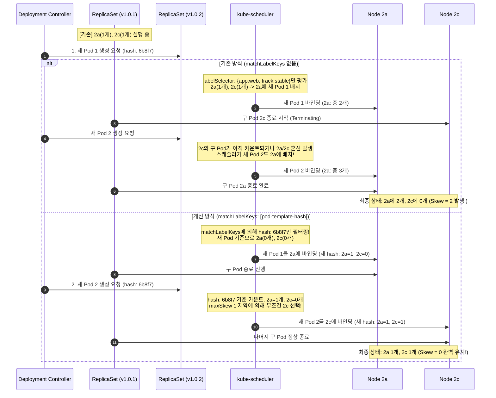

# 롤링 업데이트 시 AZ 균등 분산 보장 (`spread-on-rollout`) 설계서

> 문서 위치: `docs/features/spread-on-rollout/design.md`  
> 대상 시스템: EKS v1.36, PetClinic `web` / `was` 워크로드, Karpenter `np-app`

---

## 1. 목표와 범위 (하지 않을 것 포함)

### 1.1 배경 및 문제 정의 (Background & Problem)
- **현상 (2026-10-26 발생 현황)**:
  - 2026-10-26 `v1.0.2` 승격 롤링 업데이트 후, `web` stable Pod 2개가 모두 동일 가용영역(`ap-northeast-2a`) 및 동일 노드에 배치되는 불균형 현상이 확인되었다 (`was-stable`은 정상적으로 `2a` 1개, `2c` 1개로 분산됨).
- **근본 원인 분석 (Root Cause)**:
  - 현재 `k8s/web/deployment.yaml` 및 `k8s/was/deployment-stable.yaml`의 토폴로지 분산 제약은 다음과 같이 설정되어 있다.
    ```yaml
    topologySpreadConstraints:
      - maxSkew: 1
        topologyKey: topology.kubernetes.io/zone
        whenUnsatisfiable: DoNotSchedule
        labelSelector:
          matchLabels: { app: web, track: stable }
    ```
  - **스케줄러의 배치 시점(Scheduling Phase) 평가 특성**:
    - Kubernetes `kube-scheduler`는 Pod가 생성되어 노드에 바인딩되는 **배치 시점**에만 `topologySpreadConstraints`를 평가한다. 이미 실행 중인 Pod는 클러스터 내 토폴로지가 불균형해져도 자동으로 재분산(Descheduling/Eviction)되지 않는다.
  - **롤링 업데이트 중 이전 ReplicaSet Pod 간섭 (Legacy ReplicaSet Skew Interference)**:
    - 롤링 업데이트(`RollingUpdate`)가 진행되는 동안 새 ReplicaSet의 Pod가 스케줄링될 때, 종료 대기 중이거나 아직 종료되지 않은 구버전 ReplicaSet Pod도 동일한 라벨(`app: web, track: stable`)을 가지고 있으므로 `labelSelector` 카운트에 포함된다.
    - 예를 들어, 구버전 Pod 2개가 `2a`(1개), `2c`(1개)에 떠 있는 상태에서 새 Pod 1이 `2a`에 스케줄링된 후, 구버전 Pod 중 `2c`에 있던 Pod가 먼저 종료되면, 새 Pod 2를 스케줄링하는 순간 스케줄러는 `2a`(구버전 1 + 신버전 1)와 `2c`(0개)를 보게 되거나 롤링 배포 서지(`maxSurge: 25%`) 타이밍에 따라 종료 중인 Pod를 여전히 활성 상태로 계산하여 의도치 않은 AZ 몰림이 발생한다.
    - 최종적으로 구버전 Pod가 모두 종료된 후 남은 신버전 Pod 2개는 모두 `2a`에 남아 `2a: 2`, `2c: 0` (Skew = 2) 상태로 고착된다.
- **리스크**:
  - `web` stable이 단일 AZ(`ap-northeast-2a`)에 몰려 있으면, 해당 AZ 장애 발생 시 서비스 정적 에셋 서빙 및 프록시 계층이 전면 중단되어 Multi-AZ 고가용성(HA) 아키텍처가 무력화된다.

### 1.2 핵심 목표 (Goals)
1. **`matchLabelKeys: [pod-template-hash]` 표준 도입 (EKS v1.36)**:
   - Kubernetes 1.27+에서 베타 도입되고 1.31+에서 정식 지원(GA)된 `matchLabelKeys`를 적용한다.
   - 스케줄러가 incoming Pod를 배치할 때, Deployment 컨트롤러가 Pod 템플릿에 자동 주입하는 고유 해시(`pod-template-hash`)가 일치하는 Pod만 카운트하도록 스코프를 제한한다.
   - 이로써 롤링 업데이트 도중 종료 중인 이전 버전 ReplicaSet Pod가 새 버전 Pod의 가용영역 스큐(Skew) 계산에 간섭하지 못하게 원천 차단한다.
2. **대상 워크로드 전면 적용 및 기존 스케줄링 정책 유지**:
   - 대상:
     - `k8s/web/deployment.yaml`의 `web`(stable, `whenUnsatisfiable: DoNotSchedule`)
     - `k8s/web/deployment.yaml`의 `web-canary`(`whenUnsatisfiable: ScheduleAnyway`)
     - `k8s/was/deployment-stable.yaml`의 `was-stable`(`whenUnsatisfiable: DoNotSchedule`)
     - `k8s/was/deployment-canary.yaml`의 `was-canary`(`whenUnsatisfiable: ScheduleAnyway`)
   - 기존의 `whenUnsatisfiable` 정책(`stable`: 엄격한 `DoNotSchedule`, `canary`: 유연한 `ScheduleAnyway`)을 그대로 유지한다.
3. **Karpenter `np-app` 노드 풀과의 정합성 및 무중단 스케줄링 보장**:
   - 현재 서울 리전(`ap-northeast-2a`, `ap-northeast-2c`)에 각 1대씩 배치된 On-Demand `np-app` 노드에서 `DoNotSchedule`이 Pending 없이 동작함을 입증한다.
   - PDB(`minAvailable: 1`), HPA(2~10), KEDA(2~10, fallback 4)와의 상호작용을 정립한다.
4. **기존 불균형 배치의 무중단 자가 치유(Self-Healing)**:
   - 현재 `2a`에 2개 모두 몰려 있는 `web` stable Pod를 매니페스트 적용(롤아웃 트리거)만으로 다운타임 없이 `2a` 1개, `2c` 1개로 즉시 재분산한다.
5. **정적 검증 스크립트(`scripts/validate-manifests.sh`) 회귀 방지 검사 추가**:
   - `web`/`was` stable 및 canary 매니페스트에 `matchLabelKeys: [pod-template-hash]` 필드가 누락되지 않도록 CI/검증 파이프라인을 강화한다.

### 1.3 범위 (In-Scope)
- `docs/features/spread-on-rollout/design.md` 설계서 작성
- `k8s/web/deployment.yaml` 매니페스트 내 `web` 및 `web-canary`의 `topologySpreadConstraints` 수정
- `k8s/was/deployment-stable.yaml` 매니페스트 내 `was-stable`의 `topologySpreadConstraints` 수정
- `k8s/was/deployment-canary.yaml` 매니페스트 내 `was-canary`의 `topologySpreadConstraints` 수정
- `scripts/validate-manifests.sh` 내 `matchLabelKeys` 및 정책 불변성 회귀 검증 로직 추가
- 실 클러스터 배포 및 롤링 재시작 반복 검증 절차 수립 ([위험] 단계)

### 1.4 하지 않을 것 (Out-of-Scope / Non-Goals)
- **노드 단위 분산(`kubernetes.io/hostname`) 도입 제외**:
  - `topologyKey: kubernetes.io/hostname`을 추가하지 않는다.
  - 근거:
    1. 현재 `np-app` 노드는 `2a` 1대, `2c` 1대(총 2대)로 운영 중이다. AZ 단위 분산(`topology.kubernetes.io/zone`)을 통해 1대씩 배치되면 **자연스럽게 노드 단위 분산도 100% 달성**된다.
    2. HPA/KEDA에 의해 Pod가 2개 초과로 스케일아웃될 때, 호스트명 단위 `DoNotSchedule`이 걸려 있으면 Karpenter가 Pod 1개당 EC2 인스턴스 1대를 무조건 신규 프로비저닝해야 하므로 인프라 비용이 기하급수적으로 낭비된다.
    3. `ScheduleAnyway`로 호스트명 분산을 걸더라도 Karpenter의 노드 통합/빈 패킹(`WhenEmptyOrUnderutilized`) 정책과 경합을 일으킬 수 있으므로 클러스터 장애 도메인 격리의 핵심인 AZ(`zone`) 분산에 집중한다.
- **Descheduler 데몬 별도 설치 제외**:
  - 주기적으로 Pod를 퇴출(Evict)하는 별도 Descheduler 컨트롤러는 운영 복잡도를 증가시키고 예기치 않은 Pod 재시작을 유발하므로 도입하지 않는다. K8s 1.36 내장 스케줄러 기능인 `matchLabelKeys`만으로 원인을 원천 제거한다.
- **애플리케이션 코드 및 Dockerfile 수정 제외**:
  - 본 작업은 오직 Kubernetes 스케줄링 메타데이터 변경에 국한된다.
- **`docs/architecture.md` 직접 수정 제외**:
  - 워크플로 불변 규칙에 따라 `docs/architecture.md`는 리뷰 및 머지 직전 단계(Step ⑦)에서 Claude가 갱신한다.

---

## 2. 구성 요소와 디렉터리 구조 (기존 구조 대비 추가·변경되는 부분 표시)

### 2.1 구성 요소 변경 요약

| 구성 요소 | 대상 파일 | 변경 구분 | 주요 변경 내용 |
|---|---|---|---|
| **Web Tier (Stable)** | `k8s/web/deployment.yaml` (`Deployment/web`) | **변경 [MOD]** | `spec.template.spec.topologySpreadConstraints`에 `matchLabelKeys: [pod-template-hash]` 추가. (`whenUnsatisfiable: DoNotSchedule` 유지) |
| **Web Tier (Canary)** | `k8s/web/deployment.yaml` (`Deployment/web-canary`) | **변경 [MOD]** | `spec.template.spec.topologySpreadConstraints`에 `matchLabelKeys: [pod-template-hash]` 추가. (`whenUnsatisfiable: ScheduleAnyway` 유지) |
| **WAS Tier (Stable)** | `k8s/was/deployment-stable.yaml` (`Deployment/was-stable`) | **변경 [MOD]** | `spec.template.spec.topologySpreadConstraints`에 `matchLabelKeys: [pod-template-hash]` 추가. (`whenUnsatisfiable: DoNotSchedule` 유지) |
| **WAS Tier (Canary)** | `k8s/was/deployment-canary.yaml` (`Deployment/was-canary`) | **변경 [MOD]** | `spec.template.spec.topologySpreadConstraints`에 `matchLabelKeys: [pod-template-hash]` 추가. (`whenUnsatisfiable: ScheduleAnyway` 유지) |
| **Validation Script** | `scripts/validate-manifests.sh` | **변경 [MOD]** | `web`/`was` 4개 Deployment의 `topologySpreadConstraints`에 `matchLabelKeys: [pod-template-hash]` 및 zone 분산 정책 정적 검사 추가 |
| **Feature Documentation** | `docs/features/spread-on-rollout/design.md` | **추가 [NEW]** | 본 설계 문서 |

### 2.2 디렉터리 구조

```text
anchovy/
├── docs/
│   └── features/
│       └── spread-on-rollout/
│           └── design.md                   # [NEW] 본 기능 설계서
├── k8s/
│   ├── was/
│   │   ├── deployment-canary.yaml          # [MOD] matchLabelKeys 추가 (ScheduleAnyway)
│   │   ├── deployment-stable.yaml          # [MOD] matchLabelKeys 추가 (DoNotSchedule)
│   │   ├── keda-scaledobject.yaml          # (유지) min 2, max 10, fallback 4
│   │   └── pdb.yaml                        # (유지) minAvailable 1
│   └── web/
│       ├── deployment.yaml                 # [MOD] web, web-canary matchLabelKeys 추가
│       ├── hpa.yaml                        # (유지) min 2, max 10
│       └── pdb.yaml                        # (유지) minAvailable 1
└── scripts/
    ├── deploy-all.sh                       # (유지) 전체 배포 워크플로
    └── validate-manifests.sh               # [MOD] topologySpread matchLabelKeys 검증 추가
```

### 2.3 매니페스트 변경 상세 (Before vs After)

#### (1) `k8s/web/deployment.yaml` (`web` stable)
```diff
       topologySpreadConstraints:
         - maxSkew: 1
           topologyKey: topology.kubernetes.io/zone
           whenUnsatisfiable: DoNotSchedule
           labelSelector:
             matchLabels: { app: web, track: stable }
+          matchLabelKeys:
+            - pod-template-hash
```

#### (2) `k8s/web/deployment.yaml` (`web-canary`)
```diff
       topologySpreadConstraints:
         - maxSkew: 1
           topologyKey: topology.kubernetes.io/zone
           whenUnsatisfiable: ScheduleAnyway
           labelSelector:
             matchLabels: { app: web, track: canary }
+          matchLabelKeys:
+            - pod-template-hash
```

#### (3) `k8s/was/deployment-stable.yaml` (`was-stable`)
```diff
       topologySpreadConstraints:
         - maxSkew: 1
           topologyKey: topology.kubernetes.io/zone
           whenUnsatisfiable: DoNotSchedule
           labelSelector:
             matchLabels: { app: was, track: stable }
+          matchLabelKeys:
+            - pod-template-hash
```

#### (4) `k8s/was/deployment-canary.yaml` (`was-canary`)
```diff
       topologySpreadConstraints:
         - maxSkew: 1
           topologyKey: topology.kubernetes.io/zone
           whenUnsatisfiable: ScheduleAnyway
           labelSelector:
             matchLabels: { app: was, track: canary }
+          matchLabelKeys:
+            - pod-template-hash
```

---

## 3. 데이터 흐름 / 시스템 아키텍처 및 인터페이스

### 3.1 롤링 업데이트 시 스케줄러 동작 비교



### 3.2 Karpenter `np-app` 노드 풀과의 상호작용
- **현재 노드 풀 현황**:
  - `infra/karpenter/nodepool-app.yaml` 정의에 따라 On-Demand 기본 풀(`np-app`, `workload-tier: app`)이 서울 리전 2개 AZ(`ap-northeast-2a`, `ap-northeast-2c`)에 걸쳐 배포된다.
  - 현재 안정 상태(Steady State)에서 `2a`에 1대, `2c`에 1대의 c6i/m6i 인스턴스가 프로비저닝되어 있다.
- **`DoNotSchedule` 제약 하에서 Pending 없는 즉시 스케줄링 조건**:
  - `web` stable 2개, `was-stable` 2개가 각각 `maxSkew: 1` 및 `DoNotSchedule`을 갖는다.
  - `matchLabelKeys` 적용 시, 롤링 업데이트 중에 새로운 Pod 2개는 반드시 `2a`에 1개, `2c`에 1개로 분산 스케줄링된다.
  - 현재 `2a` 노드와 `2c` 노드가 이미 기동되어 있고, 각 노드당 메모리 및 CPU Request 여유가 충분하므로(web은 100m/64Mi, was는 500m/1280Mi), 새 Pod 생성 시 노드가 없어 `Pending` 상태로 머무는 지연(EC2 부팅 40~60초) 없이 즉시 기동된다.
- **Karpenter Consolidation 및 Node Drain 상호작용**:
  - Karpenter의 노드 통합 정책(`WhenEmptyOrUnderutilized`, `consolidateAfter: 1m`)은 노드를 비우거나 축소할 때 대상 Pod를 Evict한다.
  - Pod가 Evict될 때 K8s 스케줄러는 다시 `topologySpreadConstraints`를 평가하므로, 남은 Pod의 반대편 AZ에 재스케줄링을 시도한다. 반대편 AZ 노드에 용량이 부족할 경우 Karpenter가 새 노드를 신속하게 프로비저닝한다.

### 3.3 PDB(minAvailable: 1) · HPA · KEDA와의 상호작용
1. **PDB (`PodDisruptionBudget`, `minAvailable: 1`)**:
   - `k8s/web/pdb.yaml` 및 `k8s/was/pdb.yaml`은 `app=web,track=stable` 및 `app=was,track=stable`에 대해 상시 최소 1개의 Pod 가용성을 보장한다.
   - `Deployment`의 롤링 업데이트 전략(`maxSurge: 25%`, `maxUnavailable: 25%`)에 따라, 2개 레플리카 환경에서는 `maxSurge=1`, `maxUnavailable=0`으로 계산된다. 즉, 신규 Pod가 `Ready` 상태가 되기 전까지 기존 Pod가 삭제되지 않으므로 PDB 위반이 발생하지 않는다.
2. **HPA (`k8s/web/hpa.yaml`, CPU 60%, replicas: 2~10)**:
   - 트래픽 증가로 HPA가 `web` Pod를 2개에서 3, 4, ..., 10개로 점진적 스케일아웃할 때:
     - 모든 Pod가 동일한 `pod-template-hash`를 가지므로, `matchLabelKeys` 조건 하에서 스케줄러는 `2a`와 `2c`에 번갈아가며 1개씩 추가한다.
     - 2개: `(2a: 1, 2c: 1)`, Skew = 0
     - 3개: `(2a: 2, 2c: 1)` 또는 `(2a: 1, 2c: 2)`, Skew = 1 <= maxSkew (스케줄링 성공)
     - 4개: `(2a: 2, 2c: 2)`, Skew = 0
     - 10개: `(2a: 5, 2c: 5)`, Skew = 0
   - 스케일다운 시에도 ReplicaSet 컨트롤러는 토폴로지 균형을 유지하는 방향으로 Pod를 종료한다.
3. **KEDA (`k8s/was/keda-scaledobject.yaml`, Prometheus 요청률 기반, replicas: 2~10, fallback: 4)**:
   - `was-stable`은 KEDA에 의해 동적으로 스케일링된다. Prometheus 장애 시 `fallback: 4`가 발동하며, 이 경우 `2a`에 2개, `2c`에 2개가 배치되어 고르게 부하를 분산한다.
   - `matchLabelKeys`는 HPA/KEDA의 정상 스케일링 동작에 일체 부작용을 주지 않고 완벽한 대칭성을 보장한다.

### 3.4 현재 불균형 배치 자가 치유(Self-Healing) 흐름
- **현재 상태**: `web` stable Pod 2개가 모두 `ap-northeast-2a` 노드에 존재.
- **자가 치유 메커니즘**:
  1. `k8s/web/deployment.yaml`에 `matchLabelKeys: [pod-template-hash]`를 추가하여 클러스터에 Apply한다.
  2. `spec.template`의 변경으로 인해 Deployment 컨트롤러가 새로운 ReplicaSet(신규 해시)을 생성한다.
  3. 신규 ReplicaSet의 1번째 Pod가 생성된다. 새 해시 기준 `2a=0`, `2c=0`이므로 `2a`(또는 `2c`)에 배치된다.
  4. 신규 Pod 1이 준비되면, 신규 ReplicaSet의 2번째 Pod가 생성된다. 새 해시 기준 이미 배치된 곳이 1개이므로, 스케줄러는 `maxSkew: 1` 및 `DoNotSchedule`에 의해 **반드시 반대편 AZ(`2c`)** 노드에 배치한다.
  5. 2개의 신규 Pod가 모두 정상 구동(Ready)되면, `2a`에 몰려 있던 구버전 Pod 2개가 차례대로 종료된다.
  6. 별도의 수동 파괴나 다운타임 없이 `2a` 1개, `2c` 1개로 자동 정렬된다.

---

## 4. 실행 환경

### 4.1 런타임 및 플랫폼 버전 명세
- **Kubernetes 컨트롤 플레인 / 워커 노드**: Amazon EKS v1.36 (`ap-northeast-2`)
- **Kube-Scheduler**: v1.36 (기본 스케줄링 플러그인 `NodeResourcesFit`, `PodTopologySpread` 활성화)
- **Karpenter**: v1.15.0 (`CRD: karpenter.sh/v1`, `NodePool: np-app`)
- **컨테이너 이미지 런타임**:
  - `web` (Nginx): `1.27-alpine` 기반, 사이드카 `nginx-prometheus-exporter:1.3.0`
  - `was` (Tomcat): `Tomcat 11` + `Eclipse Temurin JDK 21`
- **관련 Operator / Controller**:
  - OpenTelemetry Operator: `0.105.0`
  - KEDA: `2.21.0`
  - Metrics Server: `3.14.0`

### 4.2 컨테이너 리소스 사양 및 노드 배치
- **노드 선택자 및 테인트(Placement)**:
  - 노드 선택자: `workload-tier: app`
  - 테인트: 없음 (일반 애플리케이션 워크로드)
- **리소스 Requests / Limits**:
  - `web` 컨테이너:
    - Requests: `cpu: 100m, memory: 64Mi`
    - Limits: `cpu: 500m, memory: 256Mi`
  - `nginx-exporter` 컨테이너:
    - Requests: `cpu: 10m, memory: 16Mi`
    - Limits: `cpu: 100m, memory: 64Mi`
  - `was-stable` 컨테이너:
    - Requests: `cpu: 500m, memory: 1280Mi`
    - Limits: `cpu: "2", memory: 2Gi`
  - `was-canary` 컨테이너:
    - Requests: `cpu: 500m, memory: 1280Mi`
    - Limits: `cpu: "2", memory: 2Gi`

### 4.3 환경변수 목록 (값 미포함, 명칭 및 용도)
| 환경변수명 | 주입 위치 | 용도 |
|---|---|---|
| `AWS_REGION` | 배포 쉘 환경 | AWS 리전 명시 (`ap-northeast-2`) |
| `EKS_CLUSTER_NAME` | 배포 쉘 환경 | 대상 EKS 클러스터 식별 |
| `ECR_WEB_REPOSITORY_URI` | `k8s/web/deployment.yaml` | Nginx 웹 프록시 이미지 ECR URI |
| `ECR_WAS_REPOSITORY_URI` | `k8s/was/deployment-*.yaml` | Tomcat WAS 이미지 ECR URI |
| `STABLE_IMAGE_TAG` | `k8s/web/`, `k8s/was/` | 프로덕션 안정 버전 이미지 태그 |
| `CANARY_IMAGE_TAG` | `k8s/web/`, `k8s/was/` | 카나리 테스트 버전 이미지 태그 |
| `WAS_UPSTREAM_HOST` | `k8s/web/deployment.yaml` | Nginx 프록시 대상 WAS 서비스명 (`was-stable` / `was-canary`) |
| `WAS_UPSTREAM_PORT` | `k8s/web/deployment.yaml` | Nginx 프록시 대상 WAS 포트 (`8080`) |
| `OTEL_DEPLOYMENT_ENVIRONMENT` | `k8s/was/deployment-*.yaml` | 배포 환경 레이블 (`production`) |

---

## 5. 보안 요구사항 (Security Requirements)

### 5.1 Pod Security Standards 및 보안 컨텍스트
기존 매니페스트에 선언된 최고 수준의 컨테이너 격리 규격을 그대로 유지한다.
- **Pod 레벨 SecurityContext**:
  - `runAsNonRoot: true` 강제
  - `runAsUser: 10001`, `runAsGroup: 10001`, `fsGroup: 10001` (루트 권한 실행 원천 차단)
  - `seccompProfile: { type: RuntimeDefault }`
  - `automountServiceAccountToken: false` (쿠버네티스 API 토큰 불필요 주입 차단)
- **컨테이너 레벨 SecurityContext**:
  - `allowPrivilegeEscalation: false` (권한 상승 방지)
  - `readOnlyRootFilesystem: true` (루트 파일시스템 읽기 전용)
  - `capabilities: drop: ["ALL"]` (모든 Linux 기능 플래그 드롭)
  - 임시 쓰기 영역은 비공유 `emptyDir` 마운트 활용 (`/tmp`, `/var/cache/nginx` 등)

### 5.2 권한 최소화 및 시크릿 관리 방식
- Kubernetes 스케줄링 옵션(`topologySpreadConstraints`) 변경은 RBAC 권한 상승을 요구하지 않으며 기존 CI/CD 배포 권한 범위 내에서 수행된다.
- 본 기능 적용 시 민감 정보(DB 암호, AWS 액세스 키 등)의 노출이나 변경은 일체 발생하지 않는다.
- 기존의 AWS Secrets Manager + External Secrets Operator(ESO) 동기화 파이프라인 및 ServiceAccount IRSA 토큰 분리 체계가 변함없이 유지된다.

---

## 6. 구현 단계 체크리스트 (Claude 구현용)

Claude는 아래 단계 순서대로 작업을 진행한다.

### Phase 1: 매니페스트 수정 (정적 코드 변경)
- [ ] **Step 1: `k8s/web/deployment.yaml` 수정**
  - `Deployment/web`의 `topologySpreadConstraints[0]`에 `matchLabelKeys: [pod-template-hash]` 추가 (`whenUnsatisfiable: DoNotSchedule` 유지).
  - `Deployment/web-canary`의 `topologySpreadConstraints[0]`에 `matchLabelKeys: [pod-template-hash]` 추가 (`whenUnsatisfiable: ScheduleAnyway` 유지).
- [ ] **Step 2: `k8s/was/deployment-stable.yaml` 수정**
  - `Deployment/was-stable`의 `topologySpreadConstraints[0]`에 `matchLabelKeys: [pod-template-hash]` 추가 (`whenUnsatisfiable: DoNotSchedule` 유지).
- [ ] **Step 3: `k8s/was/deployment-canary.yaml` 수정**
  - `Deployment/was-canary`의 `topologySpreadConstraints[0]`에 `matchLabelKeys: [pod-template-hash]` 추가 (`whenUnsatisfiable: ScheduleAnyway` 유지).

### Phase 2: 정적 검증 스크립트 수정 및 로컬 테스트
- [ ] **Step 4: `scripts/validate-manifests.sh` 회귀 검증 규칙 추가**
  - Section 10 또는 Operational Guards에 검사 추가:
    - 대상 파일: `k8s/web/deployment.yaml`, `k8s/was/deployment-stable.yaml`, `k8s/was/deployment-canary.yaml`
    - 각 Deployment의 `spec.template.spec.topologySpreadConstraints` 파싱:
      - `topologyKey == "topology.kubernetes.io/zone"` 인 제약이 반드시 존재해야 함.
      - `maxSkew == 1` 이어야 함.
      - `matchLabelKeys`가 리스트 형태로 정의되어 있고 `"pod-template-hash"`가 포함되어 있어야 함.
      - `whenUnsatisfiable` 값이 stable은 `"DoNotSchedule"`, canary는 `"ScheduleAnyway"`로 일치해야 함.
- [ ] **Step 5: 로컬 오프라인 검증 실행**
  - `bash scripts/validate-manifests.sh` 실행하여 오류 없이 `OK` 통과하는지 확인.
  - 고의로 `matchLabelKeys`를 제거했을 때 검증기가 `FAIL`을 반환하는지 음성 테스트(Negative Test) 수행 후 복구.

### Phase 3: 실 클러스터 적용 및 불균형 해소 검증 [위험]
> [!IMPORTANT]
> 아래 단계는 실제 가동 중인 AWS EKS 클러스터에 직접 매니페스트를 적용하고 Pod를 롤아웃하므로 반드시 사용자의 사전 승인을 득한 후 실행한다.

- [ ] **Step 6 [위험]: 매니페스트 적용 (Targeted Apply 또는 Full Deploy)**
  - **선택 가이드**:
    - **옵션 A (권장, 빠른 무중단 적용 - 대상 매니페스트만 적용)**:
      ```bash
      . ./scripts/lib.sh
      render k8s/web/deployment.yaml | kubectl apply -f -
      render k8s/was/deployment-stable.yaml | kubectl apply -f -
      render k8s/was/deployment-canary.yaml | kubectl apply -f -
      
      kubectl -n petclinic rollout status deploy/web --timeout=300s
      kubectl -n petclinic rollout status deploy/was-stable --timeout=600s
      kubectl -n petclinic rollout status deploy/web-canary --timeout=300s
      kubectl -n petclinic rollout status deploy/was-canary --timeout=600s
      ```
    - **옵션 B (전체 파이프라인 정합 배포)**:
      ```bash
      ./scripts/deploy-all.sh
      ```
- [ ] **Step 7 [위험]: AZ 분산(2a: 1개, 2c: 1개) 자가 치유 확인**
  - 실행 명령:
    ```bash
    kubectl get pods -n petclinic -l app=web,track=stable -o wide -L topology.kubernetes.io/zone
    kubectl get pods -n petclinic -l app=was,track=stable -o wide -L topology.kubernetes.io/zone
    ```
  - 검증 기준:
    - `web` stable Pod 2개 중 1개는 `ap-northeast-2a`, 1개는 `ap-northeast-2c`에 배치되어야 함.
    - `was` stable Pod 2개 중 1개는 `ap-northeast-2a`, 1개는 `ap-northeast-2c`에 배치되어야 함.
- [ ] **Step 8 [위험]: 롤링 재시작 반복 시험 (Repeatability Test)**
  - 롤링 업데이트가 반복되어도 분산이 깨지지 않고 유지되는지 시험:
    ```bash
    kubectl -n petclinic rollout restart deploy/web deploy/was-stable
    kubectl -n petclinic rollout status deploy/web --timeout=300s
    kubectl -n petclinic rollout status deploy/was-stable --timeout=600s
    
    kubectl get pods -n petclinic -l app=web,track=stable -o wide -L topology.kubernetes.io/zone
    kubectl get pods -n petclinic -l app=was,track=stable -o wide -L topology.kubernetes.io/zone
    ```
  - 롤아웃 완료 후에도 `2a` 1개, `2c` 1개 비율이 흔들림 없이 유지되는지 확인 (2회 이상 반복 권장).

---

## 구현 중 질문

<!-- Claude가 구현 단계에서 판단이 필요했던 사항이나 설계 범위 내 세부 결정을 기록하는 빈 섹션 -->
