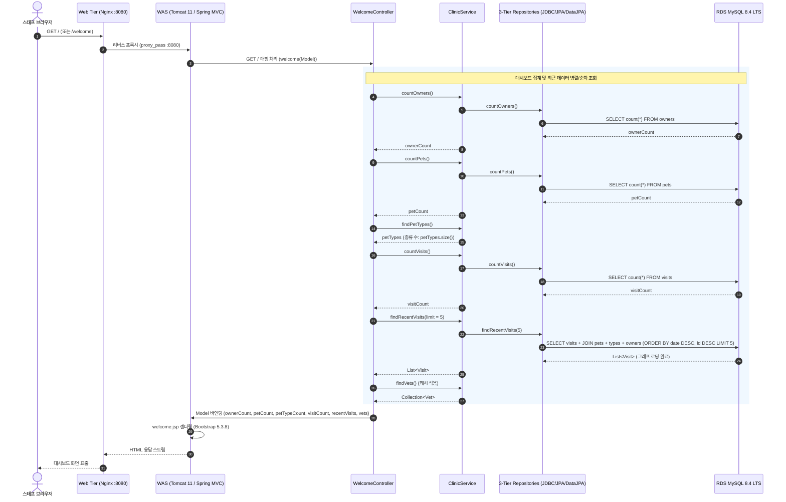

# 스태프 운영 대시보드 (`staff-dashboard`) 기능 설계서

## 1. 목표와 범위 (하지 않을 것 포함)

### 1.1 배경 및 문제 정의 (Background & Problem)
- **정적 환영 페이지의 한계**:
  - 현재 PetClinic 메인 화면(`/`, `welcome.jsp`)은 단순 환영 텍스트와 정적 이미지(`pets.png`)만 렌더링하고 있다.
  - Spring MVC 설정(`mvc-core-config.xml`)에서 `<mvc:view-controller path="/" view-name="welcome"/>` 정적 매핑으로 처리되어 있어 백엔드 비즈니스 로직이나 DB 조회가 전혀 수행되지 않는다.
- **데스크 스태프의 업무 비효율**:
  - 병원 데스크에 상주하는 스태프는 환자/보호자 현황 파악, 최근 진료/방문 이력 추적, 신규 방문 접수, 보호자 조회, 당직 수의사 전문 분야 확인을 위해 여러 메뉴(`Find owners`, `Veterinarians`)를 번갈아 탐색해야 하는 비효율이 존재한다.
- **운영 콘솔 프로토타입 제시**:
  - `docs/features/staff-dashboard/mockup/main.html` 프로토타입을 기반으로 메인 화면을 스태프 운영 대시보드로 전환하여, 첫 화면에서 병원 운영 핵심 지표와 최근 진료 흐름을 한눈에 파악하고 즉시 업무로 전환할 수 있는 콘솔을 제공한다.

### 1.2 핵심 목표 (Goals)
1. **메인 화면(`/`)의 스태프 운영 콘솔화**:
   - `welcome.jsp`를 재설계하여 상단 요약 카드(보호자 수, 환자·종류 수, 총 방문 수), 최근 방문 표, 보호자 신속 검색 폼, 수의사 명단(전문 분야)을 통합 제공한다.
2. **정적 뷰 컨트롤러를 `WelcomeController`로 승격**:
   - `mvc-core-config.xml`의 `<mvc:view-controller path="/" .../>`를 제거하고, `@Controller` 기반 `WelcomeController`를 신설하여 대시보드 모델 데이터를 `ClinicService` 파사드를 통해 주입한다.
3. **3종 저장소 구현체(Spring Data JPA, JPA, JDBC) 완벽 지원**:
   - 저장소 프로필(`spring-data-jpa`, `jpa`, `jdbc`) 3종 모두에 카운트 쿼리(보호자 수, 반려동물 수, 방문 수) 및 최근 방문 상한(Top-N) 조회 기능을 빠짐없이 구현한다.
4. **RDS 부하 방지 건수 상한(Upper Limit) 강제**:
   - 최근 방문 조회는 파라미터화된 상한(`limit = 5` 또는 `10`)을 두어 대용량 데이터 환경에서도 RDS MySQL에 부하가 없도록 최적화한다.
5. **무중단 카나리 배포(10%) 검증 및 안정적 프로모션**:
   - 신규 기능 반영 이미지(`petclinic-web:v1.0.2`, `petclinic-was:v1.0.2`)를 CodeBuild로 빌드 후, 10% 카나리 분할 배포(`X-Canary: always` 검증 포함)를 거쳐 무중단으로 적용한다.

### 1.3 범위 (In-Scope)
- **설계 문서 작성**: `docs/features/staff-dashboard/design.md`
- **Spring MVC 설정 및 컨트롤러**:
  - `mvc-core-config.xml` 내 `<mvc:view-controller path="/" view-name="welcome"/>` 제거
  - `org.springframework.samples.petclinic.web.WelcomeController` 신설 (`GET /` 및 `/welcome` 처리)
- **도메인 서비스 및 저장소 확장**:
  - `ClinicService`, `ClinicServiceImpl`에 대시보드 조회 메서드 추가
  - `OwnerRepository`, `PetRepository`, `VisitRepository` 인터페이스 확장
  - `SpringDataOwnerRepository`, `SpringDataPetRepository`, `SpringDataVisitRepository` 구현
  - `JpaOwnerRepositoryImpl`, `JpaPetRepositoryImpl`, `JpaVisitRepositoryImpl` 구현
  - `JdbcOwnerRepositoryImpl`, `JdbcPetRepositoryImpl`, `JdbcVisitRepositoryImpl` 구현
- **뷰 템플릿(JSP) 및 UI 구현**:
  - `app/src/main/webapp/WEB-INF/jsp/welcome.jsp` 전면 개편
  - Bootstrap 5.3.8 스타일 적용 및 기존 PetClinic 공통 레이아웃(`petclinic:layout`, `petclinic:menu`, `petclinic:footer`) 준수
- **단위 및 통합 테스트**:
  - `WelcomeControllerTests` 신설 (MockMvc 기반 컨트롤러 단위 테스트)
  - `AbstractClinicServiceTests` 확장 (카운트 및 최근 방문 조회 기능 검증 → JDBC/JPA/Spring Data JPA 3종 프로필 자동 회귀 테스트)
- **컨테이너 빌드 및 카나리 배포**:
  - AWS CodeBuild를 통한 `v1.0.2` 멀티스테이지 이미지 빌드 및 ECR 푸시
  - 카나리 10% 트래픽 분할 검증 후 100% 프로모션

### 1.4 하지 않을 것 (Out-of-Scope / Non-Goals)
- **DB 스키마(DDL) 변경 제외 (사용자 결정 사항)**:
  - 사용자 요구사항에 따라 `schema.sql`이나 RDS MySQL의 스키마 변경을 일절 수행하지 않는다.
  - 신규 컬럼, 외래키, 또는 수의사-방문 연관 테이블을 추가하지 않는다.
- **목업의 "Assigned Vet" 컬럼 및 "On Duty" 배지 제외**:
  - DB 스키마에 수의사-방문 매핑 및 수의사 출근/당직 상태 컬럼이 없으므로, 목업의 Assigned Vet 열은 제외하고 수의사 명단은 전문 분야(Specialties) 표시로 갈음한다.
- **"Visits Today" 당일 방문 통계 제외**:
  - 샘플 데이터(`data.sql`)의 방문 일자가 2008~2011년에 위치하여 "오늘 방문" 필터링 시 0건만 노출되므로, 전체 누적 방문 수(`Total Visits`) 및 최근 방문 목록으로 대체한다.
- **존재하지 않는 전역 링크 제외**:
  - 목업에 존재하는 `/visits/new` 및 `/pets/new`는 PetClinic 엔드포인트에 존재하지 않는 URL이다(방문 등록은 개별 반려동물 컨텍스트인 `/owners/{ownerId}/pets/{petId}/visits/new`로만 가능). 따라서 유효하지 않은 전역 버튼은 제외하고, 최근 방문 목록의 각 행에서 해당 반려동물에 대한 방문 추가 링크를 제공한다.
- **목업 자체의 상단 네비게이션·버전 배지·고정 검색 결과 미리보기 제외**:
  - 목업의 임의 헤더/nav(`<header>`, `<nav>`), 버전 배지(`Spring PetClinic V3.2 DB`), 하드코딩된 특정 보호자 미리보기는 제거하고, PetClinic 표준 헤더/메뉴 태그(`petclinic:layout`, `petclinic:menu`)를 일관되게 유지한다.
- **Nginx(`web`) 설정 변경 제외**:
  - Web 계층은 정적 파일 서빙 및 WAS 프록시만 담당하며, `/` 요청은 이미 WAS로 프록시되므로 Nginx 설정 변경은 불필요하다.

---

## 2. 구성 요소와 디렉터리 구조 (기존 구조 대비 추가·변경되는 부분 표시)

### 2.1 기존 구조 대비 추가·변경되는 구성 요소
| 구분 | 대상 컴포넌트 | 변경 구분 | 기존 사양 | 변경 사양 (staff-dashboard) | 변경 이유 및 근거 |
|---|---|---|---|---|---|
| **Web MVC Config** | `mvc-core-config.xml` | **변경** | `<mvc:view-controller path="/" view-name="welcome"/>` | view-controller 제거 | `/` 요청을 Java 컨트롤러로 라우팅하여 DB 모델 데이터를 뷰에 전달하기 위함 |
| **Web Controller** | `WelcomeController` | **신규** | 없음 (정적 뷰로 직행) | `@Controller WelcomeController` 추가 (`/` 및 `/welcome`) | `ClinicService`를 주입받아 대시보드 통계 및 최근 방문 목록을 Model에 바인딩 |
| **Service Layer** | `ClinicService` / `Impl` | **변경** | 개별 엔티티 CRUD 위주 | 카운트 메서드 3종 및 `findRecentVisits(limit)` 추가 | 컨트롤러에 단일 진입점 파사드 제공 및 트랜잭션 관리 |
| **Repository (Spring Data)** | `SpringData*Repository` | **변경** | 기본 쿼리 메서드 | `countOwners`, `countPets`, `countVisits`, `findRecentVisits(limit)` 구현 | Spring Data JPA 프로필 동작 지원 |
| **Repository (JPA)** | `Jpa*RepositoryImpl` | **변경** | EntityManager CRUD | JPQL 카운트 및 `JOIN FETCH` 기반 N+1 방지 최근 방문 상한 쿼리 구현 | JPA 순수 프로필 동작 지원 |
| **Repository (JDBC)** | `Jdbc*RepositoryImpl` | **변경** | `JdbcClient` 기반 쿼리 | ANSI SQL 카운트 및 4개 테이블 JOIN + `LIMIT` 상한 쿼리 구현 | JDBC 프로필 동작 지원 |
| **View (JSP)** | `welcome.jsp` | **변경** | 정적 이미지 단일 출력 | 3개 요약 카드, 최근 방문 테이블, 보호자 검색 폼, 수의사 명단 UI | 스태프 운영 콘솔 요구사항 충족 |
| **Test** | `WelcomeControllerTests` | **신규** | 없음 | MockMvc 기반 컨트롤러 슬라이스 테스트 | 대시보드 HTTP 상태코드 및 모델 속성 검증 |
| **Test** | `AbstractClinicServiceTests` | **변경** | 기존 서비스 메서드 테스트 | 카운트 3종 및 최근 방문 건수·정렬 단위 테스트 추가 | 3종 저장소 구현체(JDBC/JPA/Spring Data) 일괄 회귀 검증 |
| **Release / Deploy** | Web / WAS 컨테이너 | **변경** | `v1.0.1` | **`v1.0.2`** 빌드 및 카나리 10% 배포 | 대시보드 기능 배포 및 카나리 점진적 트래픽 전환 |

### 2.2 디렉터리 구조 (추가 `[NEW]` · 변경 `[MOD]` · 유지 표시)
```text
.
├── .env.example                                      # (유지 — 변수 규격 동일)
├── docs/
│   ├── architecture.md                               # (유지 — 머지 직전 ⑦ 단계에서 Claude가 현행화)
│   └── features/
│       └── staff-dashboard/
│           ├── mockup/
│           │   └── main.html                         # (유지 — UI 프로토타입 원본)
│           ├── design.md                             # [NEW] 본 기능 설계서
│           ├── review.md                             # [NEW] 코드 리뷰 기록 (Codex 작성)
│           └── security.md                           # [NEW] 보안 점검 기록 (Antigravity 작성)
├── app/
│   ├── pom.xml                                       # (유지 — 라이브러리 및 플러그인 버전 유지)
│   └── src/
│       ├── main/
│       │   ├── java/org/springframework/samples/petclinic/
│       │   │   ├── repository/
│       │   │   │   ├── OwnerRepository.java          # [MOD] countOwners() 메서드 추가
│       │   │   │   ├── PetRepository.java            # [MOD] countPets() 메서드 추가
│       │   │   │   ├── VisitRepository.java          # [MOD] countVisits(), findRecentVisits(limit) 추가
│       │   │   │   ├── jdbc/
│       │   │   │   │   ├── JdbcOwnerRepositoryImpl.java # [MOD] countOwners() 구현
│       │   │   │   │   ├── JdbcPetRepositoryImpl.java   # [MOD] countPets() 구현
│       │   │   │   │   └── JdbcVisitRepositoryImpl.java # [MOD] countVisits(), findRecentVisits(limit) 구현
│       │   │   │   ├── jpa/
│       │   │   │   │   ├── JpaOwnerRepositoryImpl.java  # [MOD] countOwners() 구현
│       │   │   │   │   ├── JpaPetRepositoryImpl.java    # [MOD] countPets() 구현
│       │   │   │   │   └── JpaVisitRepositoryImpl.java  # [MOD] countVisits(), findRecentVisits(limit) 구현
│       │   │   │   └── springdatajpa/
│       │   │   │       ├── SpringDataOwnerRepository.java # [MOD] countOwners() 선언
│       │   │   │       ├── SpringDataPetRepository.java   # [MOD] countPets() 선언
│       │   │   │       └── SpringDataVisitRepository.java # [MOD] countVisits(), findRecentVisits(limit) 구현
│       │   │   ├── service/
│       │   │   │   ├── ClinicService.java            # [MOD] 대시보드 통계 및 최근 방문 조회 메서드 선언
│       │   │   │   └── ClinicServiceImpl.java        # [MOD] 트랜잭션 읽기 전용 서비스 로직 구현
│       │   │   └── web/
│       │   │       └── WelcomeController.java        # [NEW] 메인 대시보드 라우팅 및 모델 매핑 컨트롤러
│       │   ├── resources/spring/
│       │   │   └── mvc-core-config.xml               # [MOD] <mvc:view-controller path="/" .../> 제거
│       │   └── webapp/WEB-INF/jsp/
│       │       └── welcome.jsp                       # [MOD] 스태프 대시보드 Bootstrap 5.3.8 UI 구현
│       └── test/java/org/springframework/samples/petclinic/
│           ├── service/
│           │   └── AbstractClinicServiceTests.java   # [MOD] 신규 통계 및 최근 방문 조회 테스트 추가
│           └── web/
│               └── WelcomeControllerTests.java       # [NEW] WelcomeController MockMvc 단위 테스트
└── k8s/                                              # (유지 — deploy-all.sh 실행 시 v1.0.2 태그 주입)
```

---

## 3. 데이터 흐름 / API 또는 인터페이스

### 3.1 전체 대시보드 렌더링 데이터 흐름 (Data Flow)



### 3.2 Java 인터페이스 및 클래스 명세

#### 1) `Repository` 계층 확장
- **`OwnerRepository`**:
  ```java
  public interface OwnerRepository {
      // 기존 메서드 유지...
      long countOwners();
  }
  ```
- **`PetRepository`**:
  ```java
  public interface PetRepository {
      // 기존 메서드 유지...
      long countPets();
  }
  ```
- **`VisitRepository`**:
  ```java
  public interface VisitRepository {
      // 기존 메서드 유지...
      long countVisits();
      List<Visit> findRecentVisits(int limit);
  }
  ```

#### 2) 3종 영속성 구현체 세부 구현 전략
- **Spring Data JPA (`repository/springdatajpa`)**:
  - `SpringDataOwnerRepository`:
    ```java
    @Query("SELECT count(o) FROM Owner o")
    long countOwners();
    ```
  - `SpringDataPetRepository`:
    ```java
    @Query("SELECT count(p) FROM Pet p")
    long countPets();
    ```
  - `SpringDataVisitRepository`:
    ```java
    @Query("SELECT count(v) FROM Visit v")
    long countVisits();

    default List<Visit> findRecentVisits(int limit) {
        return findRecentVisitsInternal(org.springframework.data.domain.PageRequest.of(0, limit));
    }

    @Query("SELECT v FROM Visit v JOIN FETCH v.pet p JOIN FETCH p.type JOIN FETCH p.owner ORDER BY v.date DESC, v.id DESC")
    List<Visit> findRecentVisitsInternal(org.springframework.data.domain.Pageable pageable);
    ```
- **JPA 순수 구현체 (`repository/jpa`)**:
  - `JpaOwnerRepositoryImpl`:
    ```java
    @Override
    public long countOwners() {
        return this.em.createQuery("SELECT count(o) FROM Owner o", Long.class).getSingleResult();
    }
    ```
  - `JpaPetRepositoryImpl`:
    ```java
    @Override
    public long countPets() {
        return this.em.createQuery("SELECT count(p) FROM Pet p", Long.class).getSingleResult();
    }
    ```
  - `JpaVisitRepositoryImpl`:
    ```java
    @Override
    public long countVisits() {
        return this.em.createQuery("SELECT count(v) FROM Visit v", Long.class).getSingleResult();
    }

    @Override
    public List<Visit> findRecentVisits(int limit) {
        return this.em.createQuery(
            "SELECT v FROM Visit v JOIN FETCH v.pet p JOIN FETCH p.type JOIN FETCH p.owner ORDER BY v.date DESC, v.id DESC",
            Visit.class
        ).setMaxResults(limit).getResultList();
    }
    ```
- **JDBC 구현체 (`repository/jdbc`)**:
  - `JdbcOwnerRepositoryImpl`:
    ```java
    @Override
    public long countOwners() {
        return this.jdbcClient.sql("SELECT count(*) FROM owners").query(Long.class).single();
    }
    ```
  - `JdbcPetRepositoryImpl`:
    ```java
    @Override
    public long countPets() {
        return this.jdbcClient.sql("SELECT count(*) FROM pets").query(Long.class).single();
    }
    ```
  - `JdbcVisitRepositoryImpl`:
    ```java
    @Override
    public long countVisits() {
        return this.jdbcClient.sql("SELECT count(*) FROM visits").query(Long.class).single();
    }

    @Override
    public List<Visit> findRecentVisits(int limit) {
        String sql = """
            SELECT v.id as visit_id, v.visit_date, v.description,
                   p.id as pet_id, p.name as pet_name, p.birth_date as pet_birth_date,
                   t.id as type_id, t.name as type_name,
                   o.id as owner_id, o.first_name as owner_first_name, o.last_name as owner_last_name, o.telephone as owner_telephone
            FROM visits v
            JOIN pets p ON v.pet_id = p.id
            JOIN types t ON p.type_id = t.id
            JOIN owners o ON p.owner_id = o.id
            ORDER BY v.visit_date DESC, v.id DESC
            LIMIT :limit
            """;
        return this.jdbcClient.sql(sql)
            .param("limit", limit)
            .query((rs, rowNum) -> {
                Visit visit = new Visit();
                visit.setId(rs.getInt("visit_id"));
                visit.setDate(rs.getDate("visit_date").toLocalDate());
                visit.setDescription(rs.getString("description"));

                Pet pet = new Pet();
                pet.setId(rs.getInt("pet_id"));
                pet.setName(rs.getString("pet_name"));
                java.sql.Date bDate = rs.getDate("pet_birth_date");
                if (bDate != null) pet.setBirthDate(bDate.toLocalDate());

                PetType type = new PetType();
                type.setId(rs.getInt("type_id"));
                type.setName(rs.getString("type_name"));
                pet.setType(type);

                Owner owner = new Owner();
                owner.setId(rs.getInt("owner_id"));
                owner.setFirstName(rs.getString("owner_first_name"));
                owner.setLastName(rs.getString("owner_last_name"));
                owner.setTelephone(rs.getString("owner_telephone"));
                pet.setOwner(owner);

                visit.setPet(pet);
                return visit;
            }).list();
    }
    ```

#### 3) `ClinicService` 파사드 계층
```java
public interface ClinicService {
    // 기존 메서드...
    long countOwners();
    long countPets();
    long countVisits();
    List<Visit> findRecentVisits(int limit);
}
```
- `ClinicServiceImpl` 구현체에서 `@Transactional(readOnly = true)` 어노테이션을 부여하여 읽기 전용 트랜잭션으로 각 Repository를 호출한다.

#### 4) `WelcomeController` 웹 계층
```java
package org.springframework.samples.petclinic.web;

import org.springframework.samples.petclinic.service.ClinicService;
import org.springframework.stereotype.Controller;
import org.springframework.ui.Model;
import org.springframework.web.bind.annotation.GetMapping;

@Controller
public class WelcomeController {

    private static final int RECENT_VISITS_LIMIT = 5;
    private final ClinicService clinicService;

    public WelcomeController(ClinicService clinicService) {
        this.clinicService = clinicService;
    }

    @GetMapping({"/", "/welcome"})
    public String welcome(Model model) {
        model.addAttribute("ownerCount", this.clinicService.countOwners());
        model.addAttribute("petCount", this.clinicService.countPets());
        model.addAttribute("petTypeCount", this.clinicService.findPetTypes().size());
        model.addAttribute("visitCount", this.clinicService.countVisits());
        model.addAttribute("recentVisits", this.clinicService.findRecentVisits(RECENT_VISITS_LIMIT));
        model.addAttribute("vets", this.clinicService.findVets());
        return "welcome";
    }
}
```

### 3.3 화면 구성 및 상호작용 명세 (`welcome.jsp`)

1. **상단 타이틀 영역**:
   - `<h2>Staff Operations & Practice Console</h2>` (깔끔하고 직관적인 운영 콘솔 타이틀)
2. **요약 지표 카드 (3열 Grid: `col-md-4`)**:
   - **Card 1: REGISTERED OWNERS**:
     - 수치: `<c:out value="${ownerCount}"/> Active in DB`
     - 액션 링크: `<a href="<spring:url value="/owners/find"/>">View All / Search →</a>`
   - **Card 2: REGISTERED PATIENTS**:
     - 수치: `<c:out value="${petCount}"/> Total Pets <span class="fs-6 text-muted">(<c:out value="${petTypeCount}"/> Types)</span>`
   - **Card 3: RECORDED VISITS**:
     - 수치: `<c:out value="${visitCount}"/> Total Visits`
     - 상태 배지: `<span class="badge bg-light text-dark border">Up-to-Date</span>`
3. **최근 방문 내역 표 (좌측 `col-lg-8`)**:
   - 헤더: "Visits & Appointments Schedule"
   - 컬럼 구성:
     1. `VISIT DATE`: `<c:out value="${visit.date}"/>`
     2. `PET & TYPE`: `<strong><c:out value="${visit.pet.name}"/></strong><br><small class="text-muted"><c:out value="${visit.pet.type.name}"/> (DOB: <c:out value="${visit.pet.birthDate}"/>)</small>`
     3. `OWNER & CONTACT`: `<c:out value="${visit.pet.owner.firstName} ${visit.pet.owner.lastName}"/><br><small class="text-muted"><c:out value="${visit.pet.owner.telephone}"/></small>`
     4. `DESCRIPTION / NOTES`: `<c:out value="${visit.description}"/>`
     5. `ACTION`: `<a href="<spring:url value="/owners/${visit.pet.owner.id}/pets/${visit.pet.id}/visits/new"/>" class="btn btn-outline-primary btn-sm">+ Add Visit</a>`
   - 0건 처리: 방문 이력이 없을 경우 테이블 안내 메시지 표출
4. **우측 보조 위젯 (우측 `col-lg-4`)**:
   - **Find Owner 위젯**:
     - `action="<spring:url value="/owners"/>" method="get"`
     - 성(lastName) 입력란 `<input type="text" name="lastName" class="form-control" placeholder="Enter last name...">`
     - 검색 버튼 `<button class="btn btn-outline-secondary" type="submit">Search</button>`
     - 폼 제출 시 기존 PetClinic 검색 파이프라인(`OwnerController.processFindForm`)으로 진입하여 결과 1건이면 상세, 다건이면 목록으로 즉시 이동
   - **Veterinarians Roster 위젯**:
     - `vets` 모델 순회
     - 수의사 성명: `<strong><c:out value="${vet.firstName} ${vet.lastName}"/></strong>`
     - 전문 분야: 비어있으면 `General Practice`, 존재하면 쉼표 구분 전문 분야 목록 출력

---

## 4. 실행 환경 (런타임 버전, 컨테이너/클라우드 리소스, 환경변수 목록)

### 4.1 런타임 및 주요 컴포넌트 버전
| 구분 | 컴포넌트 | 고정 버전 / 규격 |
|---|---|---|
| **Application Framework** | Spring Framework | `7.0.9` (Spring Data `2026.0.1`, Hibernate `7.4.11.Final`, Java `17` 타겟 / Java `21` 런타임) |
| **Servlet Container** | Apache Tomcat | `11.0.2` (WAR 언패킹 배포, UID 10001, 읽기 전용 루트 파일시스템) |
| **Web Reverse Proxy** | Nginx | `1.27.2-alpine` (정적 캐싱, 보안 헤더, WAS `8080` 프록시) |
| **UI Framework** | Bootstrap | `5.3.8` (WebJars 패키징) |
| **Database** | Amazon RDS for MySQL | `8.4.11` LTS Multi-AZ (`db.t3.medium`, `mysql8.4` 파라미터 그룹, TLS 강제) |
| **Container Registry** | Amazon ECR | `petclinic-web:v1.0.2`, `petclinic-was:v1.0.2` (`IMMUTABLE` 태그) |
| **Build Host** | AWS CodeBuild | `BUILD_GENERAL1_MEDIUM` (`amazonlinux2-x86_64-standard:5.0`, `linux/amd64`) |
| **Gateway Routing** | NGINX Gateway Fabric | Gateway API `v1.6.3`, NGF `2.8.0`, 카나리 가중치 분할 (초기 100:0 → 검증 후 90:10) |

### 4.2 컨테이너 및 클라우드 리소스
| 워크로드 | 기본 Replicas | CPU Request / Limit | Memory Request / Limit | 스케일링 정책 |
|---|---|---|---|---|
| **`was-stable`** | 2 | `500m` / `1000m` | `1280Mi` / `2Gi` | KEDA ScaledObject (2~10, PromQL `> 50 req/s`) |
| **`was-canary`** | 1 | `500m` / `1000m` | `1280Mi` / `2Gi` | KEDA ScaledObject (1~3, PromQL `> 50 req/s`) |
| **`web` (Nginx)** | 2 | `50m` / `100m` | `64Mi` / `128Mi` | HPA (CPU 60%, 2~10) |
| **`web-canary`** | 1 | `50m` / `100m` | `64Mi` / `128Mi` | HPA (CPU 60%, 1~4) |

### 4.3 환경변수 목록 (`.env.example` 규격 — 실제 값은 기재하지 않음)
| 카테고리 | 환경변수명 | 용도 |
|---|---|---|
| **배포 및 이미지 태그** | `IMAGE_TAG` | 신규 빌드 이미지 태그 (`v1.0.2` 지정) |
| | `STABLE_IMAGE_TAG` | 현재 운영 스테이블 이미지 태그 (`v1.0.1` → 프로모션 시 `v1.0.2`) |
| | `CANARY_IMAGE_TAG` | 카나리 배포 대상 이미지 태그 (`v1.0.2` 지정) |
| | `STABLE_WEIGHT` / `CANARY_WEIGHT` | `HTTPRoute` 트래픽 분할 비율 (카나리 검증 시 `90:10`, 최종 프로모션 시 `100:0`) |
| **ECR 리포지토리** | `ECR_WEB_REPOSITORY_URI` | `petclinic-web` ECR URI |
| | `ECR_WAS_REPOSITORY_URI` | `petclinic-was` ECR URI |
| **CodeBuild 원격 빌드** | `CODEBUILD_PROJECT_NAME` | 이미지 빌드 전용 프로젝트명 |
| | `CODEBUILD_S3_BUCKET_NAME` | 소스 아카이브 임시 S3 버킷명 (1일 만료 Lifecycle) |
| | `BUILD_TARGET` | 빌드 대상 (`all`로 web, was 모두 빌드) |
| **애플리케이션 / DB** | `SPRING_PROFILES_ACTIVE` | Spring 활성 프로필 (`jpa` 또는 `jdbc`, `spring-data-jpa`) |
| | `RDS_HOST`, `RDS_PORT`, `RDS_DB_NAME` | 프라이빗 RDS 엔드포인트 및 접속 포트, 데이터베이스명 |
| | `JDBC_URL`, `JDBC_USERNAME`, `JDBC_PASSWORD` | Secrets Manager에서 ESO를 거쳐 주입되는 RDB 자격증명 |

---

## 5. 보안 요구사항 (인증, 권한 최소화, 시크릿 관리 방식)

1. **DB 계정 최소 권한 및 쿼리 하드닝 (Least Privilege & Anti-Injection)**:
   - WAS 컨테이너는 DML 권한만 보유한 `petclinic_app` 계정(`SELECT/INSERT/UPDATE/DELETE`)으로 RDS에 접속하며, DDL/스키마 수정 권한은 완전히 배제된다.
   - 모든 신규 쿼리는 JPA 파라미터 바인딩 및 JDBC NamedParameter/JdbcClient 바인딩을 강제하여 SQL Injection 가능성을 원천 차단한다.
   - 대시보드의 최근 방문 조회는 반드시 `limit` 상한을 두어 서비스 거부(DoS)나 과도한 메모리 버퍼 점유를 방지한다.
2. **개인정보 보호 및 출력 데이터 인코딩 (Privacy & XSS Prevention)**:
   - 보호자 이름, 전화번호, 반려동물 정보는 고객의 개인정보(PII)에 해당한다.
   - JSP 뷰 렌더링 시 JSTL `<c:out value="..."/>` 및 Spring 태그의 `htmlEscape="true"`를 엄격히 사용하여 악의적인 스크립트 삽입(Cross-Site Scripting)을 차단한다.
   - 애플리케이션 로그에 개인정보가 포함된 인라인 SQL이 남지 않도록 `jpa.showSql=false` 설정을 철저히 유지한다.
3. **시크릿 관리 및 네트워크 격리 (Secret Zero & Network Isolation)**:
   - DB 비밀번호 등 민감 자격증명은 소스 코드나 매니페스트에 일절 기록하지 않으며, AWS Secrets Manager → External Secrets Operator(ESO) 파이프라인을 통해서만 주입된다.
   - WAS와 RDS 간의 통신은 프라이빗 서브넷 내부에서만 이루어지며, MySQL 8.4 TLS 암호화 통신(`sslMode=REQUIRED`, `require_secure_transport=ON`)을 강제한다.
4. **컨테이너 보안 및 불변 배포 (Container Hardening & Immutability)**:
   - `web`과 `was` 컨테이너는 비루트 사용자(`UID 10001`), 읽기 전용 루트 파일시스템(`readOnlyRootFilesystem: true`), 리눅스 기능 제거(`capabilities: { drop: ["ALL"] }`) 상태로 기동된다.
   - ECR에 푸시되는 모든 이미지는 `IMMUTABLE` 태그 정책을 적용하여 기존 태그 덮어쓰기를 금지하며, `latest` 태그 사용을 차단한다.

---

## 6. 구현 단계 체크리스트 (Claude가 순서대로 따라갈 수 있게)

> **안내**: 각 단계 완료 후 커밋하고, AWS 실자원에 닿거나 변경을 가하는 단계는 **`[위험]`** 표시가 되어 있으므로 사용자 승인 후 진행한다.

- [ ] **Step 1: 저장소(Repository) 계층 카운트 및 최근 방문 조회 인터페이스 및 3종 구현체 작성**
  - `OwnerRepository`: `long countOwners()` 추가
  - `PetRepository`: `long countPets()` 추가
  - `VisitRepository`: `long countVisits()`, `List<Visit> findRecentVisits(int limit)` 추가
  - `repository/springdatajpa`: `SpringDataOwnerRepository`, `SpringDataPetRepository`, `SpringDataVisitRepository` 구현
  - `repository/jpa`: `JpaOwnerRepositoryImpl`, `JpaPetRepositoryImpl`, `JpaVisitRepositoryImpl` 구현
  - `repository/jdbc`: `JdbcOwnerRepositoryImpl`, `JdbcPetRepositoryImpl`, `JdbcVisitRepositoryImpl` 구현
  - 커밋: `feat: add count and recent visits query to all repositories`

- [ ] **Step 2: 서비스(ClinicService) 계층 비즈니스 로직 확장**
  - `ClinicService` 인터페이스에 카운트 3종 및 `findRecentVisits(int limit)` 선언
  - `ClinicServiceImpl`에 `@Transactional(readOnly = true)`로 위임 메서드 구현
  - 커밋: `feat: expose dashboard statistics in ClinicService`

- [ ] **Step 3: 비즈니스 및 저장소 계층 통합 테스트 검증**
  - `AbstractClinicServiceTests`에 `countOwners()`, `countPets()`, `countVisits()`, `findRecentVisits()` 검증 테스트 케이스 작성
  - Maven 로컬 테스트 실행 (`mvn test -Dtest=ClinicService*Tests`)으로 JDBC, JPA, Spring Data JPA 3개 프로필 모두 통과 확인
  - 커밋: `test: add regression tests for dashboard queries across 3 profiles`

- [ ] **Step 4: Spring MVC 설정 수정 및 WelcomeController 구현**
  - `app/src/main/resources/spring/mvc-core-config.xml`에서 `<mvc:view-controller path="/" view-name="welcome"/>` 제거
  - `app/src/main/java/org/springframework/samples/petclinic/web/WelcomeController.java` 신설 (`/` 및 `/welcome` 매핑)
  - `WelcomeControllerTests` 작성 및 MockMvc 단위 테스트 통과 확인
  - 커밋: `feat: implement WelcomeController and replace view-controller`

- [ ] **Step 5: 메인 대시보드 JSP 뷰 템플릿 개편 (`welcome.jsp`)**
  - `welcome.jsp`에 Bootstrap 5.3.8 기반 스태프 운영 콘솔 UI 구현
  - 3종 통계 요약 카드, 최근 방문 5건 목록 표(각 행별 방문 추가 링크 포함), 보호자 검색 폼, 수의사 명단(전문 분야) 배치
  - XSS 방지용 `<c:out>` 적용 및 기존 `petclinic:layout` 레이아웃 유지
  - 커밋: `feat: redesign welcome.jsp as staff operations dashboard`

- [ ] **Step 6: 로컬 전체 빌드 및 정적 매니페스트 검증**
  - `mvn clean test` 및 `mvn package -DskipTests` 빌드 성공 확인
  - `./scripts/validate-manifests.sh` 실행하여 전체 설정 정합성 확인
  - 커밋: `chore: verify local build and test suite`

- [ ] **Step 7 [위험]: AWS CodeBuild 원격 컨테이너 이미지 빌드 (`v1.0.2`)**
  - `.env`에 `IMAGE_TAG=v1.0.2`, `CANARY_IMAGE_TAG=v1.0.2` 설정
  - `IMAGE_TAG=v1.0.2 BUILD_TARGET=all ./scripts/build-and-push.sh` 실행
  - CodeBuild 성공 확인 및 ECR `petclinic-web:v1.0.2`, `petclinic-was:v1.0.2` 이미지 푸시 확인
  - 커밋: `build: push container images v1.0.2 via codebuild`

- [ ] **Step 8 [위험]: 카나리 10% 배포 및 단계적 검증**
  - 카나리 태그 배포: `scripts/deploy-all.sh` (또는 카나리 Pod 롤아웃 후 `scripts/set-canary-weight.sh 90 10`)
  - 헤더 기반 검증: `curl -s -H "X-Canary: always" https://${DOMAIN_NAME}/` 호출하여 대시보드 정상 응답 및 5xx 에러 없음 확인
  - 일반 트래픽 10% 유입 모니터링: Prometheus/Grafana APM 대시보드에서 `service_version="canary"` RED 메트릭 확인
  - 커밋: `deploy: rollout canary 10% for staff-dashboard v1.0.2`

- [ ] **Step 9 [위험]: 카나리 100% 프로모션 (전면 배포)**
  - 카나리 검증 완료 후 `STABLE_IMAGE_TAG=v1.0.2`로 전환하고 `scripts/set-canary-weight.sh 100 0` 또는 `deploy-all.sh`로 전면 롤아웃
  - 실서버 메인 페이지 및 보호자 검색, 방문 등록 링크 E2E 동작 최종 확인
  - 커밋: `deploy: promote v1.0.2 to stable 100%`

---

## 7. 구현 중 질문

*(현재 없음)*
