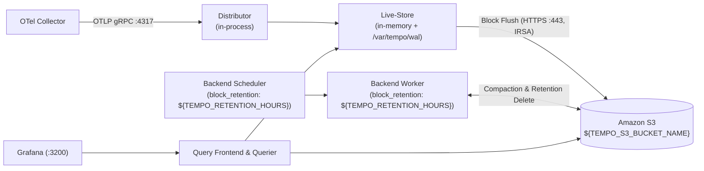

# Grafana Tempo Helm 차트 마이그레이션 설계서 (`docs/features/tempo-chart-migration/design.md`)

## 1. 목표와 범위 (하지 않을 것 포함)

### 1.1 목표 (Goals)
`helm upgrade --install` 시 `deprecated` 경고가 발생하는 구 `grafana/tempo` `1.24.4` (`https://grafana.github.io/helm-charts`, 앱 버전 `2.9.0`) Helm 차트를 업스트림이 이관·지원하는 **`grafana-community/tempo` `3.2.1` (`https://grafana-community.github.io/helm-charts`, 앱 버전 `3.1.1`)** 차트로 교체한다. 교체 후에도 기존 `apm-tracing` 기능의 모든 동작과 보안·운영 불변 조건을 동일하게 유지한다.

- **핵심 달성 목표**:
  1. **지원되는 업스트림 Helm 차트 및 버전으로 전환**:
     - Grafana가 커뮤니티 단일 바이너리/분산 차트를 `grafana/helm-charts`에서 `grafana-community/helm-charts`로 이관하면서 기존 `grafana/tempo` `1.24.4`를 `deprecated: true`로 동결한 문제를 해결한다.
     - `scripts/deploy-all.sh`의 Helm 저장소를 `grafana-community`(`https://grafana-community.github.io/helm-charts`)로 교체하고, `grafana-community/tempo` 차트 버전 **`3.2.1`** 및 컨테이너 이미지 **`grafana/tempo:3.1.1`** 로 고정한다.
  2. **현 트래픽 기준 단일 바이너리(Monolithic) 아키텍처 유지**:
     - 현 클러스터 트래픽 규모와 `ng-platform` 노드 리소스 예산을 기준으로 마이크로서비스 차트(`tempo-distributed`)로 전환하지 않고 단일 바이너리(`grafana-community/tempo`) 구성을 유지한다(상세 근거는 §1.2에 명시).
  3. **기존 `apm-tracing` 기능·보안·운영 동작 100% 유지**:
     - 전용 S3 버킷(`${TEMPO_S3_BUCKET_NAME}`) + IRSA(`monitoring/tempo`) 무키(Keyless) 연동
     - `ng-platform` 관리형 노드 그룹 배치(`nodeSelector: { workload-tier: platform }` + Toleration) 및 로컬 WAL용 `gp3` `10Gi` PVC(`/var/tempo`)
     - OTLP 수신(`:4317` gRPC, `:4318` HTTP) 및 Grafana 쿼리 API(`:3200`)
     - `k8s/tracing/networkpolicy-tracing.yaml` 기반 최소 권한 NetworkPolicy
     - Grafana Tempo 데이터소스(`uid: tempo`) 및 Prometheus Exemplar(`trace_id`) 점프 연동
     - `TEMPO_RETENTION_DAYS`에서 파생된 `${TEMPO_RETENTION_HOURS}` 기반 블록 보존 기간 정합성
     - 비루트(`UID/GID 10001`), `readOnlyRootFilesystem: true`, `allowPrivilegeEscalation: false`, `capabilities.drop: [ALL]`, `seccompProfile: RuntimeDefault` 컨테이너 하드닝

### 1.2 주요 아키텍처 설계 결정 및 근거

#### (1) 차트 이관 경로: `grafana/tempo` `1.24.4` → `grafana-community/tempo` `3.2.1` (Tempo `3.1.1`)
- **배경**:
  - 업스트림 Grafana는 `grafana/helm-charts` 저장소의 `tempo` 차트를 `1.24.4`(`appVersion: 2.9.0`)를 마지막으로 `deprecated: true` 처리하고, 후속 릴리스를 `grafana-community/helm-charts`(`https://grafana-community.github.io/helm-charts` 및 `oci://ghcr.io/grafana-community/helm-charts/tempo`)로 이관했다.
  - 현재 `scripts/deploy-all.sh`에서 `grafana` Helm 저장소(`https://grafana.github.io/helm-charts`)를 사용하는 컴포넌트는 `tempo` 하나뿐이다(Grafana 대시보드 UI는 `prometheus-community/kube-prometheus-stack`에 포함).
- **버전 선택 근거 (`3.2.1` / Tempo `3.1.1`)**:
  1. **EKS `1.36` 기준 최신 안정 메이저 라인 유지**: `production-hardening`에서 수립한 원칙(서비스 오픈 전 업스트림 지원 버전으로 고정)에 따라 구 `2.x` 차트(`2.4.0`, Tempo `2.10.8`)에 머무르지 않고 현행 안정 릴리스인 차트 **`3.2.1`**(Tempo **`3.1.1`**)을 채택한다.
  2. **Tempo 3.x 단일 바이너리(Monolithic) 호환성**: 차트 `3.0.0`부터 Tempo 3.x의 단일 프로세스 구성(`live_store`가 구 `ingester`를 대체하고, `backend_scheduler` + `backend_worker`가 구 `compactor`를 대체)으로 `ConfigMap`을 렌더링한다. 단일 바이너리 모드에서는 프로세스 내부 메모리로 데이터를 전달하므로 **외부 Kafka가 전혀 필요하지 않으며**, WAL 경로도 기존 `/var/tempo/wal` PVC를 그대로 사용한다.
  3. **`memBallastSizeMbs` 플래그 제거 해소**: Tempo 2.x 차트(`1.24.4`)는 기본값 `tempo.memBallastSizeMbs: 1024`로 인해 `-mem-ballast-size-mbs=1024` 인자를 주입하여 `1Gi` 메모리 한도에서 OOM 위험을 유발했기 때문에 `memBallastSizeMbs: 0` 오버라이드가 필요했다. Tempo 3.0부터 `-mem-ballast-size-mbs` CLI 플래그 자체가 삭제되었고 차트 `3.0.0`+의 `statefulset.yaml`에서도 해당 인자가 제거되었으므로, `k8s/tracing/tempo-values.yaml`에서 `memBallastSizeMbs: 0`을 깔끔하게 제거할 수 있다.
  4. **블록 보존 기간(`tempo.retention`) 적용 버그 수정 포함 (`3.2.0`+)**: 차트 `3.0.0`~`3.1.0`에서는 `tempo.retention`이 `backend_scheduler`에만 들어가고 실제 삭제를 수행하는 `backend_worker.compaction.block_retention`에는 기본값(`336h`)이 남는 버그(`grafana-community/helm-charts#855`)가 있었으나, **`3.2.0` / `3.2.1`에서 `tempo.retention` 값이 `backend_scheduler`와 `backend_worker` 양쪽의 `block_retention`으로 동시에 복사되도록 수정**되었다. 따라서 기존 `tempo.retention: ${TEMPO_RETENTION_HOURS}` 설정 한 줄로 S3 Lifecycle(`TEMPO_RETENTION_DAYS`)과의 보존 기간 정합성이 완벽히 유지된다.
  5. **불필요 레거시 포트 정리 및 Headless Service 보완**: 차트 `2.0.0`+(`3.2.1` 포함)에서 폐기된 OpenCensus(`:55678`) 포트가 제거되었고, `StatefulSet.spec.serviceName: tempo-headless`가 참조하는 `tempo-headless` Service(`prometheus.io/service-monitor: "false"` 포함)가 정식 템플릿으로 추가되어 Pod DNS 해석 무결성이 개선되었다.

#### (2) 단일 바이너리(Single Binary / Monolithic) 규모 유지 결정 및 근거
- **결정**: 마이크로서비스 분산 차트(`grafana-community/tempo-distributed`)로 전환하지 않고 **단일 바이너리 차트(`grafana-community/tempo`, `replicas: 1`)를 유지**한다.
- **근거**:
  1. **현 트래픽 및 스팬 수집량 규모**:
     - WAS 계층(`was-stable` 2~10 Pod, `was-canary` 1~3 Pod)의 KEDA 스케일 아웃 임계치는 Pod당 `50 req/s`이며, 최대 확장(13 Pod) 시에도 전체 HTTP 요청량은 약 `650 req/s` 수준이다.
     - OpenTelemetry Java Agent(SDK)에서 `parentbased_traceidratio` 10%(`OTEL_TRACES_SAMPLER_ARG=0.1`) 헤드 샘플링을 수행하므로, 실제로 OTel Collector를 거쳐 Tempo에 유입되는 트레이스는 평시 **초당 수~수십 건(스팬 기준 수십~수백 spans/s, 데이터량 < 1 MB/s)** 에 불과하다(100% 전수 RED 메트릭은 Collector `:8889`에서 Prometheus가 직접 수집하므로 Tempo 부하와 무관).
     - Grafana Tempo 단일 바이너리 모드는 단일 Pod에서도 수만 spans/s(수십 MB/s)까지 처리 가능하므로 현 트래픽 규모 대비 충분한 여유를 갖는다.
  2. **`ng-platform` 노드 그룹 리소스 예산 및 비용 효율성**:
     - `ng-platform`은 `m6i.large` 2대(총 `4 vCPU / 16Gi Memory`)에 Prometheus(2 Replicas), Grafana, Alertmanager, OTel Collector(2 Replicas), Tempo를 함께 수용한다.
     - `tempo-distributed`로 전환할 경우 `distributor`, `live-store`(구 `ingester`), `querier`, `query-frontend`, `backend-scheduler`, `backend-worker`, `memcached` 등 최소 6~7종의 워크로드로 분리되고, 특히 **Tempo 3.x의 분산 모드는 인제스트 버퍼로 외부 Kafka 클러스터를 필수로 요구**한다. 이는 `ng-platform` 노드의 즉각적인 증설(추가 EC2 및 Kafka 운영 비용)과 아키텍처 복잡도 급증을 초래하므로 현 규모에서 과도한 오버엔지니어링이다.
  3. **장애 격리 및 데이터 내구성**:
     - 단일 바이너리 모드에서도 로컬 WAL은 암호화된 EBS `gp3`(`10Gi`) PVC에 영속화되고 완성된 블록은 Multi-AZ 내구성을 가진 Amazon S3(`${TEMPO_S3_BUCKET_NAME}`)에 저장되며, Pod 재시작 시에도 OTel Collector의 `batch` 큐와 로컬 WAL이 트레이스 유실을 완화한다.

### 1.3 범위 (In-Scope)
- `docs/features/tempo-chart-migration/design.md` 작성
- `scripts/deploy-all.sh`의 Helm 저장소(`grafana` → `grafana-community`) 및 Tempo 차트 버전(`1.24.4` → `3.2.1`) 업데이트
- `k8s/tracing/tempo-values.yaml`의 이미지 태그(`"2.9.0"` → `"3.1.1"`) 업데이트 및 Tempo 3.0에서 제거된 `memBallastSizeMbs: 0` 필드 정리
- `scripts/validate-manifests.sh`에 Tempo 차트 저장소·버전·values 정적 검증 보강
- `README.md`의 기술 스택 버전 표(`tempo` 차트 `3.2.1` / 이미지 `grafana/tempo:3.1.1`) 현행화

### 1.4 하지 않을 것 (Out-of-Scope / Non-Goals)
- **`tempo-distributed`(마이크로서비스 모드) 또는 Kafka 도입 제외**: §1.2 (2)의 근거에 따라 단일 바이너리 구성을 유지한다.
- **OpenTelemetry Operator / Collector / Java Agent 설정 변경 제외**: `k8s/tracing/otel-operator-values.yaml`, `k8s/tracing/otel-collector-values.yaml`, `k8s/was/instrumentation.yaml`, `k8s/was/deployment-*.yaml`은 변경하지 않는다.
- **AWS IAM 정책·S3 버킷·eksctl IRSA 구성 변경 제외**: `infra/aws/iam-policies/tempo-policy.json`, `infra/aws/provision-aws-resources.sh`, `infra/eksctl/cluster.yaml`은 기존 구성을 그대로 유지한다.
- **NetworkPolicy·Grafana 데이터소스·APM 대시보드 변경 제외**: Tempo Service 이름(`tempo`)과 포트(`:3200`, `:4317`, `:4318`) 및 Pod 레이블(`app.kubernetes.io/name: tempo`)이 동일하므로 `k8s/tracing/networkpolicy-tracing.yaml`, `k8s/monitoring/kube-prometheus-values.yaml`, `k8s/monitoring/dashboard-apm-tracing.yaml`은 수정하지 않는다.
- **실제 AWS 클러스터 배포 실행 제외**: 실클러스터 배포(`scripts/deploy-all.sh`, `helm upgrade --install`)는 구현 체크리스트에 `[위험]` 단계로만 정의하고 본 작업에서는 실행하지 않는다.
- **`docs/architecture.md` 수정 제외**: `ORCA_WORKFLOW.md` 규칙에 따라 `docs/architecture.md`는 머지 직전 ⑦ 단계에서만 갱신한다.

---

## 2. 구성 요소와 디렉터리 구조 (기존 구조 대비 추가·변경되는 부분 표시)

### 2.1 변경되는 구성 요소 요약

| 계층 | 구성 요소 | 기존 (`apm-tracing`) | 변경 후 (`tempo-chart-migration`) | 배치 위치 |
|---|---|---|---|---|
| **Helm Repository** | Tempo 차트 저장소 | `grafana` (`https://grafana.github.io/helm-charts`) | **`grafana-community`** (`https://grafana-community.github.io/helm-charts`) | `scripts/deploy-all.sh` |
| **Trace Backend** | **Grafana Tempo** (Single Binary `StatefulSet`) | `grafana/tempo` Chart **`1.24.4`** (`deprecated: true`)<br>Image `grafana/tempo:2.9.0`<br>`compactor` + `ingester` 구조, `-mem-ballast-size-mbs=0` | **`grafana-community/tempo`** Chart **`3.2.1`** (`deprecated: false`)<br>Image **`grafana/tempo:3.1.1`**<br>Tempo 3.x 단일 프로세스(`live_store` + `backend_scheduler` + `backend_worker`), 밸러스트 플래그 제거, `tempo-headless` Service 포함 | `monitoring` / `ng-platform` (`workload-tier=platform`) |

### 2.2 디렉터리 구조 (추가 `[NEW]` · 변경 `[MOD]` · 유지 표시)

```text
.
├── README.md                                          # [MOD] 기술 스택 표의 Tempo 차트 버전(3.2.1) 및 이미지(grafana/tempo:3.1.1) 갱신
├── docs/
│   ├── architecture.md                                # (유지 — 머지 직전 ⑦ 단계에서 갱신)
│   └── features/
│       ├── apm-tracing/{design,review,security}.md    # (유지 — 이전 기능 이력 보존)
│       └── tempo-chart-migration/
│           └── design.md                              # [NEW] 본 기능 설계서
├── infra/
│   ├── aws/
│   │   ├── provision-aws-resources.sh                 # (유지 — Tempo S3 버킷·Lifecycle·IAM 정책 변경 없음)
│   │   └── iam-policies/tempo-policy.json             # (유지)
│   └── eksctl/cluster.yaml                            # (유지 — monitoring/tempo IRSA ServiceAccount 동일)
├── k8s/
│   ├── monitoring/
│   │   ├── kube-prometheus-values.yaml                # (유지 — Tempo 데이터소스 URL http://tempo.monitoring.svc.cluster.local:3200 동일)
│   │   └── dashboard-apm-tracing.yaml                 # (유지)
│   └── tracing/
│       ├── otel-operator-values.yaml                  # (유지)
│       ├── otel-collector-values.yaml                 # (유지 — otlp/tempo 엔드포인트 tempo.monitoring.svc.cluster.local:4317 동일)
│       ├── tempo-values.yaml                          # [MOD] 차트 3.2.1 / grafana/tempo:3.1.1 기준 갱신 (memBallastSizeMbs 제거)
│       └── networkpolicy-tracing.yaml                 # (유지 — podSelector app.kubernetes.io/name: tempo 및 포트 3200/4317/4318 동일)
└── scripts/
    ├── lib.sh                                         # (유지 — TEMPO_S3_BUCKET_NAME, TEMPO_RETENTION_HOURS 등 동일)
    ├── deploy-all.sh                                  # [MOD] helm repo grafana-community 교체 및 grafana-community/tempo --version 3.2.1 적용
    └── validate-manifests.sh                          # [MOD] grafana-community/tempo 차트 사용 및 tempo-values.yaml 정적 검증 보강
```

---

## 3. 데이터 흐름 / API 또는 인터페이스

### 3.1 외부·클러스터 내부 인터페이스 불변성
차트 교체 후에도 클러스터 내 다른 구성 요소가 Tempo와 통신하는 모든 DNS 이름, 포트, 프로토콜, 레이블은 기존과 100% 동일하다.

| 구간 | 출발지 | 목적지 (Service / Endpoint) | 프로토콜 / 포트 | 변경 여부 |
|---|---|---|---|---|
| **트레이스 수집** | `otel-collector` (`monitoring`) | `tempo.monitoring.svc.cluster.local` | OTLP gRPC `TCP 4317` (및 HTTP `TCP 4318`) | **변경 없음** |
| **트레이스 조회** | `grafana` (`monitoring`) | `http://tempo.monitoring.svc.cluster.local:3200` | HTTP `TCP 3200` (TraceQL / Trace ID 조회, `/ready` 헬스체크) | **변경 없음** |
| **S3 블록 저장** | `tempo` (`monitoring`, SA `tempo`) | `s3.${AWS_REGION}.amazonaws.com` & STS | HTTPS `TCP 443` (IRSA WebIdentity, `SSE-KMS`) | **변경 없음** |
| **Governing Service** | `StatefulSet/tempo` | `tempo-headless.monitoring.svc.cluster.local` | `clusterIP: None` (`prometheus.io/service-monitor: "false"`) | 차트 `3.2.1`이 `templates/service-headless.yaml`을 기본 생성하여 StatefulSet DNS 해석 보완 |

### 3.2 Tempo 3.x 내부 파이프라인 및 `ConfigMap/tempo` 렌더링 구조
`grafana-community/tempo` `3.2.1` 차트는 `k8s/tracing/tempo-values.yaml`을 입력받아 Tempo `3.1.1` 단일 바이너리용 `/conf/tempo.yaml`을 다음과 같이 생성한다:



- **보존 기간(`retention`) 렌더링 동작**:
  - `k8s/tracing/tempo-values.yaml`의 `tempo.retention: ${TEMPO_RETENTION_HOURS}`(기본 `336h`) 설정은 차트 `3.2.1` 템플릿에 의해 아래 두 블록에 모두 주입된다:
    ```yaml
    backend_scheduler:
      provider:
        compaction:
          compaction:
            block_retention: 336h
    backend_worker:
      compaction:
        block_retention: 336h
    ```
  - 이로써 Tempo 3.x에서도 `TEMPO_RETENTION_DAYS` 환경변수 하나만으로 S3 버킷 Lifecycle 만료 일수와 Tempo 내부 블록 보존 기간이 정확히 일치한다.

### 3.3 `k8s/tracing/tempo-values.yaml` 변경 명세

```yaml
# grafana-community/tempo chart 3.2.1 (Tempo 3.1.1, single binary) on ng-platform (monitoring). Rendered with envsubst by scripts/deploy-all.sh.
# S3 access via IRSA only: SA monitoring/tempo is created by eksctl (infra/eksctl/cluster.yaml); no static keys.
nodeSelector:
  workload-tier: platform
tolerations:
  - { key: node-role, operator: Equal, value: platform, effect: NoSchedule }

serviceAccount:
  create: false
  name: tempo

securityContext:
  runAsNonRoot: true
  runAsUser: 10001
  runAsGroup: 10001
  fsGroup: 10001
  seccompProfile:
    type: RuntimeDefault

# Local WAL; completed blocks go to S3.
persistence:
  enabled: true
  storageClassName: gp3
  size: 10Gi

tempo:
  repository: grafana/tempo
  tag: "3.1.1"
  resources:
    requests: { cpu: 250m, memory: 512Mi }
    limits: { memory: 1Gi }
  securityContext:
    allowPrivilegeEscalation: false
    readOnlyRootFilesystem: true
    capabilities:
      drop: [ALL]
  # No usage reports to Grafana Labs (egress 443 is open for S3/STS only by intent).
  reportingEnabled: false
  # TEMPO_RETENTION_DAYS * 24h (scripts/deploy-all.sh), same days as the S3 lifecycle.
  # Chart 3.2.1 renders this into both backend_scheduler and backend_worker block_retention.
  retention: ${TEMPO_RETENTION_HOURS}
  storage:
    trace:
      backend: s3
      s3:
        bucket: ${TEMPO_S3_BUCKET_NAME}
        endpoint: s3.${AWS_REGION}.amazonaws.com
        region: ${AWS_REGION}
        insecure: false
      wal:
        path: /var/tempo/wal
  # OTLP from the collector. The chart's default jaeger receivers stay (its port templates
  # require them) but networkpolicy-tracing.yaml admits only 4317/4318 from the collector.
  receivers:
    otlp:
      protocols:
        grpc:
          endpoint: "0.0.0.0:4317"
        http:
          endpoint: "0.0.0.0:4318"
```

---

## 4. 실행 환경 (런타임 버전, 컨테이너/클라우드 리소스, 환경변수 목록)

### 4.1 런타임 및 컴포넌트 고정 버전 명세

| 구분 | 컴포넌트 | 차트 / 이미지 | 기존 버전 | 변경 후 고정 버전 | 배치 노드 그룹 |
|---|---|---|---|---|---|
| **Trace Backend** | Grafana Tempo | Helm `grafana-community/tempo`<br>Image `grafana/tempo` | Chart `grafana/tempo` `1.24.4` (Deprecated)<br>Image `2.9.0` | Chart **`3.2.1`**<br>Image **`3.1.1`** | `ng-platform` (`workload-tier=platform`) |
| **Operator** | OpenTelemetry Operator | Helm `open-telemetry/opentelemetry-operator`<br>Image `ghcr.io/open-telemetry/opentelemetry-operator/opentelemetry-operator` | Chart `0.105.0`<br>Image `0.144.0` | 변경 없음 | `ng-critical` (`workload-tier=critical`) |
| **Java Agent** | OTel Auto-Instrumentation | `ghcr.io/open-telemetry/opentelemetry-operator/autoinstrumentation-java` | `2.12.0` | 변경 없음 | `np-app` (`was-*` initContainer) |
| **Collector** | OpenTelemetry Collector | Helm `open-telemetry/opentelemetry-collector`<br>Image `otel/opentelemetry-collector-contrib` | Chart `0.116.0`<br>Image `0.120.0` | 변경 없음 | `ng-platform` (`workload-tier=platform`) |

### 4.2 컨테이너 및 클라우드 리소스
- **Kubernetes 리소스 (`monitoring` 네임스페이스)**:
  - `StatefulSet/tempo`: `1` Replica, `requests: { cpu: 250m, memory: 512Mi }`, `limits: { memory: 1Gi }`
  - `PersistentVolumeClaim/storage-tempo-0`: `gp3` `10Gi` (`ReadWriteOnce`, `/var/tempo`에 마운트되어 `/var/tempo/wal` 및 `/var/tempo/traces` 수용)
  - `Service/tempo` (`ClusterIP`) 및 `Service/tempo-headless` (`clusterIP: None`)
  - `ServiceAccount/tempo` (`eksctl`이 생성한 IRSA Role 연결, 차트에서는 `serviceAccount.create: false`)
- **AWS 클라우드 리소스 (변경 없음)**:
  - Amazon S3 버킷: `${TEMPO_S3_BUCKET_NAME}` (`SSE-KMS`, 퍼블릭 액세스 완전 차단, `${TEMPO_RETENTION_DAYS}`일 만료 Lifecycle)
  - IAM Policy: `arn:aws:iam::${AWS_ACCOUNT_ID}:policy/${EKS_CLUSTER_NAME}-tempo`

### 4.3 관련 환경변수 목록 (`.env.example` 및 `scripts/deploy-all.sh` 기준 — 실제 값은 기재하지 않음)

| 카테고리 | 변수명 | 필수 여부 | 용도 |
|---|---|---|---|
| **AWS / 클러스터** | `AWS_REGION`, `AWS_ACCOUNT_ID`, `EKS_CLUSTER_NAME` | 필수 | S3 엔드포인트(`s3.${AWS_REGION}.amazonaws.com`) 및 IRSA IAM 정책/역할 식별 |
| **Tracing / Tempo S3** | `TEMPO_S3_BUCKET_NAME` | 필수 | Tempo 트레이스 블록 저장 전용 S3 버킷명 (`BACKUP_S3_BUCKET_NAME`과 중복 불가) |
| **Tracing / Retention** | `TEMPO_RETENTION_DAYS` | 선택 (기본 `14`) | S3 객체 만료 일수 및 `deploy-all.sh`가 계산하는 `TEMPO_RETENTION_HOURS`(`$((TEMPO_RETENTION_DAYS * 24))h`)의 기준값 |
| **Tracing / OTel** | `OTEL_TRACES_SAMPLER_ARG`, `OTEL_DEPLOYMENT_ENVIRONMENT` | 선택 (기본 `0.1`, `production`) | WAS Java Agent 헤드 샘플링 비율(`0`~`1`) 및 배포 환경 리소스 속성 |

---

## 5. 보안 요구사항 (인증, 권한 최소화, 시크릿 관리 방식)

1. **무키(Keyless) IRSA 인증 및 정적 자격증명 금지**:
   - `k8s/tracing/tempo-values.yaml`의 `tempo.storage.trace.s3`에는 `access_key`, `secret_key` 등 정적 자격증명을 일절 포함하지 않으며(`scripts/validate-manifests.sh`로 강제 검증), `serviceAccount: { create: false, name: tempo }`를 통해 `eksctl`이 프로비저닝한 IRSA ServiceAccount(`monitoring/tempo`)만 사용한다.
   - S3 통신은 항상 TLS(`insecure: false`)를 강제한다.
2. **최소 권한 IAM 및 S3 격리 유지**:
   - `infra/aws/iam-policies/tempo-policy.json`은 오직 `${TEMPO_S3_BUCKET_NAME}` 버킷에 대한 `s3:ListBucket`과 `${TEMPO_S3_BUCKET_NAME}/*`에 대한 `PutObject`/`GetObject`/`DeleteObject`/`GetObjectTagging`/`PutObjectTagging`만 허용하며, DB 백업 버킷(`${BACKUP_S3_BUCKET_NAME}`) 접근 권한은 부여하지 않는다.
3. **네트워크 최소 권한 (`k8s/tracing/networkpolicy-tracing.yaml`) 및 외부 리포팅 차단**:
   - Tempo Pod(`app.kubernetes.io/name: tempo`)는 Ingress로 `opentelemetry-collector`의 `:4317`/`:4318`과 `grafana`의 `:3200`만 허용하고, 차트가 기본 생성하는 Jaeger(`:6831`, `:6832`, `:14250`, `:14268`) 및 Zipkin(`:9411`) 포트로의 접근은 NetworkPolicy에 의해 전면 차단된다.
   - Egress는 `kube-dns`(`:53`)와 외부 S3/STS용 `:443`(단, EC2 IMDS `169.254.169.254/32`는 명시적 제외)만 허용하며, `tempo.reportingEnabled: false`로 설정하여 Grafana Labs로의 익명 사용량 전송을 차단한다.
4. **컨테이너 및 파일시스템 하드닝**:
   - Pod 수준에서 `runAsNonRoot: true`, `runAsUser: 10001`, `runAsGroup: 10001`, `fsGroup: 10001`, `seccompProfile.type: RuntimeDefault`를 적용한다.
   - 컨테이너 수준에서 `allowPrivilegeEscalation: false`, `readOnlyRootFilesystem: true`, `capabilities.drop: [ALL]`을 강제한다. Tempo 3.1.1의 `live_store` WAL 및 로컬 블록 경로는 `/var/tempo`(`storage` PVC 마운트) 하위(`/var/tempo/wal`, `/var/tempo/traces`)만을 사용하므로 읽기 전용 루트 파일시스템에서 정상 동작한다.
5. **차트 및 이미지 버전 고정 (Supply Chain Security)**:
   - `scripts/deploy-all.sh`에서 `--version 3.2.1`로 Helm 차트 버전을 고정하고, `k8s/tracing/tempo-values.yaml`에서 `tempo.repository: grafana/tempo`, `tempo.tag: "3.1.1"`로 컨테이너 이미지 태그를 명시적으로 고정한다(`:latest` 또는 빈 태그 금지).

---

## 6. 구현 단계 체크리스트

Claude는 아래 순서대로 구현하고 각 단계마다 커밋한다. `[위험]` 표시가 있는 단계는 이번 작업에서는 실행하지 않으며, 향후 실행 시 반드시 사용자 컨펌을 먼저 받는다.

- [ ] **Step 1: `k8s/tracing/tempo-values.yaml` 및 `scripts/deploy-all.sh` 차트 전환**
  - `k8s/tracing/tempo-values.yaml`:
    - 상단 주석을 `grafana-community/tempo chart 3.2.1 (Tempo 3.1.1, single binary)` 기준으로 갱신한다.
    - `tempo.tag`를 `"2.9.0"`에서 `"3.1.1"`로 변경한다.
    - Tempo 3.0 및 차트 3.x에서 제거된 `tempo.memBallastSizeMbs: 0` 및 관련 주석을 제거한다.
    - 나머지 설정(`nodeSelector`, `tolerations`, `serviceAccount`, `securityContext`, `persistence`, `tempo.resources`, `tempo.securityContext`, `tempo.reportingEnabled: false`, `tempo.retention: ${TEMPO_RETENTION_HOURS}`, `tempo.storage.trace`, `tempo.receivers.otlp`)은 그대로 유지한다.
  - `scripts/deploy-all.sh`:
    - `helm repo add grafana https://grafana.github.io/helm-charts`를 `helm repo add grafana-community https://grafana-community.github.io/helm-charts`로 변경한다.
    - `helm upgrade --install tempo grafana/tempo --version 1.24.4 ...`를 `helm upgrade --install tempo grafana-community/tempo --version 3.2.1 ...`로 변경한다.

- [ ] **Step 2: `scripts/validate-manifests.sh` 정적 검증 규칙 보강 및 `README.md` 업데이트**
  - `scripts/validate-manifests.sh`:
    - `tempo-values.yaml`의 `tempo.repository`와 `tempo.tag`가 고정된 이미지 태그 규칙(`check_image`)으로 검증되도록 추가한다(기존 `check_image`는 최상위 `image:` 키만 확인하므로 `tempo.repository` + `tempo.tag`도 검사).
    - `tempo-values.yaml`의 `tempo` 하위에 제거된 `memBallastSizeMbs` 키가 남아 있지 않은지 검증한다.
    - `scripts/deploy-all.sh`가 deprecated된 `grafana/tempo`나 `https://grafana.github.io/helm-charts` 대신 `grafana-community/tempo`와 `https://grafana-community.github.io/helm-charts`를 사용하는지 정적 검증을 추가한다.
  - `README.md`:
    - `§2. 기술 스택 및 버전 명세` 표의 Tracing 행에서 `tempo 1.24.4 (grafana/tempo:2.9.0)`를 `grafana-community/tempo 3.2.1 (grafana/tempo:3.1.1)`로 수정한다.
  - 오프라인 검증 실행:
    - `./scripts/validate-manifests.sh` 및 `./scripts/test-prometheus-rules.sh`를 실행하여 모든 검증이 통과하는지 확인한다.
    - (가능한 경우) `helm template`으로 `grafana-community/tempo` `3.2.1` 차트와 렌더링된 `k8s/tracing/tempo-values.yaml`을 로컬 렌더링하여 `deprecated` 경고 없이 `StatefulSet`, `ConfigMap`, `Service`, `Service/tempo-headless`가 정상 생성되고 `backend_scheduler`·`backend_worker` 양쪽에 `block_retention: 336h`가 반영되는지 확인한다.

- [ ] **Step 3: [위험] 실클러스터 배포 및 E2E 트레이싱 검증 (이번 작업에서는 실행하지 않음)**
  - **주의**: 실제 AWS EKS 클러스터가 프로비저닝된 이후에만 사용자 컨펌을 받아 실행한다.
  - 기존 클러스터에 `grafana/tempo` `1.24.4`로 배포된 `StatefulSet/tempo`가 존재하는 경우, 차트 `1.24.4` → `3.2.1` 업그레이드 시 `StatefulSet.spec.VolumeClaimTemplates` 또는 `serviceName` 변경 여부를 사전 확인하고 필요 시 `helm upgrade --install tempo grafana-community/tempo --version 3.2.1 -n monitoring -f <(render k8s/tracing/tempo-values.yaml) --wait` (또는 `./scripts/deploy-all.sh`)를 실행한다.
  - 배포 후 `docs/features/apm-tracing/design.md` §7의 TC-1 ~ TC-5(Tempo Pod `Ready`, IRSA S3 블록 업로드, OTLP 트레이스 수신, Grafana `:3200` 데이터소스 및 Exemplar 점프)를 검증한다.

---

## 구현 중 질문
