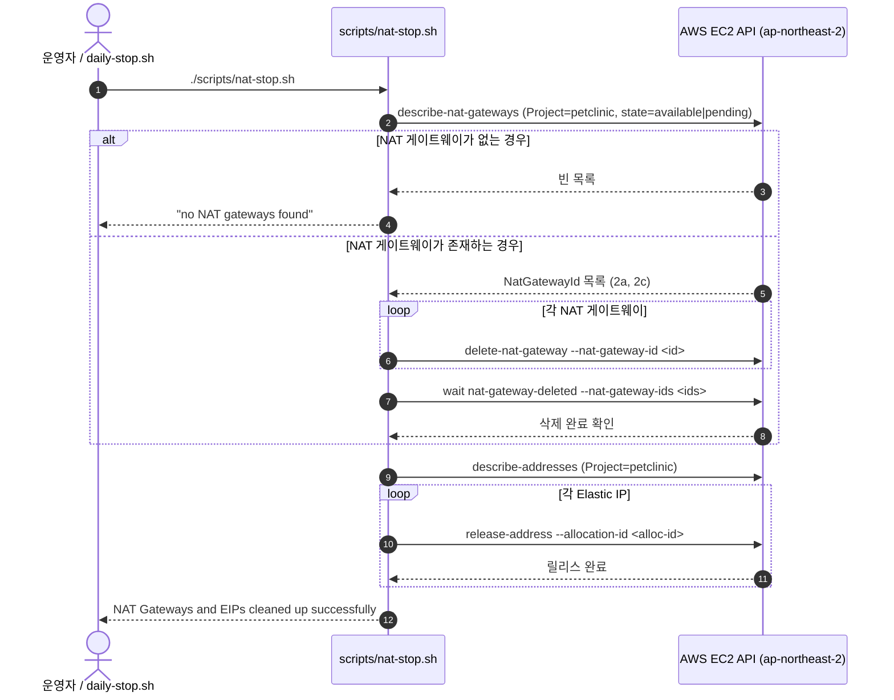
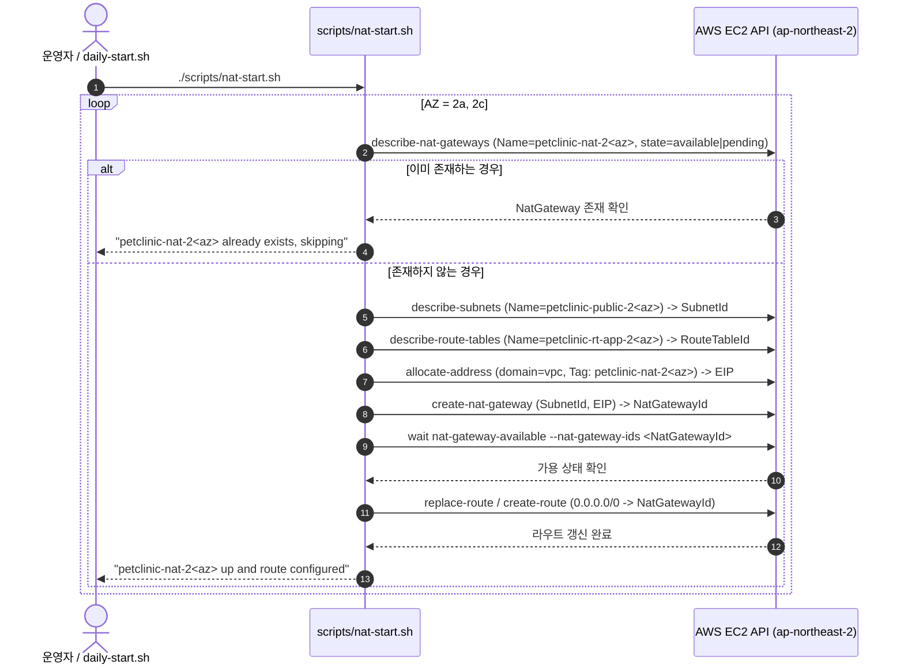

# VPC 프로비저닝 및 NAT 라이프사이클 관리 설계서 (`docs/features/vpc-provisioning/design.md`)

## 1. 목표와 범위 (하지 않을 것 포함)

### 1.1 배경 및 문제 정의 (Background & Problem)
- **저장소 밖 임시 스크립트로 구축된 VPC 환경**:
  - 2026-10-26 최초 실 AWS 인프라 구축 당시 VPC 및 서브넷 생성 작업(`docs/daily/2026-10-26.md` 10:49 항목)이 저장소 외부의 임시 스크립트(`<SCRATCH>/vpc-create.sh`)로 실행되었습니다.
  - 이로 인해 현재 저장소의 코드와 스크립트만으로는 VPC, 서브넷 6개, IGW, 라우트 테이블 4개, NAT Gateway 2개 등 네트워크 기반 리소스를 완전히 재현하거나 재해 복구(DR) 시 일관되게 복원할 수 없는 상태입니다.
- **셸 기본 리전 불일치로 인한 사고 재발 방지**:
  - 10-26 구축 당시 작업 서버 셸의 기본 환경변수에 `AWS_REGION=us-east-1`이 설정되어 있어 서울 리전(`ap-northeast-2`)이 아닌 `us-east-1`에 빈 VPC가 오발주되는 사고가 발생했습니다.
  - 따라서 네트워크 프로비저닝 스크립트 레벨에서 `ap-northeast-2` 리전을 엄격하게 고정하여 리전 불일치 사고를 원천 방지해야 합니다.
- **일일 운영 비용 절감을 위한 NAT 게이트웨이 라이프사이클 관리 필요성**:
  - Multi-AZ 고가용성을 위해 운용되는 NAT Gateway 2개(EIP 2개 포함)는 상시 가동 시 시간당 약 $0.13, 일일 약 $2.83(월 약 $85)의 고정 비용을 유발합니다.
  - 10-26 일일 기록에서는 퇴근 시 수동 bash 명령으로 NAT Gateway 2개 삭제 및 EIP를 반납하고, 출근 시 NAT 2개와 EIP를 재생성하여 앱 라우트 테이블의 `0.0.0.0/0`을 갱신하는 수동 절차를 수행했습니다.
  - 이를 저장소 내 표준 운영 스크립트(`scripts/nat-stop.sh`, `scripts/nat-start.sh`)로 체계화하고, 기존 `daily-stop.sh` / `daily-start.sh`와 유기적으로 연동하여 비용 절감 운영 편의성과 안전성을 확보해야 합니다.
- **설정값 중심의 상위 아키텍처 개요도 부재**:
  - 현재 `docs/architecture.drawio`는 Pod 단위 및 Kubernetes 리소스 상세 배치도 위주로 구성되어 있어, 네트워크 CIDR, 노드 그룹 사양, 트래픽 포트 흐름 등 시스템 전반의 핵심 사양이 한눈에 들어오지 않습니다.
  - 따라서 상위 레벨에서 전체 인프라와 트래픽 흐름을 명료하게 조망할 수 있는 개요 다이어그램(`docs/architecture-overview.drawio`)의 신규 도입이 필요합니다.

### 1.2 핵심 목표 (Goals)
1. **VPC 및 서브넷 프로비저닝 스크립트화**:
   - `infra/aws/provision-aws-resources.sh`에 `vpc` 서브명령어를 추가(또는 `infra/aws/provision-vpc.sh` 모듈화)하여 단일 명령으로 10-26 실환경과 100% 동일한 VPC 환경을 재현합니다.
   - 대상 리소스: VPC `10.0.0.0/16`(DNS hostnames/support 활성화), 서브넷 6개(퍼블릭 2a/2c, 앱 프라이빗 2a/2c, DB 프라이빗 2a/2c), 인터넷 게이트웨이(IGW), 라우트 테이블 4개(퍼블릭, 앱 2a, 앱 2c, DB), AZ별 EIP 및 NAT Gateway 2개.
2. **태그 기반 검색을 통한 완벽한 멱등성(Idempotency) 보장**:
   - 모든 리소스에 `Name=petclinic-*`, `Project=petclinic` 태그를 일관되게 부여합니다.
   - 스크립트 실행 시 기존 태그로 리소스를 먼저 조회하여 이미 존재하는 자원은 그대로 재사용하며, 현재 정상 운영 중인 실환경 VPC나 서브넷을 중복 생성하지 않습니다.
3. **리전 고정 및 `.env` 출력 표준화**:
   - 셸의 `AWS_REGION` 또는 `AWS_DEFAULT_REGION` 환경변수 값과 무관하게 스크립트 시작 시 `ap-northeast-2`로 강제 고정합니다.
   - 프로비저닝 종료 시 `.env` 파일에 바로 복사해 넣을 수 있는 형태(`VPC_ID`, 서브넷 6개 ID)로 표준 출력합니다.
4. **NAT 온디맨드 켜기/끄기 스크립트화 및 일일 스크립트 연동**:
   - NAT Gateway 삭제 및 EIP 반납 스크립트(`scripts/nat-stop.sh`)와 EIP 할당, NAT Gateway 생성, 라우트 갱신 스크립트(`scripts/nat-start.sh`)를 작성합니다.
   - `scripts/daily-stop.sh` 및 `scripts/daily-start.sh`에 선택적 NAT 연계 옵션(`--stop-nat` / `--start-nat`)을 제공하여 한 번의 명령으로 일괄 정지/기동할 수 있도록 지원합니다.
5. **오프라인 가짜 AWS CLI 회귀 테스트 스위트 구축**:
   - 기존 `tests/scripts/daily-stop-start.test.sh`, `build-and-push.test.sh`와 동일하게 모의 aws CLI 기반의 오프라인 단위 테스트(`tests/scripts/vpc-provisioning.test.sh`)를 작성하여 `scripts/validate-manifests.sh`에 통합합니다.
6. **설정값 한눈에 보기 개요 다이어그램 청사진 및 도메인 공개 예외 규정**:
   - Pod 내부 상세를 배제하고 5대 계층(Edge / VPC·AZ·서브넷 / EKS 노드 그룹 / DB / 운영·관측)과 포트 트래픽 흐름(:443 → NGF :80 → web :8080 → was :8080 → RDS :3306), 노드 사양(`m6i.large`, `np-app` c6i/m6i/t3)이 명시된 개요 다이어그램(`docs/architecture-overview.drawio`)의 구조를 사전에 정의합니다.
   - 사용자 결정에 따른 "도메인 공개 예외(Domain Disclosure Exception)"를 보안 요구사항에 명문화하여 개요도 내 실제 도메인 표기를 보안 점검 위반에서 제외합니다.

### 1.3 범위 (In-Scope)
- `docs/features/vpc-provisioning/design.md` 작성 (본 문서)
- `infra/aws/provision-aws-resources.sh` 내 `vpc` 서브명령어 추가 (또는 `infra/aws/provision-vpc.sh` 연동)
- `scripts/nat-stop.sh` 및 `scripts/nat-start.sh` 신규 스크립트 구현
- `scripts/daily-stop.sh` 및 `scripts/daily-start.sh`에 `--stop-nat` / `--start-nat` 연동 지원 및 `notice()` 비용 안내 보강
- `tests/scripts/vpc-provisioning.test.sh` 오프라인 테스트 작성 (VPC 신규 생성, 멱등 재사용, 리전 고정, NAT 켜기/끄기, .env 출력 포맷 검증)
- `scripts/validate-manifests.sh`에 신규 테스트 및 셸 문법 정적 검증 등록
- `README.md`의 Day-2 운영 런북 갱신 (VPC 프로비저닝 및 일일 NAT 제어 가이드)
- Step ⑦에서 생성할 `docs/architecture-overview.drawio` 구조 설계 및 `docs/architecture.md` §4 배치 계획 수립

### 1.4 하지 않을 것 (Out-of-Scope / Non-Goals)
- **이번 기능에서 실 AWS 리소스 실행 제외**:
  - 요구사항 명시 및 안전성 확보를 위해, 이번 브랜치 구현 및 검증 과정에서는 실제 AWS 계정을 대상으로 `provision-aws-resources.sh vpc`나 `nat-start/stop.sh`를 호출하지 않습니다.
  - 모든 동작 및 정합성 검증은 오프라인 가짜 AWS CLI 단위 테스트와 정적 린트로 수행합니다.
- **기존 Pod 단위 상세 다이어그램(`docs/architecture.drawio`) 대체/삭제 제외**:
  - 기존 Pod 단위 상세 다이어그램은 Multi-AZ 및 Pod 배치 참고를 위해 그대로 보존하며, 개요도(`architecture-overview.drawio`)를 신규로 추가하여 `architecture.md` 상단에 병행 배치합니다.
- **작업 서버(LXC) 내 draw.io 이미지 자동 내보내기 제외**:
  - 비특권 LXC 환경에는 GUI/브라우저 엔진(Chrome headless 등)이 없어 데스크톱 draw.io 내보내기를 자동화할 수 없으므로, Step ⑦ 완료 후 사용자가 로컬 데스크톱에서 `.svg` / `.png`로 내보냅니다.
- **기존 네트워크 CIDR 및 토폴로지 변경 제외**:
  - 기존 실환경에서 이미 가동 중인 VPC `10.0.0.0/16`, 서브넷 6개의 CIDR 블록, 라우팅 테이블 구조를 일절 변경하지 않습니다.

---

## 2. 구성 요소와 디렉터리 구조 (기존 구조 대비 추가·변경되는 부분 표시)

### 2.1 기존 구조 대비 추가·변경되는 구성 요소
| 구분 | 대상 컴포넌트 | 변경 구분 | 상세 변경 내용 |
|---|---|---|---|
| **Infra Provisioning** | **`provision-aws-resources.sh vpc`** | **추가** | VPC `10.0.0.0/16`, 서브넷 6개, IGW, 라우트 테이블 4개, AZ별 NAT 2개 및 EIP 프로비저닝과 `.env` 변수 출력 로직 구현 (또는 `infra/aws/provision-vpc.sh` 모듈 호출) |
| **Daily Operations** | **`scripts/nat-stop.sh`** | **추가** | 업무 종료 후 `Project=petclinic` 태그의 NAT Gateway 2개 삭제 및 할당된 EIP를 즉시 릴리스하는 독립 실행 스크립트 |
| **Daily Operations** | **`scripts/nat-start.sh`** | **추가** | 업무 시작 전 AZ 2a, 2c에 각각 EIP 할당 및 NAT Gateway를 생성하고 `petclinic-rt-app-2a`, `petclinic-rt-app-2c` 라우트 테이블에 `0.0.0.0/0`을 갱신하는 독립 실행 스크립트 |
| **Daily Operations** | **`scripts/daily-stop.sh`** | **변경** | `--stop-nat` 옵션 플래그 지원 (노드그룹 0 축소 완료 후 자동으로 `nat-stop.sh` 연계 호출). `notice()` 안내문구에 NAT 게이트웨이 정지 옵션 안내 반영 |
| **Daily Operations** | **`scripts/daily-start.sh`** | **변경** | `--start-nat` 옵션 플래그 지원 (RDS/노드그룹 시작 전 `nat-start.sh`를 선행 호출하여 아웃바운드 인터넷 경로 선확보). `notice()` 안내문구 갱신 |
| **Automated Testing** | **`tests/scripts/vpc-provisioning.test.sh`** | **추가** | 가짜 aws CLI 환경에서 VPC/서브넷 생성, 멱등 재사용, 리전 고정, NAT 시작/종료, `.env` 포맷 출력을 검증하는 오프라인 회귀 테스트 스위트 |
| **Manifest Validation**| **`scripts/validate-manifests.sh`** | **변경** | `vpc-provisioning.test.sh` 실행 등록 및 신규 셸 스크립트 문법 검사(`bash -n`) 추가 |
| **Architecture Docs** | **`docs/architecture-overview.drawio`** | **추가(Step ⑦)** | 5대 계층 박스, 설정값(CIDR, 인스턴스 타입, 포트 흐름), 실제 도메인 표기 개요 다이어그램 원본 |
| **Architecture Docs** | **`docs/architecture.md`** | **변경(Step ⑦)** | §4 데이터 흐름에 개요 다이어그램을 상세 다이어그램 상단에 배치, §8에 설계 결정 기록 추가 |

### 2.2 디렉터리 구조 (추가 `[NEW]` · 변경 `[MOD]` · 유지 표시)
```text
.
├── .env.example                          # (유지 — VPC_ID, 서브넷 ID 6개 변수 이미 선언됨)
├── README.md                             # [MOD] VPC 프로비저닝 및 일일 NAT 제어 런북 추가
├── docs/
│   ├── architecture.md                   # (유지 — ⑦ 머지 직전 단계에서 개요 다이어그램 및 §8 갱신)
│   ├── architecture.drawio               # (유지 — Pod 단위 상세 다이어그램 보존)
│   ├── architecture-overview.drawio      # [NEW] (⑦ 머지 직전 단계에서 Antigravity가 신규 작성)
│   ├── architecture-overview.drawio.svg  # [NEW] (⑦ 완료 후 사용자가 데스크톱에서 내보냄)
│   ├── architecture-overview.drawio.png  # [NEW] (⑦ 완료 후 사용자가 데스크톱에서 내보냄)
│   └── features/
│       └── vpc-provisioning/
│           └── design.md                 # [NEW] 본 기능 설계서
├── infra/
│   ├── aws/
│   │   ├── provision-aws-resources.sh    # [MOD] vpc 단계 추가 (또는 provision-vpc.sh 위임)
│   │   └── provision-vpc.sh              # [NEW] VPC 및 서브넷 멱등 프로비저닝 모듈 (선택/권장)
│   └── eksctl/
│       └── cluster.yaml                  # (유지 — VPC 및 서브넷 ID 매핑 동일)
├── scripts/
│   ├── daily-start.sh                    # [MOD] --start-nat 플래그 연동 및 notice() 갱신
│   ├── daily-stop.sh                     # [MOD] --stop-nat 플래그 연동 및 notice() 갱신
│   ├── nat-start.sh                      # [NEW] EIP 할당, NAT Gateway 생성, 라우트 연결 스크립트
│   ├── nat-stop.sh                       # [NEW] NAT Gateway 삭제 및 EIP 반납 스크립트
│   └── validate-manifests.sh             # [MOD] vpc-provisioning.test.sh 오프라인 테스트 검증기 등록
└── tests/
    └── scripts/
        ├── build-and-push.test.sh        # (유지)
        ├── daily-stop-start.test.sh      # (유지)
        ├── grafana-waf-ready.test.sh     # (유지)
        └── vpc-provisioning.test.sh      # [NEW] VPC 생성 및 NAT On/Off 오프라인 모의 테스트
```

---

## 3. 데이터 흐름 / API 또는 인터페이스

### 3.1 네트워크 토폴로지 사양 및 매핑

```text
+----------------------------------------------------------------------------------------------------+
| VPC: 10.0.0.0/16 (Tag: Name=petclinic-vpc, Project=petclinic)                                      |
| Region: ap-northeast-2 (Seoul)                                                                     |
| DNS Hostnames: Enabled | DNS Support: Enabled                                                      |
+----------------------------------------------------------------------------------------------------+
| Internet Gateway: petclinic-igw (Attached to VPC)                                                  |
+---------------------------------------------------+------------------------------------------------+
| AZ: ap-northeast-2a                               | AZ: ap-northeast-2c                            |
+---------------------------------------------------+------------------------------------------------+
| [Public Subnet 2a] (10.0.0.0/24)                  | [Public Subnet 2c] (10.0.1.0/24)               |
| - Tag: petclinic-public-2a                        | - Tag: petclinic-public-2c                     |
| - NAT Gateway: petclinic-nat-2a (+EIP)            | - NAT Gateway: petclinic-nat-2c (+EIP)         |
| - ALB Ingress Node Placement                      | - ALB Ingress Node Placement                   |
| - Route Table: petclinic-rt-public (0.0.0.0/0 -> IGW)                                             |
+---------------------------------------------------+------------------------------------------------+
| [App Private Subnet 2a] (10.0.16.0/20)            | [App Private Subnet 2c] (10.0.32.0/20)         |
| - Tag: petclinic-app-2a                           | - Tag: petclinic-app-2c                        |
| - EKS Nodes (np-app, ng-critical, ng-platform)    | - EKS Nodes (np-app, ng-critical, ng-platform) |
| - Route Table: petclinic-rt-app-2a                | - Route Table: petclinic-rt-app-2c             |
|   (0.0.0.0/0 -> petclinic-nat-2a)                 |   (0.0.0.0/0 -> petclinic-nat-2c)              |
+---------------------------------------------------+------------------------------------------------+
| [DB Private Subnet 2a] (10.0.48.0/24)             | [DB Private Subnet 2c] (10.0.49.0/24)          |
| - Tag: petclinic-db-2a                            | - Tag: petclinic-db-2c                         |
| - RDS MySQL 8.4 Multi-AZ (Primary)                | - RDS MySQL 8.4 Multi-AZ (Standby)             |
| - Route Table: petclinic-rt-db (인터넷 라우트 없음, 오직 VPC 로컬 라우트 10.0.0.0/16만 존재)      |
+---------------------------------------------------+------------------------------------------------+
```

### 3.2 VPC 프로비저닝 인터페이스 & 멱등 로직 (`provision-aws-resources.sh vpc`)
- **실행 명령**:
  ```bash
  ./infra/aws/provision-aws-resources.sh vpc
  ```
- **리전 강제 설정**:
  스크립트 도입부에서 무조건 서울 리전으로 고정하여 환경변수 오염 방지:
  ```bash
  export AWS_REGION=ap-northeast-2 AWS_DEFAULT_REGION=ap-northeast-2
  ```
- **단계별 멱등 생성 로직**:
  1. **VPC 조회 및 생성**:
     - `aws ec2 describe-vpcs --filters "Name=tag:Name,Values=petclinic-vpc" "Name=tag:Project,Values=petclinic"`
     - 존재하면: 기존 `VpcId` 재사용 및 로그 출력 (`reusing existing VPC: vpc-xxx`).
     - 없으면: `aws ec2 create-vpc --cidr-block 10.0.0.0/16 --tag-specifications "ResourceType=vpc,Tags=[{Key=Name,Value=petclinic-vpc},{Key=Project,Value=petclinic}]"`
     - DNS 속성 활성화: `modify-vpc-attribute --enable-dns-hostnames` 및 `--enable-dns-support`.
  2. **서브넷 6개 조회 및 생성**:
     - 서브넷 명세 루프:
       - `petclinic-public-2a`: `10.0.0.0/24`, `ap-northeast-2a`
       - `petclinic-public-2c`: `10.0.1.0/24`, `ap-northeast-2c`
       - `petclinic-app-2a`: `10.0.16.0/20`, `ap-northeast-2a`
       - `petclinic-app-2c`: `10.0.32.0/20`, `ap-northeast-2c`
       - `petclinic-db-2a`: `10.0.48.0/24`, `ap-northeast-2a`
       - `petclinic-db-2c`: `10.0.49.0/24`, `ap-northeast-2c`
     - 각 서브넷별로 `describe-subnets --filters "Name=vpc-id,Values=$VPC_ID" "Name=tag:Name,Values=$name"` 확인 후 없으면 `create-subnet`.
     - 태그 부여: `Name=$name`, `Project=petclinic`.
     - (참고) 퍼블릭 서브넷에는 `kubernetes.io/role/elb=1`, 앱 프라이빗 서브넷에는 `kubernetes.io/role/internal-elb=1` 표준 태그를 함께 부여하여 EKS LBC 검색 보조.
  3. **인터넷 게이트웨이(IGW) 생성 및 연결**:
     - `describe-internet-gateways`로 `Name=petclinic-igw` 조회.
     - 없으면 `create-internet-gateway` 호출 및 태깅.
     - VPC에 미연결 상태이면 `attach-internet-gateway --vpc-id "$VPC_ID"` 호출.
  4. **라우트 테이블 4개 생성 및 서브넷 연결**:
     - `petclinic-rt-public`: 퍼블릭 서브넷 2a, 2c 연결 (`associate-route-table`). `0.0.0.0/0` -> IGW 라우트 추가 (`create-route` / `replace-route`).
     - `petclinic-rt-app-2a`: 앱 프라이빗 서브넷 2a 연결.
     - `petclinic-rt-app-2c`: 앱 프라이빗 서브넷 2c 연결.
     - `petclinic-rt-db`: DB 프라이빗 서브넷 2a, 2c 연결. (외부 인터넷 라우트 없음)
  5. **AZ별 EIP 및 NAT Gateway 2개 생성**:
     - `petclinic-nat-2a`, `petclinic-nat-2c`에 대해 `describe-nat-gateways`로 `available` 또는 `pending` 상태 확인.
     - 없는 경우:
       - Elastic IP 할당 (`allocate-address --domain vpc --tag-specifications "ResourceType=elastic-ip,Tags=[{Key=Name,Value=petclinic-nat-2$az},{Key=Project,Value=petclinic}]"`).
       - NAT Gateway 생성 (`create-nat-gateway --subnet-id "$pub_subnet_id" --allocation-id "$eip_alloc_id"`).
       - `wait nat-gateway-available` 대기.
       - 해당 앱 라우트 테이블(`petclinic-rt-app-2$az`)의 `0.0.0.0/0` 라우트를 NAT 게이트웨이로 설정 (`create-route` 또는 `replace-route`).
  6. **환경변수 출력 포맷**:
     스크립트 종료 직전 터미널에 아래 양식으로 출력하여 운영자가 `.env`에 즉시 반영할 수 있도록 지원:
     ```text
     ================================================================================
     VPC provisioning complete! Add the following to your .env file:
     ================================================================================
     VPC_ID=vpc-xxxxxxxxxxxxxxxxx
     PUBLIC_SUBNET_A_ID=subnet-xxxxxxxxxxxxxxxxx
     PUBLIC_SUBNET_C_ID=subnet-xxxxxxxxxxxxxxxxx
     APP_PRIVATE_SUBNET_A_ID=subnet-xxxxxxxxxxxxxxxxx
     APP_PRIVATE_SUBNET_C_ID=subnet-xxxxxxxxxxxxxxxxx
     DB_PRIVATE_SUBNET_A_ID=subnet-xxxxxxxxxxxxxxxxx
     DB_PRIVATE_SUBNET_C_ID=subnet-xxxxxxxxxxxxxxxxx
     ================================================================================
     ```

### 3.3 NAT 게이트웨이 정지 흐름 (`scripts/nat-stop.sh`)


### 3.4 NAT 게이트웨이 기동 흐름 (`scripts/nat-start.sh`)


### 3.5 `daily-stop.sh` 및 `daily-start.sh` 연계 설계
- **설계 방향 결정: 모듈성 및 안전성 최우선**:
  - `nat-stop.sh`와 `nat-start.sh`는 독자적으로 언제든 호출할 수 있는 독립 실행 스크립트로 작성합니다.
  - 동시에 일일 작업의 편의를 위해 `daily-stop.sh`와 `daily-start.sh`에 선택적 연동 플래그를 제공합니다:
    - `scripts/daily-stop.sh [--dry-run] [--stop-nat]`:
      1. 워크로드 및 Karpenter 노드 정지
      2. RDS 정지
      3. EKS 관리형 노드그룹 0 축소 및 완료 대기
      4. `--stop-nat` 플래그가 전달된 경우: 노드가 0으로 완전히 내려간 직후 `"$ROOT/scripts/nat-stop.sh"`를 호출하여 NAT Gateway 삭제 및 EIP 반납 수행. (미지정 시 기존처럼 노드그룹 0 축소까지만 진행하고 안내 출력)
    - `scripts/daily-start.sh [--dry-run] [--start-nat]`:
      1. `--start-nat` 플래그가 전달된 경우: **가장 먼저** `"$ROOT/scripts/nat-start.sh"`를 호출하여 NAT 게이트웨이 생성 및 라우트 연결이 완료될 때까지 대기. (노드가 시작될 때 아웃바운드 인터넷 및 EKS 통신에 필요한 경로 선확보)
      2. RDS 시작
      3. EKS 관리형 노드그룹 복원
      4. Karpenter 풀, 워크로드, HPA/KEDA, CronJob 정상 복원
  - `notice()` 함수 수정:
    - 기존 "NAT Gateway cannot be stopped" 고정 문구를 보완하여, `./scripts/nat-stop.sh` (또는 `--stop-nat`)로 NAT를 삭제하여 하루 약 $2.83를 추가 절감할 수 있으며, 다음 출근 시 `./scripts/nat-start.sh` (또는 `--start-nat`)로 복원할 수 있음을 안내.

---

## 4. 실행 환경 (런타임 버전, 컨테이너/클라우드 리소스, 환경변수 목록)

### 4.1 런타임 및 주요 도구 버전
| 도구 / 런타임 | 요구 버전 | 용도 |
|---|---|---|
| **Bash** | 4.x 이상 | 인프라 프로비저닝 및 라이프사이클 제어 스크립트 실행 (`set -euo pipefail`) |
| **AWS CLI** | v2 (2.15.x 이상) | EC2 VPC, 서브넷, IGW, 라우트 테이블, NAT 게이트웨이, EIP 제어 |
| **jq** | 1.6 이상 | AWS CLI JSON 응답 파싱 및 필터링 |
| **Core Utilities** | standard POSIX | `tr`, `cut`, `grep`, `mktemp` 등 기본 유틸리티 |

### 4.2 클라우드 리소스 (AWS 서울 리전 `ap-northeast-2`)
| 리소스 유형 | 논리적 식별자 (Name 태그) | CIDR / 사양 | 연결 대상 및 주요 설정 |
|---|---|---|---|
| **VPC** | `petclinic-vpc` | `10.0.0.0/16` | DNS Hostnames/Support: `true`, Tag `Project=petclinic` |
| **Public Subnet 2a** | `petclinic-public-2a` | `10.0.0.0/24` | AZ: `ap-northeast-2a`, ALB 및 NAT Gateway 2a 위치 |
| **Public Subnet 2c** | `petclinic-public-2c` | `10.0.1.0/24` | AZ: `ap-northeast-2c`, ALB 및 NAT Gateway 2c 위치 |
| **App Private Subnet 2a** | `petclinic-app-2a` | `10.0.16.0/20` | AZ: `ap-northeast-2a`, EKS 노드/Pod 위치, Outbound -> NAT 2a |
| **App Private Subnet 2c** | `petclinic-app-2c` | `10.0.32.0/20` | AZ: `ap-northeast-2c`, EKS 노드/Pod 위치, Outbound -> NAT 2c |
| **DB Private Subnet 2a** | `petclinic-db-2a` | `10.0.48.0/24` | AZ: `ap-northeast-2a`, RDS Primary 위치, 인터넷 연결 차단 |
| **DB Private Subnet 2c** | `petclinic-db-2c` | `10.0.49.0/24` | AZ: `ap-northeast-2c`, RDS Standby 위치, 인터넷 연결 차단 |
| **Internet Gateway** | `petclinic-igw` | N/A | `petclinic-vpc`에 연결 |
| **Public Route Table** | `petclinic-rt-public` | N/A | `0.0.0.0/0 -> petclinic-igw`, 퍼블릭 서브넷 2a, 2c 연결 |
| **App Route Table 2a** | `petclinic-rt-app-2a` | N/A | `0.0.0.0/0 -> petclinic-nat-2a`, 앱 프라이빗 서브넷 2a 연결 |
| **App Route Table 2c** | `petclinic-rt-app-2c` | N/A | `0.0.0.0/0 -> petclinic-nat-2c`, 앱 프라이빗 서브넷 2c 연결 |
| **DB Route Table** | `petclinic-rt-db` | N/A | 인터넷 라우트 없음, DB 프라이빗 서브넷 2a, 2c 연결 |
| **Elastic IP 2a / 2c** | `petclinic-nat-2a`, `petclinic-nat-2c` | Elastic IPv4 | 도메인 `vpc`, Tag `Project=petclinic` |
| **NAT Gateway 2a / 2c** | `petclinic-nat-2a`, `petclinic-nat-2c` | AWS Managed NAT | 각각 Public 2a, 2c 서브넷에 배치 |

### 4.3 환경변수 목록 (`.env.example` 및 스크립트 기준 — 값은 저장소에 기재하지 않음)
| 환경변수명 | 필수 여부 | 용도 설명 |
|---|---|---|
| `AWS_REGION` | 필수 | AWS 대상 리전 (스크립트 실행 시 `ap-northeast-2`로 강제 고정) |
| `AWS_DEFAULT_REGION` | 필수 | AWS CLI 기본 리전 (동일하게 `ap-northeast-2`로 고정) |
| `VPC_ID` | 산출물 | 프로비저닝된 `petclinic-vpc` ID |
| `PUBLIC_SUBNET_A_ID` | 산출물 | `petclinic-public-2a` 서브넷 ID |
| `PUBLIC_SUBNET_C_ID` | 산출물 | `petclinic-public-2c` 서브넷 ID |
| `APP_PRIVATE_SUBNET_A_ID` | 산출물 | `petclinic-app-2a` 서브넷 ID |
| `APP_PRIVATE_SUBNET_C_ID` | 산출물 | `petclinic-app-2c` 서브넷 ID |
| `DB_PRIVATE_SUBNET_A_ID` | 산출물 | `petclinic-db-2a` 서브넷 ID |
| `DB_PRIVATE_SUBNET_C_ID` | 산출물 | `petclinic-db-2c` 서브넷 ID |
| `EKS_CLUSTER_NAME` | 선택 | 기본값 `petclinic-eks` (태깅 및 리소스 참조용) |

---

## 5. 보안 요구사항 (인증, 권한 최소화, 시크릿 관리 방식)

### 5.1 IAM 최소 권한 원칙 (Least Privilege)
VPC 프로비저닝 및 NAT 게이트웨이 라이프사이클 관리에 필요한 IAM 권한은 Amazon EC2 VPC 관련 작업으로 한정됩니다:
- `ec2:DescribeVpcs`, `ec2:CreateVpc`, `ec2:ModifyVpcAttribute`
- `ec2:DescribeSubnets`, `ec2:CreateSubnet`, `ec2:ModifySubnetAttribute`
- `ec2:DescribeInternetGateways`, `ec2:CreateInternetGateway`, `ec2:AttachInternetGateway`
- `ec2:DescribeRouteTables`, `ec2:CreateRouteTable`, `ec2:AssociateRouteTable`, `ec2:CreateRoute`, `ec2:ReplaceRoute`
- `ec2:DescribeAddresses`, `ec2:AllocateAddress`, `ec2:ReleaseAddress`
- `ec2:DescribeNatGateways`, `ec2:CreateNatGateway`, `ec2:DeleteNatGateway`
- `ec2:CreateTags`, `ec2:DescribeTags`
불필요한 IAM, S3, RDS 수정 권한은 이 스크립트 실행에 요구되지 않습니다.

### 5.2 계층별 네트워크 격리 및 서브넷 라우팅 보안
- **DB 계층 완전 격리 (Air-Gapped)**:
  - `petclinic-rt-db` 라우트 테이블에는 `0.0.0.0/0` 라우트를 절대 등록하지 않습니다.
  - RDS MySQL 데이터베이스는 인터넷 게이트웨이나 NAT 게이트웨이로의 경로가 전혀 없으므로, 외부 인터넷으로부터의 직접적인 접근 및 원격 침해 위협이 원천 차단됩니다.
- **앱 계층의 프라이빗 인입 보호**:
  - `petclinic-app-2a` 및 `petclinic-app-2c` 서브넷은 공인 IP가 자동 할당되지 않으며, 외부로부터의 인입은 인터넷-페이싱 ALB -> NGF를 거쳐 전달됩니다.
  - 외부 아웃바운드 통신(컨테이너 이미지 풀, EKS API 통신 등)은 오직 지정된 AZ의 NAT 게이트웨이를 경유하도록 강제합니다.

### 5.3 셸 환경변수 리전 오염 방지
- 스크립트 실행 환경의 셸에 `AWS_REGION=us-east-1` 등의 타 리전이 설정되어 있어 발생하는 인프라 오발주를 방지하기 위해, 모든 스크립트 최상단에서 아래 구문을 강제 실행합니다:
  ```bash
  export AWS_REGION=ap-northeast-2 AWS_DEFAULT_REGION=ap-northeast-2
  ```

### 5.4 도메인 공개 예외 (Domain Disclosure Exception) — 사용자 승인 특별 예외
- **배경 및 승인 내역**:
  - `CLAUDE.md`의 "공개 저장소 노출 금지" 규칙에 따라 모든 문서 및 코드에서는 도메인, 계정 ID, 엔드포인트에 플레이스홀더를 사용하는 것이 원칙입니다.
  - 그러나 사용자 명시적 결정에 따라, 전체 시스템의 상위 조망을 제공하는 **개요 다이어그램 원본(`docs/architecture-overview.drawio`) 및 내보낸 이미지(`docs/architecture-overview.drawio.svg`, `.png`)에 한하여 실제 서비스 도메인을 표기하는 예외**를 적용합니다.
- **엄격한 예외 범위 제한**:
  1. **허용 대상**: 오직 `docs/architecture-overview.drawio` 및 그 내보낸 이미지 파일에만 실제 서비스 도메인 문자열 표기를 허용합니다.
  2. **금지 대상(불변 유지)**:
     - 소스 코드(`app/`), 셸 스크립트(`scripts/`, `infra/`), YAML 매니페스트(`k8s/`, `infra/`).
     - 일반 마크다운 문서(`docs/architecture.md`, `README.md`, `docs/features/*/design.md`).
     - 일일 작업 기록(`docs/daily/YYYY-MM-DD.md`).
     - 위 파일들에는 종전과 동일하게 `<DOMAIN>`, `${DOMAIN_NAME}` 등의 플레이스홀더만을 사용해야 합니다.
  3. **기타 민감 정보 일절 금지**:
     - 개요 다이어그램이라 할지라도 AWS 계정 ID(12자리), IAM Role/Policy ARN, VPC/Subnet의 실제 리소스 ID(`vpc-xxx`, `subnet-xxx`), 화이트리스트 IP/CIDR(`GRAFANA_ALLOWED_CIDRS`), RDS DB 엔드포인트 URL, 비밀번호/시크릿은 절대 포함하지 않습니다.
- **리뷰 및 보안 점검 기준 (Codex & Antigravity 지침)**:
  - Codex(③ 코드 리뷰) 및 Antigravity(④ 보안 점검)는 `docs/architecture-overview.drawio` 파일 내에 실제 서비스 도메인이 기재된 것을 보안 위반(High/Critical)으로 지적해서는 안 됩니다.
  - 단, 그 외의 파일에 실제 도메인이 기재되거나, 다이어그램에 계정 ID/ARN/IP 실값이 노출된 경우에는 정상적으로 지적해야 합니다.

---

## 6. 구현 단계 체크리스트 (Claude가 순서대로 따라갈 수 있게)

- [x] **Step 1: `infra/aws/provision-aws-resources.sh`에 `vpc` 서브명령어 추가**
  - 최상단 `export AWS_REGION=ap-northeast-2 AWS_DEFAULT_REGION=ap-northeast-2` 고정.
  - VPC, 서브넷 6개, IGW, 라우트 테이블 4개, AZ별 NAT 2개 및 EIP 멱등 프로비저닝 로직 작성.
  - 모든 리소스에 `Name=petclinic-*`, `Project=petclinic` 태그 일관 적용.
  - 기존 리소스가 태그로 조회되면 중복 생성하지 않고 재사용.
  - 종료 시 `.env` 설정 형식으로 `VPC_ID` 및 서브넷 ID 6개 출력.
  - 커밋: `feat: add vpc provisioning phase to provision-aws-resources.sh` (`e5f4e39`)

- [x] **Step 2: NAT 게이트웨이 정지/기동 스크립트(`scripts/nat-stop.sh`, `scripts/nat-start.sh`) 구현**
  - `scripts/nat-stop.sh`: `Project=petclinic` 태그의 NAT 게이트웨이 삭제 대기 및 EIP 해제 (멱등 처리).
  - `scripts/nat-start.sh`: AZ별 EIP 할당, NAT 게이트웨이 생성 대기, `petclinic-rt-app-2a/c` 라우트 교체 (멱등 처리).
  - 두 스크립트 모두 `chmod +x` 실행 권한 부여 및 리전 서울 고정.
  - 커밋: `feat: add nat-stop and nat-start scripts for daily cost saving` (`fd7f5fb`)

- [x] **Step 3: `scripts/daily-stop.sh` 및 `scripts/daily-start.sh` 연계 옵션 반영**
  - `daily-stop.sh`: `--stop-nat` 인자 처리 추가. 노드그룹 축소(desired=0) 완료 후 `nat-stop.sh` 호출. `notice()`에 NAT 정지 옵션 안내 추가.
  - `daily-start.sh`: `--start-nat` 인자 처리 추가. RDS/노드그룹 시작 전 `nat-start.sh` 선행 호출. `notice()` 갱신.
  - 커밋: `feat: integrate optional nat start/stop flags into daily scripts` (`21298ee`)

- [x] **Step 4: 오프라인 회귀 테스트(`tests/scripts/vpc-provisioning.test.sh`) 작성**
  - 가짜 `aws` CLI 스텁을 구성하여 호출 인자 로깅 및 응답 시뮬레이션.
  - 테스트 케이스:
    1. 신규 VPC 생성 시: `create-vpc`, `modify-vpc-attribute`, `create-subnet` 6회, `create-internet-gateway`, `create-route-table` 4회, `create-nat-gateway` 2회 호출 및 `.env` 출력 확인.
    2. 기존 VPC 재사용 시 (멱등성): `describe-vpcs`에 이미 존재하는 경우 `create-vpc`가 호출되지 않고 기존 ID 재사용 확인.
    3. 리전 강제 고정: 외부에서 `AWS_REGION=us-east-1` 주입 시에도 `ap-northeast-2`로 실행되는지 확인.
    4. `nat-stop.sh`: NAT 존재 시 삭제 대기 및 EIP 반납 확인, 없을 시 안전 통과 확인.
    5. `nat-start.sh`: NAT 부재 시 생성 및 라우트 연결 확인, 이미 존재 시 건너뜀 확인.
  - 커밋: `test: add offline unit tests for vpc provisioning and nat control` (`0a22dc0`)

- [x] **Step 5: `scripts/validate-manifests.sh` 및 정적 검사 등록**
  - `scripts/validate-manifests.sh`에 `tests/scripts/vpc-provisioning.test.sh` 실행 항목 추가.
  - `bash -n` 문법 검사 대상에 신규 스크립트 추가.
  - 커밋: `test: register vpc provisioning tests in validate-manifests.sh` (`f2b19f7`)

- [x] **Step 6: `README.md` Day-2 운영 런북 갱신**
  - 네트워크 초기 구축(`provision-aws-resources.sh vpc`) 설명 추가.
  - 일일 비용 절감을 위한 NAT 켜기/끄기 런북 가이드 반영 (`daily-stop.sh --stop-nat`, `daily-start.sh --start-nat`).
  - 커밋: `docs: update operational runbook for vpc and nat lifecycle` (`541bbe0`)

- [x] **Step 7: 전체 정적 검증 및 테스트 실행**
  - `./scripts/validate-manifests.sh` 실행하여 전체 43개 이상 YAML 매니페스트, 4개 이상 스크립트 단위 테스트 성공 확인.

- [ ] **Step 8 [위험]: 실 AWS VPC 멱등성 검증 (※ 주의: 이번 기능 브랜치에서는 실행하지 않음)**
  - *(참고용: 향후 실 인프라 재프로비저닝 시 사용자 승인 후 `./infra/aws/provision-aws-resources.sh vpc` 실행)*

- [ ] **Step 9 [위험]: 실 AWS NAT 켜기/끄기 검증 (※ 주의: 이번 기능 브랜치에서는 실행하지 않음)**
  - *(참고용: 향후 실 인프라 운영 시 사용자 승인 후 `./scripts/nat-stop.sh` 및 `./scripts/nat-start.sh` 실행)*

---

## 7. 아키텍처 문서 및 다이어그램 반영 계획 (Step ⑦ 사전 정의)

머지 직전 ⑦ 단계에서 Antigravity가 수행할 `docs/architecture.md` 및 `docs/architecture-overview.drawio` 갱신 사항을 사전에 정의합니다:

### 7.1 `docs/architecture-overview.drawio` 신규 작성
- **다이어그램 목표**:
  기존 Pod 단위 상세 다이어그램(`docs/architecture.drawio`)과 차별화하여, 인프라의 주요 계층 박스와 설정값(CIDR, 인스턴스 사양, 포트 흐름)이 한눈에 보이는 명료한 개요도를 생성합니다.
- **계층 박스 구성 (5 Layer Boxes)**:
  1. **Edge**: Route 53, ACM, AWS WAFv2, Internet-facing ALB
  2. **VPC / Subnet**: VPC `10.0.0.0/16`, AZ 2a / 2c 분할, 퍼블릭 서브넷 2개(`10.0.0.0/24`, `10.0.1.0/24`), 앱 프라이빗 서브넷 2개(`10.0.16.0/20`, `10.0.32.0/20`), DB 프라이빗 서브넷 2개(`10.0.48.0/24`, `10.0.49.0/24`), IGW 및 AZ별 NAT Gateways
  3. **EKS Node Groups**:
     - `np-app` (Karpenter On-Demand: c6i/m6i/t3) & `np-app-spot` (Karpenter Spot)
     - `ng-critical` (Managed Node Group: `m6i.large`, 2 Replicas)
     - `ng-platform` (Managed Node Group: `m6i.large`, 2 Replicas)
  4. **Data / Storage**: RDS MySQL 8.4 LTS Multi-AZ Primary/Standby (`:3306`), S3 (Backup, Tempo, CodeBuild)
  5. **Ops & Observability**: Prometheus, Grafana, Alertmanager, OTel Collector, Tempo
- **번호 매긴 트래픽 흐름 및 포트 표기**:
  - ① 사용자 요청 -> HTTPS `:443` (Route 53 / ACM / WAFv2) -> AWS ALB
  - ② AWS ALB -> NGINX Gateway Fabric (NGF) HTTP `:80`
  - ③ NGF `HTTPRoute` -> Web Tier (`web` / `web-canary`) HTTP `:8080` (카나리 가중치 90:10 분할, `X-Canary: always` 헤더 라우팅)
  - ④ Web Tier -> WAS Tier (`was-stable` / `was-canary`) HTTP `:8080`
  - ⑤ WAS Tier -> RDS MySQL Multi-AZ `:3306` (TLS 암호화 연결)
- **도메인 공개 예외 적용**:
  - 개요 다이어그램에만 실제 서비스 도메인을 표기하며, 실제 도메인 문자열은 ⑦ 단계 시작 시 조율 에이전트(Claude)에게 전달받아 다이어그램 XML에 반영합니다.

### 7.2 `docs/architecture.md` 갱신
- **§2 구성 요소 표**: Network / VPC 계층 설명에 저장소 내 스크립트 기반 VPC 프로비저닝 및 NAT 라이프사이클 관리 명시.
- **§3 디렉터리 구조**: 신규 스크립트(`nat-stop.sh`, `nat-start.sh`) 및 테스트, 다이어그램 파일 등록.
- **§4 데이터 흐름**: 최상단에 신규 개요 다이어그램(`architecture-overview.drawio.svg`)과 읽는 법을 배치하고, 기존 Pod 단위 상세 다이어그램(`architecture.drawio.svg`)은 하단에 이어서 배치.
- **§8 설계 결정 기록**:
  - `- vpc-provisioning: 10-26 구축 당시 저장소 밖 임시 스크립트로 생성되었던 VPC·서브넷·IGW·라우트테이블을 멱등성과 서울 리전 강제 고정을 갖춘 저장소 공식 스크립트(provision-aws-resources.sh vpc)로 코드화하고, 일일 약 $2.83의 비용을 유발하는 NAT 게이트웨이를 온디맨드로 제어하는 전용 스크립트(nat-stop.sh, nat-start.sh) 및 daily-stop/start 연동을 구축함 / 저장소만으로 완전한 네트워크 인프라 재현성을 확보하고 비업무 시간 고정비를 최소화하기 위함` 추가.

---

## 8. 구현 중 질문

*(Claude가 구현 단계에서 설계 범위 내의 세부 결정 사항을 기록하는 공간입니다.)*

- **Q1. 리전 고정 범위** — §3.2·§5.3은 "스크립트 최상단"에서 고정하라고 했지만, `provision-aws-resources.sh` 의 다른 단계(pre-cluster 등)는 `.env` 의 필수값 `AWS_REGION` 을 그대로 쓰므로 건드리지 않고 **`vpc` 단계 함수 안과 `nat-start.sh`/`nat-stop.sh` 안에서만** `ap-northeast-2` 로 고정했다(서브넷 AZ 이름이 서울로 하드코딩된 곳만). 테스트는 셸에 `us-east-1` 을 주입하고 모든 호출이 `ap-northeast-2` 인지 확인한다.
- **Q2. ELB 서브넷 태그 미부여** — §3.2 (참고)의 `kubernetes.io/role/elb` / `internal-elb` 태그는 넣지 않았다. 10-26 실환경 서브넷에 없고(요구사항: 실환경과 동일), ALB는 `alb-ingress.yaml` 의 `alb.ingress.kubernetes.io/subnets` 어노테이션으로 서브넷을 직접 지정하므로 필요 없다.
- **Q3. 다른 설정으로 이미 있는 리소스** — 같은 Name 태그의 VPC·서브넷이 다른 CIDR/AZ이거나, 서브넷이 다른 라우트 테이블에 연결돼 있거나, IGW가 다른 VPC에 붙어 있거나, `petclinic-vpc` 가 2개 이상이면 **고치지 않고 멈춘다**(실환경을 조용히 바꾸지 않기 위해). 기본 경로(0.0.0.0/0)만 대상이 다르면 `replace-route` 로 바로잡는다(삭제된 NAT를 가리키는 blackhole 경로 복구).
- **Q4. NAT 생성 코드 공유** — `vpc` 단계의 NAT·EIP·앱 라우트 설정은 따로 구현하지 않고 마지막에 `scripts/nat-start.sh` 를 호출한다. `nat-start.sh` 는 VPC를 `.env` 가 아니라 `Name=petclinic-vpc` 태그로 찾으므로 `.env` 를 채우기 전(새 VPC 직후)에도 동작한다. NAT가 이미 있어도 앱 라우트가 그 NAT를 가리키는지 확인하고, 실패한 실행이 남긴 미연결 EIP(`petclinic-nat-2<az>` 태그)는 재사용한다.
- **Q5. nat-stop 안전장치 추가** — 설계에 없던 보호: VPC 안에 `pending/running/stopping` EC2가 있으면 멈춘다(노드 egress 차단 방지, `--force` 로 무시). 10-26 마감처럼 마지막 노드가 `Terminating:Wait` 에 걸려 있으면 `daily-stop.sh --stop-nat` 은 노드 그룹 축소 후 이 단계에서 실패하므로, 노드가 사라진 뒤 `nat-stop.sh` 를 다시 실행한다. 이미 `deleting` 인 NAT도 삭제 완료를 기다리며, EIP는 **연결되지 않은 것만** 반납한다(연결된 것은 개수만 안내).
- **Q6. 두 스크립트의 `--dry-run`** — `daily-*.sh --dry-run` 과 `validate-manifests.sh` 가 오프라인으로 돌 수 있도록 `nat-start.sh`/`nat-stop.sh` 에 `--dry-run`(AWS 호출 전에 계획만 출력하고 종료)을 넣었다.
